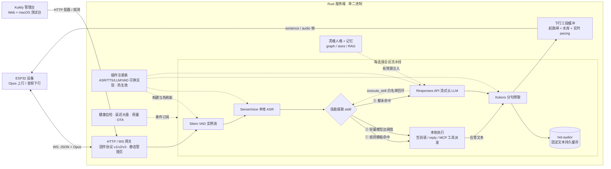

# xiaozhi-server-rust

**小智（xiaozhi-esp32）语音服务端，纯 Rust 单二进制**：本地 ASR/TTS 离线推理（SenseVoice / Kokoro INT8）、Silero VAD 池化、OpenAI 兼容 LLM，WebSocket 协议严格对齐固件（v1/v2/v3 二进制 Opus 帧）。内置 Kuikly 多端管理台（Web 直开 + macOS 原生测试台）。为 N5105 级低功耗主机的 Docker 部署而生。

> 架构与设计详见 [docs/architecture.md](<docs/architecture.md>)；功能、配置与维护入口见 [docs/README.md](<docs/README.md>)。

---

## 项目特色

- 🎙️ **完全本地语音链路** —— SenseVoice 识别 + Kokoro 合成 + Silero 切段全部离线（CPU 推理），仅 LLM 走 HTTP；下行缓冲三段式（水库 + 起跑闸）保证长回复不断音。
- ⚡ **三级技能级联** —— 规则模板 → 本地轻量模型打分 → 云 LLM，本地命中即执行、零外网零 LLM；LLM 仅能以 `execute_skill` 白名单回环；固定应答文本落盘（`hot-audio/`）跨重启复用，稳态零合成。
- 🧠 **智能上下文，可插拔、默认零成本** —— 记忆三后端（图记忆 / 纯存储 / **本地文档 RAG**，词法检索零外网零向量库）、灵魂人格预设、唤醒问候（稳态零 LLM 零 TTS）——不开启时行为与裸服务端完全一致。
- 🎛️ **配置即产品** —— schema 驱动 + 热生效三粒度 + 密钥打码护栏 + 部分更新/乐观并发；**配置预设**一键快照回滚；**每设备 overlay** 白名单个性化（这台设备换音色/语速/人格，其他设备不受影响）。
- 🩺 **状态可自诊** —— 11 个能力健康自检（坏了显示原因与怎么修）、延迟大盘 p50/p95、设备/会话/对话/用量面板、设备消息注入、LLM/TTS/VAD 内联连通性测试。
- 📦 **运维闭环** —— OTA 固件按「功能 × 型号」托管分发（元数据自动识别，防发错包变砖）、模型自动下载、可选 Bearer 鉴权。
- 💻 **双端管理** —— Web 管理台（浏览器直开）+ macOS 原生测试台（麦克风采集 + Opus 播放，端到端语音验收）。

---

## 系统框架



> 启用 `[aiui]` 时切换为云端 ASR + LLM + TTS 闭环，本地流水线与人格/记忆不参与；AIUI 与本地级联互斥。细节见[架构概览](<docs/architecture.md>)。

---

## 快速开始（Docker）

```bash
mkdir -p server-data
docker compose up -d --build                       # 首启自动从 GitHub Release 下载模型包到 ./server-data
curl http://127.0.0.1:8000/api/health              # => {"status":"ok",...}
```

浏览器打开 `http://<host>:8000/` 即管理台（配置 / 预设 / 设备个性化 / 健康自检 / OTA）；配置存于 SQLite 配置库 `server-data/data.db`，首次在管理台填写 `expected_token` / `llm.api_key` 并保存（字段参考 `server/config.example.toml`）。

裸机运行：`cd server && cargo run --release --features sherpa -- --config-db /host/data/data.db`（需本地模型 + libopus；配置存于 SQLite 配置库，字段参考 `server/config.example.toml`）。
协议联调：`python3 server/tests/mock_client.py`。

---

## 本地 UI 开发（无需模型）

```bash
./dev-server.sh                  # 真实 Rust server + 已构建的 Kuikly 管理台
./dev-server.sh --build-web      # 修改 UI 后重建 Web 再启动
./dev-server.sh --port 8001      # 自定义本地端口
```

默认访问 **http://127.0.0.1:8000/**。缺少 Web 产物时脚本自动构建；不启动另一套前端 mock server。Rust 默认 feature 即可运行，不需要 sherpa、libopus 或语音模型；首次编译需下载 Cargo 依赖，首次 Web 构建需 JDK/Gradle。

- 配置、文件、日志与管理台 WS 都走真实 API；数据隔离在 `.dev/`（已忽略），重启保留。默认不伪造设备或模型输出，设备列表为空是正常状态。
- `--dev` 仅监听回环地址，不广播 mDNS、不开放设备专用监听、不预下载模型。ASR/TTS/VAD/LLM、节点测试、语音会话与训练返回明确的开发模式不可用错误；能力状态不伪装健康。
- 开发模式忽略 `XIAOZHI_CONFIG_DB`，可显式用 `--config-db <文件>` 选择独立开发库；不要传入生产库。`XIAOZHI_ADMIN_DIR` 可指定已有 Web 目录。UI 修改后需重建并刷新浏览器，不承诺热更新。
- 等价后端命令：`cargo run --manifest-path server/Cargo.toml --no-default-features -- --dev`。不带 `--dev` 的生产启动仍要求真实模型与对应 feature。

---

## 文档

| 文档 | 内容 |
|---|---|
| [`docs/architecture.md`](<docs/architecture.md>) | 模块划分、会话流水线、协议设计、部署架构与扩展指引 |
| [`docs/README.md`](<docs/README.md>) | 文档索引：功能、配置、协议、管理台与模块维护入口 |
| [`server/config.example.toml`](<server/config.example.toml>) | 全部配置字段的行内注释（权威） |
| [`docs/plans/overall-implementation-plan.md`](<docs/plans/overall-implementation-plan.md>) | 路线图与交付状态 |
| [`docs/plans/p1-features-prd.md`](<docs/plans/p1-features-prd.md>) | 本期功能需求与验收标准 |

---

## 项目结构（monorepo）

```
.
├── Dockerfile / docker-compose.yml / docker-entrypoint.sh   # 部署编排
├── server/                      # Rust 服务端
│   ├── src/                    # main/config(含 overlay)/engine + app/(session/ws/protocol/downlink/events/metrics + mcp/firmware/hot_audio 等)
│   │                           # + plugins/(asr/tts/llm/vad/aiui/memory/soul/nlu/command/skill/wakeup + registry/health/prompt)
│   ├── config.example.toml     # 配置字段权威说明
│   └── tests/mock_client.py    # 场景化协议联调（多轮 + abort + 唤醒问候）
└── client/                      # Kuikly 多端管理台
    ├── shared/commonMain/       # 管理台 + 配置页（跨端共用）
    ├── shared/macosArm64Main/   # macOS 壳 + 测试台（仅 macOS 编译）
    └── apps/                    # h5App(Web) / macosApp(Catalyst) / iosApp / androidApp / ohosApp
```

---

## 状态与已知限制

- 未实现官方激活流程（OTA/activate），本期接受任意设备（可选 token 校验）。
- ASR 为离线逐段识别（SenseVoice），逐字流式需换 Zipformer `OnlineRecognizer`。
- RAG 召回为词法检索（零 embedding）；本地 ONNX 语义检索列为后续可选增强。
- iOS/Android/OHOS 宿主已就位但未启用语音测试台（原生桥接当前仅 macOS 编译）。

---

## 许可证

MIT（见 [`LICENSE`](<LICENSE>)）。
