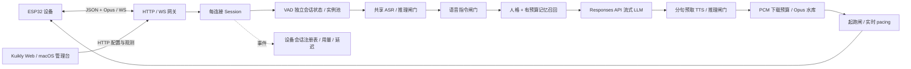

# 当前架构概览

本页只描述跨模块边界，不复制协议字节表、配置字段或模块陷阱。实现细节以邻近维护文档、源码 `//!` 注释及测试为准；历史设计从[文档索引](<README.md>)进入。

## 1. 系统与职责

- [网关](<../server/src/app/ws/AGENTS.md>)负责路由、鉴权、协商和静态管理页托管；[会话](<../server/src/app/session/AGENTS.md>)负责编排，不耦合具体引擎实现。
- [插件层](<../server/src/plugins/AGENTS.md>)按能力定义 trait/config/实现，[注册表](<../server/src/plugins/registry/AGENTS.md>)声明选择、构建、字段与热生效档位，[宿主](<../server/src/plugins/host.rs>)校验并上报状态。
- [Engines](<../server/src/engine.rs>)管理共享模型、VAD 池、派生缓存、运行快照和热刷新；同步推理隔离到 blocking 任务，并由共享闸门限制并发。
- `[aiui].enabled` 是另一条云端识别/LLM/TTS 闭环模式，本地人格和记忆不参与；不是普通 TTS 供应商切换。

## 2. 一轮级联语音回复

1. 设备 hello 协商上/下行音频参数，二进制版本跟随设备 hello；v2/v3 使用网络序。详情见[协议](<../server/src/app/protocol/AGENTS.md>)。
2. 上行 Opus 解码并喂 VAD，语音段交 ASR；离线识别与“逐字流式 ASR”不同。
3. 指令命中先播告别语再 MCP stop-listening，保留音频连接；不支持/失败则降级收尾。
4. 组装稳定人格前缀、有预算召回及近期历史，调用 **Responses API** 流。LLM 失败走有界重试和兜底，不生产 mock 回复。
5. 分句/watchdog → 串行预取合成 → 按时长受限的下载预算 → 连续编码 → 有界水库 → 按实时 pacing 下发。sentence_start 在该句音频前发送，多句共用回复时间线。
6. 首帧实际下发定义 TTFA；完成的原文写入/抽取走后台，观测事件由订阅者聚合。打断与消费者退出终止剩余生产/发送。

[下行维护](<../server/src/app/downlink/AGENTS.md>)解释设备队列与服务端缓冲区别：缓冲能吸收间歇停顿，不能弥补持续慢于实时的上游。

## 3. 配置与上下文

- [配置模块](<../server/src/config/AGENTS.md>)当前通过 ConfigStore 的文件/内置默认后端读取；运行时配置仍是 TOML，SQLite 配置后端是后续提案，不因记忆已使用 SQLite 就认定配置已迁移。
- [配置 HTTP 契约](<../server/src/app/ws/config/AGENTS.md>)提供部分更新、密钥 presence、revision/409 与保存影响回报；设备 overlay 只覆盖白名单会话参数，不能重建全局引擎。
- 热生效档位由注册表字段/段元数据唯一声明。保存成功不等于所有字段立即生效，也不由文档自行分类。
- [人格](<../server/src/plugins/soul/AGENTS.md>)默认关闭时逐字节保留旧 system_prompt；[记忆](<../server/src/plugins/memory/AGENTS.md>)默认关闭零成本，graph/store/RAG 有不同成本与存储边界。
- MCP 发现和 stop 控制已存在，[MCP 说明](<../server/src/app/mcp/AGENTS.md>)定义抽帧/清单契约；不能据此宣称 LLM 工具调用闭环已经实现。

## 4. 管理台、部署与验证

- [公共管理台](<../client/shared/src/commonMain/kotlin/com/xiaozhi/admin/AGENTS.md>)跨端复用；Web 双 bundle 由服务端同源托管，端到端语音测试由[Mac Catalyst](<../client/apps/macosApp/AGENTS.md>)原生桥承载，Opus 已实现。
- 设备/会话/最近对话/用量/延迟是进程内观测态，重启清零；长期对话由记忆原文表留存，online 不是心跳。
- [部署说明](<deployment.md>)管理目录卷、模型准备和构建限制；当前 compose 仅真实服务，没有零模型 mock profile。
- [服务端验证](<../server/AGENTS.md>)区分默认单测、sherpa 类型检查和真实链接/联调；[客户端验证](<../client/AGENTS.md>)区分 Web 与 macOS 源集。

## 5. 扩展落点

| 变更 | 阅读入口 |
|---|---|
| 新 ASR/TTS/LLM 实现 | [注册表规范](<../server/src/plugins/registry/AGENTS.md>)与各能力目录的 `AGENTS.md` |
| 新配置字段 / 密钥 | [配置维护](<../server/src/config/AGENTS.md>)与[HTTP 契约](<../server/src/app/ws/config/AGENTS.md>) |
| 新协议消息 / 二进制布局 | [协议实现](<../server/src/app/protocol.rs>)、同级测试与客户端联调 |
| 新设备工具调用 | [MCP 契约](<../server/src/app/mcp/AGENTS.md>)与会话响应关联 |
| 新管理页 / 分区 | [管理台维护](<../client/shared/src/commonMain/kotlin/com/xiaozhi/admin/AGENTS.md>) |

不要照搬历史设计里的旧中心工厂、chat/completions、mock 后端或未实现的 action/job 端点。
