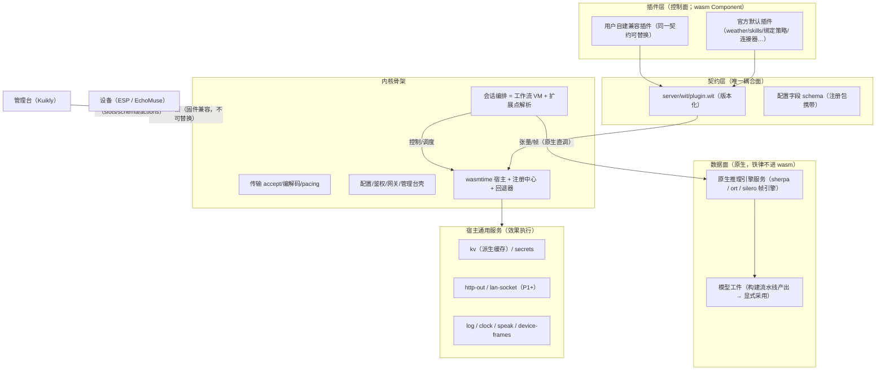
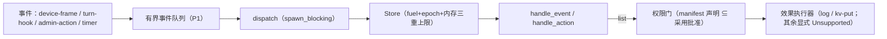
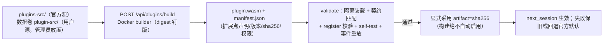
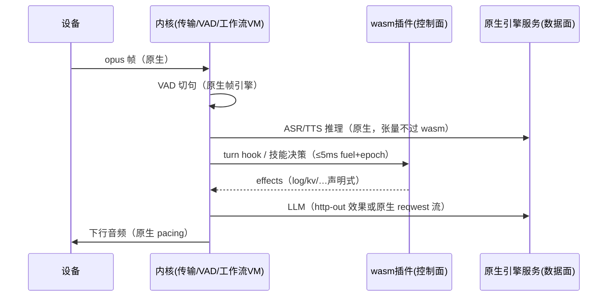

# WASM 插件平台（方案 v4 实施）

> 状态：**P0 + P1 + P2(a–e) + P3（配置门/上传 UI/摘要钉版）+ P4a/P4b/P4c/P4d + P5a/P5b + P6a + P7a–P7g + P8a/P8b/P8c 已实施**（CI provenance attestation 生成与验证、服务端 Ed25519 artifact admission、P8 native 路径收口已补；native 数据面按兼容性要求保留）；Tuya native command consumer 已接入现有 worker，见 P5b；分发模型已按用户方向反转，见 §分发。
> 概念蓝本：DeepSeek Harness（"Everything is a Plugin"，cordis 插件框架）；
> 本仓库现状与源码：`server/wit/plugin.wit`、`server/src/plugins/wasm/`、`tools/wasm-fixtures/`。

## 1. 目标与总原则

1. **一切皆插件**：内核收缩为骨架通用功能（传输帧协议、VAD 帧引擎、原生推理引擎服务、
   工作流 VM、SQLite、鉴权网关、wasm 宿主）；其余功能逐步插件化。
2. **官方默认 = 缺省实现，非特权**：与用户插件同流水线、同契约，可整体替换。
3. **替换安全**：排他扩展点解析唯一实现；失败自动回退官方默认，系统不因替换变砖。
4. **控制面/数据面分离（铁律）**：wasm 插件只做**控制与调度**（注册、槽位、策略、路由、
   协议编排、配置模板）；**密集计算（模型推理）一律原生**——模型工件由调度构建流水线
   （NLU 模式：Docker 训练/转换 → 候选验证 → 显式采用）产出，宿主原生引擎服务执行。
   张量计算永不越过 wasm 边界（与"帧级不进 wasm"同一铁律的张量级推广）。

### 1.1 设备公共能力层（P9 规划）

“系统能力”在本项目语境中指**接入硬件提供的公共能力**，不是服务器自身提供重启/音量。EchoMuse、Xiaozhi ESP、ESPHome 等设备适配器可以实现同一能力，业务技能和业务插件通过公共 native 模块复用，避免重复实现。

三层边界：

- **项目底座**：连接/协议、会话、MCP、配置、WASM 宿主、权限审计和原生数据面适配器。
- **设备公共能力层**：能力 ID、参数边界、设备能力发现、adapter 路由和统一错误分类；当前首个共享 helper 位于 `server/src/device/capabilities/`。
- **业务插件/技能层**：天气、Tuya 场景、自动化和策略差异；只引用公共能力，不复制音量、生命周期、状态等设备控制逻辑。

性能规则：PCM、帧 VAD、模型推理、EchoMuse WS/keepalive/PTY、Tuya LAN worker 等 hot path 直接 native，不强制经过 WASM。只有低频、可审计且确有替换需求的 control path 才允许 `业务 WASM → host effect → 设备公共能力层`；WASM 不是公共设备能力的必经层。

P9a/P9b/P9c 首批落地：`server/src/device/capabilities/` 已提供稳定 `device.*` capability ID、跨设备音量量化/整数边界 helper 与 native `CapabilityRegistry`；ESPHome adapter 与 EchoMuse runtime 共用 helper，旧入口和协议保持不变。registry 仅路由低频 native action，WASM 不是必经层。P9 architecture guard 已覆盖 EchoMuse/推理/分句/Tuya LAN hot path 不调用 WASM 及 capability registry native-owned，首批 helper/registry/alias/adapter matrix **7 passed**，架构守卫 **7 passed**。

## 2. 概念来源映射（DSH → 本仓库）

| DSH（cordis/TS，进程内） | 本仓库（Rust 宿主 + WASM 组件） | 落点 |
|---|---|---|
| Context/Fiber 生命周期 | 插件实例 + phase 状态机；注册随卸载全量回收 | `wasm/registry.rs` |
| `inject` 声明式依赖 | manifest 声明扩展点+契约版本；缺依赖不激活 | `wasm/contract.rs` |
| 事件 waterfall + `next()` 纪律 | 有序瀑布 + 强度分级（Observe<Guard<Rewrite<Replace） | `wasm/waterfall.rs` |
| slots 槽位注册/内省/回收 | 注册包菜单槽位 + `/api/plugins` 投影（P2） | 契约 `registration` |
| 主题 token 唯一颜色权威 | 客户端 designTheme 语义别名层（P2） | client 侧 |
| 一次操作双调用方（UI+工具） | 动作端点：管理台按钮与语音技能同一实现（P2） | `handle_action` |
| 元数据免激活可读 | manifest 静态字段（P3 构建产物 manifest.json） | 构建流水线 |
| 插件清单 vs 管理页分离 | 「内置插件」只读清单 +「插件管理」操作页（P2） | client 侧 |
| 插件市场（npm/git/本地） | 双源根构建（仓库官方 + 数据卷用户源，P3） | 构建流水线 |
| HMR / restart-required | 采用/回退 `next_session` 生效；sha256 变更即新一代 | 采用器（P3） |
| 会话日志唯一事实源 | 会话事件流为源；插件 kv 是派生缓存 | `wasm/kv.rs` |

**明确不借**：进程内 JS 模块加载、pnpm 分发与脚本审批、`!!js` 配置表达式、客户端可执行代码下发。

## 3. 依赖宪法

- R1 单向依赖：插件→契约→宿主→内核；内核永不 import 插件代码（架构测试守卫，P8 白名单归零）。
- R2 契约唯一耦合面：WIT（`server/wit/plugin.wit`，宿主 bindgen 与 guest wit-bindgen 同源）。
- R3 内核零插件知识：空注册表 = 完整可启动（P0 已有测试 `extension_unresolved_without_any_implementation`）。
- R4 插件间无横向依赖：协作只经事件/效果。
- R5 双侧物理隔离：guest SDK 零内核依赖（P1 建 `xiaozhi-plugin-sdk` crate）。
- R6 客户端只消费投影：槽位/schema/动作运行时来自 `/api/plugins`（P2）。
- R7 替换安全：官方默认不可卸载；任何失败回退官方默认（P0 已有 `resolution fallback` 测试）。

## 4. 架构图

### 4.1 分层总架构

### 4.2 插件运行时（控制面执行模型：纯决策函数 + 效果）

### 4.3 构建-采用流水线（P3 目标态，镜像 NLU 模型构建）

### 4.4 热路径（一轮对话；数据面不过 wasm）

## 5. 契约（WIT v0.1）

`server/wit/plugin.wit`，包 `xiaozhi:plugin@0.1.0`：

- 导入 `host`：`log(level,message)`、`now-ms() -> u64`（控制面最小集；kv/http 走效果）。
- 导出 `lifecycle`：`manifest() -> plugin-manifest`、`register() -> registration`、
  `handle-event(event,payload) -> result<list<effect>,string>`、
  `handle-action(id,payload) -> result<string,string>`、`self-test() -> result<list<test-result>,string>`。
- 注册包：菜单槽位（nav.main / config.section / workflow.node-menu）+ 配置字段
  （形状对齐静态注册表 FieldSchema）+ 动作声明（白名单）。
- 版本化：`manifest.api-version` 主段 ≠ 宿主 `CONTRACT_MAJOR_VERSION` → 拒绝激活。
- 命名坑：接口内 `use` 引入的类型名不能与同名导出函数冲突（`manifest` 函数 vs 类型
  改名 `plugin-manifest`）。开放形状载荷（事件/动作/效果参数）v0.1 用 JSON 字符串承载。

## 6. 沙箱与性能预算

| 路径 | 粒度 | 预算/手段 |
|---|---|---|
| 音频帧→VAD→pacing | 20ms 帧 | 不过 wasm（原生帧引擎） |
| 模型推理 | 张量 | 不过 wasm（原生引擎服务 + 模型工件） |
| turn hook / 连接器决策 | 每次调用 | fuel 1e8 + epoch 5s 双保险；超限陷阱 → Degraded + 扩展点回退 |
| 管理动作 | 次 | epoch 5s；job 化轮询（P2 端点） |
| 线性内存 | 每插件 | ResourceLimiter 64MiB；实例化期超限直接拒绝装载 |
| 指标 | — | 调用数/p50-p99/fuel/trap → `/api/metrics`（P2） |

陷阱语义（实测记录，wasmtime 48）：

- fuel 耗尽/epoch 超时：类型化 `wasmtime::Trap::{OutOfFuel,Interrupt}`，宿主侧必须
  用 `anyhow::Error::msg` 装箱保留类型才能分类（字符串化会丢）。
- 内存上限拒绝在 wasm 语义中**不陷阱**：`memory.grow` 返回 -1 → guest 分配器得 null →
  guest panic（泛化 Trap）。装载期最小内存超限才在宿主侧报 "exceeds memory limits"。
  guest SDK（P1）应把分配失败转成显式 `Err` 而非 panic。

## 7. 扩展点与替换回退

- 解析表 `[extensions."<point>"] implementation = "<plugin-id>"`（P0 内存态；P2 接配置管线）。
- 解析顺序：首选（激活且声明实现）→ 官方默认（声明该点且 official=true 的唯一者；
  多个是配置错误，取注册序并告警）→ Unresolved。
- phase：`Active / Failed(装载) / Degraded{trap}`（enabled 是配置意图，P2 与配置管线对接）。
- 热装载铁律：**先建新后替换**，失败保留旧实例（P0 测试 `manifest_id_mismatch_rejected_and_old_instance_kept`）。

## 8. 与静态注册表的关系（绞杀者）

静态注册表（`plugins/registry`）回答「内置能力现状」；本平台回答「动态插件供给」。
P2 在 `/api/plugins` 投影合并两清单；P4+ 按域迁移（provider 绑定/策略先走，模型工件与
推理路径保持原生），P8 删除原生路径、架构测试白名单归零。

## 9. 分阶段计划

| 阶段 | 内容 | 状态 |
|---|---|---|
| P0 | WIT 契约 + 沙箱宿主 + 扩展点解析/回退 + waterfall + hello/trap 冒烟 | ✅ 已实施 |
| P1 | guest SDK crate（`xiaozhi-plugin-sdk`，含分配失败→Err）+ weather 试点 + 用户插件替换演练 | ✅ 已实施（P1a SDK/kv/替换演练；P1b http 回灌；P1c weather.official 全瀑布回放）——生产接线（skills 事件桥 + backend 开关）随 P2 |
| P2 | `/api/plugins` 投影合并 + 统一动作端点 + 客户端槽位合并（PluginSlots.kt）+ 事件队列 | ✅ 已实施（P2a–P2d 服务端全量 + P2e 客户端 PluginSlots 槽位合并/纯模型回归；余：插件面板动作执行 UI 与配置编辑） |
| P3 | ~~构建流水线~~ → **分发与引导落地**（P2b 上传/验证/采用/重启重装 + Docker 启动引导 + builder 镜像；P3 `[plugins]` 配置段总闸/每插件启停、raw 直传配置门、artifact SHA-256 钉版与 ConfigStore 持久化） | ✅ 已实施；builder-image CI 含组件校验、digest 清单与 provenance attestation |
| P4 | asr/tts/llm/vad.provider **绑定与策略**插件化（推理留原生） | ✅ P4a/P4b/P4c/P4d 已实施（ASR utterance 级远端变体；TTS/LLM/VAD 为控制策略包装器，native PCM/HTTP/SSE/逐帧 VAD 数据面保持原生） |
| P5 | tuya 连接器插件化（lan-socket 宿主服务） | ✅ P5a 控制策略 wrapper + P5b typed lan-socket effect/有界 queue + native consumer 已实施（worker drain、真实 Tuya LAN 执行、KV 结果回写） |
| P6 | echomuse 插件化（宿主保留 WS/keepalive/hub/PTY） | ✅ P6a 会话入口策略 wrapper 已实施（device.echomuse；native 承载/音频/PTY 保留） |
| P7 | 其余域（nlu/唤醒/echo 的**策略与目录**；skills 域；prompt/soul/memory.policy；**debug 域**：节点测试/日志流/测试台独立成插件——用户方向 2026-11-04） | 🚧 P7a 天气缓存粒度统一、P7b prompt.soul、P7c wakeup.strategy、P7d debug.policy、P7e skill.policy、P7f memory.policy、P7g nlu.catalog 有界策略桥已实施；其余策略/目录域待做 |
| P8 | 收口：删原生路径、架构测试白名单归零、本文档归档实测数据 | ✅ P8a bridge 依赖守卫 + P8b native 数据面归属证据 + P8c 删除门槛矩阵 + 显式 policy/fallback guard 已实施；native 数据面不删除，按兼容性保留 |

## 10. P0/P1a 验证证据

### P0（契约/沙箱/解析）

- `cargo test --manifest-path server/Cargo.toml`（默认，零 feature 影响）：1227 passed / 0 failed。
- `cargo test --manifest-path server/Cargo.toml --features wasm-plugins`：1244 passed / 0 failed
  （含 wasm:: 17 项：hello 全链路 6、陷阱 4、扩展点/解析 3、契约/权限/瀑布 4）。
- 夹具：`tools/wasm-fixtures/build.sh` → `server/tests/fixtures/wasm/{hello,trap}.wasm`
  （真实 wit-bindgen 0.63 guest，wasm32-unknown-unknown + wasm-tools 1.263 组件化，产物入库）。
- 代码规模：`src/plugins/wasm/` 全部 ≤600 行（最大 registry.rs 322），测试外置 `tests.rs`。

## 11. 分发模型（用户方向，2026-11-04 反转）

**插件不编译进主系统；wasm 产物一律不入 git；插件修改永不触发主系统/本地构建。**

| 通道 | 语义 | 落点 |
|---|---|---|
| 管理界面上传 | `POST /api/plugins/upload`：base64 组件 → 隔离验证（self-test/注册包/契约版本）→ 采用（数据卷 `plugins/<id>.wasm` 原子写 + 热装载，先建新后替换）→ **立即生效** | P2b 已交付 |
| 启动引导 | 数据卷缺产物 → 按 `plugins-src/manifest.toml`（数据表，内核零插件知识）调 Docker（`xiaozhi-plugin-builder` 镜像）执行插件 `build.sh` → 验证 → 采用；无 Docker 降级告警指向上传替代 | P2b 已交付（`wasm/bootstrap.rs` + `tools/plugin-builder/`） |
| 重启重装 | assemble 扫描数据卷 `plugins/*.wasm` 逐个装载（坏件跳过不阻断启动） | P2a/P2b 已交付 |
| 开发态 | 改插件源 → `./build.sh` 只重建 guest（独立 crate）；测试经 `ensure_fixture` 按需重建（缺失/源更新），git 忽略产物 | 已生效 |

服务端 admission 已支持 Ed25519 detached signature：`[plugins].attestation_public_key` 配置标准 base64 公钥，条目 `attestation` 签名覆盖 artifact SHA-256 摘要文本；缺签名或校验失败在 WASM load/bootstrap 前 fail-closed。builder 镜像 CI 已由 `.github/workflows/plugin-builder.yml` 覆盖组件校验、digest 清单，以及 GitHub provenance attestation 的生成与 `gh attestation verify` 验证。`[plugins.entries."<id>"]` 已支持
`enabled` 与可选 `artifact`（SHA-256 内容钉版）：上传采用经 ConfigStore 持久回写，重启重装
严格跳过摘要不符产物；缺省 `artifact` 保持旧配置兼容放行。**debug 域（节点测试/日志流/测试台）
也独立成插件**（P7）。

### P2a（HTTP 投影面 + 统一动作 + 插件文档契约，2026-11-04）

- **Engines 集成**：`wasm: Option<Arc<WasmHost>>`（feature 门控；空注册表起步，初始化失败降级
  None 不阻断核心语音服务）——单一装配点 `assemble()` 接入。
- **端点**（全过 main 层管理鉴权；feature 未编入 = 路由不存在）：
  - `GET /api/plugins` 追加 `wasm` 键（插件清单 + 扩展点解析投影；旧客户端零破坏）；
  - `POST /api/plugins/{id}/actions/{name}` 统一动作端点（"一次操作、双调用方"；
    白名单在宿主；wasm 调用 spawn_blocking）；
  - `POST /api/plugins/extensions/{point}/preference` 扩展点首选（进程内态，P3 持久化；
    响应即时回显解析结果）。
- **插件文档契约（用户要求）**：每个 `plugins-src/<插件>` 必须自带 README（`## 功能描述` +
  `## 使用方法` 两节：事件/payload、动作、配置字段、kv 键布局、权限、边界），
  由 `server/src/plugins/plugin_docs_tests.rs` 结构检查强制（缺文档 = 测试失败；weather 已补齐模板）。
- 测试：默认 1228（+文档契约）；wasm-plugins **1259**（+端点回环 HTTP 契约 3 项：
  合并投影/动作白名单/扩展点首选回环）。

### P4a（asr.provider 事件桥 + 原生适配器，2026-11-04）

- **utterance 级契约**（P2d/P2c 事件面复用，无新 WIT 面）：`asr.transcribe` 事件 payload
  JSON（`req_id/session_id/sample_rate/samples/pcm_base64`——f32-le base64），插件经 kv
  `asr-result:<req_id>` 返回 `{text}`（weather 同款结果协议）。
- **原生适配器** `plugins/asr/wasm_engine.rs`：`WasmAsrEngine` 实现 `AsrEngine` trait
  （recognize 同步纪律与原生推理同为 spawn_blocking 调用上下文）；扩展点 `asr.provider`
  **调用期再解析**（用户替换透明，首选未声明 → 回退官方默认，测试钉住该语义）。
- **铁律不破**：本地 SenseVoice 路径零改动；wasm 通道定位 = 远端引擎变体（用户自备
  Whisper 服务器等经 http-get 效果），网络 RTT 主导下 utterance 粒度边界开销可忽略。
- **P4b 已实施**：现有配置约定 `[asr].engine = "wasm-remote"`（默认 `sensevoice`）选择
  `asr.wasm-remote` 描述符；feature 门控构建 `WasmAsrEngine`，由 `asr.provider` 扩展点
  调用期解析。WASM 宿主初始化失败或扩展点无实现时显式报错，绝不静默回退本地 SenseVoice；
  tts/llm 同构随后。
- **测试**：wasm_engine 3 项（真实 wasm 往返回显采样数/未装载显式 Err/替换回退语义）+ 注册表
  选择/构建/feature 门测试；hello 夹具成为多扩展点演示件（demo.greeter + asr.provider 探针）。
  默认 **1244 passed / 6 ignored** / wasm-plugins **1312 passed / 6 ignored**（P6a 完成后的全量回归）。

### P4c（tts.provider / llm.provider 控制策略，2026-11-05）

- **TTS 策略包装器**：`[tts].engine = "wasm-policy"` 选择 `tts.wasm-policy`；描述符仍要求
  sherpa/Kokoro 模型，因为 WASM 只改整句控制，native `TtsEngine` 继续负责模型推理、流式
  f32 PCM、重采样与下行。事件 `tts.prepare` 的请求为 `{req_id,text,speed,speaker}`，插件
  通过 `tts-result:<req_id>` 返回 `{text,speed?,speaker?,route?}`；文本、route 与数值均有限制，
  缺宿主/插件、坏 JSON、非法 route/speed 显式失败，不静默绕过策略。
- **LLM 策略包装器**：`[llm].engine = "wasm-policy"` 选择 `llm.wasm-policy`；native
  OpenAI Responses provider 仍负责 HTTP、SSE、工具调用、空回复和取消。事件 `llm.prepare`
  只传 `req_id/user_text/history_turns/has_memory/tool_names` 等受限元数据，结果 KV
  `llm-result:<req_id>` 仅允许 `{user_text?,route?}`，不会把完整历史、音频或模型响应交给 WASM。
  策略线程通过 `spawn_blocking` 隔离；策略失败显式返回，默认 `openai` 路径零行为变化。
- **注册表/配置**：`TTS_ENGINES`、`LLM_ENGINES` 与 registry descriptor/schema 同步；
  `wasm-policy` 的 TTS 描述符明确声明底层 Kokoro 依赖，LLM 描述符复用 OpenAI upstream
  校验与字段，热生效均为 `NextSession`。
- **测试证据**：TTS 配置/策略/注册表测试、LLM WASM 策略真实 hello 夹具回环、native
  provider 流式与取消透传均覆盖；ASR 原有真实 WASM roundtrip 保持不变。该阶段继续遵守
  “控制面进 WASM、密集计算与音频/HTTP 数据面留 native”边界。

### P4d（vad.provider 会话级控制策略，2026-11-05）

- `[vad].engine = "wasm-policy"` 选择 `vad.wasm-policy`；策略只在服务端 VAD 会话从池中借出
  native 实例前执行一次 `vad.prepare`，不会进入逐帧 `accept`/`flush` 热路径。
- 请求仅包含受限元数据：`{req_id,sample_rate,threshold,min_silence_duration,min_speech_duration}`；
  插件通过 `vad-result:<req_id>` 返回 `{route?,threshold?,min_silence_duration?,min_speech_duration?}`。
  当前唯一允许的 route 是 `native`，所有数值 finite/range/长度均校验；缺宿主、插件、KV、坏 JSON
  或非法结果均显式失败。
- native Silero 仍负责全部 PCM/f32 帧推理、状态、flush、segment callback；WASM 不接收或返回
  音频数据。策略结果和解析到的插件 id 纳入 `VadPool` 签名，避免旧策略实例跨会话复用；EchoMuse
  的 device-VAD 路径继续旁路服务端策略。
- **测试证据**：hello 夹具声明 `vad.provider` 并返回 native 控制结果；VAD 策略覆盖缺插件显式
  错误与成功回环，既有 VAD 池/设备 VAD 测试保持通过。

### P5a（Tuya connector 控制策略，2026-11-05）

- `[tuya].engine = "native"|"wasm-policy"`；默认 `native`，旧 `backend`/`lan`/`wasm` 值继续兼容收敛。注册表新增 `tuya.native` 与 `tuya.wasm-policy`，配置错误不会静默切回另一实现。
- `wasm-policy` 只调用 `connector.tuya.prepare`，请求包含规范化设备名、`on|off` 动作和有限候选元数据（索引、展示标签、online、model、是否已有 bool switch DP）。`local_key`、IP、云凭证、原始 DP、TCP/UDP 报文和 socket 句柄永不进入 WASM。
- 插件通过 `tuya-result:<req_id>` 返回 `{route:"native",candidate_index,action}`。宿主严格校验候选索引、动作和 route；缺宿主/插件、KV、坏 JSON、越界选择或非法动作均显式失败，不静默绕过策略。
- 选择结果之后仍由 native `TuyaEngine` 执行 online 预检、DP 识别、per-device 互斥、rustuya TCP 6668、set→status 回读、DP cache、listener 和 offline/timeout/unsupported 归类。WASM 是控制面策略，不是 Tuya 协议或 lan-socket 数据面。
- hello fixture 增加 `connector.tuya` 回环；覆盖成功选择、未装载 fail-closed、越界结果。P5a 全量回归：默认 **1242 passed / 6 ignored**，wasm-plugins **1308 passed / 6 ignored**。后续 P5b 才评估 typed `lan-socket` 高层 effect/异步命令队列，不把原始 socket 暴露给插件。

### P5b（typed lan-socket effect + 有界 native command queue，2026-11-05）

- WIT 新增 `effect-lan-status` / `effect-lan-set-dp`：插件只提交 `request_id`、宿主分配的
  opaque `device_handle`、数字 DP id 与有界 JSON value；local_key、IP、云凭证、原始 TCP/UDP
  报文和 socket 句柄永不跨越 WASM 边界。
- 宿主新增独立 `lan-socket` 权限门与 `LanSocketQueue`：队列容量默认 64，可 drain 批量命令；
  request/handle/DP/value-json 均有长度和字符校验，非法 JSON、原始 DP 字符串、队列满均显式
  fail-closed。未绑定执行器时仍返回 `Unsupported`，不静默丢弃。
- 队列命令附带仅宿主内部使用的 `plugin_id` 路由元数据（不进入 WIT、不由 guest 提供），使
  native Tuya consumer 能按请求来源安全回灌结果；命令仍只含 opaque handle/数字 DP/有界 JSON。
- `TuyaEngine::drain_wasm_commands` 已接入现有 Tuya worker：每 tick 最多 drain 16 条命令，按
  opaque handle 映射 native 设备目录，复用 rustuya 会话、per-device 互斥、超时/错误三分类、
  set→status 回读与 DP cache/listener；结果写回插件隔离 KV 的 `lan-result:<request_id>`，结果
  超过 16KiB 改为有界 unsupported 错误。原始数据面仍只在 native。
- hello guest fixture 声明 `lan-socket` 并真实产生 status/set-dp effects；P5b 测试覆盖权限拒绝、
  有界背压、非法 value/DP、非法来源路由、未绑定显式失败和 guest→宿主队列回环。P5b 当时全量回归：默认
  **1244 passed / 6 ignored**，wasm-plugins **1316 passed / 6 ignored**；guest SDK **5 passed**。P5 native
  consumer 回归另有 **2 passed**（结果上限与 guest→native→KV 路由）。

### P7a（weather 缓存粒度与 native 对齐，2026-11-05）

- WASM 天气插件不再以 `city+range` 作为唯一结果缓存命中条件；站点解析后按 `station code` 缓存
  原始 `data`（TTL 600s），不同城市别名和查询时段都现场调用共享 `build_result` 组装结果。
- 保留 `station:<city>` 派生站点码缓存和结果通道；全站城市列表仍不进入单值受限的插件 KV。
  native `WeatherService::cached_or_fetch` 与 WASM 的 HTTP 拉取粒度现已一致，控制面/数据面边界不变。
- 回放测试覆盖冷路径四次请求后，以“杭州天气 + 明天”不同别名/range 命中 station 原始缓存且不再出网，
  同时断言返回结果 range 为“明天”。P7a 单项回归通过。

### P6a（EchoMuse 会话入口策略，2026-11-05）

- `[echomuse].engine = "native"|"wasm-policy"`（默认 `native`，RestartOnly；旧 `wasm` 值兼容）。注册表新增 `echomuse.native` / `echomuse.wasm-policy`，策略失败不静默绕过。
- `wasm-policy` 在 EchoMuse 会话进入 workflow 前调用 `device.echomuse.prepare`，请求只包含受限 `device_id/base_os/welcome` 元数据，结果 `echomuse-result:<req_id>` 只允许 `{route:"native",welcome?}`，欢迎文案上限 1KiB。
- EchoMuse 的 WS upgrade、TCP keepalive、control/data hub 认领、bounded-turn、native PCM、speaker EOS、BLE、shell/PTY、鉴权和设备状态事实全部留在 native；WASM 不接 socket、帧、token、PTY 或音频。
- 缺宿主/插件、坏结果、超长或非法 route 显式终止当前入口，不降级到 native 策略；默认 native 路径零行为变化。hello fixture 与 bridge 测试覆盖成功回环和缺插件 fail-closed。
- P6a 回归：EchoMuse 配置 4 项、WASM bridge 16 项；默认全量 **1244 passed / 6 ignored**，wasm-plugins 全量 **1312 passed / 6 ignored**；无 `wasm-plugins` 时选择 `wasm-policy` 显式报 feature 错误；`DOCS_RS=1 cargo check --features sherpa`、`cargo fmt --check` 与 `git diff --check` 均通过。

### P7b（`prompt.soul` 有界控制策略，2026-11-05）

- 选择 `prompt.soul` 作为 P7 最小 seam：WASM 只接收 `device_id/name/address_user/tone/max_sentences/max_chars`
  等已限长的人格元数据，不接收完整历史、完整 `instructions`、原始变量表、音频或设备状态。
- `soul_prepare` 只允许策略返回 `tone`、`max_sentences`、`max_chars` 与 `route`; `route` 必须为
  `native`，所有文本长度与回复预算由 native 宿主再次校验。人格段排序、插值、预设合并和最终 prompt
  仍由 `plugins/soul` 与 `plugins/prompt` 原生完成。
- 缺失扩展点、事件/效果失败、KV 缺失、坏 JSON、未知 route 或越界覆盖均显式失败（fail-closed），
  不回退到未经策略检查的文本。默认 native 路径不调用该桥，零行为变化。
- hello 官方夹具声明 `prompt.soul` 并返回固定 native 策略；桥测试覆盖成功回环、缺插件和超长请求拒绝。
  本 seam 目前是策略能力，不改变 `SoulConfig` 的 preset/validate/preview 语义；后续接入时必须保持失败不绕过。

### P7c（`wakeup.strategy` 有界唤醒目录策略，2026-11-05）

- `wakeup_prepare` 仅把 native `[wakeup].greeting` 规范化后的有界目录（最多 64 条、每条最多 256 bytes）和 `persist` 元数据交给 `wakeup.strategy`；插件只能返回目录索引与 `route:"native"`，不能注入任意文本、PCM、TTS 参数、缓存键或音频。
- 原生 `WakeGreeting` 仍负责目录、随机/快照语义；会话沿用 `speak_canned`、`HotAudioKey`、TTS、内存/磁盘缓存和下行链路。策略失败、缺插件或非法索引不影响对话，调用方保留原生问候路径。
- hello 夹具声明 `wakeup.strategy` 并返回索引 0；bridge 测试覆盖成功回环、缺插件 fail-closed、空目录拒绝。默认未装载扩展点时不调用桥，native 路径零行为变化。
- P7b/P7c bridge 回归 **22 passed**；当前默认全量 **1276 passed / 6 ignored**、wasm-plugins 全量 **1375 passed / 6 ignored**，guest SDK **5 passed**。P9 native capability registry/action alias 回归 **6 passed**，P9 architecture guards **7 passed**。

### P7d（`debug.policy` 有界调试控制策略，2026-11-05）

- WASM 仅接收 `kind/target/session_id/requested_items` 等限长元数据，`kind` 只允许
  `node-test`、`log-stream`、`test-bench`；原始日志、节点测试输入/结果、benchmark 样本、凭据和
  socket 全部留在 native。
- 策略只能返回 `max_items/redact/route`，`max_items` 不得超过本轮请求上限且最多 256，
  `route` 必须为 `native`；未知 kind、超长输入、缺插件、坏 JSON、越界结果均 fail-closed。
- hello fixture 增加 `debug.policy` 回环，bridge 测试覆盖成功回环和请求边界拒绝；P7d 新增回归
  **3 passed**。当前仅提供 bounded seam，未改变节点测试、日志 SSE 或测试台默认 native 路径。

### P7e（`skill.policy` 有界技能策略，2026-11-05）

- WASM 仅接收 `skill_id`、最多 16 个限长 slot 和 `requested_steps`；技能定义、能力校验、变量插值、
  MCP 调用、任务持久化和副作用执行全部留在 native。
- 策略只能返回 `allow/max_steps/route`，`max_steps` 不得超过请求上限且最多 32，`route` 必须为
  `native`；空/超长 skill id、超限 slot、控制字符、缺插件或非法结果均 fail-closed。
- hello fixture 增加 `skill.policy` 回环，bridge 测试覆盖成功准入、slot 上限和缺插件拒绝；新增回归
  **3 passed**。该 seam 不改变现有 native skill planner/executor 行为。

### P7f（`memory.policy` 有界记忆召回策略，2026-11-05）

- WASM 仅接收限长 `device_id/query` 与召回预算；SQLite 事实、graph/store/rag 索引、抽取、保留、
  排序和最终 prompt 注入全部留在 native。
- 策略只能返回 `allow/max_items/max_chars/route`，items 最大 32、chars 最大 4096，且不得超过
  请求预算；空/超长查询、请求预算越界、缺插件或非法结果均 fail-closed。
- hello fixture 增加 `memory.policy` 回环，bridge 测试覆盖成功预算、query 上限和缺插件拒绝；新增回归
  **3 passed**。该 seam 不改变现有 native memory provider 行为。

### P7g（`nlu.catalog` 有界目录策略，2026-11-05）

- WASM 仅接收限长 locale 和候选目录元数据，不接收用户 utterance；训练模型仍是唯一意图识别器，
  插件不能选择或执行技能。
- 策略只能返回不重复且不越界的候选索引和 `route:native`；候选最多 32 条，id/label 限长，
  空目录、控制字符、缺插件或非法索引均 fail-closed。
- hello fixture 增加 `nlu.catalog` 回环，bridge 测试覆盖目录过滤和候选上限；新增回归 **2 passed**。
  该 seam 只控制目录呈现，不改变 native NLU/model-only 识别路径。

### P8a/P8b（WASM bridge 架构守卫与 native 所有权证据，2026-11-05）

- 新增外置 `plugins::wasm::tests::architecture` 回归，扫描 bridge/policy 源文件，禁止直接依赖
  `device`、`gateway`、`workflow`、`runtime`、`TcpStream` 或 `reqwest` 等 native 数据面符号。
- 同时固定策略返回 `route:"native"` 契约，确保 WASM 只做有界控制面决策；Tuya LAN、EchoMuse WS/PTY、
  PCM/VAD、HTTP/SSE、技能执行和记忆存储仍由 native 承担。
- P8a/P8b 架构守卫新增回归 **5 passed**；同时保留 Tuya/EchoMuse/memory native 所有权标记，并守卫重启重装前的 artifact SHA-256 pin，未删除任何原生路径，避免破坏固件兼容。
- 新增 `[plugins].require_artifact_pin` 严格 admission 开关：默认 `false` 保持旧配置兼容；设为 `true` 时，未配置 artifact SHA-256 pin 的产物不装载、不引导。
- 新增 Ed25519 detached attestation admission：`[plugins].attestation_public_key` + 条目 `attestation`，签名覆盖摘要文本；公钥启用后缺签名、非法 base64 或校验失败均在 runtime load 与 bootstrap host.load 前拒绝。

### P8c（native 路径删除门槛矩阵，2026-11-05）

在没有达到以下证据前，不删除任何 native 路径：

| 域 | 当前 native 所有权 | 删除前必须具备的证据 | 当前状态 |
|---|---|---|---|
| Tuya LAN | `device/tuya/wasm.rs` + 现有 worker | consumer 全链路、per-device 串行、错误分类和固件回归 | 保留 native，证据已有，待最终归档 |
| EchoMuse | `device/echomuse/runtime.rs` / routes | WS、keepalive、hub、PTY、音频和设备状态回归 | 保留 native，P6a 仅策略化入口 |
| Memory | `plugins/memory/*` | graph/store/rag 存储、抽取、召回和 prompt 注入回归 | 保留 native，P7f 仅预算策略 |
| NLU | `plugins/nlu/*` | model-only 识别、拒识、目录过滤和技能执行回归 | 保留 native，P7g 不接收 utterance |

P8c 当前建立删除门槛并明确不删除 native 数据面；架构守卫、native ownership 与显式 policy/fallback 测试必须继续通过，默认 feature
和 ESP 固件协议兼容性不得改变。

### P3a（`[plugins]` 配置段：总闸 + 每插件启停，2026-11-04）

- **形状**（config.rs 聚合，非 feature 门控——配置段恒存在，执行由 feature 管）：
  `[plugins] enabled` 总闸 + `[plugins.entries."<id>"] enabled`（id 含点号用引号键）；
  **缺省启用**（上传落盘即意图，无需再改配置）；`PluginsConfig::allows(id)` = 总闸 ∧ 条目。
- **接线**：装配扫描循环按 `allows` 过滤（禁用产物不装载、落盘保留）；启动引导
  `ensure_defaults` 同一过滤（禁用 id 不构建）；热生效档位 RestartOnly 入 `APP_SECTION_HOT`。
- **raw 直传通道**（P3b）：`POST /api/plugins/upload/raw?id=<id>`（octet-stream，token 走查询串）
  ——管理台上传桥 `uploadPickedFile` 的原生形态（避免客户端 base64 膨胀）；采用管线抽成
  `adopt_bytes` 与 JSON 端点共享，**配置禁用 id → 403**（配置门一致性）。
- **管理台上传 UI（P3 末件）**：静态导航「插件」（配置组）→ [PluginsManagePage](<../../client/shared/src/commonMain/kotlin/com/xiaozhi/admin/PluginsManagePage.kt>)：
  上传走平台桥 raw 直传（id 缺省=服务端 `probe_id` 从组件 manifest 探测，"选文件即上传"）；
  清单复用 PluginMetaState 同一次拉取；动作按注册清单渲染（宿主白名单）；卸载二次确认三回收；
  扩展点解析状态（resolved/fallback/未解析）徽标化。客户端验证：shared compileKotlinJs /
  adminCoreTests（含导航契约 10/9 更新）/ publishWeb / stateVar 护栏 488→491 全绿；
  浏览器回归的既有失败与本批无关（P2e 已回退实证）。
- **摘要钉版收尾**：`PluginEntryConfig.artifact` 为可选 SHA-256 小写十六进制；缺失时兼容旧配置放行。
  上传采用在热装载成功后原子写盘，并经 `ConfigStore` 回写 pin；响应返回 `sha256/persisted`。
  卸载同时删除产物并清除 pin；启动扫描校验摘要，不符即跳过并告警，避免数据卷篡改静默生效。
- **测试**：纯语义（引号键解析/缺省启用/总闸一票否决/回写保留段）+ 装载门集成
  （落盘真件启用→装载、垃圾件禁用→不装载、摘要不符→不装载，经真实 SqliteConfigStore
  location 派生产物目录）+ 摘要稳定性/配置兼容/上传卸载 pin 回写。默认 **1236 passed / 6 ignored** /
  wasm-plugins **1291 passed / 6 ignored**。

### P2e（客户端 PluginSlots：运行时槽位合并，2026-11-04）

- **契约层纯模型**（[contracts/PluginSlots.kt](<../../client/shared/src/commonMain/kotlin/com/xiaozhi/admin/contracts/PluginSlots.kt>)，
  零 Kuikly 依赖、kotlinx JSON）：解析 `wasm` 键 → 插件卡/导航项/扩展点；**基线铁律** =
  无键/不可达/解析失败 → null → 静态导航逐字节不变；有键 → 追加独立「插件」组
  （order 9000 带宽、组内相邻、与静态 id 精确冲突才去重）。
- **接线**：[PluginMetaState](<../../client/shared/src/commonMain/kotlin/com/xiaozhi/admin/PluginMetaState.kt>)
  在既有 `/api/plugins` 拉取里顺带解析（Kuikly JSONObject → 字符串 → 纯解析）；AdminShell
  导航组合并 + `plugin:<id>:<entry>` section 落 manifest 投影占位卡。
- **测试**：PluginSlotsModelTest 5 项（基线回退/解析/合并组相邻/动态 id 反查/去重与 order 钳制）；
  顺带修复**既有过期契约** UiContractsTest（AdminNav 实际 9 项含 tuya，测试停在 8 项——
  与本轮无关，回退本批改动后同样失败实证）。
- **浏览器回归**：环境无 playwright（临时装 /tmp + `PLAYWRIGHT_PATH`），`input not found:
  /models/asr-base.onnx` 失败在**不含本批改动的 bundle 上等价复现**（回退实证）——属
  tuya/插件面板迭代期的既有 UI 漂移，与 wasm 槽位无关；P2 后续批处理。publishWeb 构建绿、
  adminCoreTests 全绿、stateVar 护栏台账 487→488（+wasmSlots 注明原因）。

### P2d（designer 观察者挂钩：wasm 插件进会话 workflow，2026-11-04）

- **绑定面**：`compile_with_observers(value, 目录)`——目录来自 `Engines::wasm_observers()`
  （已装载插件 id+标题；未编入 feature = 空表，行为与原 `compile` 完全一致）。观察者仅可绑
  `start`/`link.nlu.llm`/`end` 三个已接线 hook 位，`on_error` 恒 `continue`；condition 沿用普通
  hook 面。投影 `projection_with_observers` 带目录（编辑器与编译器同源），observer 条目带标记。
- **严格/宽松分层**：保存（save.rs）与编辑器（workflow.rs get/validate）按**当时**装载目录严格校验；
  会话启动（start.rs）对未装载观察者**宽松剔除+告警**——热卸载/重启后旧绑定只降级不炸会话。
- **会话派发**（hooks.rs 三个挂点位）：`hook.<position>` 事件（payload `{session_id, device_id,
  position, text?}`）→ `try_dispatch`（单步、**不执行**效果、不回灌）→ `spawn_deferred`
  （tokio 异步执行，fire-and-forget：效果即上报，http 响应不回灌——会话已继续，没有下一步）。
  陷阱→Degraded+告警；旁路观察者**永不阻塞/打断对话轮**，不进 hook_result 错误流。
- 测试：designer +4（钩位白名单/on_error=continue/目录外仍未知+描述符仍拒+去重+condition 面/
  投影标记）；wasm +3（try_dispatch 不执行+业务拒绝 Ok(None)、spawn_deferred 异步落 kv、
  observe_hook 对未装载/作恶插件不 panic 且降级）。trap 夹具新增 hook.* 作恶面。
  默认 1232 / wasm-plugins 1280 passed。

### P2c（weather 生产接线：事件桥 + 后端开关，2026-11-04）

- **`[weather].backend = "native"|"wasm"`**（默认 native，重启生效；config.example 已同步）：
  skills 层**零改动**——`WeatherService::forecast` 分发；wasm 缺依赖（feature 未编入/插件未装载/
  宿主初始化失败）**明确报错不静默回退 native**（双跑对照价值 = 差异可见）。
- **事件桥** `wasm/bridge.rs`：扩展点解析（用户替换实现透明）→ geo 预填（宿主服务，事件源侧职责）
  → 事件派发（宿主同步驱动完整瀑布）→ 插件 kv `result:<req_id>` 结果通道。调用纪律与原生
  reqwest 同（skills 计划执行本在 spawn_blocking）。
- 已知粒度差异（记录在案）：插件缓存键 = 城市+range，原生 = 站点码（range 变体共享拉取）——P7 统一。
- 跟进项：`[weather].backend` 的注册表字段元数据（管理台配置页可见性——weather 段当前无字段表，
  需要应用段字段机制）；客户端表单映射随客户端槽位批。
- 测试：wasm:: 37 项（+bridge 6：全链/缓存复用/geo 缺省/未装载显式报错/服务级开关路由/开关缺宿主
  与未知值拒绝）；既有 config 测试的全文 `backend` 子串断言收窄到 tts/memory 段（`[weather].backend`
  是合法字段）。默认 1228 / wasm-plugins 1271 passed。

### P1c（weather.official 试点 + 按步批量回灌，2026-11-04）

- **契约演进**：回灌从逐请求 `http.response` 改为**按步批量** `http.responses`（数组 payload；
  深度按**步**计而非请求数）——动机即来自 weather 冷路径：省列表后需一步并发拉全部省份城市
  （35+ 请求），逐请求深度上限会误伤合法扇出。
- **第一个真实源根插件** `plugins-src/weather/`（`weather.official`，`skill.weather` 官方默认）：
  纯决策瀑布 冷路径 3 次回灌（省列表 → 全省城市并发 → 天气组装），TTL 内热路径零出网；
  与原生实现**共享同一份 parse.rs**（`#[path]` 单源，绞杀者方向 P8 反转）；request-id 编码
  流程上下文；全站城市列表刻意不进 kv（64KB 值上限）。parse.rs 顺带清掉 3 个存量警告
  （原生测试 7/7 不变，行为等值）。
- **回放测试**（脚本化 NMC 真实形状应答，零出网）：冷路径 4 请求全链（站点匹配 58457、
  话术/实时字段断言）→ 站点码与结果落 kv → 第二次同城市**零出网**；未知城市 ok:false 优雅失败；
  self-test 证明共享 parse 在 wasm 内真实可用。
- 测试：wasm:: 28 项；默认 1227 / wasm-plugins **1255 passed**。

### P1b（http-get 两段式回灌，2026-11-04）

- **契约**：`effect.http-get {request-id, url}`；宿主执行后回灌事件 `http.response`，
  payload JSON `{id,status,body,error}`（status=0+error=网络失败，非 2xx 原样回灌）。
- **权限门**：URL host ∈ `http-out:<host>` 白名单才放行（手写最小 host 解析，端口剥离、
  scheme 限定 http(s)、非法形状拒绝）；越权效果 → Degraded + 不出网。
- **执行抽象**：`HttpFetcher` trait（生产 `ReqwestFetcher` 懒建阻塞客户端——同 weather 的
  OnceLock 纪律；测试 `ScriptedFetcher` 脚本应答，零真实网络）。
- **瀑布循环**：`handle_event` = 调用（持锁）→ 执行（出锁，HTTP 秒级不阻塞全局）→ 回灌排队
  （深度上限 4，防自我循环；超限停止回灌记错误，插件不降级——宿主策略非插件过错）。
- 测试：wasm:: 25 项（+http 闭环/网络失败优雅回灌/深度截断/越权降级/URL 严格解析）；
  默认 1227 / wasm-plugins **1252 passed**。tests.rs 按职责拆为 `tests/{sandbox,extension,http}.rs`。

### P1a（SDK + kv 闭环 + 替换演练，2026-11-04）

- **WIT v0.1+kv-get**（`interface host` 增量扩员，0.x 内兼容）：宿主导入 `kv-get`——
  插件隔离 kv 读回；未声明 `kv` 权限 → deny-as-absent（none + 审计告警，温和拒绝形态）。
- **guest SDK**（`server/crates/xiaozhi-plugin-sdk`，独立 crate 不进 server 依赖图）：
  契约绑定唯一入口（`pub_export_macro + default_bindings_module` 两选项缺一不可，
  见 tools/wasm-fixtures/AGENTS.md 坑表）+ 运行期可失败分配（`fallible::try_*`，OOM→显式 Err
  不成陷阱）+ 静态注册构建器（与宿主 `contract::validate_*` 同源的 guest 侧前置校验）。
  自测 5 项通过（native）。
- **替换演练**（P1 验收核心）：真实双 wasm 组件（hello.official 官方默认 vs
  greeter.usermade 用户实现，同一扩展点 `demo.greeter`）——首选切换→解析到用户实现；
  卸载→实时回退官方默认 + kv 命名空间回收。测试
  `usermade_plugin_replaces_official_and_falls_back_on_unload`。
- 测试：默认 feature 1227 passed / 0 failed（不变）；`--features wasm-plugins`
  **1247 passed / 0 failed**（wasm:: 20 项：+kv 闭环、+deny-as-absent、+替换演练）。
