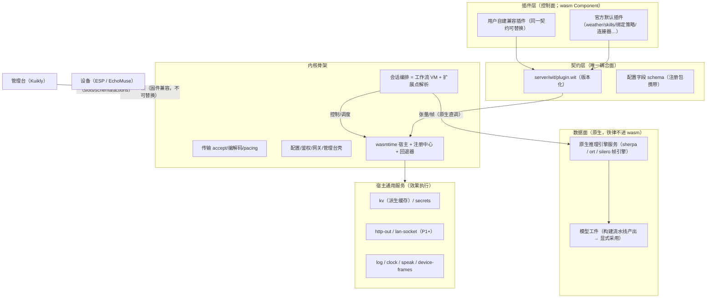
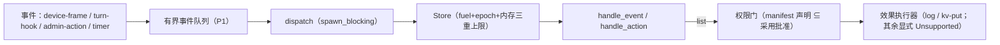
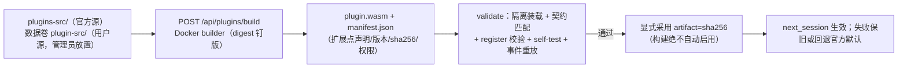
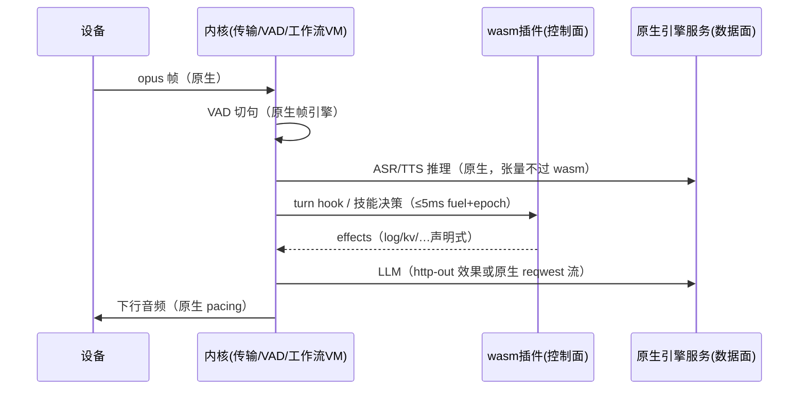

# WASM 插件平台（方案 v4 实施记录 · 历史）

> **历史文档 / 状态**：本文描述 v0.1 契约（`xiaozhi:plugin@0.1.0`）与方案 v4 的 P0–P9 阶段。
> **§5 契约清单、§9 阶段表、§10 及各阶段验证计数均为当时快照，不作现行规则**（见 `docs/README.md` 维护规则 6）。
> **当前契约以 `server/wit/plugin.wit`（`xiaozhi:plugin@0.2.0` / 方案 v5）与 [`plugins/wasm/AGENTS.md`](<../../plugins/wasm/AGENTS.md>) 为唯一权威。**
> 结论：本文保留 DSH 概念映射、控制面/数据面分离铁律、设备公共能力三层架构与逐阶段交付证据，供追溯取舍；
> 0.2 已把单 `interface host` 拆成四个 Host trait，改为事件驱动 + 宿主通用 socket 监听，旧契约全文描述不再适用。
> 概念蓝本：DeepSeek Harness（"Everything is a Plugin"，cordis 插件框架）；
> 历史源码落点：`server/wit/plugin.wit`、`plugins/wasm/`、`tools/wasm-fixtures/`。

## 0. 当前契约 0.2（方案 v5，2026-11-08 起）

用户方向：宿主构建期不含任何业务，只提供插件依赖的通用能力；扩展点由插件 manifest 声明，宿主按字符串通用路由，不解释业务语义。

- 包名 `xiaozhi:plugin@0.2.0`；`world plugin { import host-core; import host-net; import host-timer; import host-system; export lifecycle }`。
- 新增 `subscription / protocol / endpoint-spec / resource-limits / config-field / service-method / service-decl / event / effect-kv-delete / effect-http-request`；manifest 增 `subscriptions / endpoints / resources / config-namespace / provides`，registration 增 `services`。
- `handle-event(ev: event)` 类型化信封（取代旧字符串双参），新增 `handle-service`；`effect-http-get` 由 `effect-http-request` 取代；`effect-lan-*` legacy 已随阶段三收口删除（宿主效果面、`lan-socket` 权限名、native Tuya consumer 与官方 tuya 插件同步清理）。
- 宿主新增 `host_api / event_bus / services / timers / fs / mdns / config_store / net/{http,ws,tcp,udp} / contract/validate`；`registry` 改为「条目表锁只做查找 + 每插件 Runner / 有界入站队列 / 泵任务」，`instance` 改为四个 Host trait。
- ⛔ 0.2 是破坏性升级：**远端已部署插件不会自动迁移**，必须重建产物并重新 `upload/raw → register → activate`。

模块清单、并发模型、权限门、沙箱预算与升级运维纪律见 [`plugins/wasm/AGENTS.md`](<../../plugins/wasm/AGENTS.md>)；本文下文各节均为 v0.1 时代记录。

## 1. 目标与总原则

1. **一切皆插件**：内核收缩为骨架通用功能（传输帧协议、VAD 帧引擎、原生推理引擎服务、
   工作流 VM、SQLite、鉴权网关、wasm 宿主）；其余功能逐步插件化。
2. **官方默认 = 缺省实现，非特权**：与用户插件同流水线、同契约，可整体替换。
3. **替换安全**：排他扩展点解析唯一实现；失败自动回退官方默认，系统不因替换变砖。
4. **控制面/数据面分离（铁律）**：wasm 插件只做**控制与调度**（注册、槽位、策略、路由、
   协议编排、配置模板）；**密集计算（模型推理）一律原生**——模型工件由调度构建流水线
   （NLU 模式：Docker 训练/转换 → 候选验证 → 显式采用）产出，宿主原生引擎服务执行。
   张量计算永不越过 wasm 边界（与"帧级不进 wasm"同一铁律的张量级推广）。

### 1.1 设备公共能力层（P9 规划 · 历史阶段编号）

“系统能力”在本项目语境中指**接入硬件提供的公共能力**，不是服务器自身提供重启/音量。EchoMuse、Xiaozhi ESP、ESPHome 等设备适配器可以实现同一能力，业务技能和业务插件通过公共 native 模块复用，避免重复实现。

三层边界：

- **项目底座**：连接/协议、会话、MCP、配置、WASM 宿主、权限审计和原生数据面适配器。
- **设备公共能力层**：能力 ID、参数边界、设备能力发现、adapter 路由和统一错误分类；当前首个共享 helper 位于 `server/src/device/capabilities/`。
- **业务插件/技能层**：天气、Tuya 场景、自动化和策略差异；只引用公共能力，不复制音量、生命周期、状态等设备控制逻辑。

性能规则：PCM、帧 VAD、模型推理、EchoMuse WS/keepalive/PTY、Tuya LAN worker 等 hot path 直接 native，不强制经过 WASM。只有低频、可审计且确有替换需求的 control path 才允许 `业务 WASM → host effect → 设备公共能力层`；WASM 不是公共设备能力的必经层。

P9a/P9b/P9c 首批落地：`server/src/device/capabilities/` 已提供稳定 `device.*` capability ID、跨设备音量量化/整数边界 helper 与 native `CapabilityRegistry`；ESPHome adapter 与 EchoMuse runtime 共用 helper，旧入口和协议保持不变。registry 仅路由低频 native action，WASM 不是必经层。P9 architecture guard 已覆盖 EchoMuse/推理/分句/Tuya LAN hot path 不调用 WASM 及 capability registry native-owned，首批 helper/registry/alias/adapter matrix **7 passed**，架构守卫 **7 passed**。

## 2. 概念来源映射（DSH → 本仓库）

| DSH（cordis/TS，进程内） | 本仓库（Rust 宿主 + WASM 组件） | 落点 |
|---|---|---|
| Context/Fiber 生命周期 | 插件实例 + phase 状态机；注册随卸载全量回收 | `wasm/registry.rs` |
| `inject` 声明式依赖 | manifest 声明扩展点+契约版本；缺依赖不激活 | `wasm/contract.rs` |
| 事件 waterfall + `next()` 纪律 | 有序瀑布 + 强度分级（Observe<Guard<Rewrite<Replace） | `wasm/waterfall.rs` |
| slots 槽位注册/内省/回收 | 注册包菜单槽位 + `/api/plugins` 投影（P2） | 契约 `registration` |
| 主题 token 唯一颜色权威 | 客户端 designTheme 语义别名层（P2） | client 侧 |
| 一次操作双调用方（UI+工具） | 动作端点：管理台按钮与语音技能同一实现（P2） | `handle_action` |
| 元数据免激活可读 | manifest 静态字段（P3 构建产物 manifest.json） | 构建流水线 |
| 插件清单 vs 管理页分离 | 「内置插件」只读清单 +「插件管理」操作页（P2） | client 侧 |
| 插件市场（npm/git/本地） | 双源根构建（仓库官方 + 数据卷用户源，P3） | 构建流水线 |
| HMR / restart-required | 采用/回退 `next_session` 生效；sha256 变更即新一代 | 采用器（P3） |
| 会话日志唯一事实源 | 会话事件流为源；插件 kv 是派生缓存 | `wasm/kv.rs` |

**明确不借**：进程内 JS 模块加载、pnpm 分发与脚本审批、`!!js` 配置表达式、客户端可执行代码下发。

## 3. 依赖宪法

- R1 单向依赖：插件→契约→宿主→内核；内核永不 import 插件代码（架构测试守卫，P8 白名单归零）。
- R2 契约唯一耦合面：WIT（`server/wit/plugin.wit`，宿主 bindgen 与 guest wit-bindgen 同源）。
- R3 内核零插件知识：空注册表 = 完整可启动（P0 已有测试 `extension_unresolved_without_any_implementation`）。
- R4 插件间无横向依赖：协作只经事件/效果。
- R5 双侧物理隔离：guest SDK 零内核依赖（P1 建 `xiaozhi-plugin-sdk` crate）。
- R6 客户端只消费投影：槽位/schema/动作运行时来自 `/api/plugins`（P2）。
- R7 替换安全：官方默认不可卸载；任何失败回退官方默认（P0 已有 `resolution fallback` 测试）。

## 4. 架构图

### 4.1 分层总架构

### 4.2 插件运行时（控制面执行模型：纯决策函数 + 效果）

### 4.3 构建-采用流水线（P3 目标态，镜像 NLU 模型构建）

### 4.4 热路径（一轮对话；数据面不过 wasm）

## 5. 契约（WIT v0.1 · 历史）

> ⚠️ 本节是 v0.1 契约全文描述，包名、导入面、效果与签名均已过时；当前契约见 §0 与 `plugins/wasm/AGENTS.md`。

`server/wit/plugin.wit`，包 `xiaozhi:plugin@0.1.0`：

- 导入 `host`：`log(level,message)`、`now-ms() -> u64`（控制面最小集；kv/http 走效果）。
- 导出 `lifecycle`：`manifest() -> plugin-manifest`、`register() -> registration`、
  `handle-event(event,payload) -> result<list<effect>,string>`、
  `handle-action(id,payload) -> result<string,string>`、`self-test() -> result<list<test-result>,string>`。
- 注册包：菜单槽位（nav.main / config.section / workflow.node-menu）+ 配置字段
  （形状对齐静态注册表 FieldSchema）+ 动作声明（白名单）。
- 版本化：`manifest.api-version` 主段 ≠ 宿主 `CONTRACT_MAJOR_VERSION` → 拒绝激活。
- 命名坑：接口内 `use` 引入的类型名不能与同名导出函数冲突（`manifest` 函数 vs 类型
  改名 `plugin-manifest`）。开放形状载荷（事件/动作/效果参数）v0.1 用 JSON 字符串承载。

## 6. 沙箱与性能预算

| 路径 | 粒度 | 预算/手段 |
|---|---|---|
| 音频帧→VAD→pacing | 20ms 帧 | 不过 wasm（原生帧引擎） |
| 模型推理 | 张量 | 不过 wasm（原生引擎服务 + 模型工件） |
| turn hook / 连接器决策 | 每次调用 | fuel 1e8 + epoch 5s 双保险；超限陷阱 → Degraded + 扩展点回退 |
| 管理动作 | 次 | epoch 5s；job 化轮询（P2 端点） |
| 线性内存 | 每插件 | ResourceLimiter 64MiB；实例化期超限直接拒绝装载 |
| 指标 | — | 调用数/p50-p99/fuel/trap → `/api/metrics`（P2） |

陷阱语义（实测记录，wasmtime 48）：

- fuel 耗尽/epoch 超时：类型化 `wasmtime::Trap::{OutOfFuel,Interrupt}`，宿主侧必须
  用 `anyhow::Error::msg` 装箱保留类型才能分类（字符串化会丢）。
- 内存上限拒绝在 wasm 语义中**不陷阱**：`memory.grow` 返回 -1 → guest 分配器得 null →
  guest panic（泛化 Trap）。装载期最小内存超限才在宿主侧报 "exceeds memory limits"。
  guest SDK（P1）应把分配失败转成显式 `Err` 而非 panic。

## 7. 扩展点与替换回退

- 解析表 `[extensions."<point>"] implementation = "<plugin-id>"`（P0 内存态；P2 接配置管线）。
- 解析顺序：首选（激活且声明实现）→ 官方默认（声明该点且 official=true 的唯一者；
  多个是配置错误，取注册序并告警）→ Unresolved。
- phase：`Active / Failed(装载) / Degraded{trap}`（enabled 是配置意图，P2 与配置管线对接）。
- 热装载铁律：**先建新后替换**，失败保留旧实例（P0 测试 `manifest_id_mismatch_rejected_and_old_instance_kept`）。

## 8. 与静态注册表的关系（绞杀者）

静态注册表（`plugins/registry`）回答「内置能力现状」；本平台回答「动态插件供给」。
P2 在 `/api/plugins` 投影合并两清单；P4+ 按域迁移（provider 绑定/策略先走，模型工件与
推理路径保持原生），P8 删除原生路径、架构测试白名单归零。

## 9. 分阶段计划（v0.1 历史阶段表）

> ⚠️ 下表 P0–P8 的「已实施」是 2026-11-04～06 的当时状态，不是当前阶段口径。

| 阶段 | 内容 | 状态 |
|---|---|---|
| P0 | WIT 契约 + 沙箱宿主 + 扩展点解析/回退 + waterfall + hello/trap 冒烟 | ✅ 已实施 |
| P1 | guest SDK crate（`xiaozhi-plugin-sdk`，含分配失败→Err）+ weather 试点 + 用户插件替换演练 | ✅ 已实施（P1a SDK/kv/替换演练；P1b http 回灌；P1c weather.official 全瀑布回放）——生产接线（skills 事件桥 + backend 开关）随 P2 |
| P2 | `/api/plugins` 投影合并 + 统一动作端点 + 客户端槽位合并（PluginSlots.kt）+ 事件队列 | ✅ 已实施（P2a–P2d 服务端全量 + P2e 客户端 PluginSlots 槽位合并/纯模型回归；余：插件面板动作执行 UI 与配置编辑） |
| P3 | ~~构建流水线~~ → **分发与引导落地**（P2b 上传/验证/采用/重启重装 + Docker 启动引导 + builder 镜像；P3 `[plugins]` 配置段总闸/每插件启停、raw 直传配置门、artifact SHA-256 钉版与 ConfigStore 持久化） | ✅ 已实施；builder-image CI 含组件校验、digest 清单与 provenance attestation |
| P4 | asr/tts/llm/vad.provider **绑定与策略**插件化（推理留原生） | ✅ P4a/P4b/P4c/P4d 已实施（ASR utterance 级远端变体；TTS/LLM/VAD 为控制策略包装器，native PCM/HTTP/SSE/逐帧 VAD 数据面保持原生） |
| P5 | tuya 连接器插件化（lan-socket 宿主服务） | ✅ P5a 控制策略 wrapper + P5b typed lan-socket effect/有界 queue + native consumer 已实施（worker drain、真实 Tuya LAN 执行、KV 结果回写） |
| P6 | echomuse 插件化（宿主保留 WS/keepalive/hub/PTY） | ✅ P6a 会话入口策略 wrapper 已实施（device.echomuse；native 承载/音频/PTY 保留） |
| P7 | 其余域（nlu/唤醒/echo 的**策略与目录**；skills 域；prompt/soul/memory.policy；**debug 域**：节点测试/日志流/测试台独立成插件——用户方向 2026-11-04） | 🚧 P7a 天气缓存粒度统一、P7b prompt.soul、P7c wakeup.strategy、P7d debug.policy、P7e skill.policy、P7f memory.policy、P7g nlu.catalog 有界策略桥已实施；其余策略/目录域待做 |
| P8 | 收口：删原生路径、架构测试白名单归零、本文档归档实测数据 | ✅ P8a bridge 依赖守卫 + P8b native 数据面归属证据 + P8c 删除门槛矩阵 + 显式 policy/fallback guard 已实施；native 数据面不删除，按兼容性保留 |

## 10. P0/P1a 验证证据（历史快照）

> ⚠️ 本节及后续各阶段 `cargo test ... passed` 计数均为当时快照，不作现行测试基线；当前基线以 `cargo test --features wasm-plugins` 实跑为准。

### P0（契约/沙箱/解析）

- `cargo test --manifest-path server/Cargo.toml`（默认，零 feature 影响）：1227 passed / 0 failed。
- `cargo test --manifest-path server/Cargo.toml --features wasm-plugins`：1244 passed / 0 failed
  （含 wasm:: 17 项：hello 全链路 6、陷阱 4、扩展点/解析 3、契约/权限/瀑布 4）。
- 夹具：`tools/wasm-fixtures/build.sh` → `server/tests/fixtures/wasm/{hello,trap}.wasm`
  （真实 wit-bindgen 0.63 guest，wasm32-unknown-unknown + wasm-tools 1.263 组件化，产物入库）。
- 代码规模：`plugins/wasm/` 全部 ≤600 行（最大 registry.rs 322），测试外置 `tests.rs`。

## 11. 分发模型（用户方向，2026-11-04 反转）

**插件不编译进主系统；wasm 产物一律不入 git；插件修改永不触发主系统/本地构建。**

| 通道 | 语义 | 落点 |
|---|---|---|
| 管理界面上传 | `POST /api/plugins/upload`：base64 组件 → 隔离验证（self-test/注册包/契约版本）→ 采用（数据卷 `plugins/<id>.wasm` 原子写 + 热装载，先建新后替换）→ **立即生效** | P2b 已交付 |
| 启动引导 | **已移除（2026-11-06 简化）**：服务端不再做 Docker 自动构建，相关 `tools/plugin-builder` 镜像已删除。发布后插件一律由管理界面上传发布，重启经数据卷 `plugins/` 扫描重装即注册；测试夹具由 `tools/wasm-fixtures/build.sh` 在本地按需构建（git 忽略），不进部署链路 | 已移除 |
| 重启重装 | assemble 扫描数据卷 `plugins/*.wasm` 逐个装载（坏件跳过不阻断启动） | P2a/P2b 已交付 |
| 开发态 | 改插件源 → `./build.sh` 只重建 guest（独立 crate）；测试经 `ensure_fixture` 按需重建（缺失/源更新），git 忽略产物 | 已生效 |

服务端 admission 已支持 Ed25519 detached signature：`[plugins].attestation_public_key` 配置标准 base64 公钥，条目 `attestation` 签名覆盖 artifact SHA-256 摘要文本；缺签名或校验失败在 WASM load（重启扫描与上传采用前）fail-closed。测试夹具由 `tools/wasm-fixtures/build.sh` 在本地按需构建（`ensure_fixture` 缺失/源更新自动重建），组件合法性由 wasm 测试套件的 artifact/组件校验覆盖；无独立 CI 构建步骤（随 2026-11-06 简化移除 `.github/workflows/plugin-builder.yml` 与 `tools/plugin-builder/` 构建镜像）。`[plugins.entries."<id>"]` 已支持
`enabled` 与可选 `artifact`（SHA-256 内容钉版）：上传采用经 ConfigStore 持久回写，重启重装
严格跳过摘要不符产物；缺省 `artifact` 保持旧配置兼容放行。**debug 域（节点测试/日志流/测试台）
也独立成插件**（P7）。

### P2a（HTTP 投影面 + 统一动作 + 插件文档契约，2026-11-04）

- **Engines 集成**：`wasm: Option<Arc<WasmHost>>`（feature 门控；空注册表起步，初始化失败降级
  None 不阻断核心语音服务）——单一装配点 `assemble()` 接入。
- **端点**（全过 main 层管理鉴权；feature 未编入 = 路由不存在）：
  - `GET /api/plugins` 追加 `wasm` 键（插件清单 + 扩展点解析投影；旧客户端零破坏）；
  - `POST /api/plugins/{id}/actions/{name}` 统一动作端点（"一次操作、双调用方"；
    白名单在宿主；wasm 调用 spawn_blocking）；
  - `POST /api/plugins/extensions/{point}/preference` 扩展点首选（进程内态，P3 持久化；
    响应即时回显解析结果）。
- **插件文档契约（用户要求）**：每个 `plugins-src/<插件>` 必须自带 README（`## 功能描述` +
  `## 使用方法` 两节：事件/payload、动作、配置字段、kv 键布局、权限、边界），
  由 `plugins/plugin_docs_tests.rs` 结构检查强制（缺文档 = 测试失败；weather 已补齐模板）。
- 测试：默认 1228（+文档契约）；wasm-plugins **1259**（+端点回环 HTTP 契约 3 项：
  合并投影/动作白名单/扩展点首选回环）。

### P4a（asr.provider 事件桥 + 原生适配器，2026-11-04）

- **utterance 级契约**（P2d/P2c 事件面复用，无新 WIT 面）：`asr.transcribe` 事件 payload
  JSON（`req_id/session_id/sample_rate/samples/pcm_base64`——f32-le base64），插件经 kv
  `asr-result:<req_id>` 返回 `{text}`（weather 同款结果协议）。
- **原生适配器** `plugins/asr/wasm_engine.rs`：`WasmAsrEngine` 实现 `AsrEngine` trait
  （recognize 同步纪律与原生推理同为 spawn_blocking 调用上下文）；扩展点 `asr.provider`
  **调用期再解析**（用户替换透明，首选未声明 → 回退官方默认，测试钉住该语义）。
- **铁律不破**：本地 SenseVoice 路径零改动；wasm 通道定位 = 远端引擎变体（用户自备
  Whisper 服务器等经 http-get 效果），网络 RTT 主导下 utterance 粒度边界开销可忽略。
- **P4b 已实施**：现有配置约定 `[asr].engine = "wasm-remote"`（默认 `sensevoice`）选择
  `asr.wasm-remote` 描述符；feature 门控构建 `WasmAsrEngine`，由 `asr.provider` 扩展点
  调用期解析。WASM 宿主初始化失败或扩展点无实现时显式报错，绝不静默回退本地 SenseVoice；
  tts/llm 同构随后。
- **测试**：wasm_engine 3 项（真实 wasm 往返回显采样数/未装载显式 Err/替换回退语义）+ 注册表
  选择/构建/feature 门测试；hello 夹具成为多扩展点演示件（demo.greeter + asr.provider 探针）。
  默认 **1244 passed / 6 ignored** / wasm-plugins **1312 passed / 6 ignored**（P6a 完成后的全量回归）。

### P4c（tts.provider / llm.provider 控制策略，2026-11-05）

- **TTS 策略包装器**：`[tts].engine = "wasm-policy"` 选择 `tts.wasm-policy`；描述符仍要求
  sherpa/Kokoro 模型，因为 WASM 只改整句控制，native `TtsEngine` 继续负责模型推理、流式
  f32 PCM、重采样与下行。事件 `tts.prepare` 的请求为 `{req_id,text,speed,speaker}`，插件
  通过 `tts-result:<req_id>` 返回 `{text,speed?,speaker?,route?}`；文本、route 与数值均有限制，
  缺宿主/插件、坏 JSON、非法 route/speed 显式失败，不静默绕过策略。
- **LLM 策略包装器**：`[llm].engine = "wasm-policy"` 选择 `llm.wasm-policy`；native
  OpenAI Responses provider 仍负责 HTTP、SSE、工具调用、空回复和取消。事件 `llm.prepare`
  只传 `req_id/user_text/history_turns/has_memory/tool_names` 等受限元数据，结果 KV
  `llm-result:<req_id>` 仅允许 `{user_text?,route?}`，不会把完整历史、音频或模型响应交给 WASM。
  策略线程通过 `spawn_blocking` 隔离；策略失败显式返回，默认 `openai` 路径零行为变化。
- **注册表/配置**：`TTS_ENGINES`、`LLM_ENGINES` 与 registry descriptor/schema 同步；
  `wasm-policy` 的 TTS 描述符明确声明底层 Kokoro 依赖，LLM 描述符复用 OpenAI upstream
  校验与字段，热生效均为 `NextSession`。
- **测试证据**：TTS 配置/策略/注册表测试、LLM WASM 策略真实 hello 夹具回环、native
  provider 流式与取消透传均覆盖；ASR 原有真实 WASM roundtrip 保持不变。该阶段继续遵守
  “控制面进 WASM、密集计算与音频/HTTP 数据面留 native”边界。

### P4d（vad.provider 会话级控制策略，2026-11-05）

- `[vad].engine = "wasm-policy"` 选择 `vad.wasm-policy`；策略只在服务端 VAD 会话从池中借出
  native 实例前执行一次 `vad.prepare`，不会进入逐帧 `accept`/`flush` 热路径。
- 请求仅包含受限元数据：`{req_id,sample_rate,threshold,min_silence_duration,min_speech_duration}`；
  插件通过 `vad-result:<req_id>` 返回 `{route?,threshold?,min_silence_duration?,min_speech_duration?}`。
  当前唯一允许的 route 是 `native`，所有数值 finite/range/长度均校验；缺宿主、插件、KV、坏 JSON
  或非法结果均显式失败。
- native Silero 仍负责全部 PCM/f32 帧推理、状态、flush、segment callback；WASM 不接收或返回
  音频数据。策略结果和解析到的插件 id 纳入 `VadPool` 签名，避免旧策略实例跨会话复用；EchoMuse
  的 device-VAD 路径继续旁路服务端策略。
- **测试证据**：hello 夹具声明 `vad.provider` 并返回 native 控制结果；VAD 策略覆盖缺插件显式
  错误与成功回环，既有 VAD 池/设备 VAD 测试保持通过。

### P5a（Tuya connector 控制策略，2026-11-05）

- `[tuya].engine = "native"|"wasm-policy"`；默认 `native`，旧 `backend`/`lan`/`wasm` 值继续兼容收敛。注册表新增 `tuya.native` 与 `tuya.wasm-policy`，配置错误不会静默切回另一实现。
- `wasm-policy` 只调用 `connector.tuya.prepare`，请求包含规范化设备名、`on|off` 动作和有限候选元数据（索引、展示标签、online、model、是否已有 bool switch DP）。`local_key`、IP、云凭证、原始 DP、TCP/UDP 报文和 socket 句柄永不进入 WASM。
- 插件通过 `tuya-result:<req_id>` 返回 `{route:"native",candidate_index,action}`。宿主严格校验候选索引、动作和 route；缺宿主/插件、KV、坏 JSON、越界选择或非法动作均显式失败，不静默绕过策略。
- 选择结果之后仍由 native `TuyaEngine` 执行 online 预检、DP 识别、per-device 互斥、rustuya TCP 6668、set→status 回读、DP cache、listener 和 offline/timeout/unsupported 归类。WASM 是控制面策略，不是 Tuya 协议或 lan-socket 数据面。
- hello fixture 增加 `connector.tuya` 回环；覆盖成功选择、未装载 fail-closed、越界结果。P5a 全量回归：默认 **1242 passed / 6 ignored**，wasm-plugins **1308 passed / 6 ignored**。后续 P5b 才评估 typed `lan-socket` 高层 effect/异步命令队列，不把原始 socket 暴露给插件。

### P5b（typed lan-socket effect + 有界 native command queue，2026-11-05）

- WIT 新增 `effect-lan-status` / `effect-lan-set-dp`：插件只提交 `request_id`、宿主分配的
  opaque `device_handle`、数字 DP id 与有界 JSON value；local_key、IP、云凭证、原始 TCP/UDP
  报文和 socket 句柄永不跨越 WASM 边界。
- 宿主新增独立 `lan-socket` 权限门与 `LanSocketQueue`：队列容量默认 64，可 drain 批量命令；
  request/handle/DP/value-json 均有长度和字符校验，非法 JSON、原始 DP 字符串、队列满均显式
  fail-closed。未绑定执行器时仍返回 `Unsupported`，不静默丢弃。
- 队列命令附带仅宿主内部使用的 `plugin_id` 路由元数据（不进入 WIT、不由 guest 提供），使
  native Tuya consumer 能按请求来源安全回灌结果；命令仍只含 opaque handle/数字 DP/有界 JSON。
- `TuyaEngine::drain_wasm_commands` 已接入现有 Tuya worker：每 tick 最多 drain 16 条命令，按
  opaque handle 映射 native 设备目录，复用 rustuya 会话、per-device 互斥、超时/错误三分类、
  set→status 回读与 DP cache/listener；结果写回插件隔离 KV 的 `lan-result:<request_id>`，结果
  超过 16KiB 改为有界 unsupported 错误。原始数据面仍只在 native。
- hello guest fixture 声明 `lan-socket` 并真实产生 status/set-dp effects；P5b 测试覆盖权限拒绝、
  有界背压、非法 value/DP、非法来源路由、未绑定显式失败和 guest→宿主队列回环。P5b 当时全量回归：默认
  **1244 passed / 6 ignored**，wasm-plugins **1316 passed / 6 ignored**；guest SDK **5 passed**。P5 native
  consumer 回归另有 **2 passed**（结果上限与 guest→native→KV 路由）。

### P7a（weather 缓存粒度与 native 对齐，2026-11-05）

- WASM 天气插件不再以 `city+range` 作为唯一结果缓存命中条件；站点解析后按 `station code` 缓存
  原始 `data`（TTL 600s），不同城市别名和查询时段都现场调用共享 `build_result` 组装结果。
- 保留 `station:<city>` 派生站点码缓存和结果通道；全站城市列表仍不进入单值受限的插件 KV。
  native `WeatherService::cached_or_fetch` 与 WASM 的 HTTP 拉取粒度现已一致，控制面/数据面边界不变。
- 回放测试覆盖冷路径四次请求后，以“杭州天气 + 明天”不同别名/range 命中 station 原始缓存且不再出网，
  同时断言返回结果 range 为“明天”。P7a 单项回归通过。

### P6a（EchoMuse 会话入口策略，2026-11-05）

- `[echomuse].engine = "native"|"wasm-policy"`（默认 `native`，RestartOnly；旧 `wasm` 值兼容）。注册表新增 `echomuse.native` / `echomuse.wasm-policy`，策略失败不静默绕过。
- `wasm-policy` 在 EchoMuse 会话进入 workflow 前调用 `device.echomuse.prepare`，请求只包含受限 `device_id/base_os/welcome` 元数据，结果 `echomuse-result:<req_id>` 只允许 `{route:"native",welcome?}`，欢迎文案上限 1KiB。
- EchoMuse 的 WS upgrade、TCP keepalive、control/data hub 认领、bounded-turn、native PCM、speaker EOS、BLE、shell/PTY、鉴权和设备状态事实全部留在 native；WASM 不接 socket、帧、token、PTY 或音频。
- 缺宿主/插件、坏结果、超长或非法 route 显式终止当前入口，不降级到 native 策略；默认 native 路径零行为变化。hello fixture 与 bridge 测试覆盖成功回环和缺插件 fail-closed。
- P6a 回归：EchoMuse 配置 4 项、WASM bridge 16 项；默认全量 **1244 passed / 6 ignored**，wasm-plugins 全量 **1312 passed / 6 ignored**；无 `wasm-plugins` 时选择 `wasm-policy` 显式报 feature 错误；`DOCS_RS=1 cargo check --features sherpa`、`cargo fmt --check` 与 `git diff --check` 均通过。

### P7b（`prompt.soul` 有界控制策略，2026-11-05）

- 选择 `prompt.soul` 作为 P7 最小 seam：WASM 只接收 `device_id/name/address_user/tone/max_sentences/max_chars`
  等已限长的人格元数据，不接收完整历史、完整 `instructions`、原始变量表、音频或设备状态。
- `soul_prepare` 只允许策略返回 `tone`、`max_sentences`、`max_chars` 与 `route`; `route` 必须为
  `native`，所有文本长度与回复预算由 native 宿主再次校验。人格段排序、插值、预设合并和最终 prompt
  仍由 `plugins/soul` 与 `plugins/prompt` 原生完成。
- 缺失扩展点、事件/效果失败、KV 缺失、坏 JSON、未知 route 或越界覆盖均显式失败（fail-closed），
  不回退到未经策略检查的文本。默认 native 路径不调用该桥，零行为变化。
- hello 官方夹具声明 `prompt.soul` 并返回固定 native 策略；桥测试覆盖成功回环、缺插件和超长请求拒绝。
  本 seam 目前是策略能力，不改变 `SoulConfig` 的 preset/validate/preview 语义；后续接入时必须保持失败不绕过。

### P7c（`wakeup.strategy` 有界唤醒目录策略，2026-11-05）

- `wakeup_prepare` 仅把 native `[wakeup].greeting` 规范化后的有界目录（最多 64 条、每条最多 256 bytes）和 `persist` 元数据交给 `wakeup.strategy`；插件只能返回目录索引与 `route:"native"`，不能注入任意文本、PCM、TTS 参数、缓存键或音频。
- 原生 `WakeGreeting` 仍负责目录、随机/快照语义；会话沿用 `speak_canned`、`HotAudioKey`、TTS、内存/磁盘缓存和下行链路。策略失败、缺插件或非法索引不影响对话，调用方保留原生问候路径。
- hello 夹具声明 `wakeup.strategy` 并返回索引 0；bridge 测试覆盖成功回环、缺插件 fail-closed、空目录拒绝。默认未装载扩展点时不调用桥，native 路径零行为变化。
- P7b/P7c bridge 回归 **22 passed**；当前默认全量 **1276 passed / 6 ignored**、wasm-plugins 全量 **1375 passed / 6 ignored**，guest SDK **5 passed**。P9 native capability registry/action alias 回归 **6 passed**，P9 architecture guards **7 passed**。

### P7d（`debug.policy` 有界调试控制策略，2026-11-05）

- WASM 仅接收 `kind/target/session_id/requested_items` 等限长元数据，`kind` 只允许
  `node-test`、`log-stream`、`test-bench`；原始日志、节点测试输入/结果、benchmark 样本、凭据和
  socket 全部留在 native。
- 策略只能返回 `max_items/redact/route`，`max_items` 不得超过本轮请求上限且最多 256，
  `route` 必须为 `native`；未知 kind、超长输入、缺插件、坏 JSON、越界结果均 fail-closed。
- hello fixture 增加 `debug.policy` 回环，bridge 测试覆盖成功回环和请求边界拒绝；P7d 新增回归
  **3 passed**。当前仅提供 bounded seam，未改变节点测试、日志 SSE 或测试台默认 native 路径。

### P7e（`skill.policy` 有界技能策略，2026-11-05）

- WASM 仅接收 `skill_id`、最多 16 个限长 slot 和 `requested_steps`；技能定义、能力校验、变量插值、
  MCP 调用、任务持久化和副作用执行全部留在 native。
- 策略只能返回 `allow/max_steps/route`，`max_steps` 不得超过请求上限且最多 32，`route` 必须为
  `native`；空/超长 skill id、超限 slot、控制字符、缺插件或非法结果均 fail-closed。
- hello fixture 增加 `skill.policy` 回环，bridge 测试覆盖成功准入、slot 上限和缺插件拒绝；新增回归
  **3 passed**。该 seam 不改变现有 native skill planner/executor 行为。

### P7f（`memory.policy` 有界记忆召回策略，2026-11-05）

- WASM 仅接收限长 `device_id/query` 与召回预算；SQLite 事实、graph/store/rag 索引、抽取、保留、
  排序和最终 prompt 注入全部留在 native。
- 策略只能返回 `allow/max_items/max_chars/route`，items 最大 32、chars 最大 4096，且不得超过
  请求预算；空/超长查询、请求预算越界、缺插件或非法结果均 fail-closed。
- hello fixture 增加 `memory.policy` 回环，bridge 测试覆盖成功预算、query 上限和缺插件拒绝；新增回归
  **3 passed**。该 seam 不改变现有 native memory provider 行为。

### P7g（`nlu.catalog` 有界目录策略，2026-11-05）

- WASM 仅接收限长 locale 和候选目录元数据，不接收用户 utterance；训练模型仍是唯一意图识别器，
  插件不能选择或执行技能。
- 策略只能返回不重复且不越界的候选索引和 `route:native`；候选最多 32 条，id/label 限长，
  空目录、控制字符、缺插件或非法索引均 fail-closed。
- hello fixture 增加 `nlu.catalog` 回环，bridge 测试覆盖目录过滤和候选上限；新增回归 **2 passed**。
  该 seam 只控制目录呈现，不改变 native NLU/model-only 识别路径。

### P8a/P8b（WASM bridge 架构守卫与 native 所有权证据，2026-11-05）

- 新增外置 `plugins::wasm::tests::architecture` 回归，扫描 bridge/policy 源文件，禁止直接依赖
  `device`、`gateway`、`workflow`、`runtime`、`TcpStream` 或 `reqwest` 等 native 数据面符号。
- 同时固定策略返回 `route:"native"` 契约，确保 WASM 只做有界控制面决策；Tuya LAN、EchoMuse WS/PTY、
  PCM/VAD、HTTP/SSE、技能执行和记忆存储仍由 native 承担。
- P8a/P8b 架构守卫新增回归 **5 passed**；同时保留 Tuya/EchoMuse/memory native 所有权标记，并守卫重启重装前的 artifact SHA-256 pin，未删除任何原生路径，避免破坏固件兼容。
- 新增 `[plugins].require_artifact_pin` 严格 admission 开关：默认 `false` 保持旧配置兼容；设为 `true` 时，未配置 artifact SHA-256 pin 的产物不装载、不引导。
- 新增 Ed25519 detached attestation admission：`[plugins].attestation_public_key` + 条目 `attestation`，签名覆盖摘要文本；公钥启用后缺签名、非法 base64 或校验失败均在 runtime load（重启扫描与上传采用前）拒绝。

### P8c（native 路径删除门槛矩阵，2026-11-05）

在没有达到以下证据前，不删除任何 native 路径：

| 域 | 当前 native 所有权 | 删除前必须具备的证据 | 当前状态 |
|---|---|---|---|
| Tuya LAN | `device/tuya/wasm.rs` + 现有 worker | consumer 全链路、per-device 串行、错误分类和固件回归 | 保留 native，证据已有，待最终归档 |
| EchoMuse | `device/echomuse/runtime.rs` / routes | WS、keepalive、hub、PTY、音频和设备状态回归 | 保留 native，P6a 仅策略化入口 |
| Memory | `plugins/memory/*` | graph/store/rag 存储、抽取、召回和 prompt 注入回归 | 保留 native，P7f 仅预算策略 |
| NLU | `plugins/nlu/*` | model-only 识别、拒识、目录过滤和技能执行回归 | 保留 native，P7g 不接收 utterance |

P8c 当前建立删除门槛并明确不删除 native 数据面；架构守卫、native ownership 与显式 policy/fallback 测试必须继续通过，默认 feature
和 ESP 固件协议兼容性不得改变。

### P3a（`[plugins]` 配置段：总闸 + 每插件启停，2026-11-04）

- **形状**（config.rs 聚合，非 feature 门控——配置段恒存在，执行由 feature 管）：
  `[plugins] enabled` 总闸 + `[plugins.entries."<id>"] enabled`（id 含点号用引号键）；
  **缺省启用**（上传落盘即意图，无需再改配置）；`PluginsConfig::allows(id)` = 总闸 ∧ 条目。
- **接线**：装配扫描循环按 `allows` 过滤（禁用产物不装载、落盘保留）；热生效档位 RestartOnly 入 `APP_SECTION_HOT`。
- **raw 直传通道**（P3b）：`POST /api/plugins/upload/raw?id=<id>`（octet-stream，token 走查询串）
  ——管理台上传桥 `uploadPickedFile` 的原生形态（避免客户端 base64 膨胀）；采用管线抽成
  `adopt_bytes` 与 JSON 端点共享，**配置禁用 id → 403**（配置门一致性）。
- **管理台上传 UI（P3 末件）**：静态导航「插件」（配置组）→ [PluginsManagePage](<../../client/shared/src/commonMain/kotlin/com/xiaozhi/admin/PluginsManagePage.kt>)：
  上传走平台桥 raw 直传（id 缺省=服务端 `probe_id` 从组件 manifest 探测，"选文件即上传"）；
  清单复用 PluginMetaState 同一次拉取；动作按注册清单渲染（宿主白名单）；卸载二次确认三回收；
  扩展点解析状态（resolved/fallback/未解析）徽标化。客户端验证：shared compileKotlinJs /
  adminCoreTests（含导航契约 10/9 更新）/ publishWeb / stateVar 护栏 488→491 全绿；
  浏览器回归的既有失败与本批无关（P2e 已回退实证）。
- **摘要钉版收尾**：`PluginEntryConfig.artifact` 为可选 SHA-256 小写十六进制；缺失时兼容旧配置放行。
  上传采用在热装载成功后原子写盘，并经 `ConfigStore` 回写 pin；响应返回 `sha256/persisted`。
  卸载同时删除产物并清除 pin；启动扫描校验摘要，不符即跳过并告警，避免数据卷篡改静默生效。
- **测试**：纯语义（引号键解析/缺省启用/总闸一票否决/回写保留段）+ 装载门集成
  （落盘真件启用→装载、垃圾件禁用→不装载、摘要不符→不装载，经真实 SqliteConfigStore
  location 派生产物目录）+ 摘要稳定性/配置兼容/上传卸载 pin 回写。默认 **1236 passed / 6 ignored** /
  wasm-plugins **1291 passed / 6 ignored**。

### P2e（客户端 PluginSlots：运行时槽位合并，2026-11-04）

- **契约层纯模型**（[contracts/PluginSlots.kt](<../../client/shared/src/commonMain/kotlin/com/xiaozhi/admin/contracts/PluginSlots.kt>)，
  零 Kuikly 依赖、kotlinx JSON）：解析 `wasm` 键 → 插件卡/导航项/扩展点；**基线铁律** =
  无键/不可达/解析失败 → null → 静态导航逐字节不变；有键 → 追加独立「插件」组
  （order 9000 带宽、组内相邻、与静态 id 精确冲突才去重）。
- **接线**：[PluginMetaState](<../../client/shared/src/commonMain/kotlin/com/xiaozhi/admin/PluginMetaState.kt>)
  在既有 `/api/plugins` 拉取里顺带解析（Kuikly JSONObject → 字符串 → 纯解析）；AdminShell
  导航组合并 + `plugin:<id>:<entry>` section 落 manifest 投影占位卡。
- **测试**：PluginSlotsModelTest 5 项（基线回退/解析/合并组相邻/动态 id 反查/去重与 order 钳制）；
  顺带修复**既有过期契约** UiContractsTest（AdminNav 实际 9 项含 tuya，测试停在 8 项——
  与本轮无关，回退本批改动后同样失败实证）。
- **浏览器回归**：环境无 playwright（临时装 /tmp + `PLAYWRIGHT_PATH`），`input not found:
  /models/asr-base.onnx` 失败在**不含本批改动的 bundle 上等价复现**（回退实证）——属
  tuya/插件面板迭代期的既有 UI 漂移，与 wasm 槽位无关；P2 后续批处理。publishWeb 构建绿、
  adminCoreTests 全绿、stateVar 护栏台账 487→488（+wasmSlots 注明原因）。

### P2d（designer 观察者挂钩：wasm 插件进会话 workflow，2026-11-04）

- **绑定面**：`compile_with_observers(value, 目录)`——目录来自 `Engines::wasm_observers()`
  （已装载插件 id+标题；未编入 feature = 空表，行为与原 `compile` 完全一致）。观察者仅可绑
  `start`/`link.nlu.llm`/`end` 三个已接线 hook 位，`on_error` 恒 `continue`；condition 沿用普通
  hook 面。投影 `projection_with_observers` 带目录（编辑器与编译器同源），observer 条目带标记。
- **严格/宽松分层**：保存（save.rs）与编辑器（workflow.rs get/validate）按**当时**装载目录严格校验；
  会话启动（start.rs）对未装载观察者**宽松剔除+告警**——热卸载/重启后旧绑定只降级不炸会话。
- **会话派发**（hooks.rs 三个挂点位）：`hook.<position>` 事件（payload `{session_id, device_id,
  position, text?}`）→ `try_dispatch`（单步、**不执行**效果、不回灌）→ `spawn_deferred`
  （tokio 异步执行，fire-and-forget：效果即上报，http 响应不回灌——会话已继续，没有下一步）。
  陷阱→Degraded+告警；旁路观察者**永不阻塞/打断对话轮**，不进 hook_result 错误流。
- 测试：designer +4（钩位白名单/on_error=continue/目录外仍未知+描述符仍拒+去重+condition 面/
  投影标记）；wasm +3（try_dispatch 不执行+业务拒绝 Ok(None)、spawn_deferred 异步落 kv、
  observe_hook 对未装载/作恶插件不 panic 且降级）。trap 夹具新增 hook.* 作恶面。
  默认 1232 / wasm-plugins 1280 passed。

### P2c（weather 生产接线：事件桥 + 后端开关，2026-11-04）

- **`[weather].backend = "native"|"wasm"`**（默认 native，重启生效；config.example 已同步）：
  skills 层**零改动**——`WeatherService::forecast` 分发；wasm 缺依赖（feature 未编入/插件未装载/
  宿主初始化失败）**明确报错不静默回退 native**（双跑对照价值 = 差异可见）。
- **事件桥** `wasm/bridge.rs`：扩展点解析（用户替换实现透明）→ geo 预填（宿主服务，事件源侧职责）
  → 事件派发（宿主同步驱动完整瀑布）→ 插件 kv `result:<req_id>` 结果通道。调用纪律与原生
  reqwest 同（skills 计划执行本在 spawn_blocking）。
- 已知粒度差异（记录在案）：插件缓存键 = 城市+range，原生 = 站点码（range 变体共享拉取）——P7 统一。
- 跟进项：`[weather].backend` 的注册表字段元数据（管理台配置页可见性——weather 段当前无字段表，
  需要应用段字段机制）；客户端表单映射随客户端槽位批。
- 测试：wasm:: 37 项（+bridge 6：全链/缓存复用/geo 缺省/未装载显式报错/服务级开关路由/开关缺宿主
  与未知值拒绝）；既有 config 测试的全文 `backend` 子串断言收窄到 tts/memory 段（`[weather].backend`
  是合法字段）。默认 1228 / wasm-plugins 1271 passed。

### P1c（weather.official 试点 + 按步批量回灌，2026-11-04）

- **契约演进**：回灌从逐请求 `http.response` 改为**按步批量** `http.responses`（数组 payload；
  深度按**步**计而非请求数）——动机即来自 weather 冷路径：省列表后需一步并发拉全部省份城市
  （35+ 请求），逐请求深度上限会误伤合法扇出。
- **第一个真实源根插件** `plugins-src/weather/`（`weather.official`，`skill.weather` 官方默认）：
  纯决策瀑布 冷路径 3 次回灌（省列表 → 全省城市并发 → 天气组装），TTL 内热路径零出网；
  与原生实现**共享同一份 parse.rs**（`#[path]` 单源，绞杀者方向 P8 反转）；request-id 编码
  流程上下文；全站城市列表刻意不进 kv（64KB 值上限）。parse.rs 顺带清掉 3 个存量警告
  （原生测试 7/7 不变，行为等值）。
- **回放测试**（脚本化 NMC 真实形状应答，零出网）：冷路径 4 请求全链（站点匹配 58457、
  话术/实时字段断言）→ 站点码与结果落 kv → 第二次同城市**零出网**；未知城市 ok:false 优雅失败；
  self-test 证明共享 parse 在 wasm 内真实可用。
- 测试：wasm:: 28 项；默认 1227 / wasm-plugins **1255 passed**。

### P1b（http-get 两段式回灌，2026-11-04）

- **契约**：`effect.http-get {request-id, url}`；宿主执行后回灌事件 `http.response`，
  payload JSON `{id,status,body,error}`（status=0+error=网络失败，非 2xx 原样回灌）。
- **权限门**：URL host ∈ `http-out:<host>` 白名单才放行（手写最小 host 解析，端口剥离、
  scheme 限定 http(s)、非法形状拒绝）；越权效果 → Degraded + 不出网。
- **执行抽象**：`HttpFetcher` trait（生产 `ReqwestFetcher` 懒建阻塞客户端——同 weather 的
  OnceLock 纪律；测试 `ScriptedFetcher` 脚本应答，零真实网络）。
- **瀑布循环**：`handle_event` = 调用（持锁）→ 执行（出锁，HTTP 秒级不阻塞全局）→ 回灌排队
  （深度上限 4，防自我循环；超限停止回灌记错误，插件不降级——宿主策略非插件过错）。
- 测试：wasm:: 25 项（+http 闭环/网络失败优雅回灌/深度截断/越权降级/URL 严格解析）；
  默认 1227 / wasm-plugins **1252 passed**。tests.rs 按职责拆为 `tests/{sandbox,extension,http}.rs`。

### P1a（SDK + kv 闭环 + 替换演练，2026-11-04）

- **WIT v0.1+kv-get**（`interface host` 增量扩员，0.x 内兼容）：宿主导入 `kv-get`——
  插件隔离 kv 读回；未声明 `kv` 权限 → deny-as-absent（none + 审计告警，温和拒绝形态）。
- **guest SDK**（`server/crates/xiaozhi-plugin-sdk`，独立 crate 不进 server 依赖图）：
  契约绑定唯一入口（`pub_export_macro + default_bindings_module` 两选项缺一不可，
  见 tools/wasm-fixtures/AGENTS.md 坑表）+ 运行期可失败分配（`fallible::try_*`，OOM→显式 Err
  不成陷阱）+ 静态注册构建器（与宿主 `contract::validate_*` 同源的 guest 侧前置校验）。
  自测 5 项通过（native）。
- **替换演练**（P1 验收核心）：真实双 wasm 组件（hello.official 官方默认 vs
  greeter.usermade 用户实现，同一扩展点 `demo.greeter`）——首选切换→解析到用户实现；
  卸载→实时回退官方默认 + kv 命名空间回收。测试
  `usermade_plugin_replaces_official_and_falls_back_on_unload`。
- 测试：默认 feature 1227 passed / 0 failed（不变）；`--features wasm-plugins`
  **1247 passed / 0 failed**（wasm:: 20 项：+kv 闭环、+deny-as-absent、+替换演练）。

### S3a（阶段三 ESPHome 第一切片 + geo/天气归属裁决，2026-11-09）

阶段二收口（策略桥删除、ui.mode、0.2 投影、legacy lan effect）完成后的阶段三首步。

- **ESPHome 目录策略**：`[esp_home].engine = "wasm-policy"` 时，桥在绑定端口**之前**经
  `connector.esp-home` 扩展点征询「实体放行 + 显示名」决策（`server/src/device/esp_home/policy.rs`
  + `state.rs::CatalogPlan`）；fail-closed——缺 feature/宿主/插件显式报错、桥不启动，不静默降级。
  未放行实体不进 `ListEntities`、不发状态、命令被忽略；key 恒为静态实体表索引，协议、noise_psk
  加密、状态采集、音量命令与 BLE 代理全部留 native。`engine = "native"`（默认）逐字节保持原行为。
- **注册表**：`Capability::EspHome`（`esp_home` feature 门控）+ `esp-home.native` /
  `esp-home.wasm-policy` 描述符 + `[esp_home].engine` 引擎表（`ESPHOME_ENGINES`，旧值 `wasm`
  兼容读）；一致性由 `config/tests.rs::declared_engine_ids_match_registry_implementations`
  与注册表覆盖度测试钉住。
- **官方插件**：新增 `esphome.official`（`plugins-src/esphome`，`connector.esp-home`，默认全放行
  直通）；`hello.official` 探针同步声明 14 个扩展点（保持 Registered）。插件总数 15 个业务 +
  hello = 16 个 `.wasm`。
- **geo/天气归属裁决**（用户阶段二目标项收口）：`plugins/geo` 归属底座（服务器事实/观测能力：
  出口 IP 定位 → 管理台展示 + 天气默认定位预填）；天气业务本体只在 native-plugins（NMC）或
  WASM 插件（`skill.weather`）；`server/src/skills/weather_ops.rs` 是不联网的通用技能步执行器，
  由新架构守卫 `weather_skill_entry_stays_plugin_dispatched_without_native_networking` 钉住。
- **投影单源**：`ui.mode` 与静态 schema 投影收敛到 `registry::static_business_present` 单一判据
  （此前 `schema_json` 用宽 `cfg!(any(...))` 而纯底座契约测试只认 `native-plugins`，部分设备
  feature 组合下两表漂移；`--features esp_home` 组合此前因 `actions.rs` 双重导入等本就编译不过，
  本轮一并修复并纳入验证矩阵）。
- **文件规模整改**：`esp_home/server.rs` 逻辑 524 行 + 协议往返测试外置 `server_tests.rs`（340 行），
  恢复「测试一律独立文件」与 ≤600 行约定。
- 验证（本机实测）：default **762**/0；`wasm-plugins` **853**/0（含 8 项架构守卫）；
  `esp_home` **991**/0；`esp_home,wasm-plugins` **1086**/0（含策略 fail-closed/直通回归）；
  `native-plugins` **1281**/0；`native-plugins,wasm-plugins` **1377**/0。
- 剩余：设备**协议面**迁插件（ESPHome protobuf/noise、Tuya LAN、EchoMuse WS 经 `net` 权限宿主
  服务承载），按 P8c 删除门槛矩阵逐域取证后再删 native 路径。

### S3b（阶段三协议面证据基线：Tuya 云协议语义单源 guest 对拍，2026-11-09）

S3a 之后对「设备协议面迁插件」做的第一块**可回归验证**的证据切片（P8c 逐域取证的
Tuya 域第一步），同时给出分域迁移的可行性结论。

- **协议语义单源**：涂鸦云官方 v1.0 签名、请求构造与请求/响应形状从 `cloud.rs` /
  `cloud_transport.rs` 抽到 [`server/src/device/tuya/protocol.rs`](../../server/src/device/tuya/protocol.rs)——
  仅 hmac + sha2，**零宿主依赖**（不 import `crate::`，无 reqwest/tokio/serde_json），
  宿主 `cloud.rs` 经 `pub(crate) use` 继续消费（历史导入路径不变，行为纯位移）。
- **guest 对拍**：新夹具 `tuyasign`（tools/wasm-fixtures/tuyasign）用 `#[path]` 引入
  **同一份** `protocol.rs`，在 WASM 内执行 `official_sign` 并写回 kv；
  `plugins/wasm/tests/protocol.rs` 与宿主黄金向量逐字节对拍（v1 = 2026-11-03 python
  参照实现同源向量、v2 覆盖 Content-SHA256 段）+ 缺参 fail-closed（业务性 Err 不写
  结果键、不降级）。「协议语义在插件侧可执行且与宿主一致」从纸面承诺变成回归护栏。
- **边界不变**：`access_secret` 永不跨 WASM 边界（tuya policy seam 铁律）；生产签名
  调用方仍是持有凭证的 native `CloudClient`。插件承接完整云签名链路的**前置条件 =
  契约 `config-read` 落地**（插件经自身配置命名空间持有凭证）。
- **分域结论（P8c 取证基线，迁移前必读）**：
  | 域 | 协议栈现状 | 迁插件路径 | 前置/门槛 |
  |---|---|---|---|
  | Tuya 云 API | 本仓 `cloud.rs`（签名/解析纯函数 + HttpSender 抽象） | 单源已共享（S3b），链路整体迁移待 config-read | 契约 config-read；真凭证回归 |
  | Tuya LAN | **外部 crate `rustuya`**（async facade + 失败三归类是我们自己的） | guest 侧重写整个 LAN 协议栈（AES/HMAC/握手/DP 帧） | 真机固件回归（P8c：无证据不删 native） |
  | ESPHome | **外部 crate `esphome-native-api`**（protobuf + noise_psk） | guest 需 protobuf + noise 纯 Rust 栈；目录策略已先行（S3a） | 真机 + HA 客户端回归 |
  | EchoMuse | 本仓 native（WS/keepalive/hub/PTY），**按设计保留 native** | 不迁（文档既定），仅入口策略（P6a） | — |
- **验证（本机实测）**：`tuya-plugin` tuya 模块 **74**/0（纯位移，同数同结果）；
  default **762**/0；`wasm-plugins` **856**/0（含 protocol 对拍 3 项）。

### S3c（tuya.official 云签名链路插件侧闭环，2026-11-09）

S3b 证明「语义可执行」之后，本切片证明「链路可闭环」：真实官方插件 tuya.official
（0.3.0）完成 **config 凭证 → 单源签名 → 宿主代发 → 回灌解析 → kv 结果** 全链路。

- **凭证面**：插件配置命名空间新增 `region`（enum cn/us/eu/in）/ `access_id` /
  `access_secret`（secret 字段，`config-secret` 读取写审计）；manifest 声明 `config`
  权限 + 四区域 `http-out:<host>`。**凭证永不离开插件命名空间**，宿主只见签名后的请求。
- **链路**：`connector.tuya.cloud-token` 事件 → 单源协议 `build_token_request` 签名
  → `effect-http-request`（request-id `cloud-token|<req_id>` 承载上下文）→ 宿主
  `http.responses` 批量回灌 → 单源 `parse_token_ok` 解析 → `tuya-cloud-token:<req_id>`
  结果通道（成功 `{ok,access_token,expires_in,route:"plugin"}`；失败也落 `ok:false`）。
  缺凭证 fail-closed：不发 HTTP、不写结果键。宿主代发替换为 `net` 直连的迁移位已就绪。
- **单源扩展**：`protocol.rs` 增加 `parse_token_ok`（成功形态提取；Auth/Api 错误
  **分类**属宿主业务语义，保留在 `cloud.rs::api_error`，不进单源）。
- **测试**（真实插件源，`plugins/wasm/tests/tuya_cloud.rs`，3 passed）：
  ① 全链路（端点/签名 URL、token/有效期/route 断言）；② 缺凭证 fail-closed；
  ③ 云端业务错误走结果通道不静默。
- **边界如实声明**：生产**同步编排**（token 生命周期、分页拉取、SQLite 落库）仍由
  native `CloudClient` 持有；插件接管编排的下一步是 devices 目录拉取/分页解析与
  同步语义迁移，之后才谈 P8c 删除门槛。
- 验证（本机实测）：default **762**/0；`wasm-plugins` **859**/0（含 S3c 3 项）；
  tuya 模块 **74**/0。tuya.official 版本 0.2.0 → 0.3.0（同 id 重传严格递增纪律）。

### S3d（tuya.official 设备清单分页链路插件侧闭环 + 夹具重建互斥，2026-11-09）

S3c 之后把云链路推进到**业务数据**：设备目录的单页拉取与形状解析进插件。

- **单源扩展**：`protocol.rs` 新增 `parse_devices_page_ok`——页形状事实进单源
  （真机 `result.devices`、兼容旧文档 `result.list` / 裸数组、`has_more` 满页近似、
  游标 `last_row_key`/`last_row_id`）；设备行保持原始 JSON Value（字段投影到
  `CloudDevice` 是宿主业务语义，留在 `cloud.rs`）。
- **插件链路**：`connector.tuya.cloud-devices` 单页契约——payload 带 token 直接取页；
  不带则自动先取 token（`devices-token|<rid>|<t>|<cursor>` 上下文随波，回灌链 2 步，
  宿主深度上限 4 之内）；`has_more`/`last_row_key` 由调用方决定续页，插件不做无界
  循环。设备行（含 local_key，凭证材料）只留在插件隔离 kv，宿主同步编排接管前不外溢。
- **夹具重建互斥**（实测教训）：`ensure_fixture` 过期重建与并行测试线程读产物存在
  竞态，本轮两度造成全量套件间歇失败——重建全程加进程级 Mutex，强制过期场景复跑
  确认不再复现。
- 验证（本机实测）：`wasm-plugins` **862**/0（tuya_cloud 6 passed：S3c 3 + S3d 3，
  强制过期重建后复跑同样全绿）；default **762**/0；tuya 模块 **74**/0；
  16 个系统产物重建 ✅。

### S3e（tuya 目录同步生产接线：wasm-policy 引擎经插件云链路，2026-11-09）

S3c/S3d 的插件云链路从「证据」升级为「生产路径」：`[tuya].engine = "wasm-policy"` 时，
native 同步编排（60s 闸门 / token 一次 / 翻页 ≤ MAX_PAGES / SQLite upsert / 四归类）
通过 `connector.tuya` 插件链路取目录——**协议语义在插件、编排与存储在宿主**。

- **接线形态**：`TuyaEngine` 晚绑注入 WASM 宿主（`set_wasm_host`，镜像
  `WeatherService::set_wasm_host`；runtime 装配期注入，两 feature 门控）；取数步
  `spawn_blocking`（阻塞 guest + 效果 HTTP，与 weather/dispatch 同纪律）。
- **凭证面**：插件路径读插件配置命名空间（管理台插件配置），**不读 [tuya] 段**——
  两套凭证互不混淆；缺宿主/缺 feature 显式 `network_error`（消息指明"宿主未注入"/
  "需要 wasm-plugins"），不静默回退 native。
- **归类口径**：插件路径错误统一 `network_error`（Auth 分类是 native 客户端业务
  语义，不跨插件边界）；partial 语义同 native（已取到的设备照常落库）。
- **边界如实声明**：LAN 数据面（worker/lan）、控制面（voice/policy seam）与
  sync 编排的**落库**仍 native——架构守卫不受影响（worker/lan 不含 plugins::wasm
  的所有权断言继续成立；sync 是低频控制面，允许派发 WASM）。
- 验证（本机实测）：wasm-plugins,tuya-plugin **942**/0（sync_tests 9，含
  插件链路同步落库 2 台 + 缺宿主显式失败）；`wasm-plugins` **862**/0；
  `native-plugins` **1281**/0（native 路径逐字节不变）；default **762**/0；
  tuya 模块 **74**/0；DOCS_RS+sherpa check 通过。

### S3f（Tuya LAN 0x55AA 帧编解码进插件：rustuya 黄金帧对拍，2026-11-09）

LAN 域（P8c 矩阵里唯一以**外部 crate** 为协议栈所有者的数据面）第一块无需真机的
迁移证据：帧编解码协议语义落到插件侧并与 rustuya 本尊逐字节对拍。

- **单源**：[`plugins-src/tuya/src/lan_codec.rs`](../../plugins-src/tuya/src/lan_codec.rs)
  （guest 域内单源，hmac+sha2 + 手写 CRC-32/ISO-HDLC 位循环，不引 crc crate）——
  0x55AA pack/parse：头长度谎报拒绝（MAX_PAYLOAD_LEN=256KB）、CRC/HMAC 双尾、
  retcode 启发式逐条对齐 rustuya `unpack_message`；0x6699（3.5/AES-GCM）未实现
  （guest 无 rand，IV 策略待定）。
- **为什么不在 guest 直接依赖 rustuya**：其 tokio(rt-multi-thread/net)/socket2/rand
  依赖无 feature 可关，无法编译 wasm32-unknown-unknown——协议语义只能以
  「重实现 + 黄金帧对拍」方式迁移，这正是本切片的做法。
- **对拍**：`plugins/wasm/tests/tuya_lan.rs`（5 passed）——宿主用 rustuya
  `pack_message` 生成黄金帧，guest `lan-pack`/`lan-parse` 事件经 kv 结果通道回读
  后逐字节比较（明文 CRC 帧、HMAC-SHA256 帧、retcode 启发式两种形态、CRC 翻转
  拒绝、外来前缀拒绝）。
- **边界如实声明**：native LAN 数据面（`worker`/`lan`，rustuya async facade）不变，
  架构守卫所有权断言继续成立；删除门槛仍是 P8c 的真机固件回归。完整 LAN 会话层
  （握手/心跳/重连，即 rustuya actor 部分）未迁移。
- 验证（本机实测）：wasm-plugins,tuya-plugin **947**/0（含 S3f 5 项）；
  `wasm-plugins` **863**/0；tuya 模块 **74**/0；16 个系统产物重建 ✅。

### S3g（LAN 0x6699/3.5 帧编解码进插件：AES-128-GCM 对拍 + 构建环境加固，2026-11-09）

S3f 之后补齐 3.5 帧，**LAN 编解码层（55AA CRC/HMAC + 6699 GCM）在插件侧完整**。

- **单源扩展**：`lan_codec.rs` 新增 `pack_frame_6699` / `parse_frame_6699`——
  AES-128-GCM（nonce = iv 12B，AAD = 头 `data[4..18]`，tag 附于 ct 尾）；retcode
  启发式与 55AA 不同（**正向**要求 `payload[4] ∈ {'{','3'}`，rustuya 同款）；
  guest 无 rand，IV 由调用方传入（rustuya 参考 `msg.iv` 同语义，对拍用固定 IV）。
  guest 依赖新增 `aes-gcm 0.11`（`default-features=false`，关闭 getrandom）。
- **双向对拍**（`tests/tuya_lan.rs`，LAN 全套 9 passed）：guest pack ↔ rustuya
  pack 逐字节一致；rustuya 帧 → guest parse 字段全对齐；**guest 帧 → rustuya
  unpack 解开**（双向等价公民）；GCM tag 篡改拒绝。
- **过程实录（两处环境地雷，均已钉死）**：
  1. `~/.cargo/config.toml` 的 `[env] CARGO_PROFILE_DEV_DEBUG` 会被 cargo 注入
     测试进程并传给子 cargo，非法值导致 `ensure_fixture` 的子构建直接报
     "could not load config key profile.dev"——`ensure_fixture` 对子构建
     `env_remove` 全部 `CARGO_PROFILE_*` 与 `RUSTC_WRAPPER`（sccache 在测试
     沙盒下 rmeta 写入间歇 EPERM，一并隔离）；
  2. 同秒 mtime 让 cargo 指纹误判「未变更」→ 旧产物被静默沿用：构建一律
     **不经管道直接落日志**（管道 grep|head 会 SIGPIPE 杀掉 cargo），
     `plugins-src/tuya/build.sh` 默认 `CARGO_TARGET_DIR=/tmp/xiaozhi-guest-target`
     （可覆盖），并以行为验证代替字符串 forensics。
- 验证（本机实测）：wasm-plugins,tuya-plugin **950**/0；`wasm-plugins` **863**/0；
  `native-plugins` **1281**/0；default **762**/0；tuya 模块 **74**/0。

### S3h（v3.3 控制命令全链路进插件：命令帧 rustuya 对拍，2026-11-09）

S3f/S3g 只覆盖「帧的壳」，本切片把「命令的心脏」搬进插件：**DP 控制命令的载荷形状
与加密组装**（`lan_command` 事件，`plugins-src/tuya/src/lan_codec.rs`）。

- **载荷形状**（镜像 rustuya `ProtocolV33::generate_payload` + 共享 helper）：
  基础载荷 `{gwId, devId, uid, [cid], t, dps}`，**t 为字符串**（rustuya
  `t.to_string().into()`——首块 ECB 一致而次块分歧的对拍抓出的口径差异）；
  `Control`(0x07) 去 `gwId`；`UpdateDps`(0x12) 只留 `cid` 并插 `dpId`
  （data 或缺省 `[18,19,20]`）。
- **加密与帧**：AES-128-ECB + PKCS7（对齐 `cipher.encrypt(padding=true)`）；
  非裸头命令（NO_PROTOCOL_HEADER_CMDS 之外，如 Control）前插 `"3.3"+12×0`
  协议头；帧组装 = `pack_frame_55aa`（v3.3 `get_hmac_key`=None → CRC32 尾）。
- **对拍**（`tests/tuya_lan.rs`，LAN 全套 11 passed）：Control 与 UpdateDps 两条
  命令帧与 rustuya `generate_payload → pack_payload → pack_message` 参考链
  **逐字节一致**（effective cmd 亦一致）。对拍第一次失败即抓出上述 t 字符串口径
  ——parity 测试本身就是语义勘误器。
- **边界如实声明**：会话层（TCP 连接、版本协商、心跳、重连）未实现——这是
  LAN 域剩余的主体；native 数据面不变。
- 验证（本机实测）：wasm-plugins,tuya-plugin **952**/0；`wasm-plugins` **863**/0；
  `native-plugins` **1281**/0；default **762**/0；DOCS_RS+sherpa 0 error；
  16 个系统产物重建 ✅（本机需 `CARGO_TARGET_DIR=/tmp/xiaozhi-guest-target`
  环境变量，见 S3g 加固记录）。

### S3i（v3.4 TCP 会话协商状态机进插件：会话/命令帧 rustuya 对拍，2026-11-09）

S3h 覆盖 v3.3「命令的心脏」后，本切片把 **v3.4 TCP 会话层的密码学状态机**搬进插件
（`plugins-src/tuya/src/lan_session.rs` + `lan_events.rs` 事件面）。规格权威 =
rustuya `device/actor.rs::negotiate_session_key` + `protocol/v34.rs` + `crypto.rs`。

- **三步握手（纯函数）**：`session_start_frame`——SessKeyNegStart(0x03)，payload =
  16B nonce 经 local_key ECB+PKCS7 加密（裸头命令），0x55AA **HMAC 尾**；
  `session_finish`——验证回包（解密后 48B = `remote_nonce(16)‖HMAC-SHA256(local_key,
  local_nonce)(32)`，不足 48B / HMAC 不符显式报错）→ `finish_hmac = HMAC(local_key,
  remote_nonce)` → 签发 SessKeyNegFinish(0x05)；会话密钥 = `local_nonce ⊕ remote_nonce`
  循环 XOR，**密钥库形态** = 再经 local_key ECB **无填充**加密的 16B blob
  （rustuya `encrypt_session_key(padding=false)` 同款怪癖；后续帧以 blob 作 AES 与
  HMAC 密钥，`get_cipher` 同口径）。
- **会话模式命令帧**：`lan-command` 增 `version:"3.4"`——modern envelope
  `{protocol:5, t(数值), data:{cid?,ctype?,dps?}}`（Control 生效为 ControlNew 0x0d）、
  UpdateDps 同 v3.3 形状、heartbeat 去 uid/t 且无需 t；帧尾 = **HMAC**（v3.4
  `get_hmac_key`=Some，与 v3.3 CRC 尾不同）。
- **parity 实测两处语义勘误**（parity 作为勘误器的再次证明）：
  ① **协议头位置两代不同**——v3.3 `pack_payload` 先加密后拼头（头以明文在密文外），
  v3.4 先拼头再整体加密（头进密文）；初版统一成 v3.3 语义被对拍抓出（actual 帧头
  可见 `"3.4"` 明文、长度差 1 字节）。
  ② `dps` 为 null 时不得插 `dps` 键（rustuya `create_base_payload` 仅 `data` 为
  Some 才插入）——heartbeat 帧 16 字节后分歧的对拍抓出。
- **对拍**（`tests/tuya_lan_session.rs`，8 passed）：start 帧 / finish 流（finish 帧 +
  blob + remote_nonce 三路一致）/ 篡改 HMAC 拒绝 / 短回包拒绝 / control（含 cid）/
  update_dps / heartbeat，全部与 rustuya `TuyaProtocol`(V3_4) + `TuyaCipher` +
  `pack_message` 参考链逐字节一致。LAN 全套 **19 passed**。
- **边界如实声明**：TCP 传输（连接、心跳节拍、重连）仍 native——WIT 契约暂无 TCP
  出站能力，完整会话编排归属裁决留待契约决策；v3.5（0x6699/GCM 会话协商，密钥库为
  GCM[12..28] 形态）未实现；nonce 由调用方传入（guest 无随机源，生产编排接宿主随机源）。
- **600 行红线收口**：`plugins-src/tuya/src/lib.rs` LAN 事件处理器（S3f 起积累的
  hex/编解码/命令 handler）迁出至 `lan_events.rs`（649→522 行），新增
  `lan_session.rs`/`lan_events.rs` 均 <600。
- 验证（本机实测）：wasm-plugins,tuya-plugin **960**/0；`wasm-plugins` **863**/0；
  `native-plugins` **1281**/0；default **762**/0；`tuya_` 过滤 **29**/0（含会话 8 +
  LAN 11 + 云链路等）；本轮改动文件 rustfmt clean；`git diff --check`
  干净。

### S3j（v3.5 TCP 会话协商进插件：两代会话语义齐备，2026-11-09）

S3i 覆盖 v3.4 后，本切片补齐 **v3.5（0x6699/GCM）会话**（`lan_session.rs` 增
`session_start_frame_35` / `session_finish_35`，规格 = rustuya `protocol/v35.rs`）。

- **两代共享面**（抽取 `verify_and_derive`）：回包验证（48B =
  `remote_nonce‖HMAC-SHA256(local_key, local_nonce)`，不足/HMAC 不符显式报错）、
  finish HMAC、会话密钥 `local ⊕ remote` 循环 XOR——rustuya 的 trait 默认实现
  本就版本无关，guest 侧同构。
- **v3.5 差异面**：
  - 打包：0x6699 **帧级 AES-128-GCM**（nonce = 调用方传 IV，AAD = 帧头 [4..18]），
    载荷只拼 "3.5" 头**不做帧前加密**（rustuya v35 `pack_payload` 语义，与 v3.4
    的「头进明文整体 ECB 加密」形成三代三样：3.3 头在密文外、3.4 头进密文、
    3.5 无帧前加密）；
  - 密钥库 blob：`GCM(local_key, nonce=local_nonce[..12])` 输出 `iv‖ct‖tag` 取
    **[12..28]**（密文前 16 字节、无 tag——rustuya v35 `encrypt_session_key`
    切片怪癖），后续帧以 blob 作 GCM 密钥（`get_cipher` 同口径）；
  - start 帧 payload = nonce **明文**进 6699 帧（裸头命令无头、无帧前加密）。
- **事件面**：`lan-session-start` / `lan-session-finish` / `lan-command` 的
  `version` 增 `"3.5"`（3.5 会话与命令需 `iv_hex` 12B）；命令载荷臂与 3.4
  完全同款（rustuya 两代共享同一批 generate_payload helper，guest 复用同一
  builder）。
- **对拍**（`tests/tuya_lan_session_v35.rs`，与 v3.4 文件共享 host/call_lan/
  回包构造，5 passed）：start 帧 / finish 三路一致（帧 + blob + remote_nonce）/
  篡改拒绝 / control（blob 密钥）/ heartbeat——与 rustuya `TuyaProtocol`(V3_5) +
  `pack_message` 6699 分支逐字节一致。会话全套 **13 passed**。
- **600 行红线**：v3.5 测试独立成文件（兄弟模块 `super::` 复用助手，整文件按
  `tuya-plugin` feature 门控）；`lan_codec.rs` 内联 pack_payload_33 wrapper
  收回 603→595。
- 验证（本机实测）：wasm-plugins,tuya-plugin **965**/0；`wasm-plugins` **863**/0；
  `native-plugins` **1281**/0；default **762**/0；16 个系统产物重建 ✅；
  `git diff --check` 干净；改动文件 rustfmt clean。
- **里程碑**：v3.3–v3.5 三代 LAN 协议语义（帧编解码 + 控制命令 + 会话协商）
  **全部进插件**且逐字节对拍；Tuya LAN 域剩余 = TCP 传输归属裁决（WIT 暂无
  TCP 出站；连接/心跳节拍/重连仍 native）与真机固件回归（P8c 门槛）。

### S3k（ESPHome 明文帧编解码 + 核心消息 protobuf 进插件：真连接双向对拍，2026-11-09）

Tuya LAN 三代语义收口（S3f–S3j）后，协议面迁移按 P8c 矩阵推进到 **ESPHome 域**。
规格权威 = 外部 crate `esphome-native-api` 3.0.0（native 栈所有者）的 `frame.rs`
（FrameCodec 明文分支）+ `parser.rs`（类型映射）+ `proto/*.rs`（prost 派生）。
落点 `plugins-src/esphome/src/api_frame.rs`（guest 单源，零新依赖：varint/protobuf
手写）+ 事件 `connector.esp-home.frame-pack` / `frame-parse`（esphome.official
v0.2.0，结果键 `esphome-frame:<req_id>`）。

- **对拍方法升级**：前序切片用参考 crate 的纯函数（rustuya pack/unpack）做黄金
  帧；ESPHome 的 FrameCodec 是 crate 私有——改用 **真连接对拍**：宿主测试把
  `EspHomeApi::start`（设备角色，无加密 → 明文路径）跑在 tokio 内存 duplex 上，
  guest 帧作为对端输入、参考帧从对端读出。证据面（5 passed，整文件 `esp_home`
  feature 门控）：
  ① guest HelloRequest 载荷 ↔ 公开 `parser::proto_to_vec`（prost）逐字节一致；
  ② **真握手消费 guest 帧**（HelloRequest 被参考解析器接受、握手完成）；
  ③ guest 解码参考侧真实发出的 HelloResponse（字段与 builder 配置一致）；
  ④ 真连接经参考 FrameCodec 发出的 PingResponse 帧 ↔ guest 输出**逐字节一致**；
  ⑤ guest SwitchCommandRequest 帧被真连接广播还原同值（key/state/device_id）；
  另有加密帧（0x01）/垃圾起始字节显式拒绝。
- **对拍实证第四处语义勘误**：明文帧 wire 长度标记 **不含类型字节**（varint
  载荷长度）；参考实现编码器写 `item.len()-1`、解码器读 `varint+1` 还原——
  编码/解码不对称的怪癖。初版按「含类型字节」实现，真连接对拍当场暴露（握手
  停滞 + PingResponse 帧形状 `[0,0,8]` vs `[0,1,8]`）。
- **guest 手写 protobuf**（prost 语义对齐：字段按声明序编码、默认值跳过——
  0/false/空串不写 wire）：HelloRequest（client_info/major/minor）、
  SwitchCommandRequest（key fixed32/state/device_id）；HelloResponse 字段解码
  （未知字段按 wire type 跳过，向后兼容固件加字段）；消息类型映射收录桥策略面
  相关核心子集（1/2/5/6/7/8/9/11/19/20/33）。
- **工程面**：esphome 夹具源加入 `ensure_fixture`（SOURCE_ROOTS=5，build.sh 补
  `CARGO_TARGET_DIR` 默认规避 EPERM）；测试文件整文件 `esp_home` feature 门控
  （wasm-plugins 单独组合不编译该模块）。
- 验证（本机实测）：`wasm-plugins,esp_home` **1101**/0；`wasm-plugins,tuya-plugin`
  **965**/0；`wasm-plugins` **863**/0；`native-plugins` **1281**/0；default
  **762**/0；16 个系统产物重建 ✅；改动文件 rustfmt clean；`git diff --check`
  干净。
- **边界如实声明**：ESPHome 完整 protobuf 目录/状态消息面（ListEntities* /
  *StateResponse / BLE / VoiceAssistant 共 123 类）与 noise_psk 加密握手仍
  native；TCP 传输归属裁决与 Tuya 域共用（WIT 暂无 TCP 出站）。

### S3l（宿主通用 TCP 出站能力：已迁协议语义的生产前提，2026-11-09）

Tuya/ESPHome 两个域的协议语义已大量进插件（S3b–S3k），但都卡在同一处：**WIT 契约
没有 TCP 出站**，生产编排无从接管。本切片补上这块通用能力面——它是底座能力而非
业务：宿主只搬运字节，不认识任何协议（纯净性硬边界的正题）。

- **WIT**：`host-net` 增 `tcp-connect(host, port) → connection-id`。**0.2 内加性
  扩展，不升 0.3**：wit-bindgen guest 只 import 实际引用的函数，旧产物装载不受
  影响（本机全量重建后亦验证兼容）。需 `net` 权限（与 udp-send 同口径，instance.rs
  门禁 + 审计）。
- **宿主实现**（`net/tcp.rs::connect`）：同步签名（guest 泵 spawn_blocking 线程
  内阻塞可接受）→ 解析 + `std` connect → 转 tokio → 复用 `serve_conn` 读写循环。
  连接 id 走**全局分配器**——顺带修掉入站连接每端点局部计数器的潜在 bug（跨端点
  首连接在 conns 表相撞）。入站/出站同表：`net-send` / `net-close` / `net-peer`
  同口径复用，事件 `io.tcp.opened / io.tcp.data / io.tcp.closed` 一致
  （correlation-id = connection-id）。
- **回归**（`tests/net_connect.rs`，NetManager 回环 3 passed）：opened/data
  （echo 逐字节）/closed 全生命周期 + 跨插件归属校验拒绝 + 连接拒绝显式报错 +
  连接 id 全局唯一；guest→host 全链心证 = hello 探针 self-test 增
  `tcp-connect-probe`（对 127.0.0.1:1 发起真实调用、预期拒绝——证明 bindgen
  链路、权限门与调用语义可用）。
- **纪律执行**：SDK 与全部夹具、16 个系统产物随契约变更重建（本机带
  `CARGO_TARGET_DIR=/tmp/xiaozhi-guest-target`）。
- 验证：`wasm-plugins` **866**/0（+3 net_connect）；`wasm-plugins,tuya-plugin`
  **968**/0；`wasm-plugins,esp_home` **1104**/0；`native-plugins` **1281**/0；
  default **762**/0；改动文件 rustfmt clean；`git diff --check` 干净。
- **打开的门**：Tuya LAN 会话编排（连接/心跳节拍/重连）进插件的实施切片——
  会话状态机（S3i/S3j）与传输能力（本片）均已就位，下一步是把编排状态机接上
  `tcp-connect` + `io.tcp.*` 事件；生产接管仍以 P8c 真机回归为最终门槛。

### S3m（v3.4 会话编排进插件：guest 状态机接真 TCP，2026-11-09）

S3l 补齐 TCP 出站后，本切片把 **Tuya LAN v3.4 的连接与三步握手编排**搬进插件
（`lan_events.rs` 编排处理器 + `lan_session.rs` 的 `wire_resp_to_payload` /
`derive_nonce`），tuya.official 升 v0.4.0（声明 `net` 权限 + 订阅 `io.tcp.*`）。

- **编排状态机**（kv `tuya-lan-state:<device_id>`，凭证材料只留插件隔离 kv）：
  `lan-connect` → `tcp-connect` 出站 → 发 SessKeyNegStart（nonce = SHA-256
  (local_key‖device‖now_ms) 确定性派生，guest 无随机源）→ `WaitResp`；
  `io.tcp.data`（correlation-id = connection-id）→ `wire_resp_to_payload`（exact
  解析不剥 retcode + ECB 解密去填充）→ 验证派生 → 发 finish → `Established`
  （blob 落 kv）；`io.tcp.closed` → `Closed`；失败置 `Failed` 并落结果通道
  （泵路径对 guest 业务 Err 静默，结果通道是编排的可观测面）。
- **对拍升级为端到端**：`tests/tuya_lan_orchestrate.rs` 用 **rustuya 原语搭的
  v3.4 模拟设备**（真 TCP，TuyaCipher/pack_message/hmac 全参考实现）跑通三步
  握手全链——guest 帧被设备侧解密消费、finish_hmac 在设备侧验证通过、重复会话
  fail-closed（结果通道 ok:false）。2 passed。
- **顺带修掉三处平台缺陷**（编排端到端暴露）：
  ① 订阅 topic 校验的字符白名单先于通配检查，尾部 `.*` 订阅**永远无法声明**
  （文档承诺的通配订阅是死路）——通配形状先判，白名单作用于前缀；
  ② 泵路径 `call_guest_event` 硬编码 `correlation_id: None`——socket 回灌事件的
  关联键全部丢失（HTTP 面靠 payload 里的 id 未暴露此坑）；
  ③ TCP 连接注册在 spawn 的 IO 任务内完成，guest 拿到 connection-id 立即
  `net-send` 会赛跑"连接不存在"——注册提前到 accept/connect 同步完成（入站/
  出站一致）。
- **帧解析口径分裂**：`parse_frame_55aa`（剥 retcode，JSON 面既有行为）与
  `parse_frame_55aa_exact`（不剥，二进制会话载荷专用）——rustuya 接收路径把
  retcode 启发式作用在二进制密文上属实现缺陷（几乎必剥 4 字节导致解密失败），
  编排按协议语义实现并如实记录偏差。
- 验证：`wasm-plugins,tuya-plugin` **970**/0（+2 编排）；`wasm-plugins` **866**/0；
  `wasm-plugins,esp_home` **1104**/0；`native-plugins` **1281**/0；default
  **762**/0；改动文件 rustfmt clean；`git diff --check` 干净。
- **边界如实声明**：心跳节拍、数据面帧解密（Established 后的会话密钥解帧）、
  重连与 v3.5 编排留下一片；生产接管仍以 P8c 真机回归为最终门槛。

### S3n（Tuya LAN 会话编排剩余面：流式帧切分 / 心跳节拍 / 数据面解帧，2026-11-09）

S3m 打通「连接 + 三步握手」后，本切片补齐 v3.4 会话的**运行期面**：

- **流式帧切分**（`lan_stream.rs`，新）：TCP 只给原始字节（宿主纯净性边界），
  分帧是协议语义 → 插件侧。`feed_split` 处理粘包/半包，缓冲经状态 kv 持久化
  （事件间无内存态），前导垃圾按 `00 00 55 AA` 32-bit 前缀逐字节滑动丢弃，
  长度谎报/缓冲超限显式报错清空（防放大）。`data_frame_decode` 用会话 blob
  做 exact 解帧 + ECB 解密去填充 + `"3.4"` 头剥离。
- **心跳节拍**：`lan-connect` 增 `heartbeat_ms`（缺省 30s，下限 200ms）→ 单全局
  interval timer（省配额）→ `host.timer.fired` → 遍历 Established 设备，距上次
  心跳 ≥ 间隔才发（防 timer 抖动重复）→ `command_frame_34` heartbeat 帧（会话
  blob 密钥）。陈旧 timer id 忽略（重建后残留）。
- **数据面步进**：Established 态 `io.tcp.data` → 帧切分 → 解密 → 心跳应答识别，
  `last_pong_ms`/`data_frames`/`rx_buf_hex` 落状态 kv；单帧解析失败不断链
  （记 `last_error`、丢缓冲防错位连锁）。
- **对拍 = rustuya 模拟设备真 TCP**（`tests/tuya_lan_orchestrate.rs` 2 passed，
  5 连跑稳定）：心跳帧在设备侧解密验证 `{"devId":"ivf9id","gwId":"ivf9id"}`
  逐字节；pong 以**半包（10+90 分两次写）+ 粘包（两帧一次写）**两种注入回灌，
  guest 帧切分重组后识别应答（`data_frames ≥ 3`、`last_pong_ms > 0`）。LAN 全套
  **25 passed**。
- **排查实录（教训归档）**：① 帧前缀是完整 32-bit `00 00 55 AA`（wire 前两字节
  0x00），切分器与 mock 同错只查 `55 AA` → 头错位；② 模拟设备应答后立即 drop
  可能 RST 丢弃未读字节 → 假失败，必须保持连接；③ **清理临时插桩的裸正则误删
  `state_write`**，数据面处理全在内存完成从未落盘，表现为「无 trap、无写、phase
  active」的静默失败——排查耗时极长。教训：成对标记（写前/写后）替代裸正则，
  删除后必须跑行为断言。④ 顺带加固：`guest-alloc` 由只增不回收的 bump 换成
  **dlmalloc**（类型名保留，15 插件零改动）——原实现长跑/高频事件下堆持续增长
  撞 64MB 沙箱上限会 OOM trap 并静默中断整个 handle_event（属长跑隐患）。
- 验证（本机实测）：`wasm-plugins,tuya-plugin` **970**/0（LAN 25、orchestrate 2）；
  `wasm-plugins` **866**/0；`wasm-plugins,esp_home` **1104**/0；`native-plugins`
  **1281**/0；default **762**/0；16 个系统产物重建 ✅；改动文件 rustfmt clean；
  `git diff --check` 干净；600 行红线（`lan_events.rs` 660→拆分为
  `lan_events.rs` 298 + `lan_orchestrate.rs` 390）。
- **剩余**：自动重连/退避（需要真实网络故障证据）、v3.5 编排放接入（纯函数已在
  S3j）、设备主动上报（Status）业务接线；生产接管仍以 P8c 真机回归为门槛。

### S3o（Tuya LAN v3.5 会话编排接入：两代会话编排齐备，2026-11-09）

S3n 补齐 v3.4 运行期面后，本切片把**同一 guest 状态机**接到 v3.5 的 0x6699/GCM
wire 布局上，并补上「一张网卡两代设备」需要的公共件；协议语义仍全部在插件侧，
宿主只搬字节：

- **双布局流式切分**（`lan_stream.rs`）：切分器泛化为 `FrameLayout`（前缀 4B / 头长 /
  len 之外尾长）——0x55AA `total = 16 + len`（HMAC/CRC 尾在 len 内），0x6699
  `total = 18 + len + 4`（suffix 在 len 外）；`feed_split_55aa` / `feed_split_v35`
  共用 32-bit 前缀扫描（前导垃圾逐字节滑动）。
- **v3.5 帧模块拆分**（`lan_frame_6699.rs`，新）：`pack_frame_6699` /
  `parse_frame_6699` / `command_frame_35` 从 `lan_codec.rs` 迁出（589→412 行，600
  红线余量），该文件回到 55AA + v3.3/v3.4 命令面；同时新增
  `parse_frame_6699_exact`（**不剥 retcode**，会话/数据面二进制载荷面，与 S3m 的
  55AA exact 口径一致——retcode 启发式是 JSON 面语义）。
- **确定性 IV**（`lan_session::derive_iv`）：guest 无随机源，v3.5 每帧 GCM 却要求
  IV 唯一——`SHA-256(seed ‖ seqno_be ‖ tag)[..12]`。握手 `seed` = 本连接 nonce
  （含宿主时钟，跨连接唯一）；Established `seed` = 会话 blob（两侧 nonce 派生，
  跨连接唯一）+ seqno 单调递增 + tag 区分用途 → 同密钥下 IV 不重复（GCM 硬要求）。
- **编排状态机泛化**（`lan_orchestrate.rs`）：`lan-connect` 接受 `version:"3.5"`；
  WaitResp 按版本走 `wire_resp_to_payload_35` + `session_finish_35`，Established
  心跳用 `command_frame_35` + `derive_iv(blob, seqno, "hb")`，数据面
  `data_frame_decode_35`（exact 解帧 + 剥 "3.5" 头，心跳应答识别同款）。
- **握手阶段也走流式重组**（S3o 起）：WaitResp 先把入站字节并入持久缓冲再切帧，
  半包只落缓冲、保持 WaitResp；多余完整帧回填缓冲交 Established 处理。此前
  v3.4 隐含「握手回包一次到齐」的未声明假设，现由 mock 的 20B+剩余两次写验证。
- **对拍 = rustuya 模拟 v3.5 设备真 TCP**（`tests/tuya_lan_orchestrate.rs` +1）：
  设备侧 `unpack_message(no_retcode=true)` 解 guest 的 0x6699 帧、
  `ProtocolV35::encrypt_session_key` 派生会话 blob、finish HMAC 独立校验；心跳明文
  逐字节 `{"devId":"ivf9id","gwId":"ivf9id"}`；pong ×2 粘包一次写 → guest
  `data_frames ≥ 2`。LAN 全套 **26 passed**（3 连跑稳定）。
- **fail-closed 意外实证**：首轮 mock 的 remote nonce 常量实为 15 字节（"恰 16
  字节"注释误判），回包 47B 被编排的 `≥48` 长度校验拒绝并置 `Failed`
  （`会话回包过短（47 < 48）`）——校验本身即回归护栏，修复后一次通过。
- 验证（本机实测）：`wasm-plugins,tuya-plugin` **971**/0；`wasm-plugins`
  **866**/0；`wasm-plugins,esp_home` **1104**/0；`native-plugins`
  **1281**/0；default **762**/0；改动文件 rustfmt clean；
  `git diff --check` 干净；600 行红线（`lan_codec.rs` 412 / `lan_frame_6699.rs` 214 /
  `lan_orchestrate.rs` 484 / `lan_stream.rs` 124）。
- **剩余**：自动重连/退避（`io.tcp.closed` 只置 `Closed`，需显式重 `lan-connect`；
  需要真实网络故障证据）；设备主动上报（Status）业务接线；生产接管仍以 P8c 真机
  回归为门槛。

### S3p（Tuya LAN 自动重连 / 指数退避 + `io.tcp.closed` 关联修复，2026-11-09）

S3o 让两代会话编排齐备后，本切片补齐**断链恢复**，并顺带修掉一个被重连状态机
首次触发的宿主平台缺陷：

- **重连策略**（显式、缺省关闭）：`lan-connect` 增 `reconnect_attempts`（缺省 0
  = 不重连，上限 10）/ `reconnect_base_ms`（缺省 1s，下限 50ms）/
  `reconnect_max_ms`（缺省 30s，退避封顶）。策略随连接上下文落状态 kv，重连
  复用；凭证仍只留插件隔离 kv。
- **状态转移**：活跃连接（`WaitResp|Established`）失败或关闭 → `Reconnecting`
  （attempt+1、延迟 `base·2^(attempt-1)` 封顶 max、一次性 `set-timeout`）→
  timer 到期从状态 kv 恢复凭证重走建链；握手成功 attempt 归零、`reconnects`+1；
  重试耗尽 → `Failed`（保留最后一次 `next_retry_ms` 诊断）。退避 timer 每设备
  至多一个，远低于宿主单插件 ≤64 配额。
- **模块拆分**（600 行红线）：`lan_state`（状态 kv 访问）/ `lan_reconnect`
  （策略与退避）/ `lan_connect`（建链 + 握手首帧，首连与重连同路径）/
  `lan_heartbeat`（心跳节拍 + timer 分发）/ `lan_orchestrate`（`io.tcp.*` 步进，
  484→274 行）。
- **宿主平台缺陷（本轮发现并修复）**：`io.tcp.closed` 由 `Envelope::json` 按
  载荷里的 `id`/`request_id` 推关联键，而其载荷字段是 `connection_id` →
  correlation-id 恒为 `None`。S3l 文档承诺「生命周期事件关联口径一致」并未落实：
  guest 能收到 data 的 correlation-id，却永远无法把 closed 映射回具体连接/设备，
  自动重连无从触发。现 closed 与 data 同口径携带 `correlation-id=connection-id`，
  `tests/net_connect.rs` 补断言（3 passed）。
- **对拍 ①（断链重连）**：rustuya 模拟设备支持**两次连接**——首连三步握手成功后
  主动断链 → guest `io.tcp.closed` → 退避 timeout → 自动重连并第二次握手成功：
  新 conn_id、`reconnects ≥ 1`、attempt 归零、新会话心跳 pong 正常（`last_pong_ms > 0`）。
- **对拍 ②（重试耗尽）**：连接被拒的死端口 + `reconnect_attempts=2` → 首连失败即
  落结果通道 ok:false → 两次退避重试后 `Failed`：`attempt=2`、`next_retry_ms`
  50→100 指数递增、无残留 timer。
- **顺带加固**：`observability/events/tests.rs` 的 `summary_marks_missing_stages_with_dash`
  原断言「llm首字=1 或 =2」在并行全量套件高负载下会把 15ms 睡拖成 3 位毫秒而误报
  （本轮 5 套件连跑时命中一次，单跑 3 连绿）；改为解析数值并断言 ≥5ms，保留原意。
- 验证（本机实测）：`wasm-plugins,tuya-plugin` **973**/0（LAN 全套 **28**、重连
  **2**，5 连跑稳定）；`wasm-plugins` **866**/0；`wasm-plugins,esp_home`
  **1104**/0（首次 5 套件连跑时命中上述时延误报，单跑复检绿）；`native-plugins`
  **1281**/0；default **762**/0；改动文件 rustfmt clean；`git diff --check` 干净。
- **剩余**：设备主动上报（Status）业务接线；生产接管仍以 P8c 真机回归为门槛。

### S3q（Tuya LAN 设备主动上报 DP 状态接线 + DP 解析单源，2026-11-09）

S3p 打通断链恢复后，本切片把**设备主动上报（DP 状态）**的业务语义接到插件，
并把 DP 解析收敛为 native/guest 单源：

- **单源解析**（`server/src/device/tuya/dps.rs`，新）：`parse_dps` 从 `lan.rs`
  迁出为纯函数模块（仅 `serde_json` + std，无宿主依赖）；native `lan`/`voice`/
  `tuya/mod` 全部改引该处（原测试迁入 `dps_tests`），guest 经 `#[path]` 共用
  同一份源码（与 `protocol.rs` 同模式）——「DP 语义在插件侧可执行」由编译期
  单源 + 两侧测试共同钉住。
- **上报接线**（`lan_status.rs`，guest）：Established 数据面每帧解密后按命令过滤
  （Status 0x08 / DpQuery 0x0a / DpQueryNew 0x10 / UpdateDps 0x12）→ `parse_dps`
  → 状态 kv **增量合并** `dps`（上限 128 键）+ `online` / `last_seen_ms` /
  `status_count` / `last_status_ms` → 发布 `tuya.official.lan-status` 事件
  （插件命名空间，新增 `pub` 权限；载荷 `{device_id,cmd,count,dps,online,at_ms}`，
  8KB 上界；发布失败只告警不断链）。心跳 pong 等非上报命令不再套 DP 解析。
- **两处对 native 的语义修正（第 6/7 处语义勘误）**：
  ① native `LanSink::on_message` 对**任意** JSON 载荷套 `parse_dps`，心跳回显
  `{"devId","gwId"}` 会被当成 DP 写进缓存；插件只接设备上报类命令。
  ② native 用 `dp_cache.insert(device_id, dps)` **整表替换**，设备只报增量 DP 时
  先前状态会被丢掉；插件按 DP id 增量合并。
- **对拍 = rustuya 模拟设备推 Status**（`"3.4"` 协议头进明文、ECB+PKCS7 加密 +
  HMAC 帧）：状态 kv 三 DP/在线/计数正确、`tuya.official.lan-status` 事件载荷与
  kv 快照一致；**心跳 pong 后 `status_count` 仍为 1、DP 键仍 3 个且无 `devId`**
  ——命令过滤与增量合并在真 TCP 链路上可验证。宿主测试面新增
  `WasmHost::subscribe_topic`（`#[cfg(test)]`，验证 guest 发布面）。
- 验证（本机实测）：`wasm-plugins,tuya-plugin` **974**/0（LAN 全套
  **29**、状态上报 **1**，5 连跑稳定）；`wasm-plugins` **866**/0；
  `wasm-plugins,esp_home` **1104**/0；`native-plugins` **1281**/0；
  default **762**/0；改动文件 rustfmt clean；`git diff --check` 干净。
- **剩余**：Tuya 协议面已完整进插件（连接/握手/心跳/数据面/重连/设备上报），
  **生产接管（删除 native LAN worker）以 P8c 真机固件回归为门槛**；EchoMuse WS
  经宿主 `net` 服务承载待做；ESPHome protobuf 全目录/noise 待做。

### S3r（ESPHome 服务端面消息面进插件：实体目录 / 状态 / 控制应答，2026-11-09）

S3k 只覆盖了明文帧 + 核心握手子集（客户端 HelloRequest / SwitchCommand 与
HelloResponse 解码）。本切片把 **native `esp_home` 桥实际使用的服务端消息全集**
收进插件，并逐字节对拍参考 prost 编码：

- **规格权威**：`esphome-native-api` 3.0.0 默认版本 `proto::version_2026_6_2`
  的 prost 派生语义——字段声明序（= tag 升序）编码、默认值跳过（0 / 0.0 /
  false / 空串）、float = fixed32（IEEE-754 位模式 LE）、enum = varint。
- **新模块** `api_catalog.rs`（guest 单源）：
  - 编码：`HelloResponse` / `PingResponse` / `ListEntitiesBinarySensorResponse` /
    `ListEntitiesNumberResponse` / `ListEntitiesDoneResponse` /
    `BinarySensorStateResponse` / `NumberStateResponse` / `NumberCommandRequest`；
  - 解码：`HelloRequest` / `NumberCommandRequest` / `SwitchCommandRequest`
    （未知字段按 wire type 跳过、坏 wire 显式报错）。
  - `api_frame` 消息类型表补齐 2/12/17/21/26/49/50/51，并公开 protobuf 原语
    （varint / 字段写 / float）供 catalog 复用。
- **事件面扩展**：`connector.esp-home.frame-pack` / `frame-parse` 的消息名与字段
  扩到上述全集；`frame-parse` 对 `type=1/33/51` 分别解出 `hello_request` /
  `switch_command` / `number_command` 结构化字段（其余类型仍透传 `payload_hex`）。
- **对拍 = 参考 crate 本尊**（`tests/esphome_frame.rs` 8 passed）：
  ① 7 条服务端消息的 guest 载荷与 `proto_to_vec` prost 编码**逐字节一致**
  （含 `min=0.0` 默认跳过与中文字符串）；② `parse_proto_message` 解析 guest 载荷
  逐字段一致；③ 3 条客户端消息用参考 prost 编码 → 手组明文帧 → guest 解码字段
  一致；④ 既有「真连接」用例（真握手 / PingResponse 逐字节 / SwitchCommand
  广播还原 / 加密帧拒绝）继续绿。
- **插件版本** 0.2.0 → **0.3.0**（消息面新增）。
- 验证（本机实测）：`wasm-plugins,esp_home` **1107**/0（esphome_frame **8**，
  3 连跑稳定）；`wasm-plugins,tuya-plugin` **974**/0；`wasm-plugins` **866**/0；
  `native-plugins` **1281**/0；default **762**/0；改动文件 rustfmt clean；
  `git diff --check` 干净。
- **剩余**：ESPHome noise 加密握手（`0x01` 帧，目前显式拒绝）与桥外更多消息
  类型；生产接管仍以 P8c 真机回归为门槛。

### S3s（宿主随机源能力 `host-core.random`，2026-11-09）

S3o/S3m 时期 guest 无熵源，Tuya nonce/IV 只能确定性派生（含宿主墙上时钟）。
本切片补上**通用随机能力**，这是 ESPHome noise 加密握手（临时密钥需要熵）与后续
任何加密类插件的平台前提：

- **WIT（0.2 内加性扩展，不升 0.3）**：`host-core` 增
  `random(len: u32) -> result<list<u8>, string>`；单次 **1..=1024** 字节，
  越界/熵源不可用显式 Err。**不设权限门**——与 `now-ms` 同为无副作用只读能力，
  不触达日志/文件/网络；旧 guest 不引用新函数装载不受影响。
- **宿主**：`RandomSource` trait + `OsRandom`（`getrandom` crate：Linux
  getrandom / macOS getentropy / Windows BCrypt）；`HostContext` 持有共享随机源；
  `instance.rs` 实现 `host_core.random`（长度上限为宿主第二道防线，guest 无预检）。
- **guest 全链心证**：hello 探针 self-test 增 `random-probe`——16B×2 两次互异 +
  `random(4096)` 越界必须被拒绝；由既有 `hello_self_test_via_validate` 与
  `tests/random.rs` 双向覆盖（OS 源填充/互异 + 探针全链）。
- **tuya.official 生产 nonce 升级**：`lan_session::random_nonce` 优先宿主随机源
  （16B），熵源不可用时回退确定性派生（不因熵源故障无法建链）。S3o 的 v3.5 每帧
  IV seed 因此获得**不可预测性**（同连接内仍以 seqno 保证唯一，GCM 纪律不变）。
- **顺带整改**：宿主 `plugins/wasm/instance.rs` 已 641 行（超 600 红线）→ 把
  `host-system` 实现拆到 `instance/host_system.rs`（520 + 127 行），行为不变
  （五个 feature 组合全绿）。
- 验证（本机实测）：`wasm-plugins,tuya-plugin` **976**/0；`wasm-plugins`
  **868**/0；`wasm-plugins,esp_home` **1109**/0；`native-plugins` **1281**/0；
  default **762**/0；`tests/random.rs` **2 passed**；改动文件 rustfmt clean；
  `git diff --check` 干净。
- **剩余**：ESPHome noise 加密握手状态机（随机源已就绪）；EchoMuse WS 经 `net`；
  Tuya 生产接管以 P8c 真机回归为门槛。

### S3t（ESPHome Noise NNpsk0 加密握手 + AEAD 传输帧进插件，2026-11-09）

S3s 补上宿主随机源后，ESPHome 协议面的最后一块非硬件门槛落地：**加密协议语义
（Noise 握手 + 传输帧）与明文帧一样归插件侧**，宿主仍只搬字节。

- **协议面（guest 单源，`plugins-src/esphome/src/`）**：
  - `noise_crypto.rs`：Noise rev 34 原语——SHA-256 哈希 / HMAC-SHA256 HKDF（`mix_key`
    两段、`mix_key_and_hash` 三段，与 `noise-protocol` 的 `Hash::hkdf` 同口径）、
    ChaCha20-Poly1305 CipherState（nonce = 4 零字节 ‖ u64 LE，每帧自增）、X25519
    （`x25519-dalek`，DH 全零共享密钥显式拒绝）；
  - `noise_wire.rs`：ESPHome 线格式——ClientHello 固定 `01 00 00`；加密帧
    `0x01 ‖ u16 BE 密文长 ‖ 密文`；ServerHello 内容 `01 ‖ name ‖ 00 [‖ mac ‖ 00]`；
    握手帧内容 `00 ‖ noise 消息`；传输帧明文 `type(u16 BE) ‖ len(u16 BE) ‖ protobuf`
    （长度字段与参考实现同口径不信任、载荷取余量）；流式缓冲半包/粘包切分；
  - `noise.rs`：NNpsk0 状态机（initiator / responder 双角色）——`-> psk, e` /
    `<- e, ee`，Split 后 initiator 发送 c1 / responder 发送 c2；相位
    `await-server-hello | await-msg2 | await-msg1 | ready`；状态 JSON 可序列化
    （h/ck/临时私钥/psk/传输密钥/nonce/接收缓冲）；
  - `noise_event.rs`：`connector.esp-home.noise` 事件面（`start / step / seal / open /
    close`），会话状态在插件隔离 kv `esphome-noise-state:<session>`——事件间无内存态
    （与 tuya LAN 编排同纪律），并发会话上限 64，`close` 回收；psk 随事件载荷传入
    （与 tuya `lan-connect` 的 `local_key` 同口径），临时密钥每次 `start` 经宿主
    `host-core.random` 现取，**熵源不可用显式失败**（不做确定性降级——可预测临时
    密钥会同时破坏前向保密与 nonce 纪律）。
- **对拍 = 两层独立实现**（`plugins/wasm/tests/esphome_noise.rs`，**6 passed**）：
  ① `noise-protocol` + `noise-rust-crypto` 参考实现**双角色逐字节**——guest initiator ↔
  参考 responder、guest responder ↔ 参考 initiator，握手消息（含 ServerHello 身份解析
  与半包/粘包重组）与**双向 AEAD 传输帧逐字节一致**（HelloRequest / HelloResponse /
  BinarySensorStateResponse / NumberCommandRequest 的 prost 载荷来自参考 crate）；
  ② `esphome-native-api` 本尊**真实加密连接**（`EspHomeApi` + base64 `encryption_key`，
  内存 duplex）：guest initiator 完成真实握手并收发加密 HelloRequest/HelloResponse；
  错误 psk 场景识别设备侧 `Handshake MAC failure` 错误帧并显式失败（fail-closed，
  不降级明文）。
- **guest 内自检**：新 `noise-nnpsk0-handshake`（双角色握手 + 双向传输帧 + 错误 psk
  MAC 失败；不触网、不读写 kv），随 `validate` 全绿。
- **宿主侧**：`server/Cargo.toml` 在 `esp_home` feature 下把 `noise-protocol` /
  `noise-rust-crypto` 作为**测试参考实现**引入（生产路径不引用；插件侧自持等价纯 Rust
  密码学栈）；无新 WIT 能力、无新权限。
- **插件版本** 0.3.0 → **0.4.0**（加密会话事件面新增）；guest 新增纯 Rust 依赖
  sha2 / hmac / chacha20poly1305（关 getrandom）/ x25519-dalek，wasm 产物 243KB。
- 验证（本机实测）：`wasm-plugins,esp_home` **1115**/0（esphome_frame **8** +
  esphome_noise **6**）；`wasm-plugins,tuya-plugin` **976**/0；`wasm-plugins`
  **868**/0；`native-plugins` **1281**/0；default **762**/0；改动文件 rustfmt clean；
  `git diff --check` 干净。
- **剩余**：ESPHome **TCP 会话编排进插件**（`io.tcp.*` 驱动握手/分帧、生产接管）与
  桥外更多消息类型，以 P8c 真机 + HA 客户端回归为删除门槛；Tuya LAN native worker 删除
  同以真机回归为门槛；EchoMuse 协议栈按设计保留 native、仅入口策略面经插件。

### S3u（ESPHome 设备侧会话进插件：握手之后的消息派发与实体面应答，2026-11-09）

S3t 补上随机源、加密握手与传输帧之后，本切片把 ESPHome **设备侧（responder）会话语义**
收进插件——native `esp_home` 桥的连接内状态机在插件侧的等价实现（`session.rs` +
`session_event.rs` + `session_catalog.rs`，无 I/O，字节搬运仍由宿主 `net`/`io.tcp.*`
承载）。esphome.official 升 **0.5.0**。

- **会话状态机**（`Session`，明文 / Noise NNpsk0 加密双模式）：
  - `feed`：对端字节 →（加密模式先推进握手）流式解帧 → 逐消息派发——`HelloRequest`→
    `HelloResponse`（API 版本 1.10、`server_info`）、兼容旧客户端的 `AuthenticationRequest`
    →空成功应答、`DeviceInfoRequest`→`DeviceInfoResponse`（身份面）、`PingRequest`→
    `PingResponse`、`ListEntitiesRequest`→逐实体定义 + Done、`SubscribeStatesRequest`→
    全量状态快照并置订阅态、`DisconnectRequest`→应答并关闭；`NumberCommandRequest` /
    `SwitchCommandRequest` 只解码不回包——数据面仍宿主执行；
  - `apply_states`：订阅态下状态推送 → 对应实体的状态响应帧（未订阅只更新目录不产出帧）；
  - 状态（身份 / 实体目录 / 订阅态 / 加密握手状态 / 流式缓冲）JSON 序列化落插件隔离 kv
    `esphome-session-state:<session>`（事件间无内存态，与 tuya LAN 编排同纪律），结果通道
    `esphome-session:<req_id>`；**fail-closed**：协议/认证失败即销毁状态（不可重试旧状态或
    重用 nonce，不降级明文）。
- **事件面** `connector.esp-home.session` 四 op（open/feed/state/close）：身份与实体目录随
  `open` 载荷传入（binary_sensor + number，≤64，key 唯一且为静态索引；state update 未知
  key / 类型漂移拒绝），psk 与 `connector.esp-home.noise` 同口径随载荷传入；加密模式临时
  密钥每次经宿主 `host-core.random` 现取，熵源不可用显式失败；并发会话上限 64，`close` 回收。
- **guest 自检**：validate 增 `esphome-device-session`（明文 Hello/目录/状态/断开全链；
  不触网、不读写 kv），随 `validate` 全绿。
- **对拍 = 参考 crate 同源（5 passed，真 TCP，localhost 随机端口）**：对拍权威口径——
  `esphome-native-api` 3.0.0 的 `EspHomeApi::start` 只实现**设备侧**握手（先读对端
  ClientHello 再回 ServerHello，明文模式也只应答不发起），无法充当 HA 客户端角色，故加密
  对拍客户端用其**同源原语** `noise-protocol` + `noise-rust-crypto` 搭建（S3t 已证与
  EspHomeApi 设备侧真实互通）；protobuf 层对拍直接用该 crate 本尊的 `proto_to_vec` /
  `parse_proto_message`。用例（`tests/esphome_session.rs` / `esphome_session_encrypted.rs`
  / `esphome_session_guards.rs`，整文件 `esp_home` feature 门控）：
  ① 明文全链：HelloRequest **半包两写** → HelloResponse 载荷与参考 prost **逐字节一致** +
  解析器字段还原；目录 + 订阅**粘包一次写**（2 实体 + Done + 全量快照逐字节）；DeviceInfo/
  Ping 粘包（身份面字段核对）；`state` op 状态推送逐字节；Number/Switch 命令解码不回包；
  Disconnect → closed → 关闭后 feed 显式失败并销毁状态；
  ② 加密全链：open 返回 ServerHello（`01‖name‖00[‖mac‖00]` 布局）→ 参考客户端握手（msg1
  半包两写）→ 应答帧与参考 CipherState **AEAD 逐字节一致**（镜像密钥 + 同 nonce）且被客户端
  密钥真实解密还原 protobuf → SubscribeStates 快照 / 状态推送解密对拍 → 错误 psk 显式
  "AEAD 认证失败"并销毁状态；
  ③ 守卫面：重复 open / 未知会话 feed / 非法 psk 长度 / 非法 session 字符集 / 未知 op /
  实体 key 重复与未知 / 订阅前 state 空输出 / close 回收全链。**对拍未抓出 guest 语义偏差**
  （明文帧、prost 编码、NNpsk0 握手、AEAD nonce 自增序列、fail-closed 语义全部与参考一致）。
- **验证（本机实测，QA 独立复核确认）**：esphome_session 过滤 **5 passed**（3 连跑稳定）；
  `wasm-plugins,esp_home` **1120**/0；`wasm-plugins` **868**/0；`wasm-plugins,tuya-plugin`
  **976**/0；`native-plugins` **1281**/0；default **762**/0；改动文件 rustfmt clean；
  `git diff --check` 干净；产物 esphome.wasm **296940 字节**。
- **剩余**：生产接管（宿主桥把 `io.tcp.*`/真连接编排接进 session 事件、psk 改插件配置
  命名空间提供）仍以 P8c 真机 + HA 客户端回归为删除门槛；桥外更多消息类型未收录；
  EchoMuse 协议栈按设计保留 native、仅入口策略面经插件。
