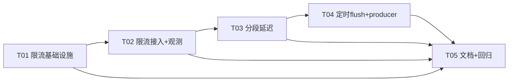

# 三项缺口设计 — 历史完整记录

> **历史设计 / 实施记录**：本文件汇总"ASR/TTS 推理并发闸门、TTFA 分段延迟指标、SentenceSplitter 定时 flush"三项缺口的设计、接线与实施记录（原 §0–8，架构师高见远，2026-10-13／实施 2026-10-14）。
> 其中的"缺口"、伪代码签名、文件数和任务优先级均以原记录时点为背景，不代表当前仍未实现，也不作为现状规范；实际行为需核对源码、测试与各模块维护说明。
> 文中形如 `AGENTS.md` §N 的引用指重组前的旧长文，不表示当前根目录 `AGENTS.md` 存在该章节；现行约定见[仓库指引](<../AGENTS.md>)。

## 当前实现入口

- [ASR/TTS 推理并发闸门](<../server/src/app/inference/AGENTS.md>)、[TTFA 分段延迟指标](<../server/src/app/metrics/AGENTS.md>)、[残句定时 flush](<../server/src/app/session/AGENTS.md#3-缺口③sentencesplitter-定时-flush>)：当前行为与维护约束。
- [会话维护](<../server/src/app/session/AGENTS.md>)、[应用层指引](<../server/src/app/AGENTS.md>)：跨模块装配与观测边界。

## §0–3 正文位置

| 原章节范围 | 正文与内容 |
|---|---|
| §0–1 | [ASR/TTS 推理并发闸门设计](<../server/src/app/inference/AGENTS.md>)：总览、跨会话限流问题、InferenceGates 方案、数据结构与接口、ASR 序列图。 |
| §2 | [TTFA 分段指标设计](<../server/src/app/metrics/AGENTS.md>)：被动采集要点、事件与聚合接口、会话埋点接线及回复分段序列图。 |
| §3 | [残句定时 flush 设计](<../server/src/app/session/AGENTS.md#3-缺口③sentencesplitter-定时-flush>)：定时器位置取舍、配置与默认值、数据结构与接口、watchdog 序列图。 |

§4–8 为当时的接线清单、任务拆分与遗留决策，正文如下。

---

## 4. 文件列表

### 新增（4 个）

| 文件 | 内容 |
|---|---|
| `server/src/app/inference.rs` | `InferenceGates` + `acquire_with_abort` + 计数/日志（缺口①核心，~150 行） |
| `server/src/app/inference/tests.rs` | 闸门单测：许可排队/释放、abort 打断、reconfigure、stats（`tokio::test`） |
| `server/src/app/session/producer.rs` | LLM 生产者 + 分句泵抽取（`spawn_llm_producer`，~100 行） |
| `server/src/app/metrics/tests.rs` | `/api/metrics` 快照形状回归（latency 节、老字段不变、分位单调） |

### 修改（16 个）

| 文件 | 改动 | 缺口 |
|---|---|---|
| `server/src/engine.rs` | 挂 `inference` 字段；`refresh_tts` 成功后 `reconfigure_tts`；`//!` 预算段补闸门说明 | ① |
| `server/src/plugins/asr/mod.rs` | `AsrConfig.max_concurrent`（default 1，clamp） | ① |
| `server/src/plugins/tts/mod.rs` | `TtsConfig.max_concurrent`（default 1，clamp） | ① |
| `server/src/plugins/llm/mod.rs` | `LlmConfig.sentence_flush_ms`（default 1500，clamp [0,60000]） | ③ |
| `server/src/plugins/registry/fields.rs` | 3 条 `FieldSchema`（asr.max_concurrent / tts.max_concurrent / llm.sentence_flush_ms） | ①③ |
| `server/src/app/session.rs` | `asr_recognize` 加闸门参数并过闸；trace 创建/传递（必要时下移 `f32_to_i16_16k` 控行数） | ①② |
| `server/src/app/session/observe.rs` | `emit_turn_latency` 辅助 | ② |
| `server/src/app/session/reply.rs` | gate 透传、trace 埋点与 emit、producer 抽取后瘦身 | ①②③ |
| `server/src/app/prefetch.rs` | `spawn_sentence_prefetch` 加 `tts_gate` + `first_pcm` hook；缓存未命中才过闸 | ①② |
| `server/src/app/session/bench.rs` | `asr_test`（经 `asr_recognize` 自动过闸）/ `tts_test` 过闸 | ① |
| `server/src/app/bench_api.rs` | `run_tts_bench` 过闸（签名加 gate） | ① |
| `server/src/app/events.rs` | `TurnLatency` 变体 + `TurnStages`/`TurnTrace` | ② |
| `server/src/app/metrics.rs` | 阶段窗口聚合 + p90/p99 + `latency` 节 | ② |
| `server/src/app/ws/metrics.rs` | 端点合并 `inference_gates` 节 | ① |
| `server/src/app/splitter.rs` | `last_feed`/`take_expired`/`flush_deadline` + `spawn_flush_watchdog` | ③ |
| `server/src/app/splitter/tests.rs` | 新增用例（见 §7 T04） | ③ |
| `server/config.example.toml` | 3 个新键注释示例 | ①③ |
| `AGENTS.md` | §5.2c 附近补"推理闸门"一小节（构建护栏不变） | ①②③ |

（可选后续，不在本批：`client/shared/.../OpsState.kt`/`OpsPages.kt` 渲染 `latency`/`inference_gates`。）

---

## 5. 类图

```mermaid
classDiagram
    class Engines {
        +asr: Arc~dyn AsrEngine~
        +inference: InferenceGates
        +event_bus: EventBus
        +metrics: Metrics
        +refresh_tts(fresh)
        +refresh_from_disk() Vec~String~
    }
    class InferenceGates {
        -asr: Gate
        -tts: Gate
        +new(cfg: &Config)
        +asr() Arc~Semaphore~
        +tts() Arc~Semaphore~
        +reconfigure_tts(permits: u32)
        +stats_json() Value
    }
    class Gate {
        -sem: RwLock~Arc~Semaphore~~
        -permits: AtomicUsize
        -counters: GateCounters
    }
    class GateCounters {
        +wait_events: AtomicU64
        +wait_ms_total: AtomicU64
        +wait_ms_max: AtomicU64
    }
    class acquire_with_abort {
        <<fn>> (sem, abort) -> Option~OwnedSemaphorePermit~
    }
    class EventBus {
        +emit(e: ServerEvent)
        +subscribe() Receiver
    }
    class ServerEvent {
        <<enum>>
        +TurnLatency{stages, interrupted}
    }
    class TurnTrace {
        -anchor: &'static str
        -t0: Instant
        -inner: Mutex~TurnStages~
        +new(anchor) Arc~Self~
        +mark_asr_end()
        +mark_llm_first_token()
        +mark_sentence_ready()
        +mark_tts_first_pcm()
        +mark_first_audio()
        +snapshot() TurnStages
    }
    class TurnStages {
        +anchor: &'static str
        +asr_end_ms: Option~u64~
        +llm_first_token_ms: Option~u64~
        +sentence_ready_ms: Option~u64~
        +tts_first_pcm_ms: Option~u64~
        +first_audio_ms: Option~u64~
    }
    class Metrics {
        +observe(e: &ServerEvent)
        +snapshot_json() Value
    }
    class SentenceSplitter {
        -buf: String
        -last_feed: Option~Instant~
        +feed(delta) Vec~String~
        +flush() Vec~String~
        +take_expired(now, wait) Option~String~
        +flush_deadline(wait) Option~Instant~
    }
    class spawn_flush_watchdog {
        <<fn>> (shared, tx, abort, done, notify, wait)
    }
    class spawn_llm_producer {
        <<fn>> (llm, history, user, prompt, abort, trace, wait) LlmProducer
    }
    class spawn_sentence_prefetch {
        <<fn>> (abort, cache, budget, tts_gate, first_pcm, resolve, sentences) Receiver
    }

    Engines *-- InferenceGates : 挂载
    InferenceGates *-- Gate : asr/tts 各一
    Gate *-- GateCounters
    Engines *-- EventBus
    Engines *-- Metrics
    EventBus ..> ServerEvent : 扇出
    ServerEvent *-- TurnStages : TurnLatency 负载
    TurnTrace *-- TurnStages : snapshot
    Metrics ..> ServerEvent : 订阅聚合
    spawn_llm_producer ..> SentenceSplitter : Arc~Mutex~ 共享
    spawn_llm_producer ..> spawn_flush_watchdog : spawn
    spawn_llm_producer ..> TurnTrace : mark llm/sentence
    spawn_sentence_prefetch ..> Gate : acquire_with_abort
    spawn_sentence_prefetch ..> TurnTrace : first_pcm hook 间接
```

---

## 6. 任务列表（供工程师直接执行，按序）

> 遵守：每任务 ≥3 文件、逻辑文件 ≤600 行、测试外置 `<name>/tests.rs`、改配置段同步注册表元数据。

### T01 限流基础设施（闸门模块 + 配置面 + Engines 接线）——P0
- **文件**：`app/inference.rs`(新)、`app/inference/tests.rs`(新)、`engine.rs`、`plugins/asr/mod.rs`、`plugins/tts/mod.rs`、`plugins/registry/fields.rs`、`config.example.toml`
- **内容**：`InferenceGates`/`acquire_with_abort`/计数日志；两个配置字段（default 1 + normalize clamp + 注册表元数据 + example 注释）；`Engines` 挂载与 `refresh_tts` 对账；单测（排队/释放/abort/reconfigure/stats_json 形状）。
- **依赖**：无（基础设施任务）
- **验收**：`cargo test` 全绿（默认 feature）；`DOCS_RS=1 cargo check --features sherpa` 通过；`registry/tests.rs::field_keys_exist_in_config` 不红。

### T02 限流接入全部调用点 + 观测出口 ——P0（依赖 T01）
- **文件**：`app/session.rs`、`app/prefetch.rs`、`app/session/reply.rs`、`app/session/bench.rs`、`app/bench_api.rs`、`app/ws/metrics.rs`（+ `app/prefetch/tests.rs` 补一条"闸门串行"用例）
- **内容**：5 个调用点按 §1.3 表格接线（ASR 裸 acquire、TTS abort 感知、缓存命中不过闸、permit move 进闭包）；`/api/metrics` 合并 `inference_gates` 节。
- **验收**：单测证明两路并发合成经闸门串行（用假 `TtsEngine` 计数）；`/api/metrics` JSON 老字段逐一不变（新增节 additive）。

### T03 分段延迟：事件 + 聚合 + 埋点 ——P1（依赖 T02，共享 reply.rs）
- **文件**：`app/events.rs`、`app/metrics.rs`、`app/metrics/tests.rs`(新)、`app/session/observe.rs`、`app/session.rs`（+ `app/session/reply.rs` 埋点、`app/prefetch.rs` first_pcm hook）
- **内容**：`TurnLatency`/`TurnStages`/`TurnTrace`；metrics 阶段窗口 + p90/p99 + `latency` 节；四条链路（语音/注入/canned/AIUI）埋点与 emit。
- **验收**：`metrics/tests.rs` 断言快照形状（latency 各节字段、分位单调、老字段不变）；`events` 无订阅者时 emit 不 panic（既有语义保持）。

### T04 SentenceSplitter 定时 flush + producer 抽取 ——P1（依赖 T03，reply.rs 重排）
- **文件**：`app/splitter.rs`、`app/splitter/tests.rs`、`app/session/producer.rs`(新)、`app/session/reply.rs`、`plugins/llm/mod.rs`、`plugins/registry/fields.rs`
- **内容**：`last_feed`/`take_expired`/`flush_deadline` + watchdog；`LlmConfig.sentence_flush_ms` + 元数据；producer 从 reply.rs 抽出并接 watchdog 与 trace 埋点。
- **验收**：splitter 单测（纯函数语义：过期判定/喂入刷新/flush 不变）；watchdog 集成测（`#[tokio::test(start_paused=true)]`：停顿出残句、done/abort 退出、0=不 spawn）；`grep` 护栏（无内联 `mod tests`、≤600 行）通过。

### T05 文档同步 + 管理页展示（可选）+ 全量回归 ——P1（依赖 T01–T04）
- **文件**：`AGENTS.md`、`docs/gap-implementation-design.md`（状态勾选）、`client/shared/commonMain/.../OpsState.kt` + `OpsPages.kt`（可选，渲染 latency/inference_gates；不做也不影响服务端验收）
- **内容**：AGENTS.md 补"推理闸门"小节（与 `engine.rs //!` 呼应）；全量回归。
- **验收命令**（AGENTS §3）：
  ```bash
  ~/.cargo/bin/cargo test --config 'source.ustc.registry="sparse+https://mirrors.ustc.edu.cn/crates.io-index/"'
  DOCS_RS=1 ~/.cargo/bin/cargo check --features sherpa --config 'source.ustc.registry="sparse+https://mirrors.ustc.edu.cn/crates.io-index/"'
  ~/.cargo/bin/cargo test --features sherpa --config '...'   # 有模型环境时
  grep -rnE 'mod[[:space:]]+tests[[:space:]]*\{' server/src --include=*.rs          # 应无输出
  find server/src -name '*.rs' -exec wc -l {} + | awk '$1>600 && $2!="total"'       # 应无输出
  python3 server/tests/mock_client.py   # 联调（协议零改动，断言序列不变）
  ```

### 依赖图



---

## 7. 共享知识（跨文件约定，工程师必读）

1. **Semaphore 获取/释放模式**：一律 `gate.clone().acquire_owned().await`（cancel-safe），permit **move 进 `spawn_blocking` 闭包**或随作用域 RAII 归还——绝不手工 release。TTS 侧用 `acquire_with_abort`（200ms 轮询，对齐 `sender.rs::POLL_MS`）；ASR 侧裸 acquire（不查 abort，理由见 §6 待明确 #5）。**等上一句 `prev` 时不得持许可**；缓存命中不得过闸。
2. **事件字段命名**：阶段一律 `snake_case` + `_ms` 后缀（`asr_end_ms`…）；锚点字符串常量集合 `{"speech_end","inject","canned","aiui"}`，**唯一权威在 `events.rs`**。
3. **时间戳口径**：`std::time::Instant` 单调钟；t0 = 锚点事件时刻；各 mark 只在 `None→Some` 时写入（first-only）；`/api/metrics` 展示的是"相对锚点偏移"，不是墙钟。
4. **`/api/metrics` 兼容纪律**：只增键不改老键、不改老键语义；`note` 文案更新允许。
5. **协议零改动**：本设计不触碰 `protocol.rs`（无 serde 小写风险、`mock_client.py` 断言序列不变）。
6. **配置段纪律**：新字段必须同步 `registry/fields.rs` 元数据（否则 schema 缺项、hot 判定保守）；默认值只写在 serde `default_*()` 函数（`default_hint` 仅展示）。
7. **文件规模**：逻辑文件 ≤600 行、测试外置；`reply.rs` 靠 producer 抽出控行数，`session.rs` 必要时下移 `f32_to_i16_16k`。
8. **构建/测试命令**：一律按 AGENTS §3（`~/.cargo/bin/cargo` + USTC sparse 覆盖；sherpa 检查加 `DOCS_RS=1`）。
9. **不自动提交**：完成后停在工作区。

---

## 8. 待明确事项（假设与遗留决策）

1. **许可数默认值的两种读法**：本设计取"并发推理线程总量 = num_threads 段预算"（默认 1 路）；若团队原意是"许可数 = num_threads"（ASR 默认 2、TTS 默认 4），改两个 serde default 即可，结构不变。**需 team-lead 拍板**。
2. **`tts_first_pcm` 缓存命中口径**：首句缓存命中轮该阶段为 `None`（零合成无从谈首 PCM），`first_audio_ms` 不受影响；JSON `note` 已说明。若希望填 `sentence_ready_ms` 同值占位，可在 `snapshot()` 一行内改。
3. **`speech_end` 作为锚点恒 0**：未采集"说话开始"（VAD 未暴露语音起点，`VadEngine::accept` 只回调切段）。如需真实 `speech_start`，需扩 VAD trait（超本批范围）。
4. **macApp 管理页展示**：服务端 JSON 已向后兼容；客户端渲染（latency 分位卡片 / 闸门排队计数）列为可选后续（T05 内可做可不做）。
5. **ASR 排队不响应 abort**：防止 stale abort 吞掉"打断后紧跟的新话语"（abort 只在 `stream_response` 入口复位，ASR 在其之前）。若要响应，需先把 abort 复位时机提前到 `recognize_segments` 之前——行为变更超出本缺口范围，未做。
6. **引擎热刷新（模型重建）未过闸门**：模型加载以 IO/分配为主且低频；纳入会造成"新会话建立"与"在飞推理"互卡。若实测发现重建挤占推理，再考虑给 `refresh_from_disk` 单独一把宽闸门。
7. **`inference_gates` 的瞬时重叠**：`reconfigure_tts` 换新 Semaphore 时，在飞 permit 持旧 Arc，切换瞬间并发上限短暂 = 新旧之和。频率极低（仅许可数变更时），接受。

---

实际并发配置、指标出口与 watchdog 行为以源码、测试及各模块维护说明为准；历史任务列表不作为可直接执行的现行修改清单。

返回[文档总索引](<README.md>)。
