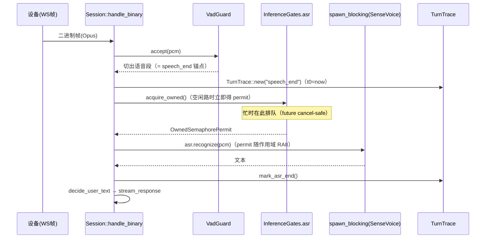
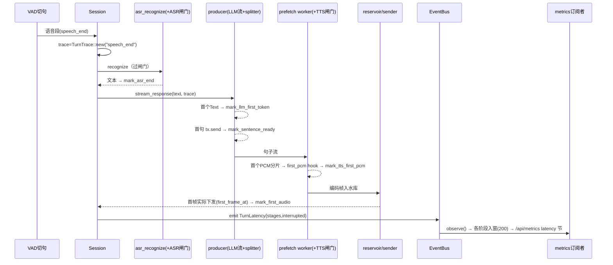
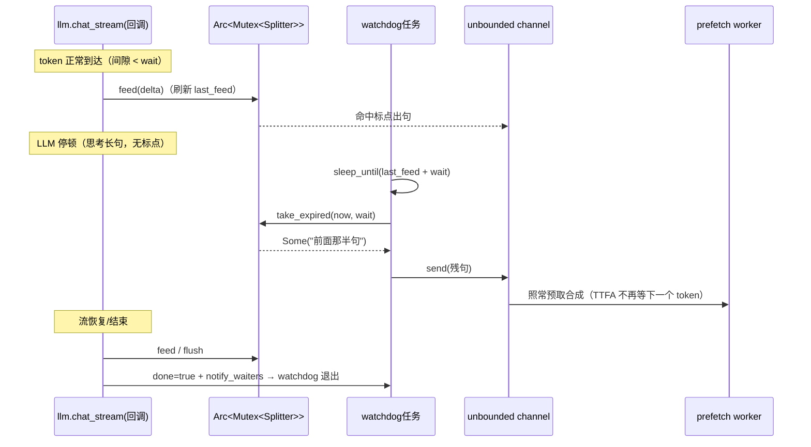
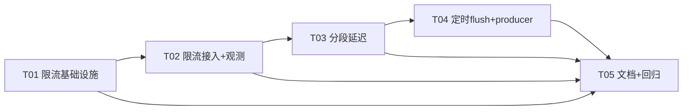

# 三项缺口实施方案（gap-implementation-design）

> 架构师：高见远（software-architect）｜日期：2026-10-13｜状态：✅ 已实施（2026-10-14，工程师寇豆码）
> 实施裁决：许可数默认值取读法 b（默认 1 路，`[asr]/[tts].max_concurrent`）；macApp 管理页渲染（T05 客户端部分）经 team-lead 裁决不做。
> 依据：2026-10-13 差距评估结论（三项真实缺口）+ 仓库 `AGENTS.md` 全部约束。
> 哲学：**最小方案、零新增依赖**（tokio `sync`/`time` 已在 `features=["full"]` 内）、贴合现有代码结构、不动协议枚举（`protocol.rs` 零改动，无 serde 小写风险）。

---

## 0. 总览

| 缺口 | 一句话方案 | 新增依赖 | 优先级 |
|---|---|---|---|
| ① ASR/TTS 跨会话推理限流 | `Engines` 上挂 `InferenceGates`（ASR/TTS 各一把 `tokio::sync::Semaphore`），包在现有 5 个 `spawn_blocking` 调用点外；许可数可配、TTS 随热切换对账；排队等待进 `/api/metrics` | 无 | P0 |
| ② TTFA 分段被动指标 | 事件总线新增 `ServerEvent::TurnLatency`（阶段偏移量），metrics 订阅者聚合 P50/P90/P95/P99；`/api/metrics` **只增不改** | 无 | P1 |
| ③ SentenceSplitter 定时 flush | splitter 记录 `last_feed`，**独立 watchdog 任务**在"距上一 token ≥ N ms 且残句非空"时倒出残句；N 走 `[llm].sentence_flush_ms`（默认 1500，0=关） | 无 | P1 |

三项互不耦合（除共享 `reply.rs` 文件，按任务顺序串行编辑即可）。

---

## 1. 缺口①：ASR/TTS 跨会话推理限流

### 1.1 问题与难点

- 四大引擎的重推理是同步 CPU 密集调用，统一经 `spawn_blocking` 隔离（`session.rs:63-73` 的 `blocking_result`、ASR `session.rs:295-301`、TTS `prefetch.rs:349-366`、测试台 `bench.rs:105/199`、`bench_api.rs:212`）。
- `spawn_blocking` **无并发上限**：tokio 的 blocking 池默认上限 512 线程。多设备同时说话 = 多路 ASR（各 `num_threads=2`）+ 多路 TTS（各 `num_threads=4`）同时压上 4 核小主机 → CPU 超订，延迟雪崩。
- 线程预算已分段（`engine.rs //!`：tokio 2 + ASR 2 + TTS 4 + VAD 1 + docker cpus 3.5）——**该预算只在"每能力同时 1 路推理"时成立**，信号量就是把这条隐含前提变成显式约束。
- 全库 Semaphore 仅有两处在用：VAD 池（`plugins/vad/pool.rs:26,47,60`，`acquire_owned` + RAII `VadGuard`）与音色探测（`app/voices.rs:150`，固定并发 2）。本方案复用 **VAD 池的范式**：`Arc<Semaphore>` + `acquire_owned()` + permit 随闭包 Drop 归还。

### 1.2 方案：`InferenceGates`（新模块 `server/src/app/inference.rs`）

**Semaphore 放哪一层**：挂在 `Engines` 上（与 `vad_pool`、`tts_cache` 同性质的进程级共享资源）。理由：

1. 引擎热切换（`Engines::refresh_from_disk` / `refresh_tts_from_disk`）替换的是 `Arc<dyn TtsEngine>` 实例，**闸门不随引擎走**——限的是"并发推理路数"，与具体引擎实现无关（本地 Kokoro 换讯飞在线也一样要防测试台打爆）；
2. 调用点（session / prefetch worker / bench / bench_api）都已持有 `Arc<Engines>` 或能拿到，接线成本低；
3. 许可数跟随配置变化：ASR 段是 `RestartOnly`（闸门许可启动时定死即可）；TTS 段是 `NextSession`——在 `refresh_tts` 成功路径里调 `reconfigure_tts(fresh.tts.max_concurrent)` 对账（许可数变了就换新 Semaphore；在飞permit 持旧 Arc，最多短暂多放行一路，可接受并注释说明）。

**许可数默认值（关键取舍）**：`[asr].max_concurrent = 1`、`[tts].max_concurrent = 1`（均可配）。

> 取舍论证：差距评估原文"ASR 并发与 num_threads 同数"存在两种读法——(a) 许可数 = num_threads（ASR=2 路 × 2 线程 = 4 线程）；(b) **并发推理的线程总量与 num_threads 预算同数**（1 路 × 2 线程 = 2 线程，恰等于 `engine.rs //!` 预算表里"ASR 识别 2 线程 / TTS 合成 4 线程"的段预算）。本设计取 (b)：读法 (a) 在 4 核机上仅 ASR 一项就要 4 线程，直接击穿已声明的预算分段，与该缺口"防 CPU 超订"的动机矛盾。默认 1 已把行为收敛进预算；算力富余的部署（如换了大主机、或 TTS 用讯飞在线这类网络型引擎）改配置即可放宽，无需改代码。已列入 §6 待明确 #1。

**获取/释放模式（跨文件统一约定）**：

```text
let gate = engines.inference.asr();          // clone Arc<Semaphore>，开销可忽略
let _permit = gate.acquire_owned().await;    // 排队等待；future 被 drop 即取消（cancel-safe）
blocking_result(move || { ... 推理 ... })     // permit 在闭包/作用域结束时 RAII 归还
```

**与 abort 语义协同（不对称，刻意为之）**：

- **TTS 侧**：等待可被 abort 打断。提供 `acquire_with_abort(sem, abort)`：`select!` 200ms 轮询 `Arc<AtomicBool>`（粒度对齐 `downlink/sender.rs::POLL_MS` 的既有栽培轮询范式）。prefetch worker 本来就在每句合成前轮询 abort，排队期同样响应，打断后不白等。
- **ASR 侧**：**不**响应 abort，用裸 `acquire_owned().await`。理由：`abort` 只在 `stream_response` 入口复位（`reply.rs:132`），而 ASR 发生在它**之前**——上一轮打断遗留的 stale `abort=true` 会让"打断后立刻说的新话语"在排队时被静默丢弃，这正是 barge-in 最常见的行为序列。现有代码在 ASR 路径也刻意不查 abort，本方案保持该语义（见 §6 待明确 #5）。

**测试台（bench）过不过闸门**：**过**。`bench.rs` 的 `asr_test`/`tts_test` 与 `bench_api.rs` 的 `run_tts_bench` 全部走同一把闸门——管理台测试台与生产会话共享 CPU，不过闸门等于给生产埋雷。AIUI 全链路（`aiui_segments` 的 `blocking_result`）是**云端闭环网络调用**，不吃本地 CPU，不过闸门；音色探测维持既有独立并发 2，不动。

**排队等待观测（双通道）**：

1. `InferenceGates` 内每能力一组 `AtomicU64`（`wait_events` / `wait_ms_total` / `wait_ms_max`），获取成功时若等待 ≥ 1ms 记账；≥ 100ms 追加一行 `tracing::info!`（含等待时长与许可数），否则 debug；
2. `/api/metrics` 新增 `inference_gates` 节（**additive**，老字段零改动）：由 `ws/metrics.rs` 端点把 `engines.metrics.snapshot_json()` 与 `engines.inference.stats_json()` 合并返回。

**引擎热刷新本身（sherpa 重建加载模型）不过闸门**：模型加载以 IO/分配为主、频率极低（会话建立时且签名变更才发生），纳入反而会让"新会话建立"与"在飞推理"互相卡（见 §6 待明确 #6）。

### 1.3 数据结构与接口（签名级伪代码）

```rust
// server/src/app/inference.rs（新文件）
//! 推理并发闸门（缺口①）：ASR/TTS 各一把 Semaphore，包在 spawn_blocking 外。
//! 范式对齐 plugins/vad/pool.rs：acquire_owned + permit RAII 归还。

use std::sync::{Arc, Mutex, RwLock};
use std::sync::atomic::{AtomicBool, AtomicU64, Ordering};
use std::time::{Duration, Instant};
use tokio::sync::{OwnedSemaphorePermit, Semaphore};

/// 等待轮询粒度（对齐 downlink/sender.rs::POLL_MS 的 abort 栽培轮询语义）。
const ABORT_POLL_MS: u64 = 200;
/// 排队 ≥ 该值打 info 日志（低于只记账）。
const LOUD_WAIT_MS: u64 = 100;

#[derive(Default)]
struct GateCounters {
    wait_events: AtomicU64,
    wait_ms_total: AtomicU64,
    wait_ms_max: AtomicU64,
}

struct Gate {
    sem: RwLock<Arc<Semaphore>>,
    permits: AtomicUsize,          // 当前许可数（对账/展示用）
    counters: GateCounters,
}

/// 进程级推理闸门：挂在 Engines 上，跨会话共享。
pub struct InferenceGates { asr: Gate, tts: Gate }

impl InferenceGates {
    /// 启动时按配置构造（asr.max_concurrent / tts.max_concurrent，均 clamp ≥ 1）。
    pub fn new(cfg: &Config) -> Self;
    /// 取当前 ASR 闸门（clone Arc，调用方 acquire_owned）。
    pub fn asr(&self) -> Arc<Semaphore>;
    /// 取当前 TTS 闸门。
    pub fn tts(&self) -> Arc<Semaphore>;
    /// TTS 热切换对账（Engines::refresh_tts 成功路径调用）：
    /// 许可数变化 → 换新 Semaphore（在飞 permit 持旧 Arc，短暂重叠可接受）。
    pub fn reconfigure_tts(&self, permits: u32);
    /// /api/metrics 合并用投影（additive）。
    pub fn stats_json(&self) -> serde_json::Value;
}

/// 记账后返回 permit；内部在获取成功时更新 counters + 日志。
async fn acquire_counted(gate: &Gate) -> OwnedSemaphorePermit;

/// abort 感知获取（仅 TTS 侧用）：200ms 轮询 abort，置位即放弃（返回 None）。
/// 取消安全：select 竞争失败只是放弃等待，不丢许可。
pub async fn acquire_with_abort(
    sem: &Arc<Semaphore>,
    abort: &AtomicBool,
) -> Option<OwnedSemaphorePermit>;
```

**配置字段（新增 2 个）**：

```rust
// plugins/asr/mod.rs :: AsrConfig 追加
/// 同时进行的 ASR 推理路上限（排队背压）。默认 1：每路 num_threads=2，
// 恰等于 engine.rs 预算表的 ASR 段线程预算；算力富余可放宽。
#[serde(default = "default_one")]
pub max_concurrent: u32,          // default_one() -> 1；normalize clamp ≥1

// plugins/tts/mod.rs :: TtsConfig 追加
/// 同时进行的 TTS 合成路上限。默认 1（本地 Kokoro 每路 4 线程 = 段预算）；
// 讯飞在线为网络型引擎，多设备部署建议 2~4。
#[serde(default = "default_one")]
pub max_concurrent: u32,          // normalize clamp ≥1
```

注册表字段元数据（`plugins/registry/fields.rs`）同步 2 条：
- `["asr"].max_concurrent`：Int，default_hint "1"，hot = `RestartOnly`（与 ASR 段一致）；
- `["tts"].max_concurrent`：Int，default_hint "1"，hot = `NextSession`（随 TTS 热切换对账），help 写明"本地引擎每路占 num_threads 线程；在线引擎可放宽"。

**调用点改造（5 处）**：

| 调用点 | 改法 |
|---|---|
| `session.rs::asr_recognize` | 关联函数加参 `asr_gate: Arc<Semaphore>`；内部先 `acquire_counted`（裸 await，不查 abort）再 `blocking_result`。两个调用方（`recognize_segments`、`bench.rs::handle_asr_test`）都传 `self.engines.inference.asr()` |
| `prefetch.rs::spawn_sentence_prefetch` | 签名加 `tts_gate: Arc<Semaphore>`；worker 循环内**缓存未命中**才 `acquire_with_abort`（缓存命中零合成不过闸），permit move 进 `spawn_blocking` 闭包随推理结束归还；**不要**在等上一句 `prev` 时持许可 |
| `reply.rs::spawn_prefetch` | 透传 `self.engines.inference.tts()` |
| `bench.rs::handle_tts_test` | producer `spawn_blocking` 前 `acquire_with_abort`，permit move 进闭包 |
| `bench_api.rs::run_tts_bench` | 签名加 `tts_gate: Arc<Semaphore>`（两个调用方 `bench_tts` 都从 `engines` 取），同上 |

**`Engines` 接线（`engine.rs`，净增 ~12 行）**：

```rust
pub struct Engines {
    ...
    /// 推理并发闸门（缺口①）：ASR/TTS 各一把，见 app/inference 模块注释。
    pub inference: crate::app::inference::InferenceGates,
}
// Engines::new：inference: InferenceGates::new(config)
// refresh_tts 成功替换引擎后：self.inference.reconfigure_tts(fresh.tts.max_concurrent);
```

### 1.4 序列图（ASR 限流）



---

## 2. 缺口②：TTFA 分段被动指标

### 2.1 设计要点

- **接缝现成**：`metrics.rs:10-12` 已注明"在 reply.rs 的流式回调处补事件字段即可（订阅者无需改 session）"。本方案照做：事件总线新增一个变体，会话侧只 `emit`，聚合在 metrics 订阅者。
- **阶段与锚点**：采集 6 个里程碑。**锚点（t0）= speech_end**（VAD 切句、即将送 ASR 的时刻；注入轮 = 文本到达，canned = 兜底/问候语入口，AIUI = 段落起点）。各阶段记录为**相对锚点的毫秒偏移**（`Instant` 单调钟，mark 时刻才算 elapsed）。`speech_end` 本身即锚点（偏移恒 0），在事件里以 `anchor` 字段显式标注，不单列数值（理由见 §6 待明确 #3）。
- **采集点**（全部为已有代码的现成位置，只加一行 mark）：

| 阶段 | 采集位置 | 说明 |
|---|---|---|
| anchor=t0 | `recognize_segments` 每段循环入口 `Instant::now()`（与 VAD 回调同 tick，误差微秒级） | 语音轮 |
| `asr_end_ms` | `asr_recognize` Ok 之后 | |
| `llm_first_token_ms` | producer 回调首个 `LlmEvent::Text` | |
| `sentence_ready_ms` | producer 首个句子 `tx.send`（含定时 flush 出的残句） | |
| `tts_first_pcm_ms` | 首个**非缓存**句的首个 PCM 分片回调（prefetch 内 hook） | 缓存命中轮为 `None`（零合成），`first_audio_ms` 仍采集 |
| `first_audio_ms` | `drain_prepared` 拿到 `first_frame_at` 后（`sender.rs` 已有该 out-param，零改动） | 即既有 TTFA 日志口径 |

- **向后兼容**：`ServerEvent` 是进程内 enum（broadcast），加变体只影响本仓订阅者（metrics.rs，同 PR 更新）；`/api/metrics` JSON **只增不改**——新增 `latency` 节与 `turns.elapsed_p90_ms/p99`，老字段（`elapsed_p50_ms` 等）原样保留。macApp 管理页可后续按需渲染（见 §6 待明确 #4）。
- **窗口与分位**：各阶段样本各自环形窗口（复用 `TURN_WINDOW=200`）；分位统一 p50/p90/p95/p99/max（`pick` 向上取整位函数已有，扩一档 q 值即可）。

### 2.2 数据结构与接口

```rust
// server/src/app/events.rs 追加（含负载与共享记录器，字段命名单一权威在此）

/// 一轮对话的分段延迟快照（事件负载；全部为相对 anchor 的毫秒偏移）。
#[derive(Clone, Debug)]
pub struct TurnStages {
    /// 锚点语义："speech_end" | "inject" | "canned" | "aiui"
    pub anchor: &'static str,
    pub asr_end_ms: Option<u64>,
    pub llm_first_token_ms: Option<u64>,
    pub sentence_ready_ms: Option<u64>,
    pub tts_first_pcm_ms: Option<u64>,
    pub first_audio_ms: Option<u64>,
}

/// 分段延迟记录器：Arc 共享， producer/合成回调/发送端各自 mark（first-only 语义）。
pub struct TurnTrace {
    anchor: &'static str,
    t0: Instant,
    inner: Mutex<TurnStages>,   // 各字段 mark 时 None→Some(elapsed)，只记首次
}

impl TurnTrace {
    pub fn new(anchor: &'static str) -> Arc<Self>;
    pub fn mark_asr_end(&self);            // 以下 mark 均 first-only、瞬时持锁
    pub fn mark_llm_first_token(&self);
    pub fn mark_sentence_ready(&self);
    pub fn mark_tts_first_pcm(&self);
    pub fn mark_first_audio(&self);
    pub fn snapshot(&self) -> TurnStages;
}

// ServerEvent 新变体（追加在 enum 末尾）：
//   TurnLatency { session_id: String, device_id: String,
//                 stages: TurnStages, interrupted: bool }
```

```rust
// server/src/app/metrics.rs :: Inner 追加
struct StageWindows {
    asr_end_ms: VecDeque<u64>,
    llm_first_token_ms: VecDeque<u64>,
    sentence_ready_ms: VecDeque<u64>,
    tts_first_pcm_ms: VecDeque<u64>,
    first_audio_ms: VecDeque<u64>,
}
// observe() 增匹配臂：ServerEvent::TurnLatency → 各 Some(ms) 分别入窗（窗口 200）
// snapshot_json() 追加（additive）：
//   "turns": { ..., "elapsed_p90_ms": pick(0.90), "elapsed_p99_ms": pick(0.99), ... }
//   "latency": {
//     "note": "各阶段相对锚点（speech_end/inject/canned/aiui）的毫秒偏移；缓存命中轮 tts_first_pcm 为空",
//     "asr_end_ms":        { p50,p90,p95,p99,max,samples },
//     "llm_first_token_ms":{...}, "sentence_ready_ms":{...},
//     "tts_first_pcm_ms":  {...}, "first_audio_ms":{...}
//   }
```

### 2.3 埋点接线（保持 session.rs 净增最小）

- `session/observe.rs` 新增两个辅助（埋点横切，具名收敛——与 `note_*` 同理）：

```rust
impl<'a, T: Transport> Session<'a, T> {
    /// 会话内统一的分段延迟事件出口（含 session_id/device_id 取值口径）。
    pub(super) fn emit_turn_latency(&self, trace: &Arc<TurnTrace>, interrupted: bool) {
        self.engines.event_bus.emit(ServerEvent::TurnLatency {
            session_id: self.session_id.clone(),
            device_id: self.device_id.clone(),
            stages: trace.snapshot(),
            interrupted,
        });
    }
}
```

- `session.rs`：`recognize_segments` 每段创建 `trace`（anchor="speech_end"）→ `asr_recognize` Ok 后 `mark_asr_end` → 显式传参 `stream_response(&user_text, trace.clone())`（签名加一个参数，优于隐藏字段）；`aiui_segments`/`aiui_downlink` 同法（anchor="aiui"，只采 `first_audio_ms`）；`handle_inject`（anchor="inject"，无 asr/sentence 阶段）。
- `reply.rs`：producer 回调 mark `llm_first_token`/`sentence_ready`；`drain_prepared` 拿到 `first_frame_at` 后 mark `first_audio`；`stream_response` 各结束分支（正常 / LLM 失败兜底前）`emit_turn_latency`；`speak_canned` 自建 trace（anchor="canned"）只采 `first_audio_ms` 并 emit——兜底/问候语与正常回复各自成事件，靠 anchor 区分。
- `prefetch.rs`：`spawn_sentence_prefetch` 签名加 `first_pcm: Option<Arc<dyn Fn() + Send + Sync>>`（由 reply.rs 传捕获 trace 的闭包；闭包内用捕获的 `AtomicBool` 保证只调一次，避免每分片加锁）。prefetch 不 import events 类型——保持通用流水线与观测解耦。
- **若 session.rs 因此超 600 行**：顺带把纯函数 `f32_to_i16_16k` 下移到 `app/audio`（行为不变搬移，遵守 §5.10）。

### 2.4 序列图（一轮语音回复的分段采集）



---

## 3. 缺口③：SentenceSplitter 定时 flush

### 3.1 定时器位置取舍（核心论证）

现状：producer 是 `tokio::spawn` 的 async 任务，但**句子产出发生在同步回调里**（`llm.chat_stream` 的 `Box<dyn FnMut(LlmEvent)->bool>`，reply.rs:174-184 内 `splitter.feed(&delta)` 即时推 unbounded channel）。候选方案：

| 方案 | 结论 |
|---|---|
| A. **producer 旁挂独立 watchdog 任务**（`tokio::time::sleep_until` 到期检查共享 splitter） | ✅ 采用 |
| B. 回调内自判 | ❌ 回调只在 token 到达时执行——"停顿"期间根本没有代码在跑，物理上无法触发 |
| C. 消费者侧（prefetch worker）定时拉取 | ❌ 消费者看不到 splitter 的残句 buffer；除非也共享状态——那等于 A 却把 splitter 内部泄露给 prefetch，耦合更差 |
| D. 把 `chat_stream` 改成 async 事件循环 | ❌ 侵入引擎 trait 与实现（openai SSE 解析），为一个小功能动大接口，违反最小方案 |

方案 A 细节：`SentenceSplitter` 提到 `Arc<Mutex<..>>` 共享（回调与 watchdog 各自瞬时持锁、锁内无 await，`std::sync::Mutex` 足够）；watchdog 由 producer 侧 spawn，持有 `tx` 克隆：

- **sleep 目标**：`splitter.flush_deadline(wait)` = `last_feed + wait`（残句为空则 `None` → 只等 notify/500ms 兜底轮询）；
- **到期动作**：`take_expired(now, wait)` 返回残句（非空且静默 ≥ wait 才给）→ `tx.send`（消费者已退出则 `send` Err → watchdog 退出）；
- **误醒无害**：新 token 刷新了 `last_feed` → 到期重算 deadline 继续睡（每次停顿至多多醒一次）；
- **终止**：三个条件——producer 结束（置 `done: Arc<AtomicBool>` + `Notify::notify_waiters`，watchdog 收到即退）、`abort` 置位（select 侧轮询/醒来检查即退）、`tx.is_closed()`。Notify 与检查之间存在微小竞态窗口时，最坏多睡一个 `wait` 周期（≤ 上限 60s 内、默认 1.5s）后自行退出，可接受并注释；
- **abort 后不再出句**：watchdog 醒来先查 `done/abort` 再 `take_expired`，顺序保证打断后不追加残句。

### 3.2 配置与默认值

```rust
// plugins/llm/mod.rs :: LlmConfig 追加
/// 残句定时出句等待（毫秒）：LLM 流距上一 token 静默 ≥ 此值且残句非空时，
/// 先把残句送 TTS（TTFA 上界收紧；思考型停顿不再无限等标点或 50 字硬切）。
/// 0 = 关闭（回退现行为）。默认 1500：比常见 inter-token 间隙（20~100ms，
// 偶发 300~800ms）高一个量级，避免误切；normalize clamp 到 [0, 60000]。
#[serde(default = "default_sentence_flush_ms")]
pub sentence_flush_ms: u32,        // fn default_sentence_flush_ms() -> u32 { 1500 }
```

- 热生效：`NextSession`（`stream_response` 每轮从 `self.eff_config` 现读；仅**全局**生效——该键不在设备 overlay 白名单，`config/overlay.rs` 的 llm 段只放行 system_prompt/max_history）；`fields.rs` 的 LLM 字段表同步 1 条元数据。
- `config.example.toml` 加注释示例。
- 取值权衡写进 help：调小 → TTFA 更稳但残句更碎（中文 TTS 对碎片句韵律可接受）；调大 → 行为趋近现状。

### 3.3 数据结构与接口

```rust
// server/src/app/splitter.rs 扩展（纯同步逻辑 + watchdog）
pub struct SentenceSplitter {
    buf: String,
    /// 上次 feed 时刻（定时 flush 判定；None = 还没喂过）
    last_feed: Option<Instant>,
}

impl SentenceSplitter {
    pub fn new() -> Self;
    /// 喂增量（内部记录 last_feed = now）；返回本次切出的完整句（0~N 句）。
    pub fn feed(&mut self, delta: &str) -> Vec<String>;          // 标点/50字硬切逻辑不变
    /// 流结束：倒出残句（不变）。
    pub fn flush(&mut self) -> Vec<String>;
    /// 定时 flush 判定（NEW，纯函数可单测）：静默 ≥ max_wait 且残句非空 →
    /// 取走残句（trim 后非空才返回），并刷新 last_feed（残句清空）。
    pub fn take_expired(&mut self, now: Instant, max_wait: Duration) -> Option<String>;
    /// 下一次到期时刻（NEW）：last_feed + max_wait；残句空/没喂过 → None。
    pub fn flush_deadline(&self, max_wait: Duration) -> Option<Instant>;
}

/// 残句看门狗（NEW）：producer 侧 spawn，到期把残句推入句子通道。
/// 退出三条件：done（producer 收工）/ abort / tx 关闭。锁内无 await。
pub(crate) fn spawn_flush_watchdog(
    shared: Arc<Mutex<SentenceSplitter>>,
    tx: tokio::sync::mpsc::UnboundedSender<String>,
    abort: Arc<AtomicBool>,
    done: Arc<AtomicBool>,
    finished: Arc<tokio::sync::Notify>,
    max_wait: Duration,
)
```

```rust
// server/src/app/session/producer.rs（新文件：从 reply.rs 抽出的 LLM 生产者 + 分句泵）
pub(super) struct LlmProducer {
    pub sentences: mpsc::UnboundedReceiver<String>,
    pub result: tokio::task::JoinHandle<anyhow::Result<crate::plugins::llm::LlmOutput>>,
}

/// 读 LLM 流 → 按句切分（含定时 flush watchdog）→ unbounded channel。
/// 回调内：abort 轮询（不变）+ 首 token/首句 trace 埋点（缺口②）。
pub(super) fn spawn_llm_producer(
    llm: crate::plugins::llm::Llm,
    history: Vec<(String, String)>,
    user: String,
    prompt: TurnPrompt,
    abort: Arc<AtomicBool>,
    trace: Arc<TurnTrace>,
    flush_wait: Duration,          // 0 = 不 spawn watchdog（回退现行为）
) -> LlmProducer
```

`reply.rs::stream_response` 改为调用 `spawn_llm_producer(...)`（`self.engines.llm()`、`self.abort`、trace、`Duration::from_millis(self.eff_config.llm.sentence_flush_ms)`），自身瘦身为编排层（LLM 失败兜底/历史/计量逻辑原样保留）。**顺带解决 reply.rs 行数**：缺口①②③在 reply.rs 的净增量被 producer 抽出抵消，最终 ~560 行（< 600 上限）。

### 3.4 序列图（定时 flush）



---

## 4. 文件列表

### 新增（4 个）

| 文件 | 内容 |
|---|---|
| `server/src/app/inference.rs` | `InferenceGates` + `acquire_with_abort` + 计数/日志（缺口①核心，~150 行） |
| `server/src/app/inference/tests.rs` | 闸门单测：许可排队/释放、abort 打断、reconfigure、stats（`tokio::test`） |
| `server/src/app/session/producer.rs` | LLM 生产者 + 分句泵抽取（`spawn_llm_producer`，~100 行） |
| `server/src/app/metrics/tests.rs` | `/api/metrics` 快照形状回归（latency 节、老字段不变、分位单调） |

### 修改（16 个）

| 文件 | 改动 | 缺口 |
|---|---|---|
| `server/src/engine.rs` | 挂 `inference` 字段；`refresh_tts` 成功后 `reconfigure_tts`；`//!` 预算段补闸门说明 | ① |
| `server/src/plugins/asr/mod.rs` | `AsrConfig.max_concurrent`（default 1，clamp） | ① |
| `server/src/plugins/tts/mod.rs` | `TtsConfig.max_concurrent`（default 1，clamp） | ① |
| `server/src/plugins/llm/mod.rs` | `LlmConfig.sentence_flush_ms`（default 1500，clamp [0,60000]） | ③ |
| `server/src/plugins/registry/fields.rs` | 3 条 `FieldSchema`（asr.max_concurrent / tts.max_concurrent / llm.sentence_flush_ms） | ①③ |
| `server/src/app/session.rs` | `asr_recognize` 加闸门参数并过闸；trace 创建/传递（必要时下移 `f32_to_i16_16k` 控行数） | ①② |
| `server/src/app/session/observe.rs` | `emit_turn_latency` 辅助 | ② |
| `server/src/app/session/reply.rs` | gate 透传、trace 埋点与 emit、producer 抽取后瘦身 | ①②③ |
| `server/src/app/prefetch.rs` | `spawn_sentence_prefetch` 加 `tts_gate` + `first_pcm` hook；缓存未命中才过闸 | ①② |
| `server/src/app/session/bench.rs` | `asr_test`（经 `asr_recognize` 自动过闸）/ `tts_test` 过闸 | ① |
| `server/src/app/bench_api.rs` | `run_tts_bench` 过闸（签名加 gate） | ① |
| `server/src/app/events.rs` | `TurnLatency` 变体 + `TurnStages`/`TurnTrace` | ② |
| `server/src/app/metrics.rs` | 阶段窗口聚合 + p90/p99 + `latency` 节 | ② |
| `server/src/app/ws/metrics.rs` | 端点合并 `inference_gates` 节 | ① |
| `server/src/app/splitter.rs` | `last_feed`/`take_expired`/`flush_deadline` + `spawn_flush_watchdog` | ③ |
| `server/src/app/splitter/tests.rs` | 新增用例（见 §7 T04） | ③ |
| `server/config.example.toml` | 3 个新键注释示例 | ①③ |
| `AGENTS.md` | §5.2c 附近补"推理闸门"一小节（构建护栏不变） | ①②③ |

（可选后续，不在本批：`client/shared/.../OpsState.kt`/`OpsPages.kt` 渲染 `latency`/`inference_gates`。）

---

## 5. 类图

```mermaid
classDiagram
    class Engines {
        +asr: Arc~dyn AsrEngine~
        +inference: InferenceGates
        +event_bus: EventBus
        +metrics: Metrics
        +refresh_tts(fresh)
        +refresh_from_disk() Vec~String~
    }
    class InferenceGates {
        -asr: Gate
        -tts: Gate
        +new(cfg: &Config)
        +asr() Arc~Semaphore~
        +tts() Arc~Semaphore~
        +reconfigure_tts(permits: u32)
        +stats_json() Value
    }
    class Gate {
        -sem: RwLock~Arc~Semaphore~~
        -permits: AtomicUsize
        -counters: GateCounters
    }
    class GateCounters {
        +wait_events: AtomicU64
        +wait_ms_total: AtomicU64
        +wait_ms_max: AtomicU64
    }
    class acquire_with_abort {
        <<fn>> (sem, abort) -> Option~OwnedSemaphorePermit~
    }
    class EventBus {
        +emit(e: ServerEvent)
        +subscribe() Receiver
    }
    class ServerEvent {
        <<enum>>
        +TurnLatency{stages, interrupted}
    }
    class TurnTrace {
        -anchor: &'static str
        -t0: Instant
        -inner: Mutex~TurnStages~
        +new(anchor) Arc~Self~
        +mark_asr_end()
        +mark_llm_first_token()
        +mark_sentence_ready()
        +mark_tts_first_pcm()
        +mark_first_audio()
        +snapshot() TurnStages
    }
    class TurnStages {
        +anchor: &'static str
        +asr_end_ms: Option~u64~
        +llm_first_token_ms: Option~u64~
        +sentence_ready_ms: Option~u64~
        +tts_first_pcm_ms: Option~u64~
        +first_audio_ms: Option~u64~
    }
    class Metrics {
        +observe(e: &ServerEvent)
        +snapshot_json() Value
    }
    class SentenceSplitter {
        -buf: String
        -last_feed: Option~Instant~
        +feed(delta) Vec~String~
        +flush() Vec~String~
        +take_expired(now, wait) Option~String~
        +flush_deadline(wait) Option~Instant~
    }
    class spawn_flush_watchdog {
        <<fn>> (shared, tx, abort, done, notify, wait)
    }
    class spawn_llm_producer {
        <<fn>> (llm, history, user, prompt, abort, trace, wait) LlmProducer
    }
    class spawn_sentence_prefetch {
        <<fn>> (abort, cache, budget, tts_gate, first_pcm, resolve, sentences) Receiver
    }

    Engines *-- InferenceGates : 挂载
    InferenceGates *-- Gate : asr/tts 各一
    Gate *-- GateCounters
    Engines *-- EventBus
    Engines *-- Metrics
    EventBus ..> ServerEvent : 扇出
    ServerEvent *-- TurnStages : TurnLatency 负载
    TurnTrace *-- TurnStages : snapshot
    Metrics ..> ServerEvent : 订阅聚合
    spawn_llm_producer ..> SentenceSplitter : Arc~Mutex~ 共享
    spawn_llm_producer ..> spawn_flush_watchdog : spawn
    spawn_llm_producer ..> TurnTrace : mark llm/sentence
    spawn_sentence_prefetch ..> Gate : acquire_with_abort
    spawn_sentence_prefetch ..> TurnTrace : first_pcm hook 间接
```

---

## 6. 任务列表（供工程师直接执行，按序）

> 遵守：每任务 ≥3 文件、逻辑文件 ≤600 行、测试外置 `<name>/tests.rs`、改配置段同步注册表元数据。

### T01 限流基础设施（闸门模块 + 配置面 + Engines 接线）——P0
- **文件**：`app/inference.rs`(新)、`app/inference/tests.rs`(新)、`engine.rs`、`plugins/asr/mod.rs`、`plugins/tts/mod.rs`、`plugins/registry/fields.rs`、`config.example.toml`
- **内容**：`InferenceGates`/`acquire_with_abort`/计数日志；两个配置字段（default 1 + normalize clamp + 注册表元数据 + example 注释）；`Engines` 挂载与 `refresh_tts` 对账；单测（排队/释放/abort/reconfigure/stats_json 形状）。
- **依赖**：无（基础设施任务）
- **验收**：`cargo test` 全绿（默认 feature）；`DOCS_RS=1 cargo check --features sherpa` 通过；`registry/tests.rs::field_keys_exist_in_config` 不红。

### T02 限流接入全部调用点 + 观测出口 ——P0（依赖 T01）
- **文件**：`app/session.rs`、`app/prefetch.rs`、`app/session/reply.rs`、`app/session/bench.rs`、`app/bench_api.rs`、`app/ws/metrics.rs`（+ `app/prefetch/tests.rs` 补一条"闸门串行"用例）
- **内容**：5 个调用点按 §1.3 表格接线（ASR 裸 acquire、TTS abort 感知、缓存命中不过闸、permit move 进闭包）；`/api/metrics` 合并 `inference_gates` 节。
- **验收**：单测证明两路并发合成经闸门串行（用假 `TtsEngine` 计数）；`/api/metrics` JSON 老字段逐一不变（新增节 additive）。

### T03 分段延迟：事件 + 聚合 + 埋点 ——P1（依赖 T02，共享 reply.rs）
- **文件**：`app/events.rs`、`app/metrics.rs`、`app/metrics/tests.rs`(新)、`app/session/observe.rs`、`app/session.rs`（+ `app/session/reply.rs` 埋点、`app/prefetch.rs` first_pcm hook）
- **内容**：`TurnLatency`/`TurnStages`/`TurnTrace`；metrics 阶段窗口 + p90/p99 + `latency` 节；四条链路（语音/注入/canned/AIUI）埋点与 emit。
- **验收**：`metrics/tests.rs` 断言快照形状（latency 各节字段、分位单调、老字段不变）；`events` 无订阅者时 emit 不 panic（既有语义保持）。

### T04 SentenceSplitter 定时 flush + producer 抽取 ——P1（依赖 T03，reply.rs 重排）
- **文件**：`app/splitter.rs`、`app/splitter/tests.rs`、`app/session/producer.rs`(新)、`app/session/reply.rs`、`plugins/llm/mod.rs`、`plugins/registry/fields.rs`
- **内容**：`last_feed`/`take_expired`/`flush_deadline` + watchdog；`LlmConfig.sentence_flush_ms` + 元数据；producer 从 reply.rs 抽出并接 watchdog 与 trace 埋点。
- **验收**：splitter 单测（纯函数语义：过期判定/喂入刷新/flush 不变）；watchdog 集成测（`#[tokio::test(start_paused=true)]`：停顿出残句、done/abort 退出、0=不 spawn）；`grep` 护栏（无内联 `mod tests`、≤600 行）通过。

### T05 文档同步 + 管理页展示（可选）+ 全量回归 ——P1（依赖 T01–T04）
- **文件**：`AGENTS.md`、`docs/gap-implementation-design.md`（状态勾选）、`client/shared/commonMain/.../OpsState.kt` + `OpsPages.kt`（可选，渲染 latency/inference_gates；不做也不影响服务端验收）
- **内容**：AGENTS.md 补"推理闸门"小节（与 `engine.rs //!` 呼应）；全量回归。
- **验收命令**（AGENTS §3）：
  ```bash
  ~/.cargo/bin/cargo test --config 'source.ustc.registry="sparse+https://mirrors.ustc.edu.cn/crates.io-index/"'
  DOCS_RS=1 ~/.cargo/bin/cargo check --features sherpa --config 'source.ustc.registry="sparse+https://mirrors.ustc.edu.cn/crates.io-index/"'
  ~/.cargo/bin/cargo test --features sherpa --config '...'   # 有模型环境时
  grep -rnE 'mod[[:space:]]+tests[[:space:]]*\{' server/src --include=*.rs          # 应无输出
  find server/src -name '*.rs' -exec wc -l {} + | awk '$1>600 && $2!="total"'       # 应无输出
  python3 server/tests/mock_client.py   # 联调（协议零改动，断言序列不变）
  ```

### 依赖图



---

## 7. 共享知识（跨文件约定，工程师必读）

1. **Semaphore 获取/释放模式**：一律 `gate.clone().acquire_owned().await`（cancel-safe），permit **move 进 `spawn_blocking` 闭包**或随作用域 RAII 归还——绝不手工 release。TTS 侧用 `acquire_with_abort`（200ms 轮询，对齐 `sender.rs::POLL_MS`）；ASR 侧裸 acquire（不查 abort，理由见 §6 待明确 #5）。**等上一句 `prev` 时不得持许可**；缓存命中不得过闸。
2. **事件字段命名**：阶段一律 `snake_case` + `_ms` 后缀（`asr_end_ms`…）；锚点字符串常量集合 `{"speech_end","inject","canned","aiui"}`，**唯一权威在 `events.rs`**。
3. **时间戳口径**：`std::time::Instant` 单调钟；t0 = 锚点事件时刻；各 mark 只在 `None→Some` 时写入（first-only）；`/api/metrics` 展示的是"相对锚点偏移"，不是墙钟。
4. **`/api/metrics` 兼容纪律**：只增键不改老键、不改老键语义；`note` 文案更新允许。
5. **协议零改动**：本设计不触碰 `protocol.rs`（无 serde 小写风险、`mock_client.py` 断言序列不变）。
6. **配置段纪律**：新字段必须同步 `registry/fields.rs` 元数据（否则 schema 缺项、hot 判定保守）；默认值只写在 serde `default_*()` 函数（`default_hint` 仅展示）。
7. **文件规模**：逻辑文件 ≤600 行、测试外置；`reply.rs` 靠 producer 抽出控行数，`session.rs` 必要时下移 `f32_to_i16_16k`。
8. **构建/测试命令**：一律按 AGENTS §3（`~/.cargo/bin/cargo` + USTC sparse 覆盖；sherpa 检查加 `DOCS_RS=1`）。
9. **不自动提交**：完成后停在工作区。

---

## 8. 待明确事项（假设与遗留决策）

1. **许可数默认值的两种读法**：本设计取"并发推理线程总量 = num_threads 段预算"（默认 1 路）；若团队原意是"许可数 = num_threads"（ASR 默认 2、TTS 默认 4），改两个 serde default 即可，结构不变。**需 team-lead 拍板**。
2. **`tts_first_pcm` 缓存命中口径**：首句缓存命中轮该阶段为 `None`（零合成无从谈首 PCM），`first_audio_ms` 不受影响；JSON `note` 已说明。若希望填 `sentence_ready_ms` 同值占位，可在 `snapshot()` 一行内改。
3. **`speech_end` 作为锚点恒 0**：未采集"说话开始"（VAD 未暴露语音起点，`VadEngine::accept` 只回调切段）。如需真实 `speech_start`，需扩 VAD trait（超本批范围）。
4. **macApp 管理页展示**：服务端 JSON 已向后兼容；客户端渲染（latency 分位卡片 / 闸门排队计数）列为可选后续（T05 内可做可不做）。
5. **ASR 排队不响应 abort**：防止 stale abort 吞掉"打断后紧跟的新话语"（abort 只在 `stream_response` 入口复位，ASR 在其之前）。若要响应，需先把 abort 复位时机提前到 `recognize_segments` 之前——行为变更超出本缺口范围，未做。
6. **引擎热刷新（模型重建）未过闸门**：模型加载以 IO/分配为主且低频；纳入会造成"新会话建立"与"在飞推理"互卡。若实测发现重建挤占推理，再考虑给 `refresh_from_disk` 单独一把宽闸门。
7. **`inference_gates` 的瞬时重叠**：`reconfigure_tts` 换新 Semaphore 时，在飞 permit 持旧 Arc，切换瞬间并发上限短暂 = 新旧之和。频率极低（仅许可数变更时），接受。
