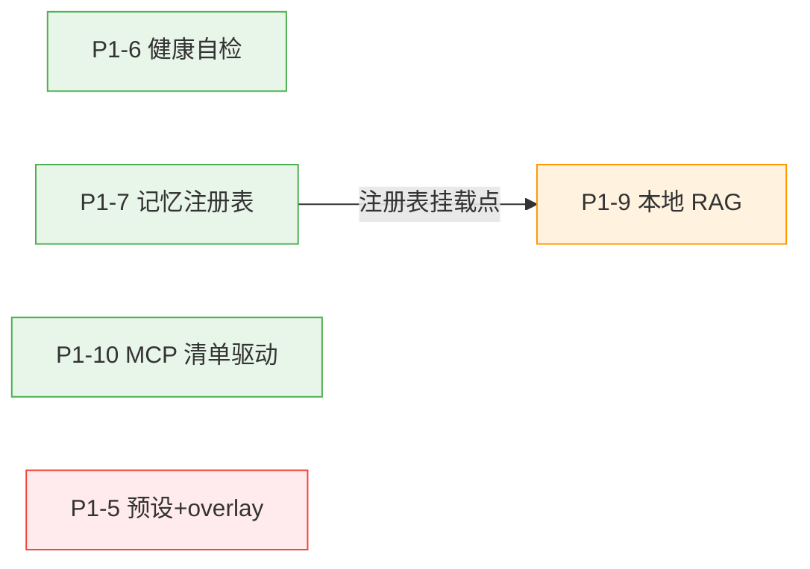

# P1 剩余功能增量 PRD（P1-5 / P1-6 / P1-7 / P1-9 / P1-10)

> 版本：v1.0（草案）　作者：产品经理 许清楚　日期：2026-10-12
> 上游输入：`docs/overall-implementation-plan.md` §2 Phase 2 表格（需求源头）、`docs/architecture-optimization-analysis.md`（分模块分析）。
> 本文档是**增量 PRD**：只覆盖 P1 尚未启动的 5 项功能，不含已完成的 P0 六项与 P1-1/P1-2/P1-4。

---

## 1. 项目信息

| 项 | 值 |
|---|---|
| 产品 | xiaozhi-server-rust 自托管小智语音助手服务端（Rust axum + Kuikly Kotlin 管理台） |
| 本期范围 | P1-5 配置预设+每设备 overlay；P1-6 引擎健康自检；P1-7 记忆多后端注册表；P1-9 本地 RAG 后端；P1-10 MCP 设备工具清单驱动 |
| 用户画像 | **自部署运维者/开发者**（部署者即用户，单管理员，无多租户） |
| 管理台形态 | Web + macOS 双端，UI 共用 `commonMain`（一处实现双端生效）；语音链路端到端验收仅 macOS / `mock_client.py`（Web 无麦克风） |
| 语言口径 | 全中文注释与错误文案，错误信息必须含「怎么修」式提示（与现有一致） |

### 现状校准（写 PRD 前核对过代码，影响范围划定）

| 计划文档原文 | 代码现状（2026-10-12） | 对本期范围的影响 |
|---|---|---|
| P1-6「补全 Memory/Soul/Command/Wake 描述符」 | `MEMORY_GRAPH` / `SOUL_PROFILE` / `COMMAND_GATE` / `WAKE_GREETING` **已在 `REGISTRY` 落地**，`PluginHost::plan(cfg)` 已能对全部 11 个 capability 算 `enabled/phase/last_error`，`GET /api/plugins` 已暴露 | P1-6 剩余工作收窄为：**`check_all(cfg)` 聚合自检端点 + 管理台露出 + 与就绪度横幅联动**，不做重复的描述符补全 |
| P1-10「握手上报可用 tools」 | MCP 能力发现（`initialize` + `tools/list` 分页）**已实现**，结果已按 `device_id` 缓存（`mcp/registry.rs`，上限 64 台），管理台 `McpToolsCard` 已可见 | P1-10 剩余工作收窄为：**消费已缓存的清单驱动 `tools/call` 决策**（替代硬编码试探）+ command/wakeup 动作模型统一；「固件握手上报」降级为可选增强 |
| P1-7「纯存储后端」 | `[memory].extraction_enabled=false` 已能"只存原文不抽取"，但仍是 Graph 后端内部开关 | 新后端 `store` 与该开关**语义分层**：backend 维度（选什么引擎）vs 开关维度（graph 内部行为），两者并存不混淆 |

---

## 2. 产品目标与用户故事

### 产品目标（3 个，正交）

1. **G1 配置可分档**：让"一台设备要不同音色/话术"和"一套参数随时整体切换"不再需要手改 TOML——预设与每设备 overlay 都落盘、可在管理台完成闭环。
2. **G2 状态可自诊**：部署者不看日志就能回答"记忆/灵魂/指令/唤醒这些可选能力现在是什么状态、坏了怎么修"——11 个 capability 的健康度一处聚合可见。
3. **G3 能力可插拔**：记忆从"单实现"走向"注册表 + 多后端"（graph / store / rag），且新后端严格保持离线单二进制与零成本默认契约；设备动作从"硬编码工具名"走向"清单驱动的动作模型"。

### 用户故事（自部署运维者/开发者视角）

- 作为自部署运维者，我**给客厅设备换个更活泼的音色、给卧室设备换个低语速**，而不影响其他设备（每设备 overlay）。
- 作为自部署运维者，我**把当前调好的一组参数存成「夜间模式」预设**，一键切换、一键切回，重启后预设还在。
- 作为自部署运维者，我**打开概览页就能看到记忆是 degraded 还是 disabled、失败原因和怎么修**，不用翻容器日志（健康自检）。
- 作为自部署运维者，我**先把记忆切到"纯存储"积累半年对话原文，之后再决定开图记忆或 RAG**，切换过程数据不丢（多后端注册表）。
- 作为自部署运维者，我**把产品手册放进服务器目录，设备就能回答手册里的问题**，全程不联网、不装向量数据库（本地 RAG）。
- 作为开发者，我**刷了不同版本的固件**，服务端依据每台设备上报的工具清单决定怎么调用，而不是对所有设备发同一个硬编码工具名、靠失败降级（MCP 清单驱动）。

---

## 3. 功能需求详述

> 每项含：背景与问题 → 需求池（该功能内部的 P0/P1/P2）→ 验收标准（行为描述，可测试）→ 前端触点 → 依赖与风险。

### 3.1 P1-5 配置预设 + 每设备 overlay

**背景与问题**：当前全局单配置（`Config::load` → TOML → `normalize()`），`PUT /api/config` 部分更新。多设备场景下"设备 A 要音色 X、设备 B 要音色 Y"无法表达；调优过程想整体切换一组参数只能手工备份文件。

**方案要点**：`Config::load` 增加 preset 与 device overlay 两层合并，全部 TOML 落盘，不引 Redis。

```text
生效配置 = 默认值 ⊕ config.toml（全局） ⊕ preset 应用结果 ⊕ overlays/devices/<device_id>.toml（仅会话内参数）
```

**需求池**

| 级别 | 需求 |
|---|---|
| P0 | 每设备 overlay：`overlays/devices/<device_id>.toml` 只存被覆盖字段的增量；**仅允许覆盖"会话内参数"白名单**（tts 音色/语速/语言、llm 提示词与历史长度、wakeup 话术、command 关键词与告别语、soul 人设、memory 召回参数）；`server`/`audio` 等结构型参数（RestartOnly）不可覆盖，越界写入被拒绝且报错含"怎么修" |
| P0 | overlay 读写走独立端点 `GET/PUT/DELETE /api/devices/{device_id}/overlay`；**不改变** `PUT /api/config` 部分更新语义与 `SECRET_PATHS` 三处同改护栏（overlay 内密钥字段同样只回 presence、空串=保留） |
| P0 | 无 `Device-Id`（unknown）或无 overlay 文件的设备一律用全局配置，行为与现状完全一致（零成本契约） |
| P0 | 配置预设：`presets/<name>.toml` 快照；管理台可"保存当前为预设 / 应用 / 删除"；应用预设 = 把预设内容按现有部分更新语义写回主配置（复用 `impact{}` 回报热生效粒度） |
| P1 | 配置页顶部显示**当前编辑对象**（全局 / 某设备 overlay），切换后表单标题与保存按钮文案随之变化，防止"以为在改全局其实改了 overlay" |
| P1 | 设备页设备卡新增「个性化配置」入口，快捷跳到以该设备为编辑对象的配置页 |
| P2 | 预设导出/导入（跨实例迁移）；overlay 批量复制到多台设备 |
| P2 | overlay 与全局的字段级 diff 视图（"这台设备覆盖了哪 3 项"） |

**验收标准（行为）**

1. 给设备 A 设置 `tts.speaker=X` 后，A 的新会话使用 X，设备 B（未设 overlay）仍用全局值；删除 A 的 overlay 后 A 的新会话回到全局值。
2. 通过 overlay 修改的字段，其热生效粒度与在全局配置中修改一致（如 `tts.speed` 新会话生效；`server.port` 不可覆盖，尝试写入返回明确错误）。
3. 重启进程后预设列表与 overlay 均保留（落盘文件仍在）。
4. 应用预设「夜间模式」后，`GET /api/config` 返回值等于预设内容（密钥字段遵守 redact 语义），响应中的生效粒度提示取最严格值。
5. overlay 文件中写入不存在的字段路径 → 加载/保存时失败并给出含「怎么修」的中文错误，不影响其他设备与全局配置加载。
6. 密钥护栏回归：在 overlay 中提交空串密钥 → 保留原值不静默清空（与全局语义一致，有回归测试）。

**前端触点**：配置页（总览 section 顶部「预设」卡：保存/应用/删除 + 当前编辑对象指示器）；设备页（设备卡「个性化配置」按钮）。Web/macOS 双端共用 commonMain 一处实现。

**依赖与风险**：动 `Config::load`/保存核心链路，是 5 项中回归风险最高者（密钥护栏、部分更新、`normalize()` 幂等都要全量回归）——排期上单独成轮（见 §4）。白名单初始集合需用户拍板（见 §6-Q1/Q2）。

---

### 3.2 P1-6 引擎 descriptor 健康自检

**背景与问题**：`GET /api/plugins` 已按实现列出 `enabled/phase/last_error`，但没有一个"按 capability 聚合、一键全量"的自检入口；概览页就绪度（P0-1）只覆盖 OTA/VAD/ASR/LLM/TTS 五类，Memory/Soul/Command/Wake 四类可选能力"坏了只降级"的状态在管理台不可见——部署者无从知道"记忆为什么没生效"。

**需求池**

| 级别 | 需求 |
|---|---|
| P0 | 新增 `GET /api/health/engines` 端点：对全部 11 个 capability 执行 `check_all(cfg)`，返回 `{capability, display, enabled, phase, last_error}` 列表；纯只读投影（复用 `PluginHost::plan` 的状态计算，不构建引擎、不改变运行期行为） |
| P0 | `phase` 口径沿用现有四档（disabled/active/degraded/failed）；`last_error` 为空时表示正常，非空时必须含「怎么修」式中文提示 |
| P0 | 概览页就绪度横幅扩展：把 Memory/Soul/Command/Wake 纳入展示；degraded/failed 项可点击跳转到对应配置 section |
| P1 | 配置页总览 section 增加「能力健康」卡：11 个 capability × phase 一览（deviation 才打标，正常项弱化显示，避免一片绿的噪音） |
| P1 | 自检结果与 `/api/plugins` 的实现级状态互相链接（capability 行展开可见其实现明细，数据同源不分叉） |
| P2 | 自检历史快照（内存态最近 N 次，重启清零，口径同 P1-1 延迟大盘） |
| P2 | 「保存前自检」：配置页保存动作可选先跑一次 `check_all(草稿配置)` 预览将出现的降级 |

**验收标准（行为）**

1. `curl GET /api/health/engines` 返回 11 个 capability 的记录，字段齐全。
2. `memory.enabled=false` 时该行 `phase=disabled` 且 `last_error` 为空（显式关闭不是错误）。
3. 把 `memory.db_path` 指向不可写目录后启动：memory 行 `phase=degraded`，`last_error` 含修复指引；同时语音对话（ASR/LLM/TTS 链路）不受影响——证明"坏掉只降级"契约仍然成立。
4. 必需能力（如 ASR）缺模型文件时：该行 `phase=failed`（与启动失败行为一致，管理台在启动失败前若不可达则该验收以 `plan()` 单测形态覆盖）。
5. 概览页横幅出现「记忆 · 降级」条目，点击跳转到配置页记忆 section。
6. 端点无副作用：连续调用两次返回一致结果，不产生引擎构建或网络请求。

**前端触点**：概览页（就绪度横幅扩展）；配置页总览 section（能力健康卡）。

**依赖与风险**：**5 项中最小、无前置依赖，可先行**。风险在于口径统一：`/api/plugins`（实现级）与新端点（能力级）数据必须同源（都出自 `plan()`），避免两处状态分叉。

---

### 3.3 P1-7 记忆多后端注册表

**背景与问题**：`MemoryProvider` trait 已存在（`recall`/`record`），但 `MemoryBackend` 闭枚举只有 `Graph|None`，选择逻辑散在配置层；新增后端要改多处。目标：类比引擎 `REGISTRY` 建立 memory 后端注册表，`GraphMemory` 挂入，并新增"纯存储后端"。

**需求池**

| 级别 | 需求 |
|---|---|
| P0 | `memory_backends` 注册表（静态常量表，类比引擎 REGISTRY）：每条含 `id / display / 字段元数据 / validate / build`；`[memory].engine` 枚举扩展为 `graph \| store \| none`（未知值反序列化即报错，沿用现有闭枚举口径） |
| P0 | `GraphMemory` 与 `NoopMemory` 挂入注册表，现有行为**零改动**（默认 `graph`、`enabled=false` 时零成本契约不破坏） |
| P0 | 新增**纯存储后端 `store`**：仅 `record`（对话原文落 SQLite），不抽取（零辅助 LLM 调用、零摘要/倒排写入）、`recall` 恒返回空——语义定位是"只积累数据，先不参与召回"，与 graph 的 `extraction_enabled` 开关分层（backend 选引擎，开关管 graph 内部行为） |
| P0 | 后端切换数据不丢：`graph → store → graph` 使用同一 `db_path`，图记忆的既有数据完整保留（store 只写自己的表/列，不触碰 graph 的表） |
| P1 | `GET /api/memory/status` 返回当前后端标识与计数（store 后端：累计轮次数、占用字节；graph 后端维持现有口径） |
| P1 | 管理台记忆 section 的 engine 下拉自动出现 `store`（schema 驱动，无需前端改卡片代码），并带一句定位说明（"只存原文不抽取，适合先积累再决定"） |
| P2 | 注册表护栏测试：新增后端必须登记字段元数据与描述符（对齐 P0-6 的 registry 漂移护栏口径） |
| P2 | store 数据导出（CSV/JSONL），为将来"积累后批量重建图记忆"铺路 |

**验收标准（行为）**

1. `engine=store` 时完成 N 轮对话：SQLite 中出现 N 条原文轮次记录；摘要/倒排相关表**零写入**；`/api/usage` 的 token 计量不因记忆产生任何辅助调用增量。
2. `engine=store` 时问任何问题，`recall` 均返回空集，LLM 上下文中不出现记忆块（对话行为与 `memory.enabled=false` 的差异仅在于：原文仍被记录）。
3. `engine` 切换 `graph → store → graph`：切回后图记忆此前积累的节点/摘要可正常召回（数据未丢）。
4. `[memory].engine=store2`（未知值）：配置加载报错，错误信息含「怎么修」（合法值列表）。
5. 默认行为回归：不写 `engine` 时默认 `graph`，`enabled=false`（默认）时 `NoopMemory` 零成本——与改动前完全一致（既有单测全绿）。
6. 管理台记忆 section 下拉出现三个选项；选择 `store` 保存后，`/api/memory/status` 的后端标识变为 `store`。

**前端触点**：配置页「记忆」section（engine 下拉 + 定位文案，schema 驱动自动生效）；运维侧 `/api/memory/status` 面板数据扩展。

**依赖与风险**：是 **P1-9 的前置**（RAG 后端要挂进这张注册表）。风险：闭枚举扩展需全量 match（既有护栏测试制衡）；SQLite 表共存需明确命名空间（store 与 graph 的表互不干扰）。

---

### 3.4 P1-9 本地 RAG 后端

**背景与问题**：部署者希望设备能回答"本地知识"问题（产品手册、家庭备忘、内部文档）。现有图记忆只沉淀对话内容，不能摄入外部文档。明确**不对接 Dify 云端**、不引外部向量库服务。

**方案要点**：本地文档 → 分块 → 索引 → 作为 `MemoryProvider` 的可选后端 `rag` 挂进 P1-7 的注册表。索引存储复用项目内 SQLite（独立 `rag.db` 或 memory 库内独立表）；召回算法**第一版用词法检索**（倒排 + BM25，与 GraphMemory 的零外网词法召回同路线），本地 embedding 作为后续可选增强（见 §6-Q4）。

**需求池**

| 级级别 | 需求 |
|---|---|
| P0 | `[memory].engine=rag`：`recall(query)` 对文档索引做词法检索，返回 top-K 分块注入 LLM 上下文（注入位置/预算复用 `[memory]` 现有 `inject_position`/`recall_max_tokens`/`recall_budget_ms` 参数，超时同样静默降级为"无记忆"） |
| P0 | 文档摄入：扫描配置的本地目录（`[memory.rag].docs_dir`，默认 `/data/rag-docs`），支持 txt/md；变更后可触发增量/全量重建索引 |
| P0 | 索引构建为**后台任务**：重建期间对话不阻塞；重建完成前 recall 返回已就绪的部分（首次为空），状态端点可见进度（文档数/分块数/最近构建时间/是否进行中） |
| P0 | `record` 行为：对话原文照常落库（与 store 后端同表语义），保证"知识问答"与"对话沉淀"不互相废弃；RAG 检索与对话记录互不污染（检索只查文档表） |
| P1 | 管理台「文档索引」卡（记忆 section 内展开）：目录路径、扫描/重建按钮、索引状态；`POST /api/memory/rag/reindex` 端点 |
| P1 | 召回可解释性：`/api/memory/recall` 手动测试端点（现有）返回命中分块及其来源文档与得分，部署者可离线验证"为什么召回了这段" |
| P2 | 支持更多格式（pdf/docx）；管理台直接上传文档（Web 文件选择器 + macOS `OtaFilePicker` 范式） |
| P2 | 可选本地 embedding（sherpa-onnx 生态或 ONNX 小模型，仍离线），作为召回质量增强开关 |

**验收标准（行为）**

1. 摄入一份包含「售后服务电话是 400-123-4567」的 md 文档并完成索引后，对设备问「售后电话是多少」：回答包含该号码，且 `/api/memory/recall` 手动端点能返回含该句的分块与来源文件名。
2. `docs_dir` 为空或索引未建：对话完全正常，recall 返回空，状态端点显示 0 文档——零知识时零影响。
3. 索引重建进行中发起对话：对话不被阻塞，召回结果是上次已就绪的索引内容。
4. 重建幂等：对同一批文档连续执行两次全量重建，分块总数一致，无重复分块。
5. `recall_budget_ms` 超时场景（人为调小）：对话不出现可感知延迟增加，日志显示按"无记忆"继续（与 graph 口径一致）。
6. 断网环境（无任何外网依赖）完成上述全部验收——证明离线单二进制约束未被破坏。
7. `engine` 在 `graph ↔ rag` 之间切换后重启：图记忆数据与 RAG 索引各自保留，互不删除。

**前端触点**：配置页「记忆」section（engine 增加 `rag` 选项 + `rag` 参数组 + 「文档索引」状态卡）。文档来源本期为服务器目录（管理台只配路径与触发重建，不做上传——上传列 P2，见 §6-Q5）。

**依赖与风险**：**硬依赖 P1-7 的注册表**（后端挂载点）。风险：分块策略与中文分词质量决定召回效果（第一版用保守分块 + 与 GraphMemory 一致的中文词法处理，降预期、保可用）；索引体积需有上界提示（大目录时状态卡显示预计分块数）。

---

### 3.5 P1-10 MCP 设备工具清单发现（清单驱动动作模型）

**背景与问题**：指令闸门命中后调用硬编码常量 `STOP_LISTENING_TOOL`（`self.audio_listener.stop`），靠设备回 `-32602 Unknown tool` 降级断开——即"先打一枪再看打没打中"。而会话开始时的能力发现（`initialize` + `tools/list` 分页）**已经拿到**每台设备的完整工具清单并按 `device_id` 缓存（上限 64 台，`McpToolsCard` 已可视化），这份信息没有被调用决策消费。

**方案要点**：调用前先查该设备已发现的工具清单——**清单里有才调，没有直接走降级**；command（指令闸门）与 wakeup（唤醒问候）统一到「依据清单选动作 → 调用 → 按结果决定保留通道 or 断开」的动作模型。固件在握手中主动上报工具摘要为**可选增强**（服务端始终以自己的探测缓存为准，旧固件零配合也能工作）。

**需求池**

| 级别 | 需求 |
|---|---|
| P0 | 指令闸门决策改造：命中指令词后，若该设备的已发现清单**含** stop 工具 → 发 `tools/call`（现行为，保留音频通道）；**不含** → 不发调用、直接走降级断开，并留 warn 日志与降级原因；**清单未知**（探测失败/未完成）→ 保持现有"试探调用 + `-32602` 降级"路径，不劣化 |
| P0 | 清单查询以 `device_id` 为键读取 `mcp/registry.rs` 缓存；缓存有 TTL/会话刷新语义（新会话探测成功即更新，与现有 `mark_offline` 生命周期一致） |
| P0 | 动作模型统一：command 与 wakeup 的"设备侧动作"抽成同一决策原语——输入（能力清单 + 意图），输出（调用哪个工具 / 降级路径），两条业务线共用；告别语/问候语下发链路（`speak_canned`）不动 |
| P1 | 管理台 MCP 工具页（`McpToolsCard`）：每台设备增加「指令闸门兼容」标记（清单含 stop = 兼容；不含 = 将降级断开；未探测 = 未知），让部署者提前知道"这台老固件说退下会断线" |
| P1 | 设备页设备卡显示「MCP 工具 N 项」（数据同源 `mcp.devices`，不新增端点） |
| P1 | 配置页指令/唤醒 section 文案更新：说明"设备动作由工具清单驱动；老固件自动降级为断开重连" |
| P2 | 固件握手 `hello` 上报工具摘要（协议增强，需固件配合）→ 免去首会话探测往返 |
| P2 | 工具调用结果计数（成功/未知工具/超时）接入事件总线与延迟大盘 |

**验收标准（行为）**

1. 设备工具清单**含** stop：说「退下」→ 告别语播完、设备回待唤醒、**连接保持**（下次唤醒免重建）——现有行为零回归。
2. 设备工具清单**不含** stop（模拟老固件）：说「退下」→ 服务端**零次** `tools/call` 发出（以日志/计数可验证）、走断开降级、管理台设备页可见降级原因——比现状少一次注定失败的往返。
3. 清单**未知**（探测超时）：行为与现状一致（试探调用 + `-32602` 或超时降级），任何情况不静默失败。
4. 唤醒问候在上述三种设备上均正常发声（问候链路不因清单状态受影响）。
5. MCP 工具页：清单含 stop 的设备显示「指令闸门兼容 ✓」；不含的显示「将降级断开」并附原因。
6. 老固件回归：用 `mock_client.py` 模拟不声明 `features.mcp` 的设备 → 一个报文都不发、直接断开（现有第一条降级路径不回归）。
7. 工具调用超时严格可控：设备不回包时按现有超时上限降级，对话不被无限阻塞。

**前端触点**：MCP 工具页（`McpToolsCard` 兼容标记）；设备页（工具数徽标）；配置页指令/唤醒 section（文案）。

**依赖与风险**：无硬依赖，可与其他项并行。风险：清单缓存的时效性（设备刷固件后清单变化，需以最近一次会话探测为准）；决策改造不得引入新的阻塞点（清单查询是内存读，零 I/O）。

---

## 4. 迭代排期建议

### 依赖关系



### 分轮方案（推荐）

| 轮次 | 内容 | 工作量估计 | 排序理由 |
|---|---|---|---|
| **第 1 轮（地基轮）** | P1-6 → P1-7 | ~3 天 | P1-6 是 5 项中**最小可先行**者（纯只读聚合端点，复用 `plan()`，无前置）；P1-7 是 P1-9 的硬前置，且"graph 挂注册表 + store 后端"不动现有行为，与 P1-6 同为低风险地基。两者收尾时管理台就拿到"能力健康"与"记忆多后端"两个可见交付物 |
| **第 2 轮（能力轮）** | P1-9 + P1-10（可并行） | ~5 天 | P1-9 趁 P1-7 注册表刚落地、上下文最热时做挂载；P1-10 与任何项无依赖，消费的是**已存在**的清单缓存，改造面集中在 session/command 层——两项互不触碰可并行推进 |
| **第 3 轮（配置核心轮）** | P1-5 单独成轮 | ~4 天 | P1-5 动 `Config::load`/保存核心链路，是**回归风险最高**的一项（密钥护栏、部分更新语义、`normalize()` 幂等全要回归），单独成轮隔离爆炸半径；且 overlay 白名单的最终形态最好等 P1-7/P1-9 把"哪些字段属于会话内参数"稳定下来后再定稿，天然适合放最后 |

**备选调整**：若希望"多设备不同音色"尽早可用，可将 P1-5 提到第 2 轮与 P1-10 并行（两者代码面不重叠：一个在 config 链路、一个在 session/MCP 链路），但 P1-5 仍需独占一轮的回归时间，不建议与 P1-9 同轮（都涉及 memory 配置字段，白名单定义会互相牵制）。

**每轮交付校验口径**（沿用 P0 惯例）：核心逻辑单测 + 双 feature 编译验证（`--features sherpa` 与默认）；P1-10 额外跑 `mock_client.py` 场景化回归；P1-5 额外全量跑密钥护栏回归。

---

## 5. 全局非功能需求（硬约束，全部 5 项适用）

| # | 约束 | 验证方式 |
|---|---|---|
| NF-1 | **离线单二进制**：不引入 Redis、Dify、外部向量库服务或任何新增常驻外部服务；新增存储一律复用项目内 SQLite（memory graph store 已用）或本地文件 | 依赖清单 diff（Cargo.toml 无新增外部服务依赖）+ 断网验收用例 |
| NF-2 | **TOML 落盘语义不破坏**：`PUT /api/config` 部分更新语义、`SECRET_PATHS` 三处同改护栏、空串=保留密钥、`normalize()` 幂等迁移——全部维持现状 | 既有配置相关回归测试全绿 + 新增 overlay/preset 路径的同款护栏测试 |
| NF-3 | **中文注释与错误文案口径**：所有新模块中文文档注释；面向用户的错误信息含「怎么修」式提示，与现有 `unknown_engine_hint` 等口径一致 | 代码评审 + 错误文案抽查 |
| NF-4 | **零成本默认契约**：不启用新功能（不写 overlay / engine 不变 / RAG 不配）时，进程行为与二进制体积与改动前一致 | 默认配置全量回归 |
| NF-5 | **只读投影不改变运行期行为**：健康自检、状态类端点均为纯投影，不触发引擎构建或网络请求 | 连续调用幂等性验收 |

---

## 6. 待确认问题（需用户拍板）

| # | 问题 | 建议方案 |
|---|---|---|
| Q1 | **P1-5 overlay 白名单初始集合**：是否如 §3.1 所列（tts 音色/语速/语言、llm 提示词/历史长度、wakeup 话术、command 词表、soul 人设、memory 召回参数）？是否允许覆盖 `engine` 选择本身（如某设备单独关记忆）？ | 白名单起步、不含 engine 切换（后者影响 db 归属，复杂度高，列 P2 观察需求） |
| Q2 | **P1-5 存储布局**：`presets/<name>.toml` 与 `overlays/devices/<device_id>.toml`（与主 config.toml 同根目录）是否可接受？容器部署需在挂载卷内，README 需同步说明 | 按上述布局，文档随实现更新 |
| Q3 | **P1-7 纯存储后端的召回语义**：`store` 恒不召回（本文案）还是保留"对原文做词法召回"的可选开关？ | 恒不召回（定位清晰：先积累）；需要召回时用户应选 graph/rag |
| Q4 | **P1-9 召回算法**：第一版词法（BM25/倒排，零新依赖、零体积增量）是否可接受？本地 embedding（ONNX 小模型，二进制体积 +模型文件代价）是否列 P2？ | 词法先行、embedding 列 P2，等真实语料反馈再评估 |
| Q5 | **P1-9 文档来源**：本期"服务器目录扫描 + 管理台触发重建"是否足够？管理台上传是否必须进 P1？ | 目录扫描先行；上传列 P2（涉及双端文件选择器与传输，工作量不小） |
| Q6 | **P1-10 握手上报增强**：固件配合的 `hello` 工具摘要上报（P2）是否需要与固件侧排期协同？ | 服务端先以探测缓存为准独立交付，固件增强另立议题 |
| Q7 | **排期确认**：§4 的"地基 → 能力 → 配置核心"三轮顺序（P1-5 放最后）是否认可，还是希望 P1-5 提前换取多设备差异化尽早上线？ | 推荐维持（风险隔离），可按用户偏好调整 |

---

## 7. 前端触点总表（Web/macOS 双端共用 commonMain）

| 功能 | 概览页 | 设备页 | 配置页 | MCP 工具页 |
|---|---|---|---|---|
| P1-5 预设+overlay | — | 「个性化配置」入口 | 预设卡 + 当前编辑对象指示器 | — |
| P1-6 健康自检 | 就绪度横幅扩展（4 类可选能力） | — | 总览 section 能力健康卡 | — |
| P1-7 记忆注册表 | — | — | 记忆 section engine 下拉（schema 驱动） | — |
| P1-9 本地 RAG | — | — | 记忆 section rag 参数组 + 文档索引状态卡 | — |
| P1-10 MCP 清单驱动 | — | 工具数徽标 | 指令/唤醒 section 文案 | 「指令闸门兼容」标记 |
