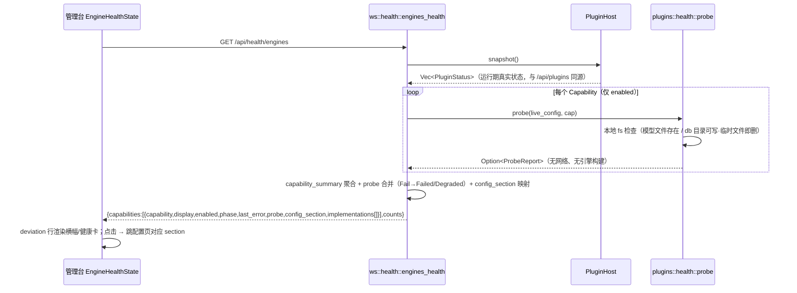
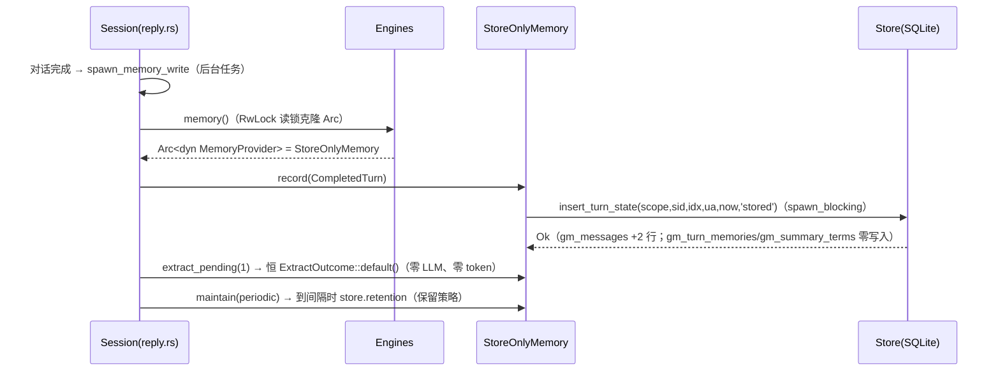
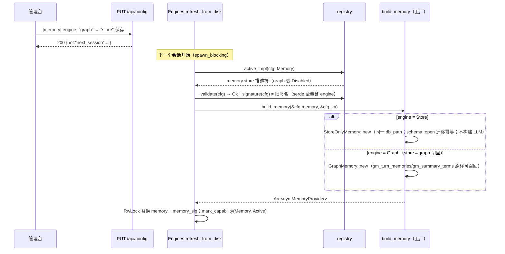
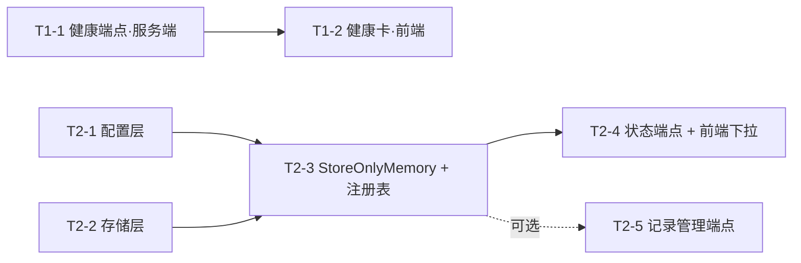

# P1 第一轮增量设计：P1-6 引擎健康自检 + P1-7 记忆多后端注册表

> 作者：架构师 高见远　日期：2026-10-12
> 上游输入：`docs/p1-features-prd.md` §3.2（P1-6）/ §3.3（P1-7）；`docs/overall-implementation-plan.md` §1 原则约束；`AGENTS.md` 工程约定。
> 代码现状已逐一核实（行号见文内），本设计为**增量设计**：不改既有 402 个测试的语义，不动 `MemoryProvider` trait 签名，不动 `Config::load` 核心链路（那是 P1-5 末轮的事）。

---

## 0. 总览

| 项 | P1-6 健康自检 | P1-7 记忆注册表 |
|---|---|---|
| 服务端新文件 | `plugins/health.rs`（探测）、`app/ws/health.rs`（端点）+ 两个 tests | `plugins/memory/store_only.rs`（+tests） |
| 服务端改动 | `host.rs`（聚合 helper 提取）、`ws/mod.rs`（路由） | `memory/config.rs`、`memory/mod.rs`、`memory/store.rs`、`memory/types.rs`、`registry/impls.rs`、`registry/mod.rs`、`registry/fields_context.rs` |
| 前端 | 新 `EngineHealthState.kt` / `EngineHealthCard.kt` + 三壳接线 | `ConfigContextState.kt` / `ConfigSoulMemoryCards.kt` 各加一处 |
| 新表/新列 | 无 | **无**（`gm_messages.extraction_state` 增加取值 `'stored'`，非 DDL） |
| 新依赖 | **0** | **0** |
| 核心风险 | 口径分叉（与 `/api/plugins` 不同源） | `active()` 语义扩展波及热切换/会话写入路径 |

两项功能代码面几乎不重叠（P1-7 不动 registry 的 Capability 枚举，P1-6 不动 memory 模块），服务端部分可全程并行。

---

## 1. 实现方案

### 1.1 P1-6 引擎健康自检

#### 1.1.1 现状与剩余工作

PRD 现状校准已确认：`REGISTRY` 12 条描述符齐全（`impls.rs:428-441` 对应 `registry/mod.rs:428-441`），`PluginHost::plan` 能对全部 11 个 capability 算 phase，`GET /api/plugins` 已按能力聚合输出（`host.rs:346 capabilities_json`）。**剩余工作 = 运行期探测聚合端点 + 管理台露出 + 跳转闭环**，不补描述符。

关键认知：`PluginDescriptor::validate`（`mod.rs:408`）是**纯配置校验、无 I/O**——`plan()` 正因此能在无 sherpa feature 的 `cargo test` 里全量断言状态逻辑。运行期探测（模型文件存在性 / db 目录可写）绝不能塞进 `validate`。

#### 1.1.2 取舍一：探测钩子放哪 —— 独立 `plugins/health.rs` 模块（**选**） vs `PluginDescriptor` 加 `healthcheck` 字段

**选独立模块，理由：**

1. **保住 `plan()` 的无 I/O 性质**。模块注释（`host.rs:113-116`）明说 plan"不触碰任何引擎 ctor ⇒ 可在无 sherpa feature 的 cargo test 里断言全部状态逻辑"。描述符里任何一个允许 I/O 的钩子都会模糊这条边界——下一个工程师很可能在 healthcheck 里写网络探测，`cargo test` 依然绿（默认 feature 下探测分支不跑），上了真机才炸。
2. **探测是 capability 级，不是 impl 级**。11 个 capability 只有 4 个有探测项（asr/vad/tts/memory）；tts 的探测只在 kokoro 被选中时才有意义——这是"选中配置"的函数而非描述符的静态属性。塞描述符 = 12 个描述符多一个大多为 `None` 的字段。
3. **描述符已经四职**（validate/warn_if/signature/build），再加一职会让"新增实现要写哪些函数"的清单继续膨胀。
4. **capability 级 `match` 天然穷尽**——`Capability` 是闭枚举，health.rs 的 match 漏一个变体编译不过，这就是免费的漂移护栏，不靠测试兜底。

**预留演进**：P1-9 的 RAG 后端若需要"索引目录存在性"这类**实现私有**探测，届时再给描述符加 `healthcheck: Option<fn(&Config) -> Option<String>>`（与本模块的 capability 级探测合并取最坏）；本轮不做。

#### 1.1.3 服务端模块设计

**新文件 `server/src/plugins/health.rs`**（capability 级探测，全部只做本地 fs 检查）：

```rust
//! 引擎健康探测：capability 级的运行期轻量检查（仅本地文件系统，无网络、无引擎构建）。
pub enum ProbeState { Ok, Fail }          // 第一版只有两档；Warn 预留
pub struct ProbeReport {
    pub state: ProbeState,
    pub detail: Option<String>,           // Fail 时必填，含「怎么修」中文
}

/// 对某能力做运行期探测；None = 该能力无需探测（或未启用，探测只在 enabled 时跑）。
/// ⚠️ 纪律：只允许本地 fs 检查（metadata / 临时文件创建后立即删除），
///    禁止网络请求、禁止引擎构建——这是 PRD 验收 6（幂等无副作用）的硬约束。
pub fn probe(cfg: &Config, cap: Capability) -> Option<ProbeReport>
```

各 capability 的探测项（match 全量穷尽，无探测项的返回 `None`）：

| Capability | 探测内容 | 失败文案示例（含怎么修） |
|---|---|---|
| Asr | `cfg.asr.model` 文件存在 | `[asr].model 指向的文件不存在：…。请检查挂载卷；容器内缺失时入口脚本会自动下载，离线环境请先预置。` |
| Vad | `cfg.vad.model` 文件存在 | 同上口径 |
| Tts | 仅 `engine=kokoro` 时：`model/voices/tokens/data_dir` 四路径存在 | 对齐 `validate_tts_kokoro`（impls.rs:169-196）的文案风格 |
| Memory | `db_path` 父目录存在且可写（创建 `.health-probe` 临时文件 → 立即删除；`:memory:` 直接 Ok） | `[memory].db_path 所在目录不可写：…。请确认挂载卷权限（docker-compose 的 ./server-data 需可写）。` |
| Llm / FullChain / Voices / Firmware / Soul / Command / Wake | 无本地探测（凭据/上游连通属配置级，网络探测被验收 6 禁止） | — |

**新文件 `server/src/app/ws/health.rs`**（HTTP handler，薄）：

- `pub(super) async fn engines_health(State(engines)) -> Response`：
  1. `engines.host.snapshot()` 取**运行期真实状态**（含 boot 失败标记、热切换失败标记）——与 `/api/plugins` 完全同源；
  2. 逐 capability 调 `plugins::health::probe(&engines.host.config(), cap)`（仅 enabled 项）；
  3. phase 合并规则：`probe == Fail` 时，必需能力 → `Failed`、可选能力 → `Degraded`（取与 host 状态更坏者）；`last_error` 取 probe 文案（host 已有更坏状态时保留 host 的）；
  4. 附 `config_section` 字段（capability → 配置页 section id 映射，前端跳转锚点）：`fullchain→"aiui"`、`firmware→"ota"`、`voices→null`（无对应 section），其余同 id；
  5. 探测为纯本地 fs 快速操作（<1ms 量级），handler 内联执行即可，无需 spawn_blocking。

**改动 `server/src/plugins/host.rs`**（同源保证的关键，非可选）：

从 `capabilities_json`（host.rs:346-403）中把"单能力聚合"逻辑提取为公开 helper，两处共用：

```rust
/// 某能力的聚合视图（phase 取最坏 / active_impl / enabled / last_error / 实现明细）。
/// `GET /api/plugins` 与 `GET /api/health/engines` 共用本函数——同源不分叉是 P1-6 的硬要求。
pub struct CapabilitySummary {
    pub capability: Capability,
    pub phase: Phase,
    pub enabled: bool,
    pub active_impl: Option<&'static str>,
    pub last_error: Option<String>,
    pub impls: Vec<PluginStatus>,
}
impl PluginHost {
    pub fn capability_summary(&self, cap: Capability) -> CapabilitySummary { /* 现有 fold 逻辑原样搬入 */ }
}
```

`capabilities_json` 改为遍历调用该 helper（**行为逐字节不变**，既有测试 `capabilities_json_carries_every_key_the_overview_page_reads` 守护）。

**改动 `server/src/app/ws/mod.rs`**：`mod health;` + 路由 `.route("/api/health/engines", get(health::engines_health))` + 模块注释路由表补一行。（ws/mod.rs 里已有内联 `async fn health()`（:176）——Rust 中函数与模块分属不同命名空间，共存无冲突；为可读性 handler 命名为 `engines_health`。）

#### 1.1.4 前端设计

**新文件 `EngineHealthState.kt`**：继承 `LoadableState`（OpsState.kt:81），`endpoint = "/api/health/engines"`，`apply()` 解析 `capabilities[]` → `ObservableList<HealthRow>`（capability/display/phase/enabled/lastError/probeState/probeDetail/configSection/deviation）+ 摘要计数。完全比照 `McpToolsState` / `PluginMetaState` 范式。

**新文件 `EngineHealthCard.kt`**：两个渲染件（全部复用 AdminTheme 组件层，禁止自造样式）：

- `healthBanner(health, onJump)`：**就绪度横幅**（PRD P0「概览页横幅扩展」）。仅当存在 deviation 行时渲染——每行「{display} · {降级|异常}」可点击 → `onJump(config_section)`；正常时不占任何视觉（延续"只在偏离时打标"铁律）。
- `engineHealthCard(health, onJump)`：**能力健康卡**（PRD P1「配置页总览 section 能力健康卡」）。11 行 × phase 一览：deviation 行打 `statusBadge` + 原因展开 + 可点击；正常行弱化（textTertiary 一行文字带过，避免一片绿噪音）；行尾显示 active impl 展示名（呼应 PRD P1「capability 行展开可见其实现明细，数据同源」——数据即响应里的 `implementations[]`）。

**接线（三壳 + 两渲染点）**：

| 文件 | 改动 |
|---|---|
| `AdminPage.kt` | `val engineHealth = EngineHealthState(this)` + `pageDidAppear` 加 `engineHealth.load(this)`；`renderOpsOverview` 调用点增参 + 跳转 lambda `{ section -> selectedSection = "config"; form.configSection = section }` |
| `OpsPages.kt` | `renderOpsOverview(stats, meta, health, ctx, onJumpSection)` 增参；页面最顶部（stats 卡之上）插 `healthBanner`；能力总览卡之下插 `engineHealthCard` |
| `ConfigCards.kt` | `renderConfigLayout` 增参 `health: EngineHealthState`；`renderConfigSection` 的 `overview` 分支渲染 `engineHealthCard(health) { form.configSection = it }` |
| `AdminShell.kt`（macOS） | `renderConfigLayout` 调用点同步增参（数据源加载跟随该壳既有 baseUrl 模式） |
| `ConfigPage.kt`（独立配置页） | 同上增参 + 加载 |

`form.configSection` setter 已存在（P0 导航重组产物，同步 `configSectionList: ObservableList`），跳转链路零新机制。

### 1.2 P1-7 记忆多后端注册表

#### 1.2.1 设计目标与不变量

- `MemoryProvider` trait（`memory/mod.rs:60-85`）**一行不改**——保住 NoopMemory/GraphMemory 两个既有实现与 `refresh_memory`（engine.rs:283-327）的热切换契约；
- `[memory].engine` 保持闭枚举口径：未知值反序列化即报错（但报错文案要中文化，见 1.2.3）；
- 默认零成本契约不破：不写 `engine` → `graph`；`enabled=false`（默认）→ `NoopMemory`；
- graph 与 store 共用同一 `db_path`，切来切去数据不丢、互不污染；
- 给 P1-9 的 RAG 后端留好挂载位：**新增后端 = `MemoryBackend` 加变体 + `build_memory` 加分支 + `impls.rs` 加描述符**，三处都有护栏测试制衡。

#### 1.2.2 MemoryBackend 枚举扩展

`memory/config.rs:12-17`：

```rust
pub enum MemoryBackend {
    Graph,   // 内置图记忆（本地词法召回 + 后台抽取）
    Store,   // 纯存储：仅 record 落原文（零 LLM、零召回）——"先积累再决定"
    None,    // 显式停用
}
```

连锁修改（同文件）：

- **`active()`**（config.rs:206-208）：`enabled && engine == Graph` → **`enabled && engine != None`**。
  波及面已逐一核实：`reply.rs:84`（spawn_memory_write 的门——store 需要通过，✓ 预期行为）；`reply.rs:53`（recall 门是 `recall_enabled`，store 后端由 `StoreOnlyMemory::recall` 恒返空兜底，不依赖该开关）；`graph.rs:308/339/366`（仅 GraphMemory 自身使用，store 永不经此路径）。
- **`engine_id()`**：match 加 `Store => "store"`。
- **`validate()`**（config.rs:235-257）：逻辑不变（`engine == None` 时 bail 的分支对 store 天然放行；db_path/scope_prefix 检查对 store 同样必需——store 也按 scope 落库）。
- **`warning()`**（config.rs:260-281）：只被 graph 描述符的 `warn_if` 调用，store 描述符 `warn_if: None`，无需改逻辑。

**`Capability::Memory` 的 display**（`registry/mod.rs:137`）从「记忆（图记忆）」改为「记忆」——多后端后原文案不再准确（UI 文案变化，已列入待明确事项 #2）。

#### 1.2.3 未知值的中文报错（PRD 验收 4）

serde 默认报错是英文（`unknown variant \`store2\`, expected one of ...`），不满足 NF-3。方案：**给 `MemoryBackend` 手写 `Deserialize`**（`Serialize` 保持 derive）：

```rust
impl<'de> serde::Deserialize<'de> for MemoryBackend {
    // 接受 str，trim + 小写归一（对齐 canonical_engine 的宽容度），
    // 命中 graph/store/none；否则返回中文错误：
    // "[memory].engine = \"store2\" 不是已知后端：可选 graph / store / none。
    //  请改成一个可选值，或删掉该键使用默认 graph（旧键 backend 仍可读）。"
}
```

字段级 `#[serde(default, alias = "backend")]` 与枚举的自定义 Deserialize 正交，旧键迁移不受影响。`Config::load` 与 `PUT /api/config` 两条路径都在反序列化层统一拦截（启动报错 / 400）。

#### 1.2.4 StoreOnlyMemory：纯存储后端

**新文件 `server/src/plugins/memory/store_only.rs`**（+ `store_only/tests.rs`）：

```rust
/// 纯存储后端（`[memory].engine = "store"`）：只把对话原文落 SQLite，不抽取、不召回。
/// 语义定位：与 graph 的 extraction_enabled 开关**分层**——backend 选引擎，开关管 graph 内部行为。
pub struct StoreOnlyMemory {
    cfg: MemoryConfig,
    store: Arc<Store>,   // 复用既有 Store（同款单连接 + Mutex + spawn_blocking 纪律）
}

impl StoreOnlyMemory {
    /// ⚠️ 构造不触碰 LLM：不调 build_llm、不读 [memory.extractor]——
    /// 这是"零辅助 LLM 成本"的结构保证（PRD 验收 1）。
    pub fn new(cfg: &MemoryConfig) -> anyhow::Result<Self>;  // store::open（迁移幂等）
}

impl MemoryProvider for StoreOnlyMemory {
    fn name(&self) -> &'static str { "store" }
    fn recall(..)            -> 恒 RecallResult::none()（绝不 Err，语义对齐 trait 约定）
    fn record(turn)          -> store.insert_turn_state(.., "stored", now)  // ⚠️ 见下
    fn extract_pending(..)   -> 恒 ExtractOutcome::default()（零 LLM 调用）
    fn maintain(opts)        -> 复用 store.retention（保留策略对原文生效；无隔离释放需求）
    fn stats()               -> MemoryStats { engine: "store", active: true, turns, db_bytes, .. }
    fn clear(scope)          -> store.clear（与 graph 同款，删 gm_messages[+gm_turn_memories]）
}
```

**关键设计：新行 `extraction_state = 'stored'`，绝不写 `'pending'`。**

`gm_messages.extraction_state` 是 TEXT 列，取值集合由代码约定——store 写 `'stored'` 意味着：

1. graph 的抽取队列查询（`store.rs:158-181`，`WHERE extraction_state = 'pending'`）**天然看不见** store 积累的数据——用户从 store 切回 graph 时不会突发 N 次辅助 LLM 调用（成本惊吓防护，这是 PRD「零辅助 LLM 调用」语义在切换场景的延伸）；
2. **零 DDL**：不新增表、不新增列、`LATEST_VERSION` 保持 2，迁移只追加纪律零触碰；
3. 摘要/倒排表（`gm_turn_memories` / `gm_summary_terms`）零写入——store 后端代码里根本没有引用它们的路径（PRD 验收 1 的结构保证）；
4. 未来"积累后批量重建图记忆"（PRD P2 导出/回填）= 一条 `UPDATE gm_messages SET extraction_state='pending' WHERE ... AND extraction_state='stored'` 的管理动作，入口留待 P2 与导出一起定（待明确 #5），**本轮绝不自动回填**。

**改动 `server/src/plugins/memory/store.rs`**：

- `insert_turn` 参数化：抽出 `pub fn insert_turn_state(&self, .., state: &str, now)`，原 `insert_turn` 委托 `'pending'`（graph 行为零变化）；
- 新增 `pub fn turn_count(&self) -> Result<i64>`：`COUNT(DISTINCT scope, session_id, turn_index)`（PRD P1「累计轮次数」）；
- 新增 `pub fn message_scope_counts(&self) -> Result<Vec<(String, i64)>>`（store 的 stats 按**原文**列 scope，graph 的 `scopes()` 按记忆列——两者口径不同，分开命名）。
- （若做可选的 T2-5 记录管理端点，列表/删除查询放新子模块 `store/listing.rs`，防 store.rs 超 600 行——现状 513 行。）

**改动 `server/src/plugins/memory/types.rs`**：`MemoryStats` 增加 `pub turns: i64` 字段 + `to_json` 补 `"turns"`（additive，graph 的 stats 一并填充，见下）。

**改动 `server/src/plugins/memory/graph.rs`**：`stats()` 补 `turns: self.store.turn_count()...`（一行）。

#### 1.2.5 工厂分发与注册表挂载

**`build_memory`**（`memory/mod.rs:131-139`）改为按 engine 分发：

```rust
pub fn build_memory(cfg: &MemoryConfig, llm: &LlmConfig) -> Result<Arc<dyn MemoryProvider>> {
    if !cfg.active() { return Ok(Arc::new(NoopMemory)); }
    match cfg.engine {
        MemoryBackend::Graph => Ok(Arc::new(GraphMemory::new(cfg, llm)?)),
        MemoryBackend::Store => Ok(Arc::new(StoreOnlyMemory::new(cfg)?)),  // 不需要 llm
        MemoryBackend::None  => Ok(Arc::new(NoopMemory)),                   // 不可达（active 已挡）
    }
}
```

**注册表**（`registry/impls.rs`，现状 517 行，加约 40 行后 ~557，合规）：

```rust
fn sel_memory_graph(cfg: &Config) -> bool { cfg.memory.enabled && cfg.memory.engine == MemoryBackend::Graph }
fn sel_memory_store(cfg: &Config) -> bool { cfg.memory.enabled && cfg.memory.engine == MemoryBackend::Store }
fn build_memory_store_d(cfg: &Config) -> Result<Built> { /* Built::Memory(build_memory(..)?) 复用同一工厂 */ }

pub const MEMORY_STORE: PluginDescriptor = PluginDescriptor {
    id: "memory.store",
    capability: Capability::Memory,
    display: "纯存储（只存原文 · 不抽取不召回）",
    local: true,
    hot: HotReload::NextSession,
    requires: &[],                       // ← 与 graph 的关键差异：无 LlmUpstream 依赖
    fields_path: &["memory"],
    fields: &[],                         // 无私有字段（[memory] 公共字段在 fields_context 已登记）
    signature: sig_memory,               // 同一函数：签名含 engine 字段，切换必然触发重建
    validate: validate_memory,           // 同一函数：db_path/scope_prefix 检查共用
    build: Some(build_memory_store_d),
    warn_if: None,                       // store 没有"无 embedding"这类软性受限
    selected: sel_memory_store,
};
```

`MEMORY_GRAPH` 的 `selected` 从 `sel_memory`（= active()）改为 `sel_memory_graph`。`REGISTRY`（`registry/mod.rs:428`）加 `MEMORY_STORE` 一条（13 条）。

**兼容性核实结论（均已对代码逐条确认）**：

- `unknown_engine_of`：`impls_of(Memory)` = {graph, store}，engine="store" 命中；"none" 的合法停用特判（mod.rs:485-488）保留；
- `PluginHost::boot` 步骤 3（`build_optional(Memory)`，host.rs:250-260）：按 selected 找到 store 描述符 → validate → build → `Built::Memory`，**engine.rs 零改动**；
- `refresh_memory`（engine.rs:283-327）：`active_impl` 找到 `memory.store` → validate → 签名比对（`sig_memory` = `cfg.memory.signature()` = 全量 serde，含 engine → 必不相等）→ **`build_memory` 分发**（engine.rs:309 直接调 `crate::plugins::memory::build_memory`，不走 `d.build`——工厂分发正好是唯一收口点，两处共用）→ RwLock 替换 → `mark_capability` 标 memory.store；
- plan/`/api/plugins`：memory capability phase = 两实现取最坏（store 选中时 graph=Disabled、store=Active → capability Active）；
- 会话侧 `spawn_memory_write`（reply.rs:82-120）：store 下 record 落库 → `extract_pending(1)` 返回默认值（`o.attempted == 0`，不进日志分支）→ `maintain(periodic)` 按 `maintenance_interval` 周期跑 retention——**链路一行不改**；
- `GET /api/memory/status`（ws/memory.rs:26-57）：`stats().engine == "store"` 自动出现（PRD 验收 6 后半句），`config.engine` 摘要同源。

#### 1.2.6 取舍二：管理面（列表/查单条/删单条）—— 走独立查询模块（**选**），不扩展 MemoryProvider trait

**PRD 的 P1-7 需求池没有单条管理端点**（P0 止于注册表/store/数据不丢；P1 是 status 计数与下拉）；团队负责人的任务书提到"管理面（列表/查单条/删单条）"并要求给出 trait 扩展与否的权衡。结论：

**不进 trait，理由：**

1. `MemoryProvider` 是**对话链路抽象**（recall/record/extract/maintain/stats/clear 六方法、BoxFut 手动装箱、三条语义铁律），列表/删单条是**运维面**。NoopMemory 被迫空实现 = "关闭记忆时管理面返回什么"变成无答案的语义噪音；
2. record 返回 id 等签名变更破坏 trait 兼容——PRD 明确倾向不破坏，本设计连方法都不加，自然不破坏；
3. 管理面查询天然**跨后端统一**（graph/store 的记录都落在 `gm_messages`），独立模块一处实现服务所有后端；未来 RAG 后端的"记录"形态不同（文档分块而非轮次），强塞 trait 会让每个新后端背 CRUD 包袱；
4. 独立模块打开自己的连接（`schema::open` 幂等迁移 + WAL + busy_timeout）：SQLite WAL 支持多连接、一写多读；管理操作是低频运维动作，busy_timeout（默认 5s）足够消化与主连接的写竞争。

**落地形态（可选任务 T2-5，可裁剪）**：`memory/store/listing.rs` 提供按 (scope, session_id, turn_index) 分组的一页列表 + 单轮删除；HTTP 面 `GET /api/memory/turns` + `POST /api/memory/turns/delete` 放 `ws/memory.rs`。**本轮不做管理 UI 卡片**（PRD 前端触点表没有它），curl 可验证，UI 留 P2。

#### 1.2.7 前端触点（schema 半驱动现状的澄清）

PRD 写"engine 下拉自动出现 store（schema 驱动，无需前端改卡片代码）"，但代码现状是：客户端 `ConfigContextState.kt:113-118` 的 `memoryBackendOptions` 是**硬编码 ObservableList**（服务端 `FieldKind::Enum` options 只进 schema，不驱动该下拉）。因此前端**必须加一行**：

```kotlin
memoryBackendOptions.addAll(listOf(
    "graph" to "内置图记忆（本地 SQLite）",
    "store" to "纯存储（只存原文，先积累再决定）",   // ← 新增
    "none"  to "不生效（保留配置）",
))
```

另在 `ConfigSoulMemoryCards.kt` 的 memoryConfigCard 中，选中 store 时显示一句 `textNote` 定位说明（PRD P1 文案要求）。双端各一份取值清单是**已知重复**，用护栏测试对冲（见 1.2.8）。

#### 1.2.8 护栏测试（对齐 P0-6 registry 漂移护栏口径）

1. **枚举 ↔ 注册表一致**：`MemoryBackend` 的全部 serde 取值 == `impls_of(Memory)` 的 impl id 集合 ∪ {"none"}（写死断言，新增后端漏登记直接打红）；
2. **未知值中文报错**：`toml::from_str::<MemoryConfig>`（engine="store2"）→ 错误文案含「可选 graph / store / none」；
3. **store 行为**：record N 轮 → gm_messages 2N 行且 state='stored'；`gm_turn_memories`/`gm_summary_terms` 零行；extract_pending 恒零；recall 恒空；
4. **切换数据保留**（PRD 验收 3）：同 db_path 下 GraphMemory 写入 → 换 StoreOnlyMemory 写入 → 换回 GraphMemory：旧节点/摘要可 recall，store 行保持 'stored' 不被抽取；
5. **默认零成本回归**（PRD 验收 5）：不写 engine → graph；enabled=false → build_memory 返回 NoopMemory（既有测试全绿即证）；
6. **REGISTRY 计数类断言同步**：`registry/tests.rs` / `host/tests.rs` 中如有对 REGISTRY 长度或 memory 实现数的字面断言，12→13、1→2 同步（工程师实施时全量跑一遍即暴露）；
7. **health 端点幂等**（PRD 验收 6）：同一配置连调两次 `capability_summary + probe` 结果一致（纯函数级单测）。

### 1.3 文件清单总表

| # | 文件 | 动作 | 任务 |
|---|---|---|---|
| 1 | `server/src/plugins/health.rs` | 新建 | T1-1 |
| 2 | `server/src/plugins/health/tests.rs` | 新建 | T1-1 |
| 3 | `server/src/plugins/mod.rs` | +`pub mod health;` | T1-1 |
| 4 | `server/src/plugins/host.rs` | 提取 `CapabilitySummary`/`capability_summary`；`capabilities_json` 改为复用 | T1-1 |
| 5 | `server/src/app/ws/health.rs` | 新建（engines_health handler） | T1-1 |
| 6 | `server/src/app/ws/health/tests.rs` | 新建 | T1-1 |
| 7 | `server/src/app/ws/mod.rs` | 路由 + mod + 注释 | T1-1 |
| 8 | `client/shared/src/commonMain/kotlin/com/xiaozhi/admin/EngineHealthState.kt` | 新建 | T1-2 |
| 9 | `client/shared/src/commonMain/kotlin/com/xiaozhi/admin/EngineHealthCard.kt` | 新建 | T1-2 |
| 10 | `client/.../admin/OpsPages.kt` | renderOpsOverview 增参 + 横幅/健康卡插入 | T1-2 |
| 11 | `client/.../admin/ConfigCards.kt` | renderConfigLayout 增参 + overview 分支 | T1-2 |
| 12 | `client/.../admin/AdminPage.kt` | 数据源 + 加载 + 调用点 + 跳转 lambda | T1-2 |
| 13 | `client/.../macosArm64Main/.../AdminShell.kt` | renderConfigLayout 调用点增参 | T1-2 |
| 14 | `client/.../admin/ConfigPage.kt` | 同上 | T1-2 |
| 15 | `server/src/plugins/memory/config.rs` | MemoryBackend+Store、自定义 Deserialize、active()/engine_id() | T2-1 |
| 16 | `server/src/plugins/registry/fields_context.rs` | engine 枚举元数据 + help | T2-1 |
| 17 | `server/src/plugins/memory/tests.rs` / `server/src/config/tests.rs` | 新变体/未知值/默认回归 | T2-1 |
| 18 | `server/src/plugins/memory/store.rs` | insert_turn_state / turn_count / message_scope_counts | T2-2 |
| 19 | `server/src/plugins/memory/types.rs` | MemoryStats.turns + to_json | T2-2 |
| 20 | `server/src/plugins/memory/graph.rs` | stats() 填 turns | T2-2 |
| 21 | `server/src/plugins/memory/store/tests.rs` | 新查询测试 | T2-2 |
| 22 | `server/src/plugins/memory/store_only.rs`（+tests.rs） | 新建 StoreOnlyMemory | T2-3 |
| 23 | `server/src/plugins/memory/mod.rs` | mod/pub use/build_memory 分发 | T2-3 |
| 24 | `server/src/plugins/registry/impls.rs` | sel 拆分 + MEMORY_STORE | T2-3 |
| 25 | `server/src/plugins/registry/mod.rs` | REGISTRY+1、Memory display 改「记忆」 | T2-3 |
| 26 | `server/src/plugins/registry/tests.rs` | 护栏 1/6 | T2-3 |
| 27 | `server/src/app/ws/memory.rs` | （极小）status 无结构改动，确认 turns 透出 | T2-4 |
| 28 | `client/.../admin/ConfigContextState.kt` | memoryBackendOptions + store | T2-4 |
| 29 | `client/.../admin/ConfigSoulMemoryCards.kt` | store 定位说明 textNote | T2-4 |
| 30 | （可选）`server/src/plugins/memory/store/listing.rs`（+tests）、`ws/memory.rs`、`ws/mod.rs` | 记录列表/删除端点 | T2-5 |

---

## 2. 数据结构与接口

### 2.1 `GET /api/health/engines` 响应 schema

```jsonc
{
  "ok": true,
  "generated_ms": 1760000000000,          // 服务端生成时刻（前端不依赖本地时钟）
  "counts": { "active": 6, "degraded": 1, "failed": 0, "disabled": 4, "total": 11 },
  "capabilities": [
    {
      "capability": "memory",             // Capability::id()
      "display": "记忆",
      "required": false,
      "enabled": true,
      "phase": "degraded",                // 合并后终态：四档口径沿用（disabled/active/degraded/failed）
      "deviation": true,
      "active_impl": "memory.graph",      // 当前选中实现 id（未启用为 null）
      "last_error": "[memory].db_path 所在目录不可写：…（怎么修）",
      "config_section": "memory",         // 前端跳转锚点；voices 为 null；fullchain→"aiui"、firmware→"ota"
      "probe": {                          // null = 无探测项或未启用
        "state": "fail",                  // "ok" | "fail"（第一版两档）
        "detail": "…"                     // 探测原始结论（与 last_error 同文案时也保留，便于区分来源）
      },
      "implementations": [ /* PluginStatus::to_json 数组，与 /api/plugins 完全同构 */ ]
    }
  ]
}
```

- 幂等性：两次调用除 `generated_ms` 外逐字段一致；不产生引擎构建、不产生网络请求（PRD 验收 6）。
- `phase` 合并规则：`host 快照 phase` 与 `probe(Fail → required?Failed:Degraded)` 取更坏者；`disabled` 项不跑 probe（`probe: null`、`last_error: null`，PRD 验收 2）。

### 2.2 `MemoryBackend` 与 `MemoryStats` 扩展

```rust
// memory/config.rs —— serde 取值：graph | store | none（自定义 Deserialize，中文报错）
pub enum MemoryBackend { Graph, Store, None }

// memory/types.rs —— additive
pub struct MemoryStats {
    pub engine: &'static str,     // "graph" | "store" | "none"
    pub active: bool,
    pub db_path: String,
    pub db_bytes: u64,
    pub turns: i64,               // ← 新增：累计轮次数（store 的核心计数；graph 一并填充）
    pub messages: i64, pub memories: i64, pub pending: i64, pub quarantined: i64,
    pub scopes: Vec<(String, i64)>,
    pub lexical_only: bool,       // store 恒 true（无召回）
    pub extractor: String,        // store 为空串
    pub error: Option<String>,
}
// to_json 增加 "turns"；GET /api/memory/status 自动透出（PRD 验收 6 后半句）
```

### 2.3 DDL：**零变更**

- 不新增表、不新增列、不改索引；`LATEST_VERSION` 保持 2，迁移只追加纪律零触碰。
- 唯一存储层变化：`gm_messages.extraction_state` 的**取值集合**增加 `'stored'`（代码约定，非 schema 变更）。graph 的抽取队列（`WHERE extraction_state='pending'`）与 store 数据天然隔离。
- `GET /api/memory/turns`（可选 T2-5）：纯读 `gm_messages` 按 (scope, session_id, turn_index) 分组，利用既有 `idx_gm_messages_scope_turn` 索引，零新索引。

### 2.4 类图（核心类型关系）

```mermaid
classDiagram
  class Capability { <<enum>> 11 变体 }
  class PluginDescriptor { +id: &'static str
    +capability: Capability
    +validate: fn(&Config) -> Result
    +build: Option~fn~
    +warn_if: Option~fn~
    +selected: fn(&Config) -> bool }
  class PluginHost { -statuses: RwLock~Vec~PluginStatus~~
    +plan(cfg) Arc~Self~
    +boot(cfg) Result
    +snapshot() Vec~PluginStatus~
    +capability_summary(cap) CapabilitySummary }
  class PluginStatus { +phase: Phase +enabled: bool +last_error: Option~String~ }
  class Phase { <<enum>> Disabled Active Degraded Failed }
  class CapabilitySummary { +phase: Phase +enabled: bool +active_impl +last_error +impls }
  class ProbeState { <<enum>> Ok Fail }
  class ProbeReport { +state: ProbeState +detail: Option~String~ }
  class health { <<module plugins::health>> +probe(cfg, cap) Option~ProbeReport~ }
  class EnginesHealth { <<handler ws::health>> +engines_health(engines) Response }

  PluginDescriptor "*" --> "1" Capability : REGISTRY 13 条
  PluginHost "1" o-- "*" PluginStatus : snapshot
  PluginHost ..> CapabilitySummary : 聚合（/api/plugins 与 /api/health/engines 同源共用）
  health ..> ProbeReport : 产出
  health ..> Capability : match 全量穷尽（编译期护栏）
  EnginesHealth ..> PluginHost : snapshot
  EnginesHealth ..> health : probe（仅 enabled 项）

  class MemoryProvider { <<trait>> +name() +recall() +record() +extract_pending() +maintain() +stats() +clear() }
  class NoopMemory
  class GraphMemory { +cfg: MemoryConfig +store: Arc~Store~ +llm: Llm }
  class StoreOnlyMemory { +cfg: MemoryConfig +store: Arc~Store~ }
  class Store { +insert_turn(state) +turn_count() +search() +counts() +retention() +clear() }
  class MemoryBackend { <<enum>> Graph Store None }
  class MemoryConfig { +engine: MemoryBackend +active() +engine_id() +validate() }
  class build_memory { <<工厂·唯一分发点>> }

  MemoryProvider <|.. NoopMemory
  MemoryProvider <|.. GraphMemory
  MemoryProvider <|.. StoreOnlyMemory
  GraphMemory o-- Store : gm_* 全套
  StoreOnlyMemory o-- Store : 仅 gm_messages（state='stored'）
  MemoryConfig *-- MemoryBackend : 自定义 Deserialize
  build_memory ..> MemoryProvider : 按 engine 分发（boot 与 refresh_memory 共用）
  PluginDescriptor ..> MemoryProvider : Built::Memory(Arc~dyn~)
```

### 2.5 时序图

**P1-6：`GET /api/health/engines`（只读投影）**



**P1-7：store 后端的对话写入（零 LLM 路径）**



**P1-7：graph ⇄ store 热切换（refresh_memory，签名含 engine 必触发重建）**



---

## 3. 任务列表（按实现顺序，P1-6 = T1-x，P1-7 = T2-x）

> 粒度口径：一个任务 = 工程师一次可完成的一个 cohesive 变更（含单测与双 feature 编译验证）。
> 每个任务的 DoD 都含：`cargo test`（默认 + `--features sherpa` 类型检查）全绿、不破坏既有 402 个测试；前端任务另加 `:shared:compileKotlinJs` + `compileKotlinMacosArm64`。

### T1-1（P0）P1-6 服务端：探测模块 + 聚合端点
- **文件**：新建 `server/src/plugins/health.rs` + `plugins/health/tests.rs`；新建 `server/src/app/ws/health.rs` + `app/ws/health/tests.rs`；改 `plugins/mod.rs`（+1 行）、`plugins/host.rs`（CapabilitySummary 提取）、`app/ws/mod.rs`（路由）
- **内容**：ProbeState/ProbeReport + probe() 四类探测项 + capability 全量 match；host 聚合 helper 提取（capabilities_json 行为不变）；`GET /api/health/engines`（phase 合并 + config_section + counts + implementations[]）
- **依赖**：无。**可与 T2-1、T2-2 并行**
- **验收映射**：P1-6 验收 1/2/4/6

### T1-2（P0）P1-6 前端：健康横幅 + 能力健康卡 + 跳转
- **文件**：新建 `EngineHealthState.kt`、`EngineHealthCard.kt`；改 `OpsPages.kt`、`ConfigCards.kt`、`AdminPage.kt`、`AdminShell.kt`、`ConfigPage.kt`
- **内容**：LoadableState 数据源；healthBanner（概览页顶、仅 deviation 渲染、可点击跳配置 section）；engineHealthCard（配置页总览 section）；三壳接线与跳转 lambda
- **依赖**：T1-1（响应 schema 定稿）。可与 T2-x 全部并行
- **验收映射**：P1-6 验收 3（横幅露出）/5

### T2-1（P0）P1-7 配置层：MemoryBackend::Store + 中文反序列化报错
- **文件**：改 `memory/config.rs`、`registry/fields_context.rs`；补 `memory/tests.rs`、`config/tests.rs`
- **内容**：枚举加 Store；自定义 Deserialize（中文怎么修报错）；active() 语义扩展为 `enabled && engine != None`；engine_id；schema engine 字段 Enum options 加 "store" + help 更新
- **依赖**：无。**可与 T1-1 并行**
- **验收映射**：P1-7 验收 4/5（默认回归）

### T2-2（P0）P1-7 存储层：state 参数化 + 轮次计数
- **文件**：改 `memory/store.rs`、`memory/types.rs`、`memory/graph.rs`；补 `memory/store/tests.rs`
- **内容**：insert_turn_state（'pending' 委托保持 graph 零变化）；turn_count / message_scope_counts；MemoryStats.turns + to_json；graph stats 填 turns
- **依赖**：无。**可与 T1-1、T2-1 并行**
- **验收映射**：P1-7 验收 1（计数的存储基础）

### T2-3（P0）P1-7 后端实现 + 注册表挂载 + 热切换兼容
- **文件**：新建 `memory/store_only.rs` + `store_only/tests.rs`；改 `memory/mod.rs`、`registry/impls.rs`、`registry/mod.rs`、`registry/tests.rs`
- **内容**：StoreOnlyMemory（record→'stored'、recall 恒空、extract 恒零、maintain=retention、stats、clear）；build_memory 分发；MEMORY_STORE 描述符 + sel 拆分；REGISTRY 13 条 + Memory display 改「记忆」；护栏测试（枚举↔注册表、store 行为、graph⇄store 切换数据保留、REGISTRY 计数断言同步）
- **依赖**：T2-1、T2-2
- **验收映射**：P1-7 验收 1/2/3/5

### T2-4（P0）P1-7 状态端点确认 + 前端下拉
- **文件**：改 `app/ws/memory.rs`（确认 turns 透出，预期极小改动）；改 `ConfigContextState.kt`、`ConfigSoulMemoryCards.kt`
- **内容**：memoryBackendOptions 加 store 项；store 选中时的定位说明 textNote；`/api/memory/status` 的 engine/turns 字段验证
- **依赖**：T2-3
- **验收映射**：P1-7 验收 6

### T2-5（P1，可选，可裁剪）记忆记录管理端点（列表/删单条）
- **文件**：新建 `memory/store/listing.rs` + `listing/tests.rs`；改 `app/ws/memory.rs`、`app/ws/mod.rs`
- **内容**：`GET /api/memory/turns?scope=&limit=&offset=`（gm_messages 按轮分组，走既有 scope_turn 索引）+ `POST /api/memory/turns/delete`（{scope, session_id, turn_index}）；独立连接（schema::open 幂等 + WAL + busy_timeout），**不进 MemoryProvider trait**
- **依赖**：T2-3。标注：PRD 未列 P0，按团队负责人提示纳入设计；不做管理 UI（curl 验证，UI 属 P2）

### 任务依赖图



**并行点**：T1-1 ∥ T2-1 ∥ T2-2 三路可同时开工（代码面零重叠）；T1-2 只依赖 T1-1，可与 T2-3/T2-4 并行；关键路径 = T2-1/T2-2 → T2-3 → T2-4。

---

## 4. 依赖包列表

**零新增。**

- P1-6：axum / serde_json / rusqlite 均已在依赖内；探测只用 `std::fs`。
- P1-7：StoreOnlyMemory 复用 rusqlite（bundled 已编译进二进制，无体积增量）；**不构建 LLM 客户端**（reqwest 不新增实例化路径）。
- 满足 NF-1（离线单二进制）与 NF-4（零成本默认）：Cargo.toml 零 diff，二进制体积仅增加新代码本身的机器码（量级 KB）。

---

## 5. 共享知识（跨文件约定，工程师必读）

1. **同源纪律（P1-6 核心）**：`/api/health/engines` 与 `/api/plugins` 的 capability 聚合必须共用 `PluginHost::capability_summary`——禁止在端点里手写第二份 fold，否则两处状态分叉（PRD 明示的最大风险）。
2. **探测纪律**：`plugins::health::probe` 只允许本地 fs 检查（metadata / 临时文件创建后立即删除）；禁止网络、禁止引擎构建。这是验收 6（幂等无副作用）的结构保证，代码评审重点盯。
3. **`'stored'` 状态语义**：`gm_messages.extraction_state='stored'` = store 后端写入、永不进入 graph 抽取队列。任何新代码不得把它改回 'pending' 批量回填——回填是 P2 的显式管理动作（成本可控性）。
4. **`build_memory` 是唯一分发点**：boot（`build_optional`）与 `refresh_memory`（engine.rs:309）都调它；新增后端只改这一处 match + 描述符，engine.rs 永远不动。
5. **签名纪律**：memory 签名 = `cfg.memory.signature()`（serde 全量，含 engine）→ 后端切换必触发重建；签名含密钥**绝不打日志**。
6. **错误文案口径**：中文 + 「怎么修」+ 合法值列表（对齐 `unknown_engine_hint`）；`MemoryBackend` 自定义 Deserialize 的报错是新范本。
7. **Kuikly 组件复用清单**（新页面/新卡片必须复用，见 `client/.../admin/`）：`groupedCard` / `metricRow` / `textNote(tone,micro)` / `statusBadge` / `opsHeader` / `opsScroller` / `skeletonCard` / `LoadableState` 基类 / `secondaryButton` / `primaryButton` / `labeledField` / `switchRow` / 下拉用官方 `AlertDialog` 范式。AdminTheme 是唯一组件层，禁止散写样式。
8. **Kuikly 响应式铁律**：observable 只在 attr/vif 闭包内读取才被跟踪；渲染扩展必须是 `ViewContainer` 扩展且在目标容器闭包内**非限定**调用；`ViewBuilder` 显式传接收者。
9. **下拉双权威（已知重复）**：服务端 `FieldKind::Enum` options（校验/schema）+ 客户端 `memoryBackendOptions`（展示文案）两处同改；护栏测试只守服务端侧，客户端侧靠联调（保存 store → status 回读 store）覆盖。
10. **工程约定**：逻辑文件 ≤600 行（impls.rs 517→~557、store.rs 513→~565 均在限内，超出即拆子模块）；测试一律外移 `<name>/tests.rs`；不自动 commit；cargo 命令必须带 USTC sparse 镜像 config；验证 = 默认 `cargo test` + `DOCS_RS=1 cargo check --features sherpa`；前端 = `compileKotlinJs` + `compileKotlinMacosArm64`（或 `publishWeb`）。
11. **跳转链路**：概览页跳配置 section = `selectedSection = "config"` + `form.configSection = <section>`；配置页内部 = `form.configSection = <section>`。`config_section` 映射由服务端下发（fullchain→aiui / firmware→ota / voices→null），客户端不自维护第二份。

---

## 6. 前端触点（管理台位置明细）

| 触点 | 位置 | 实现要点 |
|---|---|---|
| 就绪度横幅（P1-6 P0） | 概览页最顶部（实时卡之上），AdminPage `overview` section | `healthBanner`：仅 deviation 行渲染，可点击跳配置页对应 section；AdminNav 不加项 |
| 能力健康卡（P1-6 P1） | 配置页「总览」section（`ConfigSections` 的 `overview` 置顶项，order 0）内、既有 `overviewCard`（能力总览）之下 | `engineHealthCard`：11 行 × phase；deviation 打标 + 原因 + 可点击；正常行弱化 |
| AdminNav 常量表 | **本轮不加导航项**（P1-6/P1-7 均挂在既有 overview/config section 内，无新页面） | — |
| AdminPage 接线三处 | ① `val engineHealth = EngineHealthState(this)`；② `pageDidAppear` 加 `engineHealth.load(this)`；③ `renderOpsOverview` 调用点传 health + 跳转 lambda | 比照 metrics/usage 既有模式 |
| AdminShell（macOS） | `renderConfigLayout` 调用点增参；数据加载跟随 conn.baseUrl 模式 | 该壳无概览页，只服务配置页总览 section 的健康卡 |
| ConfigPage（独立页） | 同 AdminPage 三处 | `?page_name=config` 单页模式同样生效 |
| 记忆 engine 下拉（P1-7 P1） | 配置页「记忆」section（ConfigSections `memory`，order 130）的 engine 下拉 | `memoryBackendOptions` 加 store 项；选中 store 时 textNote 定位说明（"只存原文不抽取，适合先积累再决定"） |
| `/api/memory/status` 面板数据 | 配置页记忆卡的状态区（ConfigContextState.memoryStatusMsg 链路） | engine 变 "store"、新增 turns 计数——字段 additive，前端按需展示 |

---

## 7. 待明确事项

1. **T2-5 记忆记录管理端点是否本轮实施**：PRD 需求池未列（P0 止于注册表/store/数据不丢），团队负责人任务书提及"列表/查单条/删单条"故设计为可选任务（独立查询、不进 trait）。**需拍板：做 / 推迟 P2**。本设计推荐：推迟——`gm_messages` 已有 (scope, turn_index) 索引，成本确实低，但管理 UI 不在 PRD 前端触点表内，只做端点没有消费方。
2. **`Capability::Memory` display 文案**：从「记忆（图记忆）」改「记忆」是 UI 可见文案变化（多后端后原文案不准确）。若无异议随 T2-3 生效。
3. **store 后端的 maintain 语义**：本设计让保留策略（retention）对 store 数据生效（复用 graph 的 retention 代码，零新逻辑）；若期望"纯存储=存了永不删"，需在 StoreOnlyMemory 里跳过 retention——**默认前者**（用户可用 `[memory.retention]` 显式控制），需确认。
4. **memory 目录可写探测的微副作用**：探测会创建并立即删除 `.health-probe` 临时文件（磁盘写、非网络非引擎构建）。PRD 验收 6 字面是"不产生引擎构建或网络请求"，本设计合规；若要求严格零磁盘写，可降级为仅 `metadata` 检查（代价：区分不了"目录存在但只读"）。
5. **store 积累数据的回填入口**：本设计明确**不自动回填**（切回 graph 不抽取 'stored' 行，防成本惊吓）；"批量重建图记忆"入口（PRD P2 导出同批）留待 P1-9 轮后与用户确认交互形态。
6. **PRD P1-6 的 P2 项**（自检历史快照、保存前草稿自检）本轮不做，设计未包含——如需提前请明示。

---

## 8. 验收对照（PRD → 设计映射）

### P1-6（PRD §3.2 验收标准）

| # | 验收标准 | 设计覆盖 |
|---|---|---|
| 1 | `GET /api/health/engines` 返回 11 条记录、字段齐全 | T1-1：ALL_CAPABILITIES 遍历 + capability_summary + probe；响应 schema §2.1（capability/display/enabled/phase/last_error 齐全） |
| 2 | `memory.enabled=false` → phase=disabled、last_error 空 | disabled 项不跑 probe、last_error=None（plan 语义既有：未选中 → (Disabled, None)，host.rs:122-124） |
| 3 | db_path 不可写启动 → memory 行 degraded 含修复指引，语音不受影响 | 启动降级 = `build_optional` 既有行为（host.rs:284-297 mark Degraded）→ host.snapshot 透出；端点侧 memory 目录探测 Fail → Degraded（可选能力），文案含怎么修；语音不受影响 = 可选能力分级既有契约 |
| 4 | 必需能力缺模型 → failed（以 plan 单测覆盖） | probe 文件存在性 Fail + required → Failed 合并规则；单测在 plugins/health/tests.rs（无 sherpa feature 可跑：用临时路径模拟缺失） |
| 5 | 概览页横幅「记忆 · 降级」可点击跳配置记忆 section | T1-2 healthBanner + config_section 映射 + form.configSection 跳转链路 |
| 6 | 无副作用：连调两次一致、零构建零网络 | probe 仅本地 fs；handler 纯读 host snapshot + live_config；幂等单测（护栏 7） |

### P1-7（PRD §3.2/§3.3 验收标准）

| # | 验收标准 | 设计覆盖 |
|---|---|---|
| 1 | engine=store：N 轮 → N 条原文轮次；摘要/倒排零写入；token 零增量 | StoreOnlyMemory.record → insert_turn_state('stored')（gm_messages 唯一写路径）；代码无引用 gm_turn_memories/gm_summary_terms 的路径；extract_pending 恒默认值（零 LLM）；构造不建 LLM 客户端；护栏测试 3 |
| 2 | engine=store：recall 恒空、上下文无记忆块（原文仍记录） | StoreOnlyMemory.recall 恒 RecallResult::none()（绝不 Err）；与 enabled=false 的差异仅在 record 落库 |
| 3 | graph→store→graph 数据不丢、旧记忆可召回 | 同一 db_path；schema::open 迁移幂等；store 只写 gm_messages（'stored'），graph 表零触碰；护栏测试 4 |
| 4 | engine=store2 → 配置加载报错、含怎么修与合法值 | 自定义 Deserialize 中文报错（§1.2.3），Config::load 与 PUT /api/config 两条路径统一拦截；护栏测试 2 |
| 5 | 默认回归：不写 engine → graph；enabled=false → NoopMemory 零成本 | 枚举 Default 不变；active() 扩展对 enabled=false 恒 false；既有测试全绿 + 护栏测试 5 |
| 6 | 管理台下拉三选项；保存 store 后 status 后端标识变 store | memoryBackendOptions 加项（T2-4）；`/api/memory/status` 的 engine 来自 `stats().engine` = "store"（自动）；下拉 schema 半驱动的现状澄清见 §1.2.7 |

### 全局非功能

| # | 约束 | 覆盖 |
|---|---|---|
| NF-1 | 离线单二进制 | 零新增依赖（§4）；新存储复用既有 SQLite |
| NF-2 | TOML 落盘语义不破坏 | 本轮不动 `Config::load`/`put_config`/SECRET_PATHS（那是 P1-5）；`alias="backend"` 旧键不受自定义 Deserialize 影响 |
| NF-3 | 中文注释与怎么修 | probe 文案 / Deserialize 报错 / store 定位说明均按口径；新模块 `//!` 中文文档注释 |
| NF-4 | 零成本默认 | 默认配置行为与二进制依赖零变化；护栏测试 5 |
| NF-5 | 只读投影 | 健康端点纯投影（§2.1 幂等性）；probe 唯一微副作用见待明确 #4 |
