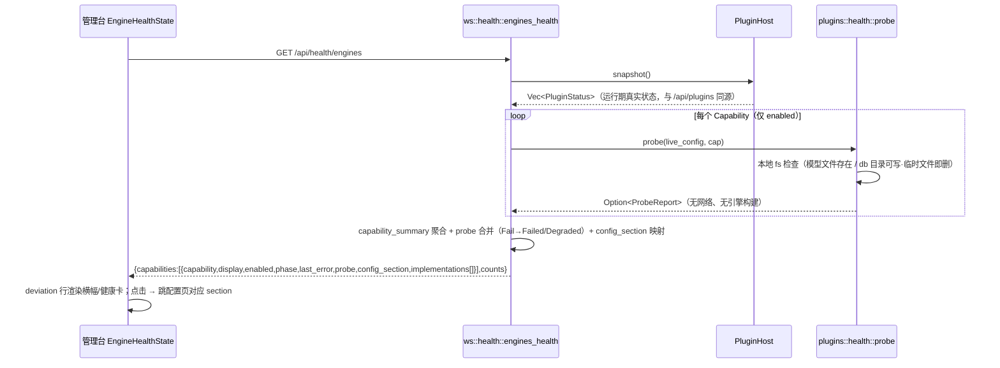
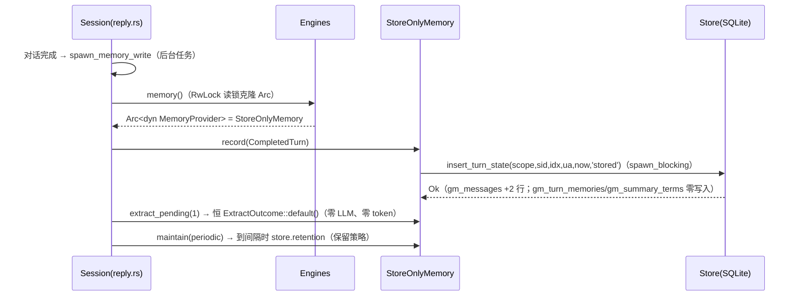
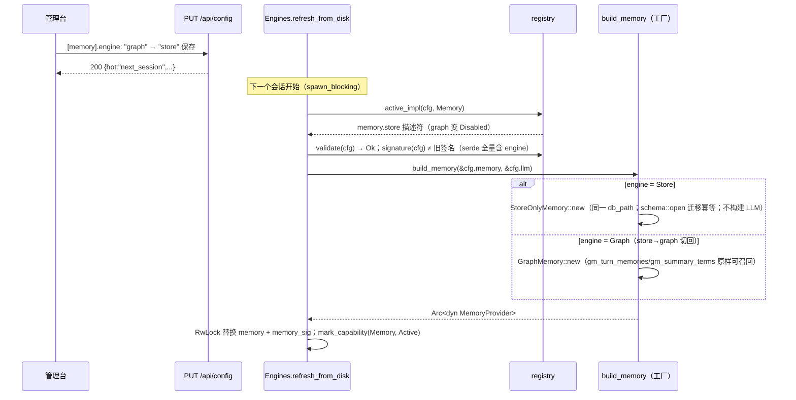
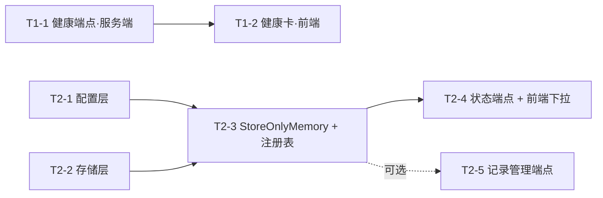

# P1 第一轮增量设计：P1-6 引擎健康自检 + P1-7 记忆多后端注册表（历史设计与实施记录）

> 定位：本文是 P1 第一轮（P1-6 引擎健康自检、P1-7 记忆多后端注册表）的历史长文；方案、任务和验收映射保留原语境，不把当时“剩余工作”或可选项当作当前状态。
> 章节分布：§0–§1.2 见[健康自检维护](<../server/src/plugins/health/AGENTS.md>)与[记忆维护](<../server/src/plugins/memory/AGENTS.md>)；**§1.3–§5 见本页**；§6–§8 见[管理台界面设计与验收记录](<admin-ui-design.md>)。
> 文中形如 `agents.md §N` 或 `AGENTS.md §N` 的引用指重组前的旧长文。
> 当前入口：[健康自检维护](<../server/src/plugins/health/AGENTS.md>)、[记忆维护](<../server/src/plugins/memory/AGENTS.md>)。

---

## 1. 实现方案（§1.3 起；§1.1 健康自检设计见健康自检维护，§1.2 记忆多后端见记忆维护）

### 1.3 文件清单总表

| # | 文件 | 动作 | 任务 |
|---|---|---|---|
| 1 | `server/src/plugins/health.rs` | 新建 | T1-1 |
| 2 | `server/src/plugins/health/tests.rs` | 新建 | T1-1 |
| 3 | `server/src/plugins/mod.rs` | +`pub mod health;` | T1-1 |
| 4 | `server/src/plugins/host.rs` | 提取 `CapabilitySummary`/`capability_summary`；`capabilities_json` 改为复用 | T1-1 |
| 5 | `server/src/app/ws/health.rs` | 新建（engines_health handler） | T1-1 |
| 6 | `server/src/app/ws/health/tests.rs` | 新建 | T1-1 |
| 7 | `server/src/app/ws/mod.rs` | 路由 + mod + 注释 | T1-1 |
| 8 | `client/shared/src/commonMain/kotlin/com/xiaozhi/admin/EngineHealthState.kt` | 新建 | T1-2 |
| 9 | `client/shared/src/commonMain/kotlin/com/xiaozhi/admin/EngineHealthCard.kt` | 新建 | T1-2 |
| 10 | `client/.../admin/OpsPages.kt` | renderOpsOverview 增参 + 横幅/健康卡插入 | T1-2 |
| 11 | `client/.../admin/ConfigCards.kt` | renderConfigLayout 增参 + overview 分支 | T1-2 |
| 12 | `client/.../admin/AdminPage.kt` | 数据源 + 加载 + 调用点 + 跳转 lambda | T1-2 |
| 13 | `client/.../macosArm64Main/.../AdminShell.kt` | renderConfigLayout 调用点增参 | T1-2 |
| 14 | `client/.../admin/ConfigPage.kt` | 同上 | T1-2 |
| 15 | `server/src/plugins/memory/config.rs` | MemoryBackend+Store、自定义 Deserialize、active()/engine_id() | T2-1 |
| 16 | `server/src/plugins/registry/fields_context.rs` | engine 枚举元数据 + help | T2-1 |
| 17 | `server/src/plugins/memory/tests.rs` / `server/src/config/tests.rs` | 新变体/未知值/默认回归 | T2-1 |
| 18 | `server/src/plugins/memory/store.rs` | insert_turn_state / turn_count / message_scope_counts | T2-2 |
| 19 | `server/src/plugins/memory/types.rs` | MemoryStats.turns + to_json | T2-2 |
| 20 | `server/src/plugins/memory/graph.rs` | stats() 填 turns | T2-2 |
| 21 | `server/src/plugins/memory/store/tests.rs` | 新查询测试 | T2-2 |
| 22 | `server/src/plugins/memory/store_only.rs`（+tests.rs） | 新建 StoreOnlyMemory | T2-3 |
| 23 | `server/src/plugins/memory/mod.rs` | mod/pub use/build_memory 分发 | T2-3 |
| 24 | `server/src/plugins/registry/impls.rs` | sel 拆分 + MEMORY_STORE | T2-3 |
| 25 | `server/src/plugins/registry/mod.rs` | REGISTRY+1、Memory display 改「记忆」 | T2-3 |
| 26 | `server/src/plugins/registry/tests.rs` | 护栏 1/6 | T2-3 |
| 27 | `server/src/app/ws/memory.rs` | （极小）status 无结构改动，确认 turns 透出 | T2-4 |
| 28 | `client/.../admin/ConfigContextState.kt` | memoryBackendOptions + store | T2-4 |
| 29 | `client/.../admin/ConfigSoulMemoryCards.kt` | store 定位说明 textNote | T2-4 |
| 30 | （可选）`server/src/plugins/memory/store/listing.rs`（+tests）、`ws/memory.rs`、`ws/mod.rs` | 记录列表/删除端点 | T2-5 |

---

## 2. 数据结构与接口

### 2.1 `GET /api/health/engines` 响应 schema

```jsonc
{
  "ok": true,
  "generated_ms": 1760000000000,          // 服务端生成时刻（前端不依赖本地时钟）
  "counts": { "active": 6, "degraded": 1, "failed": 0, "disabled": 4, "total": 11 },
  "capabilities": [
    {
      "capability": "memory",             // Capability::id()
      "display": "记忆",
      "required": false,
      "enabled": true,
      "phase": "degraded",                // 合并后终态：四档口径沿用（disabled/active/degraded/failed）
      "deviation": true,
      "active_impl": "memory.graph",      // 当前选中实现 id（未启用为 null）
      "last_error": "[memory].db_path 所在目录不可写：…（怎么修）",
      "config_section": "memory",         // 前端跳转锚点；voices 为 null；fullchain→"aiui"、firmware→"ota"
      "probe": {                          // null = 无探测项或未启用
        "state": "fail",                  // "ok" | "fail"（第一版两档）
        "detail": "…"                     // 探测原始结论（与 last_error 同文案时也保留，便于区分来源）
      },
      "implementations": [ /* PluginStatus::to_json 数组，与 /api/plugins 完全同构 */ ]
    }
  ]
}
```

- 幂等性：两次调用除 `generated_ms` 外逐字段一致；不产生引擎构建、不产生网络请求（PRD 验收 6）。
- `phase` 合并规则：`host 快照 phase` 与 `probe(Fail → required?Failed:Degraded)` 取更坏者；`disabled` 项不跑 probe（`probe: null`、`last_error: null`，PRD 验收 2）。

### 2.2 `MemoryBackend` 与 `MemoryStats` 扩展

```rust
// memory/config.rs —— serde 取值：graph | store | none（自定义 Deserialize，中文报错）
pub enum MemoryBackend { Graph, Store, None }

// memory/types.rs —— additive
pub struct MemoryStats {
    pub engine: &'static str,     // "graph" | "store" | "none"
    pub active: bool,
    pub db_path: String,
    pub db_bytes: u64,
    pub turns: i64,               // ← 新增：累计轮次数（store 的核心计数；graph 一并填充）
    pub messages: i64, pub memories: i64, pub pending: i64, pub quarantined: i64,
    pub scopes: Vec<(String, i64)>,
    pub lexical_only: bool,       // store 恒 true（无召回）
    pub extractor: String,        // store 为空串
    pub error: Option<String>,
}
// to_json 增加 "turns"；GET /api/memory/status 自动透出（PRD 验收 6 后半句）
```

### 2.3 DDL：**零变更**

- 不新增表、不新增列、不改索引；`LATEST_VERSION` 保持 2，迁移只追加纪律零触碰。
- 唯一存储层变化：`gm_messages.extraction_state` 的**取值集合**增加 `'stored'`（代码约定，非 schema 变更）。graph 的抽取队列（`WHERE extraction_state='pending'`）与 store 数据天然隔离。
- `GET /api/memory/turns`（可选 T2-5）：纯读 `gm_messages` 按 (scope, session_id, turn_index) 分组，利用既有 `idx_gm_messages_scope_turn` 索引，零新索引。

### 2.4 类图（核心类型关系）

```mermaid
classDiagram
  class Capability { <<enum>> 11 变体 }
  class PluginDescriptor { +id: &'static str
    +capability: Capability
    +validate: fn(&Config) -> Result
    +build: Option~fn~
    +warn_if: Option~fn~
    +selected: fn(&Config) -> bool }
  class PluginHost { -statuses: RwLock~Vec~PluginStatus~~
    +plan(cfg) Arc~Self~
    +boot(cfg) Result
    +snapshot() Vec~PluginStatus~
    +capability_summary(cap) CapabilitySummary }
  class PluginStatus { +phase: Phase +enabled: bool +last_error: Option~String~ }
  class Phase { <<enum>> Disabled Active Degraded Failed }
  class CapabilitySummary { +phase: Phase +enabled: bool +active_impl +last_error +impls }
  class ProbeState { <<enum>> Ok Fail }
  class ProbeReport { +state: ProbeState +detail: Option~String~ }
  class health { <<module plugins::health>> +probe(cfg, cap) Option~ProbeReport~ }
  class EnginesHealth { <<handler ws::health>> +engines_health(engines) Response }

  PluginDescriptor "*" --> "1" Capability : REGISTRY 13 条
  PluginHost "1" o-- "*" PluginStatus : snapshot
  PluginHost ..> CapabilitySummary : 聚合（/api/plugins 与 /api/health/engines 同源共用）
  health ..> ProbeReport : 产出
  health ..> Capability : match 全量穷尽（编译期护栏）
  EnginesHealth ..> PluginHost : snapshot
  EnginesHealth ..> health : probe（仅 enabled 项）

  class MemoryProvider { <<trait>> +name() +recall() +record() +extract_pending() +maintain() +stats() +clear() }
  class NoopMemory
  class GraphMemory { +cfg: MemoryConfig +store: Arc~Store~ +llm: Llm }
  class StoreOnlyMemory { +cfg: MemoryConfig +store: Arc~Store~ }
  class Store { +insert_turn(state) +turn_count() +search() +counts() +retention() +clear() }
  class MemoryBackend { <<enum>> Graph Store None }
  class MemoryConfig { +engine: MemoryBackend +active() +engine_id() +validate() }
  class build_memory { <<工厂·唯一分发点>> }

  MemoryProvider <|.. NoopMemory
  MemoryProvider <|.. GraphMemory
  MemoryProvider <|.. StoreOnlyMemory
  GraphMemory o-- Store : gm_* 全套
  StoreOnlyMemory o-- Store : 仅 gm_messages（state='stored'）
  MemoryConfig *-- MemoryBackend : 自定义 Deserialize
  build_memory ..> MemoryProvider : 按 engine 分发（boot 与 refresh_memory 共用）
  PluginDescriptor ..> MemoryProvider : Built::Memory(Arc~dyn~)
```

### 2.5 时序图

**P1-6：`GET /api/health/engines`（只读投影）**



**P1-7：store 后端的对话写入（零 LLM 路径）**



**P1-7：graph ⇄ store 热切换（refresh_memory，签名含 engine 必触发重建）**



---

## 第一轮任务与共享护栏


## 3. 任务列表（按实现顺序，P1-6 = T1-x，P1-7 = T2-x）

> 粒度口径：一个任务 = 工程师一次可完成的一个 cohesive 变更（含单测与双 feature 编译验证）。
> 每个任务的 DoD 都含：`cargo test`（默认 + `--features sherpa` 类型检查）全绿、不破坏既有 402 个测试；前端任务另加 `:shared:compileKotlinJs` + `compileKotlinMacosArm64`。

### T1-1（P0）P1-6 服务端：探测模块 + 聚合端点
- **文件**：新建 `server/src/plugins/health.rs` + `plugins/health/tests.rs`；新建 `server/src/app/ws/health.rs` + `app/ws/health/tests.rs`；改 `plugins/mod.rs`（+1 行）、`plugins/host.rs`（CapabilitySummary 提取）、`app/ws/mod.rs`（路由）
- **内容**：ProbeState/ProbeReport + probe() 四类探测项 + capability 全量 match；host 聚合 helper 提取（capabilities_json 行为不变）；`GET /api/health/engines`（phase 合并 + config_section + counts + implementations[]）
- **依赖**：无。**可与 T2-1、T2-2 并行**
- **验收映射**：P1-6 验收 1/2/4/6

### T1-2（P0）P1-6 前端：健康横幅 + 能力健康卡 + 跳转
- **文件**：新建 `EngineHealthState.kt`、`EngineHealthCard.kt`；改 `OpsPages.kt`、`ConfigCards.kt`、`AdminPage.kt`、`AdminShell.kt`、`ConfigPage.kt`
- **内容**：LoadableState 数据源；healthBanner（概览页顶、仅 deviation 渲染、可点击跳配置 section）；engineHealthCard（配置页总览 section）；三壳接线与跳转 lambda
- **依赖**：T1-1（响应 schema 定稿）。可与 T2-x 全部并行
- **验收映射**：P1-6 验收 3（横幅露出）/5

### T2-1（P0）P1-7 配置层：MemoryBackend::Store + 中文反序列化报错
- **文件**：改 `memory/config.rs`、`registry/fields_context.rs`；补 `memory/tests.rs`、`config/tests.rs`
- **内容**：枚举加 Store；自定义 Deserialize（中文怎么修报错）；active() 语义扩展为 `enabled && engine != None`；engine_id；schema engine 字段 Enum options 加 "store" + help 更新
- **依赖**：无。**可与 T1-1 并行**
- **验收映射**：P1-7 验收 4/5（默认回归）

### T2-2（P0）P1-7 存储层：state 参数化 + 轮次计数
- **文件**：改 `memory/store.rs`、`memory/types.rs`、`memory/graph.rs`；补 `memory/store/tests.rs`
- **内容**：insert_turn_state（'pending' 委托保持 graph 零变化）；turn_count / message_scope_counts；MemoryStats.turns + to_json；graph stats 填 turns
- **依赖**：无。**可与 T1-1、T2-1 并行**
- **验收映射**：P1-7 验收 1（计数的存储基础）

### T2-3（P0）P1-7 后端实现 + 注册表挂载 + 热切换兼容
- **文件**：新建 `memory/store_only.rs` + `store_only/tests.rs`；改 `memory/mod.rs`、`registry/impls.rs`、`registry/mod.rs`、`registry/tests.rs`
- **内容**：StoreOnlyMemory（record→'stored'、recall 恒空、extract 恒零、maintain=retention、stats、clear）；build_memory 分发；MEMORY_STORE 描述符 + sel 拆分；REGISTRY 13 条 + Memory display 改「记忆」；护栏测试（枚举↔注册表、store 行为、graph⇄store 切换数据保留、REGISTRY 计数断言同步）
- **依赖**：T2-1、T2-2
- **验收映射**：P1-7 验收 1/2/3/5

### T2-4（P0）P1-7 状态端点确认 + 前端下拉
- **文件**：改 `app/ws/memory.rs`（确认 turns 透出，预期极小改动）；改 `ConfigContextState.kt`、`ConfigSoulMemoryCards.kt`
- **内容**：memoryBackendOptions 加 store 项；store 选中时的定位说明 textNote；`/api/memory/status` 的 engine/turns 字段验证
- **依赖**：T2-3
- **验收映射**：P1-7 验收 6

### T2-5（P1，可选，可裁剪）记忆记录管理端点（列表/删单条）
- **文件**：新建 `memory/store/listing.rs` + `listing/tests.rs`；改 `app/ws/memory.rs`、`app/ws/mod.rs`
- **内容**：`GET /api/memory/turns?scope=&limit=&offset=`（gm_messages 按轮分组，走既有 scope_turn 索引）+ `POST /api/memory/turns/delete`（{scope, session_id, turn_index}）；独立连接（schema::open 幂等 + WAL + busy_timeout），**不进 MemoryProvider trait**
- **依赖**：T2-3。标注：PRD 未列 P0，按团队负责人提示纳入设计；不做管理 UI（curl 验证，UI 属 P2）

### 任务依赖图



**并行点**：T1-1 ∥ T2-1 ∥ T2-2 三路可同时开工（代码面零重叠）；T1-2 只依赖 T1-1，可与 T2-3/T2-4 并行；关键路径 = T2-1/T2-2 → T2-3 → T2-4。

---

## 4. 依赖包列表

**零新增。**

- P1-6：axum / serde_json / rusqlite 均已在依赖内；探测只用 `std::fs`。
- P1-7：StoreOnlyMemory 复用 rusqlite（bundled 已编译进二进制，无体积增量）；**不构建 LLM 客户端**（reqwest 不新增实例化路径）。
- 满足 NF-1（离线单二进制）与 NF-4（零成本默认）：Cargo.toml 零 diff，二进制体积仅增加新代码本身的机器码（量级 KB）。

---

## 5. 共享知识（跨文件约定，工程师必读）

1. **同源纪律（P1-6 核心）**：`/api/health/engines` 与 `/api/plugins` 的 capability 聚合必须共用 `PluginHost::capability_summary`——禁止在端点里手写第二份 fold，否则两处状态分叉（PRD 明示的最大风险）。
2. **探测纪律**：`plugins::health::probe` 只允许本地 fs 检查（metadata / 临时文件创建后立即删除）；禁止网络、禁止引擎构建。这是验收 6（幂等无副作用）的结构保证，代码评审重点盯。
3. **`'stored'` 状态语义**：`gm_messages.extraction_state='stored'` = store 后端写入、永不进入 graph 抽取队列。任何新代码不得把它改回 'pending' 批量回填——回填是 P2 的显式管理动作（成本可控性）。
4. **`build_memory` 是唯一分发点**：boot（`build_optional`）与 `refresh_memory`（engine.rs:309）都调它；新增后端只改这一处 match + 描述符，engine.rs 永远不动。
5. **签名纪律**：memory 签名 = `cfg.memory.signature()`（serde 全量，含 engine）→ 后端切换必触发重建；签名含密钥**绝不打日志**。
6. **错误文案口径**：中文 + 「怎么修」+ 合法值列表（对齐 `unknown_engine_hint`）；`MemoryBackend` 自定义 Deserialize 的报错是新范本。
7. **Kuikly 组件复用清单**（新页面/新卡片必须复用，见 `client/.../admin/`）：`groupedCard` / `metricRow` / `textNote(tone,micro)` / `statusBadge` / `opsHeader` / `opsScroller` / `skeletonCard` / `LoadableState` 基类 / `secondaryButton` / `primaryButton` / `labeledField` / `switchRow` / 下拉用官方 `AlertDialog` 范式。AdminTheme 是唯一组件层，禁止散写样式。
8. **Kuikly 响应式铁律**：observable 只在 attr/vif 闭包内读取才被跟踪；渲染扩展必须是 `ViewContainer` 扩展且在目标容器闭包内**非限定**调用；`ViewBuilder` 显式传接收者。
9. **下拉双权威（已知重复）**：服务端 `FieldKind::Enum` options（校验/schema）+ 客户端 `memoryBackendOptions`（展示文案）两处同改；护栏测试只守服务端侧，客户端侧靠联调（保存 store → status 回读 store）覆盖。
10. **工程约定**：逻辑文件 ≤600 行（impls.rs 517→~557、store.rs 513→~565 均在限内，超出即拆子模块）；测试一律外移 `<name>/tests.rs`；不自动 commit；cargo 命令必须带 USTC sparse 镜像 config；验证 = 默认 `cargo test` + `DOCS_RS=1 cargo check --features sherpa`；前端 = `compileKotlinJs` + `compileKotlinMacosArm64`（或 `publishWeb`）。
11. **跳转链路**：概览页跳配置 section = `selectedSection = "config"` + `form.configSection = <section>`；配置页内部 = `form.configSection = <section>`。`config_section` 映射由服务端下发（fullchain→aiui / firmware→ota / voices→null），客户端不自维护第二份。

---
