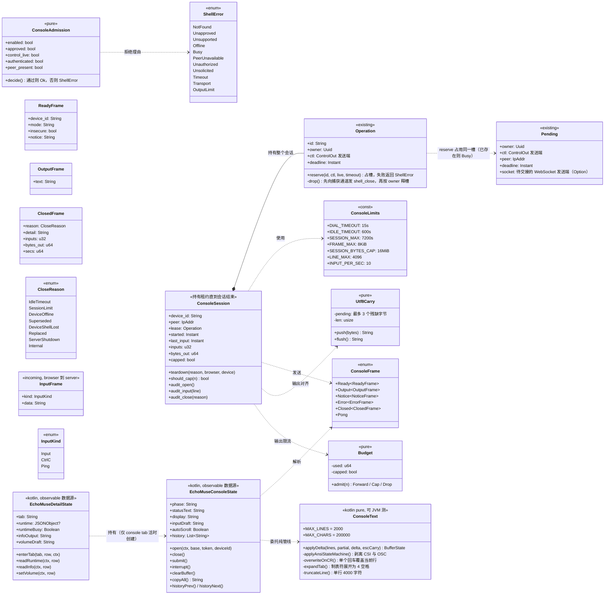
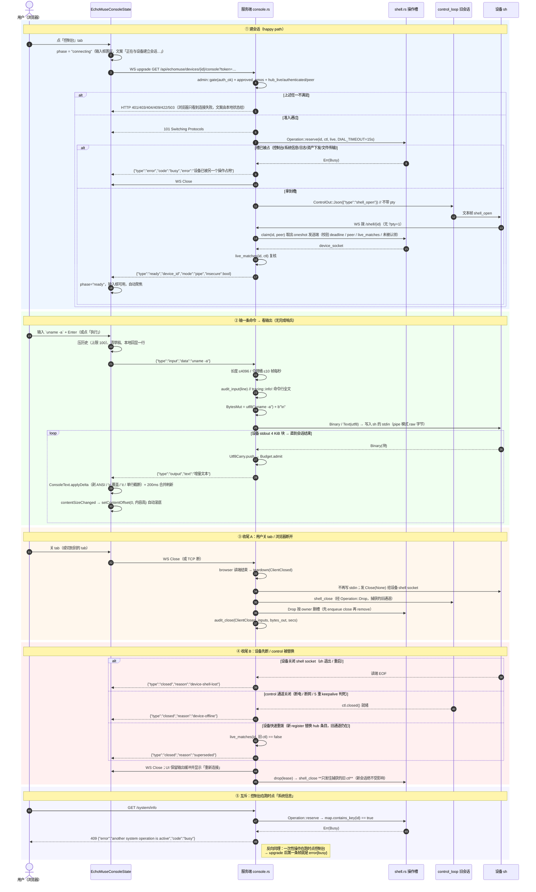
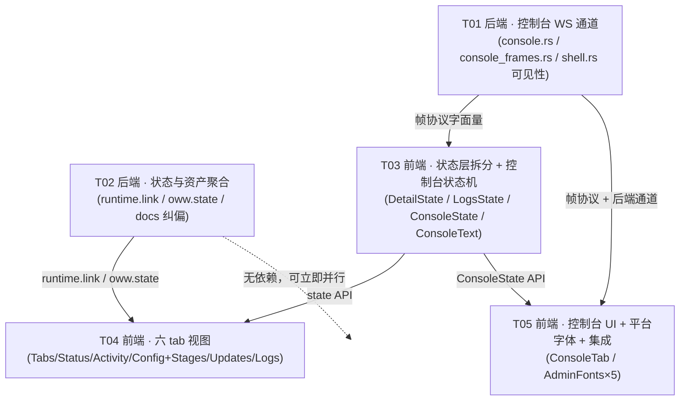

# EchoMuse 设备管理界面官方对齐 + Web 控制台 · 系统设计与任务分解

> 作者：高见远（架构）｜状态：待评审｜依托 PRD：`docs/plans/echomuse-admin-parity-prd.md`
> 上游唯一功能来源：`/tmp/upstream/controller_static_dashboard.jsx`（11658 行）、`controller_em_controller.py`、`controller_em_shell.py`、`device_control.go`、`device_internal_config_config.go`
> 我方现状：`server/src/device/echomuse/`、`client/shared/src/commonMain/kotlin/com/xiaozhi/admin/`
> 本文档**不改任何源码**，只描述设计与任务。

---

## 0. 先读结论（三条纠偏，开工前必须先认下）

在设计前逐条自查了上游与我方源码，有三处与「既有认知/PRD」不一致，**以本文为准**（都给了自证行号）：

### 0.1 设备 shell 是「同一个 `sh` 进程」，不是逐条执行

`device_control.go:1120` `cmd := exec.CommandContext(ctx, "/system/bin/sh")` 只跑一次，`1165-1217` 的输出/输入两个 goroutine 全程喂**同一个**进程。因此 `cd`、环境变量、shell 函数在后续命令里**保持**。

- pipe 模式（`shell_open` 不带 `pty`）确实**无回显、无提示符、无 ANSI、输出恒为 Binary 帧（4 KiB 块）**（`1170-1183`），`stderr` 合入 `stdout`（`1146`）。
- **PRD §9 Q1 的「可能逐条执行」是错的**。UI 不得写「每条命令独立执行、`cd` 不保持」；应写「同一 `sh` 会话，`cd`/环境变量保持；本终端不回显、无提示符」。

### 0.2 配置键边界：真正缺的设备线缆键是 3 个，`vadChannel` **不是**

设备 `ConfigMessage`（线缆结构，`device_internal_config_config.go:542-621`）里的可下发键与我方 `SETTINGS_KEYS`（`server/src/device/echomuse/admin.rs:161-213`，39 键）逐一比对：

| 结论 | 键 | 依据 |
|---|---|---|
| 我方**缺**的设备线缆键 | `consolePassword`（*string）、`consoleTimeoutMin`（*int）、`sendspinUnpaired`（*bool） | `config.go:569`、`:582`、`:593` |
| **不是**线缆键，**禁止**加白名单 | `vadChannel` | 只在 `Device` 结构体（`config.go:25`）且仅由环境变量 `VAD_CHANNEL` 注入（`config.go:210`）；`ConfigMessage` 里根本没有该字段 |
| `docs/echomuse.md:135` 的错误声明 | 该行称白名单含 `ledScene`/`ledListenColor`/`ledThinkColor`/`meter*`/`nsAsr`/`buttonSingleTapEvent`/`buttonMultiTapMs`/`owwSpeexNs` | 这些键在 `config.go` 的 `Device` **和** `ConfigMessage` 里都不存在；代码实际收的是 `listeningAnim`。**文档必须纠正**（见 T02） |

`consolePassword`/`consoleTimeoutMin` 的语义要写清：它们写盘给 **emOS USB 串口 console 的 init**（FireOS 用 adbd，忽略这两个键），**与本设计新增的 WS 控制台毫无关系**——控件文案必须区分，否则用户会以为「网页控制台的口令」。

### 0.3 服务端没有优雅退出，`server-shutdown` 只能是保留码

`server/src/main.rs:196` 阻塞在 `serve::serve_with_keepalive(listener, app).await?`，全仓无 `ctrl_c`/信号处理（`grep` 无命中）。因此进程退出的那一刻浏览器只会看到传输层断开（`1006`），**不可能**收到 `closed{reason:"server-shutdown"}` 帧。本设计把该码定义为**保留码**，不接线、不发假帧（若将来加信号处理，调 `console::shutdown_all()` 即可启用）。

---

## A. 系统设计

### 1. 实施思路

#### 1.1 三个技术难点

| # | 难点 | 本质 | 结论性方案 |
|---|---|---|---|
| D1 | **长驻会话与一次性 shell 操作共用一把 per-device 槽** | 现有 `shell.rs` 的 `Pending`/`Operation`/`claim()` 是为「一次性 HTTP 操作」设计的：owner UUID + oneshot 交 socket + 15s deadline + `Drop` 先 `shell_close` 再释槽 | **不改一次性语义**，直接把 `Operation` 当**长驻租约**用：`reserve()` 拿到的 `Operation` 不在 15s 后丢弃，而是活到会话结束；`Pending.deadline` 继续只当**设备回拨期限**（claim 过期判定），会话时长由 pump 自己的定时器管。见 §5.1 |
| D2 | **收尾路径四条，且不能互相踩** | 浏览器先关 / 设备先断 / control 被替换 / 服务端退出，任一路径都持有「设备 shell socket + 槽 + control 通道」三件东西 | 单一 `teardown(reason)` 出口 + 固定顺序 + `Drop` 兜底（owner 校验）。要点：`shell_close` **只发往捕获的旧 control 通道**，绝不用 `hub_ctl(id)`（那是新会话）。见 §5.3 |
| D3 | **Kuikly 没有终端** | 无 DOM、无 xterm、无 `ResizeObserver`、无光标定位 | 行模式终端：`Scroller` + 单个 `Text` + 环形行缓冲 + 200 ms 合并刷新；自动滚底用官方 `contentSizeChanged` → `setContentOffset`。见 §6.4 |

#### 1.2 框架与库选择（**不新增任何依赖**）

| 层 | 选择 | 理由 |
|---|---|---|
| 传输 | axum `WebSocketUpgrade`（服务端）+ 平台原生 WS（客户端，走既有 `PlatformWsSocket`） | 已有 `/shell/{id}`、`/api/admin/ws`、`/api/logs` 三条 WS 先例；`PlatformWsSocket` 是 `expect class`，web/mac/iOS 有 actual，Android `PLATFORM_WS_SUPPORTED=false` 退化 |
| 服务端会话协调 | `tokio::select!` + `oneshot` + `tokio::time::sleep_until` | 与 `shell.rs` 现有机制同构；不引入 `tokio-util`/`dashmap` |
| 帧编码 | `serde_json`（已在依赖里） | 帧极少、体积小，JSON 便于抓包与手测；DB3 |
| 前端渲染 | 只允许 `com.xiaozhi.admin.ui.*` 现成原语 + 官方 Kuikly 组件 | PRD §7.1 硬约束；不引入 xterm.js/WebView |
| 前端纯逻辑单测 | `client/adminCoreTests`（JVM，`kotlin.include(...)` 显式纳目录） | 已有 `EchoMuseWakeWordTest` 等先例；新纯函数（ANSI 剥离/`\r` 覆盖/环形截断）必须可测 |

#### 1.3 架构模式

- **服务端**：路由薄、决策纯函数化（沿用 `admin.rs` 的 `*_plan()` 风格）。`console.rs` 只做「鉴权 → 决策 → 泵」；帧编解码与限流判定放 `console_frames.rs` 的**纯函数**，供外置测试直驱。
- **客户端**：`State`（observable 数据源）+ `View`（`ViewContainer` 扩展）分离，沿用 `EchoMuseState`/`EchoMuseDeviceCard.kt` 现有范式；控制台独立成 `EchoMuseConsoleState`，不挂在页级 state 上（避免 200 ms 刷屏波及整页重组）。

---

### 2. 文件清单

#### 2.1 后端（`server/src/device/echomuse/`）

| 文件 | 动作 | 职责 | 预估行数 |
|---|---|---|---|
| `console.rs` | **新增** | 控制台 WS 端点、准入、长驻租约、双向泵、定时器、审计、收尾 | ~420 |
| `console_frames.rs` | **新增** | 帧协议常量 + 编解码 + 限流/长度判定纯函数 + 增量 UTF-8 对齐器 | ~170 |
| `console_tests.rs` | **新增**（外置） | 槽互斥/租约 owner/收尾顺序/帧形状/限流/UTF-8 边界 | ~300 |
| `shell.rs` | 改 | 仅可见性：`Operation`→`pub(super)`，暴露 `reserve()`、`owner`/`deadline`/`ctl`/`id` 取值，`live_matches`→`pub(super)`。**行为零变化** | +18/-4 |
| `admin.rs` | 改 | `admin_routes()` 追加 `.merge(super::console::routes())` 一行 | +1 |
| `oww.rs` | 改 | 新增 `GET /api/echomuse/devices/{id}/oww/state`（复用既有 `device_state()`/`parse_free_mb`/`vad_asset`/`ort_asset`） | +75 |
| `runtime.rs` | 改 | `payload()`/`offline_payload()` 增补 `link` 字段（`authenticated` + `token_required`），纯附加字段 | +14 |
| `system.rs` | 改 | `get_runtime` 传入 `token_required`；`routes()` 不变 | +4 |
| `oww_tests.rs` | 改 | 资产四态判定纯函数回归 | +40 |
| `runtime_tests.rs` / `system_tests.rs` | 改 | `link` 字段与 settings 白名单边界回归 | +30 |

> 后端行数合计新增 ~1000 行，全部单文件 ≤600。

#### 2.2 前端（`client/shared/src/commonMain/kotlin/com/xiaozhi/admin/`）

| 文件 | 动作 | 职责 | 预估行数 |
|---|---|---|---|
| `EchoMuseState.kt` | **瘦身** | 保留：设备行模型、列表加载、实时订阅、审批、删除、WiFi 下发、settings 下发（通用 `post()`）；**移除** `menuItem`/`selectMenu`/`activeMenuItem`/四个 `fill*Draft` 与全部音频草稿字段 | 1039 → ~380 |
| `EchoMuseConfigDrafts.kt` | **新增** | 从 `EchoMuseState` 搬出的配置草稿 + `fillConfigDrafts()` + `saveConfig()`（部分更新语义原样保留） | ~340 |
| `EchoMuseDetailState.kt` | **新增** | 详情卡片的 tab 选中、进 tab 懒加载/停轮询、`runtime` 结构化快照、`system/info` 折叠区、音量下发 | ~230 |
| `EchoMuseLogsState.kt` | **新增** | 日志 tab：六源白名单下拉 + 读取 + 复制（从 `EchoMuseManagementState` 搬） | ~170 |
| `EchoMuseConsoleState.kt` | **新增** | 控制台状态机：WS 通道、六种状态、历史、Ctrl-C、清屏、复制、自动滚底 | ~380 |
| `EchoMuseConsoleText.kt` | **新增** | 纯文本管线：ANSI 剥离、`\r` 覆盖、`\t` 展开、单行截断、行/字符双上限环形缓冲 | ~200 |
| `EchoMuseDetailTabs.kt` | **新增** | 六 tab 骨架：tab 集合 + `tabBar`（宽度自适应）+ `vif` 分发 + 未批准审批单页 + 头部（LCD 牌位） | ~190 |
| `EchoMuseStatusTab.kt` | **新增** | 状态 tab：Device 面板 + Resources（StatBar×3 + StatTile×3）+ 蓝牙摘要 + 系统诊断折叠 | ~340 |
| `EchoMuseActivityTab.kt` | **新增** | 活动 tab：六个统计位（2 实 4 `—`）+ 空态 + 「未采集」副标 | ~130 |
| `EchoMuseConfigTab.kt` | **新增** | 配置 tab：顶部 WiFi 三块（当前连接/可见网络/切换网络）+ 7+1 个 Stage 容器 + 「下发配置」条 | ~300 |
| `EchoMuseConfigStages.kt` | **新增** | Stage 01–08 的表单体（只渲染 §6 标 ✅ 的键） | ~430 |
| `EchoMuseUpdatesTab.kt` | **新增** | 更新 tab：版本只读 + VAD/ORT 资产四态 + 维护（重启/复制诊断/重装） | ~250 |
| `EchoMuseLogsTab.kt` | **新增** | 日志 tab 视图 | ~130 |
| `EchoMuseConsoleTab.kt` | **新增** | 控制台 tab 视图：输出区 + 输入行 + 工具条 + 六态文案 + 关于行模式折叠 | ~300 |
| `EchoMuseDeviceCard.kt` | **瘦身** | 只留 header（标题/状态/删除确认）+ 把 body 委派给 `echoMuseDetailTabs` | 613 → ~150 |
| `EchoMusePage.kt` | 微改 | `onOpenModelFiles` 透传保持；无其它改动 | +0 |
| `EchoMuseManagementCard.kt` | **删除** | 四 tab 外壳整体废弃（内容见 §6.2 归位表） | -251 |
| `EchoMuseManagementState.kt` | **删除** | 拆到 `EchoMuseDetailState`/`EchoMuseLogsState` | -360 |
| `EchoMuseAudioPanel.kt` | **删除** | 内容拆分进 `EchoMuseConfigStages.kt` 的 01/03/04/05/08 | -142 |
| `EchoMuseWakeWord.kt` | 保留 | 纯函数库（量程/选项/展示名），仅被 Stage 02 调用 | 0 |
| `EchoMuseMusicPanel.kt` | 改 | 改为 Stage 08 的 `after` 区块入口（内容基本原样） | 109 → ~110 |
| `EchoMuseBleCard.kt` | 保留 | 挂到 Stage 06 的 `after`（官方同位置 `10443`） | 0 |
| `AdminFonts.kt` | **新增** | `expect val ADMIN_MONO_FONT: String`（等宽族名） | ~15 |

> 前端新增/改造后每个文件 ≤600 行；`EchoMuseState.kt` 从 1039 拆成 380 + 340，其它大文件同步拆开。

#### 2.3 平台 actual（4 个，各 ~6 行）

| 文件 | 动作 |
|---|---|
| `client/shared/src/jsMain/kotlin/com/xiaozhi/admin/AdminFonts.kt` | `actual val ADMIN_MONO_FONT = "monospace"`（CSS 通用族，浏览器必命中） |
| `.../macosArm64Main/.../AdminFonts.kt` | `= "Menlo"`（系统自带） |
| `.../iosMain/.../AdminFonts.kt` | `= "Menlo"` |
| `.../androidMain/.../AdminFonts.kt` | `= "monospace"`（Android `Typeface` 通用族） |

> ⚠️ `shared` 的目标集合是 `androidTarget` / `js(IR)` / `iosArm64+iosSimulatorArm64` / `macosArm64`（`shared/build.gradle.kts:38-85`），源集只有 `androidMain`/`commonMain`/`iosMain`/`jsMain`/`macosArm64Main`。新增 `expect` 必须**同一次提交内**把 4 个 actual 都补齐，否则 `js`/`macos`/`ios`/`android` 任一目标编译失败。

#### 2.4 文档

| 文件 | 动作 |
|---|---|
| `docs/echomuse.md` | 改：`135` 行白名单声明纠正（去掉 8 个不存在的键，改按代码实况描述 39 键，并注明设备真缺的是 `consolePassword`/`consoleTimeoutMin`/`sendspinUnpaired` 三键）；管理面一节补 `/console`（WS）、`/oww/state` 两个端点；「刻意不做的范围」补一条「控制台 stdin 是命令通道，不是文件上传通道」 |

---

### 3. 数据结构与接口



#### 3.1 `shell.rs` 的最小改动（只动可见性，不动语义）

```rust
// 现状：struct Operation（私有）、fn live_matches（私有）、fn reserve（私有 impl 方法）
// 改为：
pub(super) struct Operation { pub(super) id: String, pub(super) owner: uuid::Uuid,
                              pub(super) ctl: UnboundedSender<ControlOut>, pub(super) deadline: Instant }
impl Operation { pub(super) fn reserve(...) }        // 签名不变
pub(super) fn live_matches(id: &str, ctl: &UnboundedSender<ControlOut>) -> bool   // 仅加 pub(super)
```

**为什么这样就够**：`Operation` 的 `Drop`（`shell.rs:158-170`）已经是「按 owner 校验后：先 enqueue `shell_close` 到**捕获的** ctl，再删槽」。一次性路径把它在 15 s 后丢掉；控制台把它持有 2 小时后再丢掉——**两条路径共用同一个类型、同一段 Drop，行为不可能分叉**。`Pending`（`shell.rs:135-141`）一个字节都不用改。

#### 3.2 后端端点契约

| 端点 | 鉴权 | 行为 |
|---|---|---|
| `GET /api/echomuse/devices/{id}/console`（**WS upgrade**） | 管理面 `auth_ok`（`?token=` 或 Bearer）+ 设备侧 `system_gate()` 五重条件 | 见 §5 |
| `GET /api/echomuse/devices/{id}/oww/state` | 同 `system_gate()` | `{"device_id","vad":{"state","sha256","bytes"},"ort":{"state","sha256"},"free_mb":u64\|null,"states":["installed\|outdated\|blocked\|unknown\|missing"],"checked_at":secs}`；`state` 五态判定用 `vad_asset()`/`ort_asset()` 摘要对比 `device_state()` 的 glob 结果，`free_mb < FREE_FLOOR_MB(50)` → `blocked`；读不到设备 → 200 + `states:["unknown"]`（**读不到 ≠ 缺失**，`oww.rs:530-532` 既有语义） |
| `GET /api/echomuse/devices/{id}/runtime`（**改**） | 不变 | 追加 `"link":{"authenticated":bool,"token_required":bool}`。`token_required = !cfg.echomuse.token.trim().is_empty()`；离线时两字段 `null` |
| 既有 `/system/info`、`/system/logs`、`/system/reboot`、`/oww/install-vad`、`/settings`、`/command`、`/music`、`/ble/*` | 不变 | **行为零变化**；控制台占槽期间它们照旧走 `Operation::reserve` → `Busy` → 409 |

---

### 4. 程序调用流程



---

### 5. 控制台专章（一期核心交付）

#### 5.1 长驻会话如何与一次性操作共用一把槽（D1 的完整答案）

**结构**：`pending()` 是一张 `Mutex<HashMap<String, Pending>>`（`shell.rs:143-147`），键是 `device_id`，值里带 `owner: Uuid`。

| 角色 | 一次性操作（现状，**完全不改**） | 控制台（新） |
|---|---|---|
| 占槽 | `Operation::reserve(id, ctl, live, OP_TIMEOUT=15s)` | `Operation::reserve(id, ctl, live, DIAL_TIMEOUT=15s)` |
| `Pending.deadline` 语义 | 整个操作的总 deadline | **仅**设备回拨期限（`claim()` 判过期） |
| 设备回拨后 | `exchange()` 发命令 → 等到哨兵 → 主动 `Close` | 把 socket 交给 pump，**一直用到会话结束** |
| 时长约束 | `timeout_at(op.deadline, work)` | pump 自己的 `sleep_until`：空闲 600 s / 硬上限 7200 s |
| 释放 | 函数返回 → `op` 落盘 → `Drop` | `teardown()` 结束 → `op` 落盘 → 同一段 `Drop` |
| 并发第二个请求 | `map.contains_key` → `Err(Busy)` → 409 | 同 → `error{busy}` |

**关键不变式（三条，测试必须钉住）**：
1. `Operation` 只在 `reserve()` 成功后存在。**没拿到槽的调用方手里没有 `Operation`，因此结构上不可能释放别人的槽**——上游 `em_shell.py:31-43` 里「用 `Lock.locked()` 冒充 `am I the owner`，导致等待者释放了持有者的锁」那类 bug 在这里不成立（`Drop` 里 `map.get(&id).is_some_and(|p| p.owner == self.owner)`，`shell.rs:161`）。上游 `owners[device_id] = current_task` + `release_lock` 判 owner（`em_shell.py:67`、`:93`）是同一思路的 Python 版，我们已经在 Rust 里用类型+UUID 表达。
2. **不抢过期槽**：`reserve` 不因为别人的 `deadline` 过期就抢占（`shell.rs:190-193` 注释「No stealing expired slots: the owner may still hold a connected socket」）。控制台持槽 2 小时，任何等待者都只会得到 `Busy`。
3. `shell_close` **只发往 `Operation.ctl`（占槽时刻捕获的那条 control 通道）**。绝不允许在收尾时用 `hub_ctl(id)` 现取——那会是设备重拨后的**新**会话，等于把新会话的 shell 关掉。

#### 5.2 帧协议完整表

**传输**：浏览器 ↔ 服务端一律 **JSON 文本帧**（`PlatformWsSocket` 的 web actual 只处理 `event.data as? String`，见 `jsMain/.../AdminRealtime.kt:53`，与「全文本」设计天然吻合）。服务端 ↔ 设备仍是原始字节（pipe 模式设备侧只知道二进制）。

**方向 1：服务端 → 浏览器**

| `type` | 字段 | 触发时机 | UI 动作 |
|---|---|---|---|
| `ready` | `device_id: String`、`mode: "pipe"`、`insecure: bool`（`[echomuse].token` 为空 → `true`）、`notice: String`（行模式说明，可空） | 设备回拨成功 + `live_matches` 复核通过之后，**任何 output 之前** | `connecting` → `ready`；输入框可用 + 自动聚焦；`insecure` 时顶部琥珀警告 |
| `output` | `text: String`（增量，可能含半个行/ANSI/`\r`，UTF-8 边界已对齐） | 设备 stdout 每块（设备侧 4 KiB 一块，`device_control.go:1170`） | 进 `ConsoleText.applyDelta`，200 ms 合并刷新 |
| `notice` | `code: "output-capped" \| "input-paused"`、`text: String` | 会话累计输出达 16 MiB 上限（仅一次） | 输出区尾部插一行提示，**不清缓冲、不断会话** |
| `error` | `code: "busy" \| "input-too-long" \| "rate-limited" \| "device-offline" \| "internal"`、`error: String`（中文） | 指令级拒绝；`busy` 时会话建立失败、随后关 WS；其余**连接保持** | `busy` → 状态「设备被占用」+ 重试按钮；其余在输出区打一行红字，会话继续 |
| `closed` | `reason: CloseReason`、`detail: String`、`inputs: u32`、`bytes_out: u64`、`secs: u64` | 会话结束（服务端随后关 WS） | 保留缓冲 + 按 reason 给文案 + 「重新连接」 |
| `pong` | — | 回应客户端 `ping` | 无 |

**方向 2：浏览器 → 服务端**

| `type` | 字段 | 触发时机 | 服务端行为 |
|---|---|---|---|
| `input` | `data: String`（一行，**不含** `\n`） | Enter / 点「执行」 | 长度 >4096 → `error{input-too-long}`，**不写设备**；否则写 `utf8(data) + "\n"` + `audit_input` |
| `ctrl-c` | — | 点「中断」或物理 Ctrl-C | 写单字节 `0x03` + audit（记为 `^C`） |
| `ping` | — | 25 s 无帧时保活（与 `AdminRealtime` 同一节奏） | 回 `pong` |
| `clear` | — | **不存在**：清屏是纯 UI 动作（缓冲在客户端） | — |

**错误码汇总（前后端必须逐字一致）**

| code | 语义 | 文案（前端） |
|---|---|---|
| `busy` | 槽被占（另一控制台/系统信息/日志/资产下发/文件传输） | `设备已被另一个操作占用（系统信息/日志/资产下发），请稍后重试` |
| `input-too-long` | 单行 >4096 B | `单行命令过长（上限 4096 字节），未发送` |
| `rate-limited` | 输入 >10 帧/秒 | `输入过快，已丢弃（每次最多 10 条/秒）` |
| `device-offline` | control 通道已断 | `设备离线——控制台不可用` |
| `internal` | 服务端内部错误 | `控制台内部错误：<detail>` |

**close reason 汇总**

| reason | 语义 | 前端文案 |
|---|---|---|
| `idle-timeout` | 600 s 无**输入**（输出流动不重置） | `会话因 10 分钟无输入已断开（输出已保留）` |
| `session-limit` | 单会话满 7200 s | `会话已达 2 小时上限，已断开（输出已保留）` |
| `device-offline` | control 通道关闭 | `设备已断开——控制台关闭` |
| `superseded` | 设备重拨（新 control 会话），旧通道仍在 | `设备已重连，旧会话已失效` |
| `device-shell-lost` | 设备关了 shell socket（sh 退出/重启） | `设备端 shell 已退出（可能被重启命令中断）` |
| `replaced` | 本会话的槽被非预期接管（防御性，正常不发生） | `会话已被替换` |
| `server-shutdown` | **保留码，一期不发**（§0.3） | `服务端已重启或网络中断`（由传输层断开推出） |
| `internal` | 服务端内部错误 | `控制台内部错误：<detail>` |

**为什么不用「完成哨兵」**：一次性 `shell.rs` 的 `__EM_DONE_<uuid>__:` 哨兵（`shell.rs:295-297`）成立的前提是「一条命令 → 一段输出 → 结束」。长驻会话**没有命令结束边界**：pipe 模式 `sh` 不回显、不打印提示符（`device_control.go:1135-1149` 只接 pipe，无 `TERM`、无 `Setctty`），服务端无法从输出流里判断「这条命令说完了」。若强行给每行包一层 `; echo 哨兵`，会引入三个新问题：①哨兵混进同一条 `sh` 的 stdout，用户会看到；②`tail -f` / `read` 这类不返回的命令永远等不到哨兵；③送给设备的字节不再是用户原文（破坏「命令通道」语义）。因此**输出就是流**，结束只由定时器/断链/用户关闭触发。一次性路径的哨兵**原样保留**（回归测试钉住）。

#### 5.3 四条收尾路径与顺序（D2）

单一出口 `ConsoleSession::teardown(reason, browser, device)`，顺序固定：

```
1) 置 closed flag（此后到达的 input 一律丢弃，不再写设备）
2) 向浏览器发 closed{reason, detail, inputs, bytes_out, secs}（尽力而为，失败忽略）
3) 关设备 shell socket：device.send(Close(None))（失败忽略）
4) drop(lease) → 内部：先向【捕获的旧 ctl】enqueue shell_close，再按 owner 删槽
   （顺序不可颠倒：先删槽会让下一个 owner 的 shell_open 与本条 close 乱序，
     shell.rs:161-168 的既有注释已钉住这点）
5) audit_close(reason, …)  // tracing::info! 一行
```

四条路径的差异只在**谁先醒**与**原因码**，1–5 顺序完全一致：

| 路径 | 唤醒条件 | reason | 特别注意 |
|---|---|---|---|
| 浏览器先关 | browser 读端 `None`/`Close` | `client-closed`（不发帧，只记审计） | 若发生在**设备回拨之前**（`rx` 还 pending），必须在 dial 等待的 `select!` 里也监听浏览器读端，否则用户关了 tab 服务端还要白占槽 15 s |
| 设备先断 | device 读端 `None`/`Err` | `device-shell-lost` | 仍需走第 4 步发 `shell_close`：设备侧 `ShellActive()`（`device_control.go:175-178`）可能还没清 |
| control 被替换 / 掉线 | `lease.ctl.closed()` 就绪，或每轮复核 `live_matches` 失败 | `device-offline` / `superseded` | **绝不用 `hub_ctl(id)`**：新旧会话的 `ctl` 是两条不同 channel，`same_channel` 判等（`mod.rs:275`、`shell.rs:217-220`） |
| 服务端退出 | 进程退出（无信号处理） | 无帧；传输层断（`1006`） | `server-shutdown` 为保留码，见 §0.3 |
| 兜底 | `Drop` 在 panic/取消时 | — | `Drop` 是最后一道；它自身幂等（owner 不匹配则什么都不做） |

**竞态清单（逐条给结论）**

| 竞态 | 结论 |
|---|---|
| 等待者超时后释放了持有者的槽 | **结构上不可能**：没拿到 `Operation` 就没有可 `Drop` 的租约（§5.1 不变式 1）。回归测试：1 个持有者 + 3 个 `Busy` 申请者，断言 `pending()` 里 owner 始终是持有者，且 `Busy` 方一次 `shell_close` 都没发出去 |
| 设备回拨晚于 15 s | `claim()` 判 `Instant::now() >= p.deadline` → `Unsolicited`；服务端已超时放弃，槽已释放。设备那条迟到的 `/shell/{id}` 拿 409 `no_pending_shell`（既有行为，不改） |
| 设备在 15 s 内回拨了两次 | 第二次 `p.socket.take()` 返回 `None` → `Unsolicited`（既有行为） |
| 换槽瞬间新旧 owner 交错 | `Drop` 先 enqueue close 再 `remove`；新 owner 的 `shell_open` 必在旧 close 之后（同一把 `Mutex` 保护，`shell.rs:158-169`） |
| 控制台占槽时设备重拨 | 旧 `ctl` 关闭 → 控制台 `device-offline` 收尾；新会话的 `reserve` 看到槽仍在（旧租约还没 drop）→ `Busy`。最坏情况新控制台等一次重试，**不会有两个 shell 同时在跑** |

#### 5.4 输出限流与审计

**为什么不能沿用 64 KiB 硬失败**：`MAX_OUTPUT = 64 * 1024`（`shell.rs:25`）对一次性命令（`uname`/`tail -c 49152`）是「设备回了非预期内容」的护栏；对长驻控制台则是**误杀**——`ls -R /` 一条就超。因此控制台**不复用** `MAX_OUTPUT`，改用两级：

| 级别 | 阈值 | 触发后 |
|---|---|---|
| 单帧 | 8 KiB | 服务端按块切分（设备本来就是 4 KiB 一块） |
| 会话累计转发 | 16 MiB | 发一次 `notice{output-capped}`，**停止转发输出**但**保留会话**（输入仍可写，用户可继续 `ps` 之类）；内存不增长（服务端不缓冲，纯流式） |
| 单行输入 | 4096 B | `error{input-too-long}`，不写设备 |
| 输入速率 | 10 帧/秒（令牌桶） | `error{rate-limited}`，不写设备 |

真正的 2000 行 / 200k 字符上限在**客户端**环形缓冲（PRD §7.1，复用 `ConsoleState` 的 `CONSOLE_MAX_LINES=2000`/`CONSOLE_FLUSH_MS=200` 口径，`ConsoleState.kt:237-241`），因为它才有「丢最旧并提示已截断」的语义。

**增量 UTF-8 对齐**（必做，否则每块边界都是乱码）：设备 4 KiB 块会切断多字节字符。`Utf8Carry` 保留尾部最多 3 个不完整字节，与下一块拼接后再解码；替换非法字节为 `U+FFFD`（`String::from_utf8_lossy` 语义），**不清空缓冲、不断会话**。收尾时 `flush()` 丢弃残余（或按 lossy 输出）。

**审计**（三行，全部 `tracing::info!`）

```
[echomuse] 控制台会话开启 device=<id> peer=<ip> auth=<true|false> insecure=<bool>
[echomuse] 控制台命令 device=<id> peer=<ip> cmd=<命令行全文>
[echomuse] 控制台会话结束 device=<id> peer=<ip> reason=<code> secs=<n> inputs=<n> bytes_out=<n>
```

- 用 `info`（默认过滤器已含），PRD §5.7 的「恒定输出」即指此。
- **文档必须提示**：审计含命令全文，可能包含口令/密钥；`RUST_LOG` 调到 `warn` 以上会丢审计；日志文件本身按敏感数据处理。UI 侧对应提示放常驻横幅（PRD §5.6）。
- 不做命令黑名单：不可靠且误报高（PRD §5.6 定稿）。

#### 5.5 单设备单会话的执行语义

- 并发第二个控制台 → upgrade 后第一帧 `error{busy}`（浏览器读不到 HTTP 状态码，只有帧能承载 code，见 §5.6）。
- 同时点「系统信息」/「读取日志」/「重启」/「资产重装」→ 既有 409 `{"error","code":"busy"}` 形状不变（`ShellError::Busy`，`shell.rs:75`）。
- 反向：一次性操作在跑时点控制台 → upgrade 成功后立刻 `error{busy}` → 关 WS。

#### 5.6 为什么「准入失败」分两段（一个必须说清的设计取舍）

浏览器的 `WebSocket` API 在握手被拒时**拿不到 HTTP 状态码**（`onerror` 无信息、`onclose` 恒 `1006`）。所以：

| 阶段 | 处理 | 理由 |
|---|---|---|
| **upgrade 前**（`auth_ok` 失败、`enabled=false`、未批准、非 emOS、control 离线、未认证、peer 缺失） | 返回标准 HTTP 码 + `{"error","code"}` JSON（复用 `system_gate()`，**零改动**） | ①这些情况在设备列表里**本来就看得到**（离线/待批准/非 emOS），前端的六态文案能凭本地状态给对；②非浏览器调用方（脚本/curl）拿到的是标准 REST 语义 |
| **upgrade 后**（槽被占 `busy`、内部错误） | 发 `error{code}` 帧再关 | 这是**唯一**浏览器必须知道具体 code 的失败（PRD §5.5 要求「设备被占用」有专属文案与重试按钮）。为此把占槽动作放到 upgrade 之后：先吃掉握手，再判槽 |

代价：占槽前已建立一条 WS（几毫秒），攻击者可以刷「连上即 busy 即断」，成本与刷任意 HTTP 端点相当——不构成新的攻击面。

---

### 6. 前端六 tab 重组

#### 6.1 骨架与文件落位

```
EchoMuseDeviceCard.kt（~150）
  splitCard(header = headerRow{标题 · 状态 · 删除确认}, body = echoMuseDetailTabs(...))
        └── EchoMuseDetailTabs.kt（~190）
              ├── 未批准 → 审批单页（官方 2129-2165；Action-required 横幅 2113-2116）
              └── 已批准 → tabBar(6) + vif 分发
                    ├── status   → EchoMuseStatusTab.kt      (2168-2390)
                    ├── activity → EchoMuseActivityTab.kt    (2394-2413)
                    ├── config   → EchoMuseConfigTab.kt      (2416-2503)
                    │                └── EchoMuseConfigStages.kt (9738-10472 的 7 Stage + 我方 Stage 08)
                    ├── console  → EchoMuseConsoleTab.kt     (2506-2510 + Shell 1006-1103)
                    ├── updates  → EchoMuseUpdatesTab.kt     (2513-2889 的只读子集)
                    └── logs     → EchoMuseLogsTab.kt        (2891-2911)
```

**结构变化**：设备卡不再用 `menuPaneRow`（左菜单 + 绝对定位竖分隔线 `dividerVAt` 的锚点来自定宽 `menuWidth`），改用 `splitColumn(tabBar, 内容)`——`splitColumn` 的分隔线是 stretch 版，**顺带消掉一整类「绝对定位竖线锚点算错」的布局风险**（`Layout.kt:191-200` 的 `SplitScope` 注释说明：定宽分区才是 `dividerVAt` 的锚点来源）。

#### 6.2 左菜单七项 → 六 tab 归位（逐项对源码确认，**零丢失**）

| 现菜单项（`EchoMuseDeviceCard.kt:212-228`） | 现渲染函数 | 迁移后 | 源码确认 |
|---|---|---|---|
| 概览 | `echoMuseOverviewPanel`（`EchoMuseDeviceCard.kt:284-332`） | **status** tab 的 Device 面板（`infoRow` 逐行接管：设备号/设备名/状态/版本/板型/系统/IP/内核/启动原因 + 「复制信息」） | 该函数只产 `infoRow` + `metaText` + 复制按钮，四项全部可原样搬 |
| WiFi 配置 | `echoMuseWifiPanel`（`369-445`） | **config** tab 顶部 `ConnectivityTab` 区（PRD §3.3，官方 1477-1556 同位置） | 现函数含 ssid/psk 下发 + 扫描 + `wifi_result` + `wifi_commit` + 扫描清单 + 离线提示，**六块全部保留**；新增：`← current` 标记、pending 横幅、二次确认 |
| 唤醒词设置 | `echoMuseWakeSettings`（`465-613`） | **config** Stage 02；模型/资产状态进 **updates** | 开关/检测位置/模型下拉/灵敏度滑杆/提示音/档位/麦编号/「管理模型文件」入口 **9 个控件全部保留**；`EchoMuseWakeWord.kt` 纯函数库不动 |
| 音频调优 | `echoMuseAudioPanel`（`EchoMuseAudioPanel.kt:22-142`） | **config** Stage 01 / 03 / 04 / 05（见 §6.3 分派表）；JSON 进阶键 → Stage 05 末尾 | 现面板 7 个 groupLabel、22 个控件逐个对号（见 §6.3） |
| 音乐 | `echoMuseMusicPanel`（`EchoMuseMusicPanel.kt`） | **config** Stage 08「音乐（本服务端扩展）」 | 内容原样；标题加「官方 dashboard 无此分组」 |
| 设备管理（四 tab） | `echoMuseManagementPanel`（`EchoMuseManagementCard.kt:42-76`） | **拆分**：①状态与音量 → **status**；②系统信息 → **status** 底部折叠区；③日志 → **logs**；④维护 → **updates** 维护区。四 tab 外壳整体废弃 | 四个 `manage*Tab` 函数逐块归位（见下） |
| 蓝牙代理 | `echoMuseBlePanel`（`EchoMuseBleCard.kt`） | **config** Stage 06 的 `after` 区（官方同位置 `10443`） | 组件不动，只换挂载点 |

**「设备管理」四 tab 的逐块归位（防丢失核对表）**

| 原区块 | 原代码 | 去向 | 保留项 |
|---|---|---|---|
| 状态与音量·读取运行状态按钮 + `outputBlock(runtimeText)` | `EchoMuseManagementCard.kt:82-120` | **status** tab：整块 JSON 文本**改成结构化渲染**（§6.5），`runtimeText`/`diagnosticText` 保留给「复制诊断」 | 「读取运行状态」按钮语义 → 进 tab 自动拉一次 + 「刷新」 |
| 状态与音量·音量输入 + 下发 | 同 `104-119` | **status** tab 音量行旁的「下发音量」（P1；一期保留输入框 + 按钮） | 0~127 校验、202 文案 |
| 状态与音量·物理静音说明 | 同 `97` | **status**「物理静音」行 | 「与音量为 0 是不同状态」 |
| 系统信息·读取 + `outputBlock(infoOutput)` | 同 `126-149` | **status** 末尾折叠区「系统诊断（原始输出）」默认收起 | 原文 + 历史快照标注 |
| 日志·来源下拉 + 读取 + 复制 + `outputBlock` | 同 `155-204` | **logs** tab（`EchoMuseLogsState` + `EchoMuseLogsTab`） | 六源白名单 id↔文案**逐字不动**（`EchoMuseManagementState.kt:21-28`） |
| 维护·重启二次确认 | 同 `210-251` | **updates** 维护区 | 二次确认 + 「仅确认请求已发出」文案 |
| 维护·复制诊断 | 同 `244-249` | **updates** 维护区 | `diagnosticText` 现由 `EchoMuseDetailState` 汇总（runtime+info+logs+结果） |

#### 6.3 配置 tab：Stage ↔ 文件 ↔ 白名单键（唯一事实来源 `admin.rs:161-213`）

| Stage | 官方 group（`dashboard.jsx:9578-9586`） | 落位 | 渲染的键（✅ = 在白名单） | 不渲染的官方键 + 原因 |
|---|---|---|---|---|
| 01 Playback | `playback` | `EchoMuseConfigStages.kt::stagePlayback` | `eqBands`✅（一期 JSON 文本域 + 预设下拉）、`eqLoudness`✅、`responseLevel`✅、`duckDb`✅、`volumeButtonSound`✅、`bassGuardEnabled`✅、`bassGuardDb`✅、`limiterEnabled`✅、`limiterThreshold`✅、`limiterRelease`✅ | `streamReply`（控制器侧，设备无此键） |
| 02 Wake word | `wakeword` | `stageWakeWord` | `owwModel`✅、`owwThreshold`✅、`bargeInEnabled`✅、`bargeInThreshold`✅、`wakeSound`✅、`wakeSoundLevel`✅（仅 `wakeSound=true` 显示，官方 `10142`）、`owwOnDevice`✅、`wakeWordEnabled`✅（我方已有）、`wakeMic`✅ | `owwSpeexNs`/`wakeArbitrationMs`/`wakeClipCapture`/`wakeClipMinScore`（设备无键/未采集） |
| 03 Microphones | `microphones` | `stageMicrophones` | `beamformingEnabled`✅、`beamAngle`✅、`adcMicpga`✅、`adcDigitalGain`✅、`micGainDb`✅、`aecEnabled`✅、`aecDelayMs`✅、`aecTailMs`✅、`aecRefSource`✅、`agcEnabled`✅ | `nsAsr`/`saveUtterances`（设备无此键）；官方「麦克风预设卡 + DeviceDiagram」→ Kuikly 画不了 7 麦示意图，改基础控件，Stage 头加说明 |
| 04 Ring | `ring` | `stageRing` | `remoteVolumeArc`✅ + `listeningAnim`✅（P2 才出控件，一期只读展示当前值） | `ledScene`/`ledListenColor`/`ledThinkColor`/`meter*`（设备无此键，是**控制器侧渲染**）。Stage 头说明加一行：`设备固件只接受 listeningAnim（JSON），其余灯环参数为官方控制器侧渲染，本服务端不下发` |
| 05 Advanced | `advanced` | `stageAdvanced` | `agcEnabled`✅、`vadThreshold`✅、`vadSpeechMs`✅、`vadSilenceMs`✅ + 末尾「进阶（JSON）」手填入口（任意白名单键） | `buttonSingleTapEvent`/`buttonMultiTapMs`（设备无键）；`controllerEndpoints`（我方由 mDNS 下发，只读说明）；`consolePassword`/`consoleTimeoutMin` → **P2 才补白名单**（§0.2，文案必须写「USB 串口 console，不是网页控制台」） |
| 06 Bluetooth | `bluetooth` | `stageBluetooth` | `bleProxyEnabled`✅、`bleProxyConnections`✅ | `BleProxyKey`（我方无配对能力）。`after`：挂 `echoMuseBlePanel`（官方 `10443` 同位置） |
| 07 Sendspin | `sendspin` | `stageSendspin` | `sendspinEnabled`✅、`sendspinName`✅ | `sendspinUnpaired` → P2 补白名单 |
| **08 音乐（非官方）** | 无 | `stageMusic` | 无配置键，纯动作面板 | 标题：`音乐（本服务端扩展，官方 dashboard 无此分组）` |

#### 6.4 控制台组件设计（Kuikly 里怎么做一个终端）

**能用什么、不能用什么（如实）**

| 需求 | Kuikly 现状 | 结论 |
|---|---|---|
| 等宽字体 | 官方 `Text` 有 `fontFamily(String)`（`docs/API/components/text.md:224`），但**传的是真实字体族名**：Android/H5 的 `monospace` 是系统通用族可直用；iOS/macOS 须写真实族名（`Menlo` 系统自带）；鸿蒙需自定义字体适配器 | 用 `expect val ADMIN_MONO_FONT` + 4 个 actual（§2.3）。**不引入字体文件**；若某端族名未命中，平台会自动回退到默认字体——此时**不能依赖字符宽度对齐**，所以下一条 |
| 列对齐（日志 tab 的时间/级别/来源） | 无 `ch` 单位、无字符宽度测量 API | **不用空格对齐**，用固定像素宽的 `View` 列（`width(72f)` + 三个 `Text`），与等宽字体解耦 |
| 输出区 | 官方 `Scroller` + `Text` | 单个 `Text` + 环形行缓冲（不用 `List`/`LazyColumn`） |
| 自动滚底 | `Scroller` 有 `contentSizeChanged { w, h }` 事件与 `setContentOffset(x, y, animated)` 方法（`scroller.md:182`、`:193`） | 内容高度变化时滚到底，**官方事件驱动、不用 setTimeout 轮询** |
| 输入 | 官方 `Input`（`inputReturn` 事件 = 输入法回车，`input.md:932`；H5 标记「实现中」） | 回车走 `inputReturn`，**同时**给一个可见「执行」按钮兜底 web |
| 清屏 / 复制 / 历史 | 纯 Kotlin 状态 | `clearBuffer()` / `copyToClipboard()` / ↑↓ 走 `history` 列表 |

**为什么 `Scroller + 单 Text` 而不是 `List`/`LazyColumn`**

| 方案 | 优点 | 缺点 | 结论 |
|---|---|---|---|
| `List`/`LazyColumn`（每行一个 item） | 只渲染可见行，长缓冲不卡 | ①2000 个 item 的 data 同步成本远高于一次文本设置；②跨行换行/长行折行在 item 内断不开，`逐行` 与「`\r` 覆盖当前行」语义冲突；③`List` 需自己算 item 高度、`scrollToPosition` 才能到底（`list.md:97`） | ✗ |
| `Scroller` + 单个 `Text`（**选用**） | 与既有 `outputBlock`（`ui/Rows.kt:191-213`）同构、零新组件；`contentSizeChanged` 直接给「内容多高」，到底一行动；`\r` 覆盖只需改缓冲字符串 | 200k 字符每次 flush 重排一次文本布局（200 ms 一次，可接受；见下方风险） | ✓ |

**缓冲与刷新**（`EchoMuseConsoleText` + `EchoMuseConsoleState`）

| 项 | 值 | 出处 |
|---|---|---|
| 可见行上限 | 2000 行 | 复用 `CONSOLE_MAX_LINES`（`ConsoleState.kt:238`） |
| 字符上限 | 200 000 字符 | 双上限：行多但每行短（`ps`）与行少但每行长（`dmesg`）都要有界 |
| 刷新节流 | 200 ms 合并 | 复用 `CONSOLE_FLUSH_MS`（`ConsoleState.kt:241`） |
| 单行截断 | 4000 字符 + `…（行过长已截断）` | PRD §5.4 |
| 历史 | 100 条，本会话内 | PRD §7.1 |
| 文本净化 | CSI/OSC 剥离、`\r` → 覆盖当前行、`\t` → 4 空格、非法字节 → `�` | PRD §5.4，**全部在 UI 层一处实现**（服务端只做 UTF-8 边界对齐，避免两处规则漂移） |

**六种连接状态 → UI**（PRD §5.5）

| phase | 触发 | 输入框 | 输出区 | 文案 | 按钮 |
|---|---|---|---|---|---|
| `connecting` | 点开 console tab，WS 建连中 / 等 `ready` | 置灰 | 空 | `正在与设备建立会话…` | — |
| `ready` | 收到 `ready` | 可用 + 自动聚焦 | 可滚动 + 自动滚底 | `已连接 · 行模式`（`insecure` 时加琥珀警告条） | 中断 / 清屏 / 复制 |
| `offline` | 进 tab 时 `row.online == false`（**不发 WS**） | 置灰 | 保留上次缓冲（标「历史输出」） | `设备离线——控制台不可用`（官方 2509 同义） | 重新连接 |
| `busy` | `error{code:"busy"}` | 置灰 | 保留 | `设备已被另一个操作占用（系统信息/日志/资产下发），请稍后重试` | 重试 |
| `closed` | 收到 `closed{reason}` | 置灰 | **保留** | 按 reason 表（§5.2） | 重新连接 |
| `unsupported` | `PLATFORM_WS_SUPPORTED == false`（Android） | 隐藏 | 空 | `当前平台暂不支持控制台（Android 客户端未接入 WebSocket）` | — |

**Android 退化**：与 `AdminRealtime`/`ConsoleState` 同一口径——`PLATFORM_WS_SUPPORTED=false` 时不建连、不重试，直接 `unsupported` 文案（`AdminRealtime.kt:104`、`ConsoleState.kt:78-81` 先例）。

**重连**：**手工**（点按钮），不自动退避。理由：自动重连 = 新会话 = 新的 root shell，用户没在看时不该悄悄开一条；且服务端单设备单会话，自动重连会和「另一个标签页刚占住」打架。误断提示文案：`连接中断（服务端已退出或网络中断）`。

#### 6.5 状态 tab 字段映射表（官方 → 我方 → 取不到时）

| 官方区块/字段（`dashboard.jsx` 行号） | 我方数据源 | 取不到时 |
|---|---|---|
| IP（离线带 `(last seen)`，`2070-2075`） | `GET /devices/{id}` → `ip`（registry 最近 register 上报，`admin.rs:102-110`） | `—` |
| Firmware（`2520` 同源 `device.firmware_ver`） | `version` | `—` |
| WiFi network（`1478`） | `GET …/runtime` → `stats.wifiSsid`（`runtime.rs:67-92` 白名单内） | `—` |
| Voice assistant（HA 卫星） | **无对应概念**（我方即服务端，无 HA 卫星） | 固定 `本服务端（无 Home Assistant 卫星）` |
| Status（`2205` 附近） | `online` + `last_seen` | — |
| Volume（`device.volume`） | `runtime.volume_state.level` | `—` |
| 物理静音 | `runtime.mute_state.muted` | `未知`（三态，不与音量合并） |
| Link（TLS + token，`_linkRow`） | **新增** `runtime.link.{authenticated, token_required}`（§3.2） | 三态文案：`明文 ws · token 已校验` / `明文 ws · 未设 token（局域网信任）` / `未认证` |
| Flash wear（`device.health.emmc`） | **未采集** | `—` + 副标 `未采集` |
| Last boot（`health.bootAt/bootReason`） | `boot_reason` + `boot_id` + `last_seen`（相对时间） | `—` |
| Config（Fleet / Local override N/M） | **无 fleet 概念** | 固定 `本机设置（N 项已保存）`，N = `settings` 键数；不显示 M |
| 配对入口（`pairRequest`） | `runtime.pair_requested_at` | 无值则不渲染该行；一期只展示 |
| StatBar CPU（`2175-2177`） | `stats.cpuPct` + `coresOnline`/`coresTotal` | 无 `stats` → 整块 `等待设备上报…` |
| StatBar RAM（`2191-2192`） | `memUsedMb`/`memTotalMb` | 同上 |
| StatBar Storage（`2193-2195`） | `storageUsedMb`/`storageTotalMb` → `x.x / y.y GB` | 同上 |
| StatTile Link（RSSI + 频段/丢包） | `wifiRssi` + `wifiFreqMhz`；`linkQuality`（分钟级丢包带）**无** | RSSI 有值时正常显示；丢包带 `—` + `未采集` |
| StatTile Latency（`rttMs`，控制器侧测量） | **未测量** | 恒 `—` + 副标 `未测量` |
| StatTile Temp（`2187-2190`） | `cpuTempC`/`maxTempC`/`thermalCoreLimit`+`coresTotal` | `—`；降频判定 `thermalCoreLimit < coresTotal` **真实可做**（三字段都在白名单） |
| LinkStrip（近 N 分钟丢包条） | **无分钟级序列** | 一期不做（P2：累计重传率 `tcpUpRetrans`/`tcpUpSegs`，文案标「自设备启动累计」） |
| Bluetooth proxy（`device.bleProxy`） | `GET …/ble/state` + `/ble/adverts`（`ble_http.rs`） | 扫描状态/广播条数/槽位；**HA 转发相关行不显示** |
| （我方独有）系统诊断 | `GET …/system/info` 原文 | 折叠区「系统诊断（原始输出）」，默认收起 |

**活动 tab（修订过的诚实版，见 §8 范围说明）**

| 统计位 | 数据源 | 一期 |
|---|---|---|
| State | `runtime.listen_state.state`（`local`/`stream`/`degraded`）+ `reason` | ✅ 真实 |
| Underruns | `runtime.playback_stats.underruns`（最近一次播报流，`runtime.rs:139-143`） | ✅ 真实，副标 `最近一次播报` |
| Turns (last 50) / Success % / Median reply / Near-misses | 无采集 | `—` + 副标 `未采集（需服务端轮次打点，二期）` |
| 空态 | — | `还没有轮次记录——轮次统计需服务端打点，二期提供` |

#### 6.6 响应式与渲染铁律的本次落点

| 铁律 | 本次具体落点 |
|---|---|
| 读 observable 必须在 `attr`/`vif` 闭包内 | ①六个 tab 的分发一律 `vif({ detail.tab == "status" }) { … }`，**不许**在构建期 `when(tab)`；②控制台输出区 `text(console.display)` 写在 `Text.attr { }` 里；③状态 tab 每个可能为 `—` 的字段都传 lambda 给 `infoRow({ label }, { value })`（`Rows.kt:40` 的动态重载），不在构建期求值 |
| 按钮回调必须是 lambda | 所有 `appButton/primaryButton/secondaryButton(…) { … }` 的 onSelect 保持闭包；控制台「执行」按钮的 enabled 传 `{ console.phase == "ready" }` |
| 渲染函数在目标容器闭包内**非限定**调用 | `echoMuseStatusTab(...)`/`echoMuseConsoleTab(...)` 等在 `vif` 的 lambda 体内直接调用，**不得** `ctx.echoMuseStatusTab(...)`（会挂到 Pager 根容器）。`EchoMuseManagementCard.kt` 现有写法即正例（`60-63`） |
| `dividerVAt` 绝对定位 | 设备卡改为 `splitColumn` 后**不再有**定宽左菜单，`dividerVAt` 的锚点问题随之消失；config tab 内部若用 `splitRow` 做双列（WiFi 三块中的「当前连接 ｜ 可见网络」），**两列都用 `flex(1f)`**，不用定宽——定宽列才会触发 `dividerVAt` 锚点计算 |
| `Slider` 必须显式宽高 | 灵敏度滑杆（Stage 02）沿用 `echoMuseSliderWidth(ctx)`，但**扣减项要改**：新布局没有 `ECHOMUSE_MENU_WIDTH(150)` 与 `panelPaddingLeft`，`echoMuseSliderChrome` 必须同步减少，否则窄窗算出的宽度偏小（不会崩，但滑杆莫名变窄）。函数随文件迁到 `EchoMuseConfigStages.kt` |
| `Tabs` 必须显式 `height` | `tabBar` 已内置 `barHeight=44f`（`Tabs.kt:78`），六个 tab 直接复用 |

**六个中文 tab 标签在窄窗下怎么不挤爆**（`tabBar` 是官方 `Tabs` 封装、**无 PageList**，`Tabs.kt:64-128`）

`tabBar` 用「固定宽 tab × 选中下标」合成 `ScrollParams` 喂给 Tabs，所以**每个 tab 必须等宽**（`Tabs.kt:60-62` 注释），宽度由调用方给。六个标签全是 2 个汉字（状态/活动/配置/控制台←3字/更新/日志），因此：

```kotlin
// EchoMuseDetailTabs.kt
private const val EM_TAB_MIN_W = 44f     // 2 汉字 @14pt(28) + 左右留白 16 = 44，再窄就裁字
private const val EM_TAB_MAX_W = 96f

/**
 * 详情卡内容区宽度：页面左右留白 + 卡片内边距。
 * 新布局无左菜单，故比旧 echoMuseSliderChrome 正好少 167f
 * （ECHOMUSE_MENU_WIDTH 150 + 1px 分隔线 + panelPaddingLeft(AdminSpace.md 16)）。
 */
private fun echoMuseDetailChrome(ctx: Pager): Float =
    AdminSpace.xl * 2 + (if (workspaceIsCompact(ctx)) AdminSpace.sm else AdminSpace.cardPadding) * 2

/** 六等分；clamp 到 [44, 96]。44×6=264 ≈ 卡片最小可用宽，低于此值卡片本身已不可用。 */
private fun echoMuseTabWidth(ctx: Pager): Float =
    ((adminContentWidth(ctx) - echoMuseDetailChrome(ctx)) / 6f).coerceIn(EM_TAB_MIN_W, EM_TAB_MAX_W)

// 调用：指示条 inset 必须一起缩，否则 44 宽的 tab 上 left=30/right=30 会算出负宽度
tabBar(
    tabs = EM_DETAIL_TABS,
    selectedIndex = { EM_DETAIL_TABS.indexOf(detail.tab).coerceAtLeast(0) },
    onSelect = { detail.enterTab(EM_DETAIL_TABS[it], row, ctx) },
    itemWidth = echoMuseTabWidth(ctx),
    indicatorInset = (echoMuseTabWidth(ctx) / 3f).coerceAtMost(30f),
)
```

取舍说明：`itemWidth` 算成 `(内容宽 / 6)` 时，指示条与 tab 帧始终对齐（等宽前提满足）；`clamp` 下界 44 保证不裁字。**不做**「窄窗隐藏部分 tab」——官方六 tab 是信息架构的一部分，藏起来等于丢功能。`Tabs` 本身不提供横向滚动（`tabs.md` 只有 `scrollParams`/`indicatorInTabItem`，无 swipe 属性），所以必须靠算术保证装得下，而不是靠滚动兜底。

---

## B. 任务分解

### 6. 所需依赖包

**无新增依赖**。全部复用既有：

```
# 服务端（server/Cargo.toml，均已在依赖中）
- axum: WebSocketUpgrade / extract::ws::{Message, WebSocket}   # /shell、/api/admin/ws 已在用
- tokio: select! / time::{sleep_until, timeout_at, Instant} / sync::{oneshot, mpsc}   # shell.rs 已在用
- serde_json: 帧编解码
- tracing: 审计
- futures_util: StreamExt/SinkExt   # shell.rs 已在用

# 客户端（client/shared/build.gradle.kts，均已在依赖中）
- com.tencent.kuikly.core.views: Scroller / Text / Input / Tabs / TabItem   # 官方组件
- com.tencent.kuikly.core.directives: vif / vfor
- com.tencent.kuikly.core.reactive.handler: observable / observableList
- com.xiaozhi.admin.ui.*: outputBlock / infoRow / splitColumn / splitCard / tabBar / labeledField / switchRow / dropdownField / appButton ...
```

---

### 7. 任务列表（5 个任务，按依赖排序）

#### T01 · 后端：控制台 WS 通道（P0）

| 项 | 内容 |
|---|---|
| **任务 ID** | T01 |
| **源文件** | 新增 `server/src/device/echomuse/console.rs`、`console_frames.rs`、`console_tests.rs`；改 `shell.rs`（仅可见性）、`admin.rs`（+1 行挂载） |
| **依赖** | 无 |
| **做什么** | ①`shell.rs` 把 `Operation`/`reserve`/`live_matches` 提到 `pub(super)`，**不动任何逻辑**；②`console_frames.rs`：`CloseReason`/`ConsoleFrame` 的 serde 定义、`parse_input()`、`Budget`（16 MiB 会话封顶）、`Utf8Carry`（增量 UTF-8 边界）、`token bucket`（10 帧/秒）、`LINE_MAX` 判定，全部纯函数；③`console.rs`：`routes()` → `GET /api/echomuse/devices/{id}/console`，`system_gate()` 前置，upgrade 后 `Operation::reserve`（`Busy` → `error{busy}` 帧 + 关）、发 `shell_open`、`select!` 等 `rx`（同时听浏览器读端/ctl.closed/dial 超时）、`live_matches` 复核、发 `ready`、进泵（浏览器帧 ↔ 设备字节 + 三组定时器）、单一 `teardown()` 出口（§5.3 五步）；④三行 `tracing::info!` 审计；⑤`admin.rs` merge 路由 |
| **验收** | `cd server && cargo test --lib device::echomuse` 全绿，其中新增断言：<br>· 槽互斥：占槽后第二个 `reserve` 得 `Busy`，且持有者 owner 不变<br>· `Busy` 申请者**不发** `shell_close`（用 channel 计数）<br>· `Drop` 顺序：先收到 `shell_close` 再能成功 `reserve`<br>· 帧形状：`ready`/`output`/`closed`/`error` 的 JSON 字段名逐字对齐 §5.2<br>· `Utf8Carry`：把「一」的 UTF-8 三字节拆成 1+2 两段，输出恰一个「一」，无 `�`<br>· `Budget`：16 MiB 后 `Forward`→`Cap`→`Drop`（只发一次 `notice`）<br>· 输入 4097 B → `error{input-too-long}` 且设备通道**零字节**<br>`cargo build` 通过；真实 loopback WS 手测：`uname -a` 有输出（用 `tools/echomuse_mock_device.py`，**绝不跑真机命令**） |

#### T02 · 后端：状态/资产聚合 + 文档纠偏（P0）

| 项 | 内容 |
|---|---|
| **任务 ID** | T02 |
| **源文件** | 改 `runtime.rs`、`system.rs`、`oww.rs`、`oww_tests.rs`、`system_tests.rs`；改 `docs/echomuse.md` |
| **依赖** | 无（与 T01 并行，互不触碰文件） |
| **做什么** | ①`runtime.rs`：`payload(&self, id, token_required)` / `offline_payload(id)` 增补 `"link":{"authenticated","token_required"}`（纯附加，旧客户端忽略）；②`system.rs::get_runtime` 传入 `!cfg.echomuse.token.trim().is_empty()`；③`oww.rs` 新增 `GET …/oww/state`（复用 `device_state()`/`vad_asset()`/`ort_asset()`/`parse_free_mb()`，产出五态 `installed|outdated|blocked|unknown|missing`；**读不到设备 ≠ 缺失** → `unknown`）；④`docs/echomuse.md`：纠正 `135` 行白名单声明（删 8 个不存在的键，补 `listeningAnim` 实况与「设备真缺 3 键」的准确表述）、管理面一节补 `/console` 与 `/oww/state`、不做范围补「控制台 stdin 是命令通道，不是文件上传通道」 |
| **验收** | `cargo test --lib device::echomuse` 全绿；新增断言：`/runtime` 的 `link` 两字段在「在线认证/在线未认证/离线」三态下的取值；`/oww/state` 的五态判定（用假 `DeviceOwwState` 直驱纯函数，不连设备）；`settings` 白名单为 40 键（含 `sendspinUnpaired`；2026-10 起）且拒绝 `vadChannel`（防止后人"顺手补"进白名单） |

#### T03 · 前端：状态层拆分 + 控制台状态机（P0）

| 项 | 内容 |
|---|---|
| **任务 ID** | T03 |
| **源文件** | 新增 `EchoMuseDetailState.kt`、`EchoMuseLogsState.kt`、`EchoMuseConsoleState.kt`、`EchoMuseConsoleText.kt`；改 `EchoMuseState.kt`（瘦身）；删 `EchoMuseManagementState.kt`；改 `client/adminCoreTests/build.gradle.kts`（`kotlin.include` 加 `EchoMuseConsoleText.kt`）+ 新增 `adminCoreTests/src/commonTest/kotlin/com/xiaozhi/admin/EchoMuseConsoleTextTest.kt` |
| **依赖** | T01（帧常量/错误码字面量必须与后端逐字一致；接口一旦冻在本设计 §5.2 即可并行开工，故风险低） |
| **做什么** | ①`EchoMuseConsoleText`：纯文本管线（ANSI CSI/OSC 状态机含跨块 carry、`\r` 覆盖当前行、`\t`→4 空格、单行 4000 截断、2000 行/200k 字符环形）；②`EchoMuseConsoleState`：`PlatformWsSocket` 直连（**不进 `AdminRealtime` 共享组**——控制台要独占、要手工重连）、六态 phase、200 ms flush、历史 100 条、`submit()`/`interrupt()`/`clearBuffer()`/`copyAll()`/`historyPrev/Next`、`PLATFORM_WS_SUPPORTED=false` → `unsupported`；③`EchoMuseDetailState`：tab 选中 + 进 tab 懒加载（status 进 tab 拉一次 runtime、activity 进 tab 拉一次、updates 进 tab 拉资产状态并 30 s 轮询、**离开立刻停**）+ `system/info` + 音量下发 + `diagnosticText` 汇总；④`EchoMuseLogsState`：六源白名单逐字搬（`EchoMuseManagementState.kt:21-28`）+ 读取 + 复制；⑤`EchoMuseState` 瘦身：删 `menuDevice`/`menuItem`/`selectMenu`/`activeMenuItem`/`fillSettingsDraft`/`fillAudioDraft`（后两个**暂不搬**，留给 T04 的 `EchoMuseConfigDrafts.kt`，避免 T03 触碰配置域） |
| **验收** | `cd client && ./gradlew :adminCoreTests:jvmTest` 全绿（新增 `EchoMuseConsoleTextTest`：ANSI 剥离含跨块 ESC、`\r` 覆盖、`\t` 展开、2000 行裁剪丢最旧、200k 字符裁剪、单行 4000 截断、非法字节 → `�` 不崩）；`./gradlew :shared:compileKotlinJs` 通过 |

#### T04 · 前端：六 tab 视图 + 配置草稿归位（P0）

| 项 | 内容 |
|---|---|
| **任务 ID** | T04 |
| **源文件** | 新增 `EchoMuseDetailTabs.kt`、`EchoMuseStatusTab.kt`、`EchoMuseActivityTab.kt`、`EchoMuseConfigTab.kt`、`EchoMuseConfigStages.kt`、`EchoMuseUpdatesTab.kt`、`EchoMuseLogsTab.kt`、`EchoMuseConfigDrafts.kt`；改 `EchoMuseDeviceCard.kt`（瘦身）、`EchoMuseMusicPanel.kt`（改 Stage 08 区块）；删 `EchoMuseManagementCard.kt`、`EchoMuseAudioPanel.kt` |
| **依赖** | T03（`EchoMuseDetailState`/`EchoMuseLogsState` 的 API），T02（`/runtime.link`、`/oww/state`）；**不依赖 T05** |
| **做什么** | ①`EchoMuseDetailTabs`：未批准 → 单页审批（Action-required 横幅 + Serial/IP/First seen + Label + 「批准并加入」）；已批准 → `tabBar`（§6.6 宽度算术 + `indicatorInset`）+ `vif` 分发；②`EchoMuseStatusTab`：Device 面板（§6.5 逐行，缺失 `—` + 副标）+ Resources（三个自组合 StatBar + 三个 StatTile，`Latency` 恒 `—`）+ 音量行与物理静音分两行 + 蓝牙摘要 + 系统诊断折叠；③`EchoMuseActivityTab`：六统计位（2 实 4 `—`）+ 空态；④`EchoMuseConfigTab` + `EchoMuseConfigStages`：WiFi 三块 + Stage 01–08（§6.3 表，只渲染 ✅ 键）+ 「下发配置」条（文案「仅代表已排队」）；⑤`EchoMuseUpdatesTab`：版本只读（`version/board/base_os/kernel_release`）+ 资产四态 + 维护（重启二次确认/复制诊断/重装 VAD）+ **全页零 OTA 文案**；⑥`EchoMuseLogsTab`：六源下拉 + 整块输出 + 复制 + 四态文案；⑦`EchoMuseConfigDrafts`：从 `EchoMuseState` 搬 `fillSettingsDraft`/`fillAudioDraft`/`saveSettings`/`saveAudioSettings`（**部分更新语义原样**：数值留空不发该键）；⑧`EchoMuseDeviceCard` 只留 header；⑨删左菜单与四 tab 外壳 |
| **验收** | `./gradlew :shared:compileKotlinJs` 通过（**渲染函数非限定调用**会在这里暴露编译错：`ctx.xxx()` 会找不到接收者）；`grep -n "ECHOMUSE_MENU_" client/shared/...` 零命中（左菜单彻底消失）；逐项走查 §6.2 归位表，每个原控件都能在新位置找到；`wc -l` 校验所有新文件 ≤600 |

#### T05 · 前端：控制台 UI + 平台字体 + 集成收尾（P0）

| 项 | 内容 |
|---|---|
| **任务 ID** | T05 |
| **源文件** | 新增 `EchoMuseConsoleTab.kt`、`AdminFonts.kt`（common + 4 个平台 actual）；改 `EchoMuseDetailTabs.kt`（接 console 分支）、`EchoMusePage.kt`（如需透传） |
| **依赖** | T01（后端帧）、T03（`EchoMuseConsoleState`）；**不依赖 T04** |
| **做什么** | ①输出区：`Scroller` + 单 `Text`（`fontFamily(ADMIN_MONO_FONT)` + `AdminType.micro`）+ `contentSizeChanged` → `setContentOffset(0, 内容高)` 自动滚底（`autoScroll` 开关）；②常驻危险提示横幅（PRD §5.6 定稿文案，逐字）+ 首次进入的 inline 说明（同会话一次）；③`insecure` 琥珀警告条；④输入行：`Input`（`inputReturn` 提交）+ 「执行」按钮（web 兜底）+ ↑↓ 历史 + 「中断」+「清屏」+「复制」；⑤六态文案与按钮（§6.4 表，逐字）；⑥「关于行模式」折叠说明（能做什么/不能做什么，PRD §7.1 要求给用户看）；⑦`AdminFonts.kt` + 4 actual（`js`=`monospace`、`macos`/`ios`=`Menlo`、`android`=`monospace`） |
| **验收** | `./gradlew :shared:compileKotlinJs` + `./gradlew :shared:compileDebugKotlinAndroid` + `./gradlew :shared:compileKotlinMacosArm64` 三者通过（新增 `expect` 必须四端 actual 齐全）；H5 手测闭环：点设备 → 控制台 → `uname -a` → 看到输出（≤3 次交互、0 弹窗）；断网 → `closed{device-offline}` 文案 + 输出保留 + 重连按钮；另一标签页占住 → `busy` 文案；不输 10 分钟 → `idle-timeout` |

---

### 8. 共享知识（跨前后端必须逐字一致）

#### 8.1 帧协议字面量

```
# type 值（前端 JSONObject.optString("type") 与后端 serde tag 必须一致）
"ready" | "output" | "notice" | "error" | "closed" | "pong"        # server → browser
"input" | "ctrl-c" | "ping"                                        # browser → server

# error.code
"busy" | "input-too-long" | "rate-limited" | "device-offline" | "internal"

# closed.reason
"idle-timeout" | "session-limit" | "device-offline" | "superseded"
| "device-shell-lost" | "replaced" | "server-shutdown"(保留) | "internal"

# notice.code
"output-capped"

# ready.mode
"pipe"        # 一期唯一值；前向兼容留着这个字段而不是布尔
```

#### 8.2 常量（两侧同值）

| 常量 | 值 | 服务端 | 客户端 |
|---|---|---|---|
| `DIAL_TIMEOUT` | 15 s | 等设备回拨 | — |
| `IDLE_TIMEOUT` | 600 s | 服务端强制断 | 文案用同一个数 |
| `SESSION_MAX` | 7200 s | 服务端强制断 | 文案 |
| `SESSION_BYTES_CAP` | 16 MiB | 服务端停转发 | 收到 `notice` 后提示 |
| `LINE_MAX` | 4096 B | 拒发 | 输入框前置提示（超长不发） |
| `INPUT_PER_SEC` | 10 | 令牌桶 | — |
| `MAX_LINES` / `MAX_CHARS` | 2000 / 200 000 | — | 环形缓冲 |
| `FLUSH_MS` | 200 | — | 合并刷新 |
| `HISTORY_MAX` | 100 | — | ↑↓ 历史 |
| `LINE_CHAR_MAX` | 4000 | — | 单行截断 |

#### 8.3 文案键（前端唯一出处，禁止各处各写）

建议集中在 `EchoMuseConsoleState.kt` 顶部的 `private object ConsoleCopy`：

```
CONNECTING       = "正在与设备建立会话…"
CONNECTED        = "已连接 · 行模式"
OFFLINE          = "设备离线——控制台不可用"
BUSY             = "设备已被另一个操作占用（系统信息/日志/资产下发），请稍后重试"
IDLE_TIMEOUT     = "会话因 10 分钟无输入已断开（输出已保留）"
SESSION_LIMIT    = "会话已达 2 小时上限，已断开（输出已保留）"
DEVICE_LOST      = "设备已断开——控制台关闭"
SUPERSEDED       = "设备已重连，旧会话已失效"
SHELL_LOST       = "设备端 shell 已退出（可能被重启命令中断）"
UNSUPPORTED      = "当前平台暂不支持控制台（Android 客户端未接入 WebSocket）"
RECONNECT_LOST   = "连接中断（服务端已退出或网络中断）"
INSECURE_WARN    = "设备未设置 token，同网段任何人可连入——root 命令通道不建议在此配置下使用"
TRUNCATED        = "输出已截断（保留最近 2000 行）"
CAPPED           = "会话输出已达 16 MiB 上限，后续输出不再显示（命令仍可执行）"
IN_USE_HINT      = "审计会记录你输入的每一行命令"
```

#### 8.4 其它跨切面约定

- **202 / `queued:true` / `dispatched:true` / `delivered:true` 一律只写「已下发/已排队/请求已发出」**，不得写「已生效/已执行/已重启」（PRD §7.4.2）。涉及音量、配置、WiFi、重启、GATT `ok`。
- **缺失一律 `—` / `未知` + 原因**，0 与 `—` 严格区分；物理静音与音量 0 分两行。
- **只有 approved + emOS + 在线 + authenticated control + peer 存在** 才允许控制台（`system_gate()` 五重，`system.rs:59-80`）。
- **单设备单操作**：控制台与 `/system/*`、`/oww/install-vad`、文件传输共用 `pending()` 一把槽。
- **不设命令黑名单**，只做常驻提示 + 全量审计。
- **Rust 测试外置** `*_tests.rs`；文件 ≤600 行；注释与思考用中文，标识符英文。
- **⛔ 不 `git add`/`git commit`**。

---

### 9. 任务依赖图



**并行度**：开工时 T01 与 T02 可同时进行（文件零交集）。T01 冻住帧协议后 T03 即可开工。T04 与 T05 拿到 T03 的 state API 后可并行。

---

## 10. 范围与优先级裁决（3 处主动收窄，需主理人确认）

| # | PRD 里的说法 | 本文裁决 | 理由 |
|---|---|---|---|
| S1 | §3.2 活动 tab「一期做前四个统计位 + 轮次环形缓冲」（P0） | **一期只做 State + Underruns（真实可得），Turns/Success/Median/Near-miss 显示 `—` + 「未采集」**；轮次环形缓冲降 P1 | 轮次打点要改会话流水线（`workflow/session`）内部 6 个点位，风险与工作量都远超一个任务，且 PRD §8.1 的「P0 六条」清单里**没有** activity。先保「点设备 → 控制台 → 输命令 → 看到输出」这条主链闭环 |
| S2 | §9 Q1「先按逐条执行实现并明示」 | **按同一 `sh` 进程（连续会话）实现与文案** | §0.1 已自证：`device_control.go:1120` 只起一个 `sh`，`1165-1217` 全程喂它 |
| S3 | §6.5 `consolePassword`/`consoleTimeoutMin` 列 P2 补白名单 | **保持 P2**，但文案必须写「emOS **USB 串口** console，与本页网页控制台无关」 | §0.2：它们确实是设备线缆键（`config.go:569/582`），但作用于串口 init；同时 `vadChannel` **不得**进白名单 |

---

## 11. 风险清单（≤5 条，每条给默认处理，不阻塞开工）

| # | 风险 | 触发信号 | 默认处理（不阻塞） |
|---|---|---|---|
| **R1** | **`Operation` 复用后控制台持槽 2 小时，用户忘了关，导致该设备所有系统操作长期 409** | 用户反馈「系统信息一直提示被占用」 | ①10 分钟空闲就断（本期已实现，正常使用不会到 2 h）；②`busy` 文案明确点名「控制台占用」并给「检查控制台」引导；③服务端审计里有会话开启/结束行，可人工定位。**不做**「强制踢掉别人的会话」——那正是上游 `em_shell.py:31-43` 踩过的坑 |
| **R2** | **200k 字符单 `Text` 每次 flush 全量重排，低端机可能卡顿（`dmesg`/`logcat` 场景）** | 输出刷屏时 UI 掉帧 | ①200 ms 合并刷新（已定）；②字符上限 200k（已定）；③若仍卡：flush 间隔自适应升到 500 ms（单点改常量），再不行降级成「按 500 行分块 `List` + `scrollToPosition`」——**留作 P1，不在一期赌性能** |
| **R3** | **Android 端无 WS（`PLATFORM_WS_SUPPORTED=false`），控制台在 Android 完全不可用** | Android 用户点控制台 | 一期如实显示 `unsupported` 文案（不静默失败、不循环重试），与 `AdminRealtime`/`ConsoleState` 同一退化口径。补 Android WS actual 列 P1 |
| **R4** | **`docs/echomuse.md:135` 的错误白名单若不同步纠正，后续有人按文档「补回」8 个不存在的键** | 有人提 PR 加 `ledScene`/`meter*` 到 `SETTINGS_KEYS` | T02 强制同时改代码与文档；`system_tests.rs` 加一条「白名单恰好 39 键且拒绝 `vadChannel`/`ledScene`」的断言，让错误在 CI 就红 |
| **R5** | **六 tab 在超窄窗（内容宽 < 264 pt）算出的 itemWidth 触到下界 44，标签可能被裁** | 手机横屏分屏等极端窗口 | ①`clamp` 下界 44 = 2 汉字 @14pt + 16 留白，理论上刚好；②真裁字时优先把 `AdminType.body` 降一档（`AdminType.micro` 同为 14，已到底）→ 改为隐藏图标留文字；③这是**视觉瑕疵不是功能丢失**，记 P2 微调，不阻塞 |

---

## 附：核对索引（工程师对照用）

| 内容 | 位置 |
|---|---|
| 六 tab 集合 / 默认 tab | `dashboard.jsx:1613-1615` |
| 未批准单页 + Action-required 横幅 | `dashboard.jsx:2129-2165`、`2113-2116` |
| 头部（改名/LCD 牌/删除确认） | `dashboard.jsx:2050-2117` |
| status tab 装配 | `dashboard.jsx:2168-2390` |
| activity tab 装配 / `TurnObservability` | `dashboard.jsx:2394-2413`、`1211-1388` |
| config tab 装配 / `ConnectivityTab` / `DeviceConfigForm` | `dashboard.jsx:2416-2503`、`1397-1559`、`9738-10472` |
| console tab / `Shell` | `dashboard.jsx:2506-2510`、`1006-1103` |
| updates tab / 维护区 / 唤醒资产 | `dashboard.jsx:2513-2889`、`2711-2745`、`2748-2868` |
| logs tab | `dashboard.jsx:2891-2911` |
| `CONFIG_SECTIONS` / `SECTION_LABELS` / `STATE_KEYS` | `dashboard.jsx:9578-9600` |
| 官方 shell 代理 + `shell_meta` | `controller_em_controller.py:5999-6042` |
| 设备 shell 会话（pipe/pty、`4 KiB` 块、只起一个 `sh`、`ShellActive`） | `device_control.go:1068-1074`、`1086-1231`、`1120`、`1146`、`1170`、`175-178` |
| 上游 shell 锁与 `owners` 教训 | `controller_em_shell.py:29-43`、`85-101`、`104-129` |
| 设备 `ConfigMessage` 全量线缆键 | `device_internal_config_config.go:542-621`（`consolePassword:569`、`consoleTimeoutMin:582`、`sendspinUnpaired:593`） |
| `vadChannel` 只由环境变量注入 | `device_internal_config_config.go:25`、`:210` |
| 我方一次性 shell（`Pending`/`Operation`/`claim`/`admit`） | `server/src/device/echomuse/shell.rs:135-147`、`149-215`、`217-220`、`222-237`、`269-292` |
| 我方系统闸门 | `server/src/device/echomuse/system.rs:59-80` |
| 我方 settings 白名单（39 键，唯一事实来源） | `server/src/device/echomuse/admin.rs:161-213` |
| 管理面路由挂载点 | `server/src/device/echomuse/admin.rs:37-52` |
| 设备 shell 回拨路由 | `server/src/device/echomuse/routes.rs:65` |
| hub 通道身份（`same_channel`） | `server/src/device/echomuse/mod.rs:265-280`、`317-325` |
| runtime 白名单 / payload | `server/src/device/echomuse/runtime.rs:67-92`、`169-186` |
| OWW 资产现状读取（可复用） | `server/src/device/echomuse/oww.rs:516-565`、`578-596` |
| 前端 WS 能力与退化 | `client/shared/.../AdminRealtime.kt:29`、`:37`、`:47-58`、`:104`；`jsMain/.../AdminRealtime.kt:16-24`、`:51-53` |
| 控制台节流/退避/行数上限口径 | `client/shared/.../ConsoleState.kt:237-247` |
| `tabBar`（无 PageList 版）与等宽约束 | `client/shared/.../ui/Tabs.kt:46-128` |
| `Scroller` 的 `contentSizeChanged` / `setContentOffset` | `.agents/skills/kuikly-ui-framework/references/KuiklyUI/docs/API/components/scroller.md:182`、`:193` |
| `Text.fontFamily` / `Input.inputReturn` | 同上 `text.md:224`、`input.md:932` |
| 设备卡现状（菜单/面板分发） | `client/shared/.../EchoMuseDeviceCard.kt:212-228`、`:260-281` |
| 日志源白名单 id↔文案 | `client/shared/.../EchoMuseManagementState.kt:21-28` |

> **关于「额外导出两个 .mermaid 文件」**：主理人明确要求「只新增这一份设计文档、不改任何源码」，因此两张图以 Mermaid 代码块内嵌在 §3 / §4（单一出处，避免与文档漂移）；若流水线需要独立文件，可原样复制本文件 §3、§4 的代码块到 `docs/class-diagram.mermaid` 与 `docs/sequence-diagram.mermaid`。
