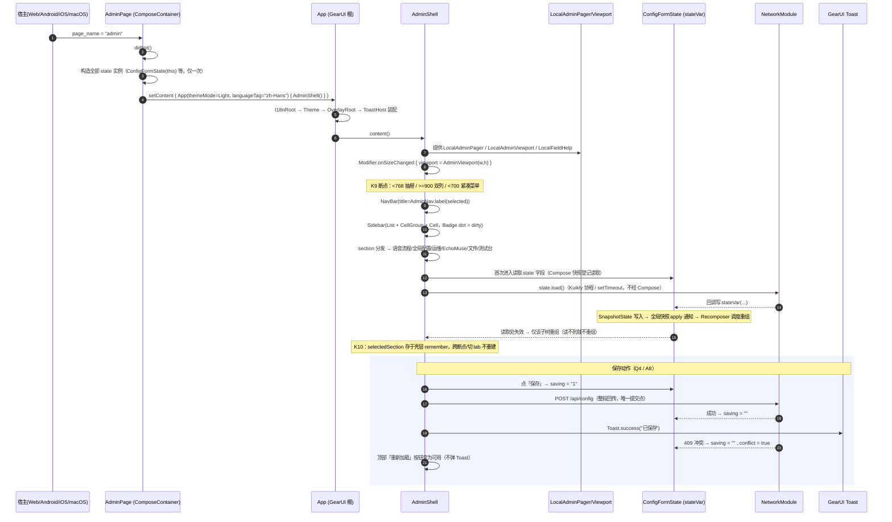

# Client 管理台 UI 全量迁移到 GearUI Kit · 技术方案与文件级任务分解

> 版本：v1.0　作者：架构师 高见远　日期：2026-10-27
> 上游输入：`docs/plans/gearui-kit-migration-prd.md`（PRD v1.0，482 行）+ 主理人已实测的 gearui-kit 源码事实 + 主理人 Q1~Q9 裁决 + 用户 D1~D3 决策
> 本阶段**只出设计**：不修改 `client/` 下任何源文件。
> 本文对 PRD 的假设做了 7 处**实证修正**（§4.6「PRD 修正登记」），凡与 PRD 冲突处以本文为准，理由均附源码证据。

---

## 0. 结论速览（先看这 12 行）

| # | 问题 | 确定答案 |
|---|---|---|
| 1 | gearui-kit 怎么引入 | 新建 Gradle 模块 `client/gearuiKit/`（`:gearuiKit`），**包名保持 `com.gearui.*` 不变**；拷 `commonMain`(256 文件/43,512 行)+4 个平台源集，**自写 `macosArm64Main` 7 个 actual**，删 `ohosArm64Main`/`commonTest`/`androidUnitTest`；去 `org.jetbrains.compose` 插件与 `compose.runtime`/`androidx.annotation` 依赖；`compileSdk 36→35`、`jvmTarget 1.8→17` |
| 2 | Kuikly 2.30.0 | 独立提交单元 T01，先于一切 UI 改动；**4 个文件**改版本 + 2 个 Podfile + `Podfile.lock` 重生成；`sharedCompose` 整个模块**删除**（实测零引用，顺带消灭 material3 补丁的验证问题） |
| 3 | 411 状态字段怎么改 | 引入 `fun <T> stateVar(init: T): ReadWriteProperty<Any?, T>`（内部 `mutableStateOf`），**字段声明只改 `by observable(` → `by stateVar(`，其余零改动**；`observableList` 实为 **47** 处（PRD 记 35，漏了 12 处带泛型写法）→ `stateListOf<T>()`；用 codemod 脚本 + Gradle 护栏 `verifyComposeStateMigration`（断言 411/47）保证不漏 |
| 4 | 页面入口与 App 根 | `@Page("admin")` 的类**不继承** GearUI `View`，直接 `: ComposeContainer()` 并在 `didInit()` 里自己调 `App(languageTag = "zh-Hans", …)`。原因：`View.didInit` 是 `final override` 且**不传 `languageTag`**，走 `View` 会得到 `en-US` 英文内置文案 |
| 5 | 26 个图标 | **全部不换** Phosphor。实测 GearUI `Icon` 只做 fill 填充、单条 path，而我们的图标是**描边 1.8 + 多图层 + 混合 stroke/fill**（`Settings`/`Wifi`/`Intent` 三处），换过去即 K1 破约。结论：几何零改动，只把 `IconOp.emit(CanvasContext)` 改成 `IconOp.emit(Path)`，用 Compose `Canvas` 重画 |
| 6 | 三态 Checkbox（Q5） | GearUI `Checkbox(indeterminate = …)` **原生支持三态**（内部 `triStateToggleable` + `Icons.minus`），退化为二态的风险不存在 |
| 7 | EchoMuse 六 tab（Q6） | `Tabs(scrollable = true)` 原生支持横向滚动，不隐藏任何 tab |
| 8 | 与旧壳共存（Q8） | **不共存**。状态字段只能有一份声明，改了一处旧 DSL 壳就读不到变化，双活必然"一半不刷新"。按 D3「一次性全量替换」执行，中间提交的判据是「编译绿 + 测试绿」，交互正确性统一在 T12/T13 验收 |
| 9 | 最易漏的隐性耦合 | `verifyAdminIcons`（`shared/build.gradle.kts:155-181`，`:159`=`ui/Contracts.kt`、`:160`=`ui/Icons.kt`）+ `adminCoreTests/build.gradle.kts:23` 三条硬编码路径；`Contracts.kt` 必须**保持零 import**（`adminCoreTests` 类路径上没有 Kuikly） |
| 10 | 任务数 | 13 个**可独立编译的提交单元** T01–T13，归入团队任务 #3（T01–T06）/ #4（T07–T11）/ #5（T12–T13） |
| 11 | 最高风险 | **R-C：411 处状态机制改造后，旧 DSL 渲染层与 Compose 快照互不感知**，中途任何"看起来能跑"的假设都不成立；次高 R-B：macosArm64 目标首次编译可能暴露上游未在 macOS 验证过的 API 面 |
| 12 | 视觉 | 完全采用 GearUI 默认主题（Light），`themeMode = ThemeMode.Light`、`theme = null`；`AdminColors/AdminType/AdminShape/AdminToken` 全删，`AdminSpace` → `GearUiSpace`（数值不变） |

---

## 1. 架构总览

### 1.1 模块与依赖图

```mermaid
graph TD
    subgraph 宿主
        H5[":apps:h5App<br/>h5App.js 壳"]
        AND[":apps:androidApp"]
        IOS["apps/iosApp<br/>(Xcode + Podfile)"]
        MAC["apps/macosApp<br/>(Xcode + Podfile, Catalyst)"]
    end

    subgraph Gradle 模块
        SH[":shared<br/>业务 + UI 单份 commonMain"]
        GK[":gearuiKit<br/>★新 vendored GearUI（5 目标）"]
        CT[":adminCoreTests<br/>纯模型/契约单测"]
        BL[":bleProtocolTests"]
    end

    subgraph 渲染层（外部制品）
        RWEB["core-render-web:h5"]
        RAND["core-render-android"]
        RIOS["OpenKuiklyIOSRender (pod)"]
    end

    H5 --> SH
    H5 --> RWEB
    AND --> SH
    AND --> RAND
    IOS --> SH
    IOS --> RIOS
    MAC --> SH
    MAC --> RIOS

    SH -->|implementation| GK
    SH -->|api| KCORE["com.tencent.kuikly-open:core"]
    SH -->|implementation| KCOMPOSE["com.tencent.kuikly-open:compose"]
    GK -->|api| KCOMPOSE
    GK -->|api| KCORE

    CT -.->|kotlin.srcDir + include 白名单| SH
    SH -.->|"已删除: :sharedCompose"| X["（零引用，T01 一并删除）"]
```

**关键口径**：`:gearuiKit` 与 `:shared` 用 **同一套 `kuiklyVersion` 属性**，`:shared` 对 `:gearuiKit` 用 `implementation`（管理台以外无消费方，不需要 `api` 泄漏）。

### 1.2 目标代码结构（`com/xiaozhi/admin/`）

```
client/shared/src/commonMain/kotlin/com/xiaozhi/admin/
├── AdminPage.kt              @Page("admin") → ComposeContainer 壳（原地改写）
├── AdminShell.kt             ★新：NavBar + 侧栏 + Drawer + section 分发
├── AdminPlatform.kt          expect/actual（签名由 DSL 扩展改为 @Composable）
├── contracts/                ★新包（从 ui/ 迁入，纯 Kotlin）
│   ├── UiContracts.kt        原 ui/Contracts.kt（Availability/ActionState/IconToken/…，零 import）
│   ├── AdminNav.kt           原 ui/Nav.kt 的纯数据部分（NavDescriptor/AdminNav/connectionLabel）
│   └── FieldHelpState.kt     原 ui/FieldHelp.kt 的状态部分（改为 Compose 状态）
├── icons/                    ★新包
│   ├── IconVectors.kt        原 ui/IconVectors.kt：IconLayer/IconOp/SvgPathParser（纯 Kotlin，无 Kuikly）
│   └── AdminIcons.kt         原 ui/Icons.kt：AdminIconVectors(26) + IconToken.vectors() + GearIcon
├── kit/                      ★新包（替代 ui/ 的组件层，全部 GearUI 组合）
│   ├── GearUiSpace.kt        AdminSpace 的 Dp 版（Q9）
│   ├── AdminScope.kt         LocalAdminPager / LocalAdminViewport / LocalFieldHelp + 断点
│   ├── GearLayout.kt         页面滚动 / 定宽左右分栏 / 双列 / 分隔线 / 间距
│   ├── GearFields.kt         labeledField / IntField / DecimalField / TextArea / switchRow / checkBoxRow / overrideChoiceRow
│   ├── GearBadges.kt         statusBadge / pluginStatusBadge / dot / skeletonCard / emptyBlock / largeTitle
│   ├── GearTerminal.kt       K2 深色终端块（Code 排版 + 深色容器）
│   ├── GearLedRing.kt        K7 12 段光环（Canvas）
│   ├── GearWaveform.kt       K8 音频波形（Canvas）
│   └── GearFieldHelp.kt      字段帮助 ⓘ + Popover 弹层
├── state/                    ★新
│   └── StateVar.kt           stateVar / stateListOf（U2 的机制基元）
├── 49 个状态/逻辑文件        原地不动，仅"观察机制"改造
└── 36 个根 UI 文件           逐个改写为 @Composable
```

`ui/`（18 文件 3,783 行）与 `compose/`（7 文件 1,803 行）在 T12 整体删除。

### 1.3 类图（结构契约）

> 同一内容另存独立文件：`docs/plans/gearui-kit-migration-class-diagram.mermaid`（可直接拖进 IDE / mermaid live 渲染）。

```mermaid
classDiagram
    direction TB

    %% ===== 页面入口 =====
    class ComposeContainer {
        +Pager pager
        +PagerData pagerData
        +acquireModule(name)
        #didInit()
        +setContent(content)
    }
    class AdminPage {
        +FieldHelpState fieldHelp
        +ConfigFormState form
        +OpsState stats
        +EchoMuseState echomuse
        +RuntimeFlags runtimeFlags()
        #didInit()
        #AdminShell()
    }
    class ConfigPage {
        #didInit()
    }
    ComposeContainer <|-- AdminPage
    ComposeContainer <|-- ConfigPage

    %% ===== App 根 =====
    class AppRoot {
        <<composable fun App>>
        +ThemeMode themeMode = Light
        +String languageTag = "zh-Hans"
        +String fallbackLanguageTag = "zh-Hans"
        +ThemeSpec? theme = null
        +RuntimeFlags runtimeFlags
        +Content()
    }
    AdminPage ..> AppRoot : didInit 里 setContent

    %% ===== 环境 CompositionLocal =====
    class AdminScope {
        <<object>>
        +LocalAdminPager: ProvidableCompositionLocal~Pager~
        +LocalAdminViewport: ProvidableCompositionLocal~AdminViewport~
        +LocalFieldHelp: ProvidableCompositionLocal~FieldHelpState~
    }
    class AdminViewport {
        +Dp width
        +Dp height
        +bool isNarrow()  %% < 768.dp
        +bool twoColumn() %% >= 900.dp
        +bool workspaceCompact() %% < 700.dp
    }
    AdminScope ..> AdminViewport

    %% ===== 壳层 =====
    class AdminShell {
        +String selectedSection
        +bool drawerOpen
        +AdminViewport viewport
        +NavBar 标题栏
        +Sidebar 侧栏
        +Drawer 窄屏抽屉
        +SectionHost 分发
    }
    AdminShell --> AdminNav
    AdminShell --> AdminViewport
    AdminShell --> FieldHelpState

    %% ===== 状态机制 =====
    class StateVar~T~ {
        -MutableState~T~ state
        +getValue(thisRef, property) T
        +setValue(thisRef, property, value)
    }
    class "stateVar(init: T)" {
        <<top-level fun>>
    }
    class "stateListOf<T>()" {
        <<top-level fun -> SnapshotStateList>>
    }
    class ConfigFormState {
        +var llmModel: String   %% by stateVar
        +var saving: String     %% by stateVar
        +MutableList~VoiceOption~ voiceOptions  %% = stateListOf()
        +fun fill(obj: JSONObject)
        +fun putJson(root: JSONObject)
        +fun save()
    }
    class WakeupSectionState {
        -PagerScope scope
        +var enabled: String
        +var greeting: String
        +var persist: String
        +fun fill(obj)
        +fun putJson(root)
    }
    ConfigFormState --> StateVar
    WakeupSectionState --> StateVar
    WakeupSectionState ..> PagerScope : setTimeout（保留）

    %% ===== 契约与图标 =====
    class IconToken {
        <<enum, 26 entries>>
        Save, Delete, Menu, ChevronDown, ChevronUp, ChevronRight,
        Play, Stop, Refresh, Check, Close, Settings, Microphone,
        Waveform, Text, Intent, Model, Speaker, Info, Wifi,
        Bluetooth, Power, Copy, Funnel, Folder, Document
    }
    class AdminIconVectors {
        <<internal object>>
        +Save: List~IconLayer~
        +Delete: List~IconLayer~
        +Settings: List~IconLayer~
        +... 共 26
    }
    class IconLayer {
        +String pathData
        +bool filled
        +float strokeWidth = 1.8
        +List~IconOp~ ops
    }
    class IconOp {
        <<sealed>>
        +Move(x,y)  +Line(x,y)  +Cubic(...)  +Quad(...)  +Close
        +emit(path: Path, scale: Float)
    }
    class SvgPathParser {
        <<internal object>>
        +parse(pathData: String) List~IconOp~
    }
    class GearIcon {
        <<composable fun>>
        +IconToken token
        +Dp size
        +Color tint
    }
    IconToken ..> AdminIconVectors : vectors() 1:1
    AdminIconVectors --> IconLayer
    IconLayer --> IconOp
    IconLayer ..> SvgPathParser
    GearIcon ..> IconToken
    GearIcon ..> IconOp : Canvas + Stroke

    %% ===== 布局常量 =====
    class GearUiSpace {
        <<object>>
        +xs=8.dp sm=12.dp md=16.dp lg=20.dp
        +xl=24.dp xxl=28.dp xxxl=32.dp
        +pagePadding=24.dp gutter=20.dp
        +cardPadding=20.dp fieldGap=12.dp
    }

    %% ===== 平台差异 =====
    class AdminPlatform {
        <<expect/actual>>
        +IS_MACOS: Boolean
        +platformExternalModules(): Map
        +pagerBaseUrl(pager): String
        +copyToClipboard(text): Boolean
        +renderTestbenchSection(...)  %% 改为 @Composable
        +macServerSwitchEntry(...)    %% 改为 @Composable
    }
    AdminShell ..> AdminPlatform
```

### 1.4 关键调用时序

> 同一内容另存独立文件：`docs/plans/gearui-kit-migration-sequence-diagram.mermaid`。



---

## 2. 五个核心技术决策

### D-A：gearui-kit 的模块化方式

#### A1. 模块身份

| 项 | 值 | 理由 |
|---|---|---|
| Gradle 路径 | `:gearuiKit` | 驼峰与 `:sharedCompose`、`:adminCoreTests` 一致 |
| 目录 | `client/gearuiKit/` | 与 `client/sharedCompose/` 平级 |
| **Kotlin 包名** | **`com.gearui.*`（不改）** | ① 组件调用点 `import com.gearui.components.button.*` 与上游文档/示例逐字一致，工程师可照抄；② 将来换回官方制品（若发布 macosArm64）只改 `build.gradle.kts` 一行 `implementation(project(":gearuiKit"))` → `implementation("com.gearui:gearui-kit:1.0.0")`，源码零改动；③ 减少 349 个文件的 `package`/`import` 改写面 |
| `settings.gradle.kts` | `include(":gearuiKit")` 追加在 `:shared` 之前 | 无顺序要求，但与 `:sharedCompose` 的删除同批 |
| 版本锁定 | `val kuiklyVersion: String = property("kuiklyVersion") as String` | 与 `:shared`、`:sharedCompose`、`:apps:h5App` 同源，杜绝版本漂移 |

#### A2. 源码拷入范围（不是整目录拷）

| 上游目录 | 处置 | 规模 | 理由 |
|---|---|---|---|
| `src/commonMain` | **逐字节拷入** | 256 文件 / 43,512 行 | 唯一不可省 |
| `src/androidMain` | 拷入 | 7 文件 / 66 行 | 只用 `android.content.res` / `java.util`，compileSdk 35 无碍 |
| `src/iosMain` | 拷入 | 7 文件 / 124 行 | iosArm64 + iosSimulatorArm64 共用 |
| `src/jsMain` | 拷入 | 7 文件 / 49 行 | web 端 |
| `src/ohosArm64Main` | **删** | 7 文件 / 76 行 | 本项目无 ohos 目标 |
| `src/commonTest` | **删** | 64 文件 / 4,010 行 | 需 `kotlin("test")` + `kotlinx-coroutines-test:1.8.1`，且原生测试要额外配置；上游自测不是本项目质量门 |
| `src/androidUnitTest` | **删** | 1 文件 / 36 行 | 同上 |
| `api/` | **不拷** | — | 上游 binary-compatibility-validator 的 ABI dump，本项目不用 BCV |
| `gearui-kit/build.ohos.gradle.kts`、`sample/`、`scripts/`、`docs/` | **不拷** | — | 与运行无关 |
| `src/macosArm64Main` | **自写** | 7 文件（见 A5） | 上游无此目标 |

> ⚠️ 拷入时保留**全部原版权头**（上游代码注释里已是英文、无 per-file 版权头，`LICENSE`/`NOTICE` 为仓库级），不做包名改写、不做格式化——保持 `diff -r` 可与上游逐字节比对，升级时可精确 rebase。

#### A3. 构建文件重写（沿用 `:sharedCompose` 口径，不照抄上游）

`client/gearuiKit/build.gradle.kts`：

```kotlin
// GearUI Kit（Apache-2.0）源码 vendored：上游只发布 android/ios/js，缺 macosArm64，
// 而本项目 macOS(Mac Catalyst) 是主力端，故源码引入并自补 macosArm64 目标。
// 与上游差异（全部为构建适配，无视觉/行为改造）：
//   ① 去 org.jetbrains.compose 插件与 implementation(compose.runtime)
//      —— 实测 com.tencent.kuikly-open:compose 的 macosArm64 变体已 api 依赖
//         org.jetbrains.compose.runtime:runtime:1.7.3（见其 .module），无需再声明；
//      且 gearui 源码零处使用 org.jetbrains.compose.* / compose.resources。
//   ② 去 androidx.annotation 依赖 —— 源码零处使用。
//   ③ 去 com.vanniktech.maven.publish —— 本地模块不发布。
//   ④ 去 ohosArm64Main / commonTest / androidUnitTest。
//   ⑤ 加 macosArm64()；去 iosX64()（本项目不含 Intel 模拟器）。
//   ⑥ compileSdk 36→35、jvmTarget 1.8→17（与 :shared 对齐）。
//   ⑦ 用默认层级模板（不手动创建 iosMain），故不得引入
//      kotlin.mpp.applyDefaultHierarchyTemplate=false（上游为 false，我们保持默认）。
// ⚠️ 升级上游时按 THIRD_PARTY_NOTICES.md 的路径重新拉取比对，不要手改组件代码。
plugins {
    kotlin("multiplatform")
    id("org.jetbrains.kotlin.plugin.compose")   // 版本由根 build.gradle.kts 统一锁定 2.1.21
    id("com.android.library")
}

val kuiklyVersion: String = property("kuiklyVersion") as String

android {
    namespace = "com.gearui.kit"
    compileSdk = 35
    defaultConfig { minSdk = 21 }
    compileOptions {
        sourceCompatibility = JavaVersion.VERSION_17
        targetCompatibility = JavaVersion.VERSION_17
    }
}

kotlin {
    androidTarget {
        compilerOptions { jvmTarget = org.jetbrains.kotlin.gradle.dsl.JvmTarget.JVM_17 }
    }
    // 目标集与 :shared 严格对齐 —— 库缺任一目标，:shared 在该目标上解析失败。
    iosArm64()
    iosSimulatorArm64()
    macosArm64()
    js(IR) { browser() }
    targets.all {
        compilations.all {
            // 上游原样保留：组件里有 opt-in 的 Kuikly API
            kotlinOptions.freeCompilerArgs += listOf("-opt-in=kotlin.RequiresOptIn")
        }
    }
    sourceSets {
        val commonMain by getting {
            dependencies {
                // 用 api：组件签名里直接出现 Compose/Dp/Shape 类型，消费方 :shared 必须可见
                api("com.tencent.kuikly-open:core:$kuiklyVersion")
                api("com.tencent.kuikly-open:compose:$kuiklyVersion")
            }
        }
    }
}
```

**逐条确认过的"可删"证据**（主理人要求"剥离插件与依赖"必须给依据）：

| 剥离项 | 证据 |
|---|---|
| `id("org.jetbrains.compose")` 插件 | `grep -rn "org.jetbrains.compose" gearui-kit/src` → **0 命中**；上游只用它取 `compose.runtime` |
| `implementation(compose.runtime)` | `compose-macosarm64-2.29.2-2.1.21.module` 的 `macosArm64ApiElements-published` 变体显式含 `org.jetbrains.compose.runtime:runtime:1.7.3`（`compile` scope），`androidx.compose.runtime` 包由它提供；本项目现有 `AdminComposeShell.kt` 只声明 kuikly compose 就能 `import androidx.compose.runtime.*`，已实证 |
| `implementation("androidx.annotation:annotation:1.9.1")` | `grep -rn "androidx.annotation" gearui-kit/src/androidMain` → **0 命中**（该依赖是上游为 lint 注解加的，实际未用） |
| `com.vanniktech.maven.publish` | 本地模块不发布 |
| `coil3` 是否需额外依赖 | **不需要**：`compose-macosarm64` klib 内含 `default/linkdata/package_com.tencent.kuikly.compose.coil3/0_coil3.knm`，`rememberAsyncImagePainter` 已内置于 `:compose` 制品（`Icon.kt`/`Avatar.kt` 用的就是它） |

#### A4. 目标与源集矩阵

| 目标 | 声明 | 源集（实际生效） | 消费方 |
|---|---|---|---|
| Android | `androidTarget()` | `androidMain` + `commonMain` | `:apps:androidApp` |
| iOS arm64 | `iosArm64()` | `iosMain` + `commonMain` | `apps/iosApp` |
| iOS 模拟器 arm64 | `iosSimulatorArm64()` | `iosMain` + `commonMain` | `apps/iosApp`（模拟器） |
| **macOS arm64** | `macosArm64()` | **`macosArm64Main`（自写）** + `commonMain` | `apps/macosApp`（Catalyst） |
| Web(JS/IR) | `js(IR){browser()}` | `jsMain` + `commonMain` | `:apps:h5App` → `:shared:packLocalJSBundleRelease` |

> `iosX64()` 不声明：本项目 `:shared` 只有 `iosArm64`/`iosSimulatorArm64`（Intel 模拟器已在 Podfile 里 `EXCLUDED_ARCHS=x86_64` 排除），多一个目标只是多一份编译时间。
> **不手动创建 `iosMain`**：项目 `client/gradle.properties` 无 `kotlin.mpp.applyDefaultHierarchyTemplate=false`，默认层级模板会自动建 `iosMain`/`macosMain`/`appleMain`/`nativeMain`。**绝对不要**把上游 `val iosMain by creating { … }` 抄进来（重复创建直接构建失败）。

#### A5. macOS 两个 actual 的确定实现

| 文件 | 上游 iOS actual 依赖 | macOS 结论 | 判断依据 |
|---|---|---|---|
| `foundation/typography/LineHeight.kt` | 仅 `com.tencent.kuikly.compose.ui.unit.TextUnit` | **逐字节复用 iOS 版** | 零平台符号 |
| `foundation/typography/NativeGenericFont.kt` | 无 import | **逐字节复用** | 纯常量 |
| `components/input/NumericKeyboard.kt` | 仅 `KeyboardType` | **逐字节复用** | 纯 Kuikly 类型 |
| `components/calendar/CalendarPlatform.kt` | `platform.Foundation.NSCalendar/NSDate` | **逐字节复用** | `platform.Foundation` 在 macosArm64 平台库中完整可用 |
| `i18n/FormatStrings.kt`（Clock） | `platform.Foundation.NSCalendar/NSDate` | **逐字节复用** | 同上 |
| `keyboard/KeyboardAvoidance.kt`（`PlatformKeyboard`） | `platform.UIKit.{UIScreen, UIKeyboardWillChangeFrameNotification}` + `kotlinx.cinterop` | **空实现**：`internal actual fun observePlatformKeyboard(onHeight: (Dp) -> Unit) { /* macOS 无软键盘；不回调 */ }` | ① macosArm64 平台库**不含 UIKit**（UIKit 只在 ios/tvos/watchos 平台库）；② macOS 无 `UIKeyboardWillChangeFrameNotification`；③ Catalyst 运行时虽有 UIKit（iOS 二进制跑在 Mac 上），但**Kotlin/Native macosArm64 产物链接的是 macOS 平台库**，强行引 UIKit 会编译期找不到符号 |
| `system/InterfaceStyle.kt` | `platform.UIKit.{UIApplication, UIWindow, UIWindowScene, UIUserInterfaceStyle}` | **空实现**：`internal actual fun applyPlatformInterfaceStyle(mode: ThemeMode) { /* no-op */ }` | ① 该函数的唯一作用是让**系统绘制的部件**跟随 App 外观（iOS 软键盘）；macOS 上无此概念。② **不选 AppKit 路线**：`NSApp.appearance = NSAppearance(named:)` 只在原生 AppKit 进程有意义，本产物是 Mac Catalyst（UIKit 进程），AppKit 符号能否在该进程安全调用未经证实，收益为零。③ D2 已定主题固定 Light，`themeMode` 恒为 `Light`，即便实现也不会产生任何可见差异。④ 空实现是**最可验证**的选择：T02 的验收命令直接跑 `compileKotlinMacosArm64`，不需要任何 macOS 运行时断言 |

> 复核主理人给的"其余 6 个可复用"：实为 **5 个可复用 + 2 个需空实现**（`PlatformKeyboard`、`InterfaceStyle`），与主理人结论一致。7 个文件 = 8 个 expect（`FormatStrings.kt` 内含 `currentEpochMillis` + `localMomentOf` 两个）。

#### A6. Apache-2.0 合规落法

| 文件 | 位置 | 内容 |
|---|---|---|
| `LICENSE` | `client/gearuiKit/LICENSE` | 上游 `LICENSE` **原文整份拷入**（Apache License 2.0，未改一行） |
| `NOTICE` | `client/gearuiKit/NOTICE` | 上游 `NOTICE` 原文整份拷入（`Copyright 2026 Shanghai Boyu Information Technology Co., Ltd.`） |
| `THIRD_PARTY_NOTICES.md` | `client/gearuiKit/THIRD_PARTY_NOTICES.md` | 中文说明：上游仓库 / commit / 拉取日期 / 采用的版本 / vendored 范围与规模 / 相对上游的 7 项构建适配（A3 表）/ 升级比对流程 / 许可与版权归属 / "本模块不含本项目自研代码，也不做视觉改造" |
| 文件头版权注释 | **不新增** | 上游 349 个 `.kt` **没有** per-file 版权头（只有仓库级 LICENSE/NOTICE），逐字节拷入即符合。**不注入**我们的中文注释头，否则破坏与上游的 `diff` 可比性，反而弱化合规可追溯性 |

> 与 `client/sharedCompose/THIRD_PARTY_NOTICES.md` 保持同一体例（已有先例可对照）。
> Apache-2.0 §4(b)/(d)：修改过的文件需标注改动——我们在 `THIRD_PARTY_NOTICES.md` 集中声明"相对上游只做构建目标补齐，`commonMain` 源码零改动；新增 `macosArm64Main` 7 个平台文件（其中 5 个照抄 iOS 版、2 个为新写空实现）"，满足可追溯要求；`macosArm64Main` 的 2 个新文件在文件头写明"新增：macOS actual，非上游代码"。
> §4(a) 要求随分发提供 License 副本：`LICENSE` 已随模块与源码一同入仓；`apps/macosApp`/`apps/iosApp` 打包时 Apache-2.0 不要求把 LICENSE 打进 App bundle（非 EULA 类），但**要求保留归属声明**，故在应用设置页（本期无）与仓库 `THIRD_PARTY_NOTICES.md` 中保留——此项记入 T13 的产物入档。

---

### D-B：Kuikly 2.30.0 升级的完整改动清单与顺序

#### B1. 结论：**独立提交单元 T01，先于一切 UI 改动**

理由：升级与 UI 迁移混在一起时，四端链接失败无法定位是"版本不匹配"还是"我们的代码"。D3 允许分批提交，因此先落一个"只升版本、UI 零改动"的提交，跑通四端 → 这是整个迁移的**唯一干净回滚点**。

#### B2. 改动清单（6 个文件 + 1 个删除）

| # | 文件 | 改动 | 说明 |
|---|---|---|---|
| 1 | `client/gradle.properties` | `kuiklyVersion=2.29.2-2.1.21` → **`2.30.0-2.1.21`** | KMP 制品与 Android 渲染层格式 `<kuikly>-<kotlin>` |
| 2 | `client/build.gradle.kts` | buildscript `classpath("com.tencent.kuikly-open:core-gradle-plugin:2.29.2-2.1.21")` → **`2.30.0-2.1.21`** | ⚠️ 这是那处"字面量双写"：buildscript 块在 project 属性求值前执行，读不到 `kuiklyVersion`。两处必须同批改，否则 core 与 web 渲染器错配 |
| 3 | `client/apps/iosApp/Podfile` | `pod 'OpenKuiklyIOSRender', '2.29.2'` → **`'2.30.0'`** | iOS 渲染层用**裸 kuikly 版本**（不带 `-kotlin` 后缀） |
| 4 | `client/apps/macosApp/Podfile` | 同上 → **`'2.30.0'`** | 复用 iOS 渲染器（Catalyst 变体） |
| 5 | `client/apps/iosApp/Podfile.lock`、`client/apps/macosApp/Podfile.lock` | `pod install` 重新生成 | 锁文件必须与 Podfile 同批，否则 CI 上 `pod install` 报 checksum 不匹配 |
| 6 | **删除 `client/sharedCompose/` 整个模块** + `settings.gradle.kts` 的 `include(":sharedCompose")` + `shared/build.gradle.kts:111` 的 `implementation(project(":sharedCompose"))` | 见 B4 | 实测**零 Kotlin 引用**，实测口径见 B4 |

**自动跟随、无需改字面量的文件**（已核对）：

| 文件 | 取值方式 |
|---|---|
| `client/shared/build.gradle.kts` | `val kuiklyVersion: String = property("kuiklyVersion") as String` |
| `client/apps/h5App/build.gradle.kts:27` | `implementation("com.tencent.kuikly-open.core-render-web:h5:$kuiklyVersion")` |
| `client/apps/androidApp/build.gradle.kts` | `core-render-android:$kuiklyVersion` + `core:$kuiklyVersion` |
| `client/sharedCompose/build.gradle.kts` | 同 `property("kuiklyVersion")`（但整模块将删除） |
| 新建的 `client/gearuiKit/build.gradle.kts` | 同 `property("kuiklyVersion")` |

**不在范围内**：`client/apps/ohosApp`（鸿蒙渲染层，四端范围外）、`server/`。

#### B3. 制品可用性

主理人已验证 `mirrors.tencent.com/repository/maven-tencent/com/tencent/kuikly-open/{core,compose}/2.30.0-2.1.21/` 均 HTTP 200。T01 落地时按目标逐个确认（`core-ksp`、`core-annotations`、`core-render-android`、`core-render-web:h5`、`core-gradle-plugin` 以及 5 个平台的 `core-*`/`compose-*`），任一缺失即停止并上报——**不允许**用 `2.29.2` 的某个子制品混搭。

#### B4. `sharedCompose` material3 补丁的处置：**不需要验证，直接随模块删除**

主理人要求"升级后验证上游是否已补齐 ListItem/RadioButton/SegmentedButton，补上就删"。实测该问题**不存在**：

- `grep -rn "compose.settings\|kuiklyx\|com.alorma" client/shared client/apps --include=*.kt` → **0 命中**（`AdminSettingsSection.kt` 等 7 个试点文件只 `import com.tencent.kuikly.compose.material3.Button`，未用 Compose-Settings 磁贴）
- `grep -rn "sharedCompose" client --include=*.kt --include=*.kts` → 仅 `settings.gradle.kts:45` 的 `include` 与 `shared/build.gradle.kts:111` 的 `implementation`，**无任何 Kotlin 代码引用**
- ⇒ `:sharedCompose`（19 文件：Compose-Settings 磁贴 + kuiklyx-viewmodel + material3 三组补丁）**当前就是死模块**

所以：**T01 直接删除 `client/sharedCompose/`**，比"升级后逐符号验证 material3"更省事、更少风险面。同时消灭三件事：① 上游 material3 是否补齐的验证成本；② 第二份 vendored 第三方代码的许可维护；③ 一个必然要跟着 2.30.0 重新适配的模块。

> **触发恢复的条件**（写清楚以便将来）：若后续需要 Compose-Settings 磁贴或 `kuiklyx-viewmodel`，**优先用 GearUI 组件替代**；确需恢复时按 `THIRD_PARTY_NOTICES.md`（删除前先把该文件内容并入 `gearuiKit/THIRD_PARTY_NOTICES.md` 的"历史 vendored"附录）重新拉取，并重新判定 material3 补丁是否仍缺位（判定命令：解包 `compose-android-<ver>.aar` 的 `classes.jar`，`grep -c ListItem`）。

#### B5. 四端渲染层同步矩阵

| 端 | 渲染层制品 | 取值处 | 同步动作 |
|---|---|---|---|
| Web(H5) | `core-render-web:h5:$kuiklyVersion` | `apps/h5App/build.gradle.kts:27` | 自动；**必须重跑** `:apps:h5App:publishWeb` 重新产 `h5App.js` 与 `nativevue2.zip` |
| Android | `core-render-android:$kuiklyVersion` | `apps/androidApp/build.gradle.kts` | 自动；`assembleDebug` 验证 |
| iOS | `pod 'OpenKuiklyIOSRender', '2.30.0'` | `apps/iosApp/Podfile` | 手改 + `pod install` |
| macOS(Catalyst) | 同上（iOS Pod 的 macabi 变体） | `apps/macosApp/Podfile` | 手改 + `pod install`；`SUPPORTS_MACCATALYST=YES`/`IPHONEOS_DEPLOYMENT_TARGET=15.0` 的 post_install 保持不变 |

#### B6. 回滚点

| 点 | 位置 | 回滚动作 |
|---|---|---|
| **R-1** | T01 完成后（`git tag gearui-migration/base-2.30.0`） | 唯一干净回滚点：UI 零改动、四端全绿 |
| R-2 | T02 完成后（`:gearuiKit` 五目标编译通过、`:shared` 仍全绿） | 删模块 + 撤 `include` |
| R-3 | T03 完成后（契约搬迁 + 护栏路径同步） | 逆搬 4 个文件 + 还原 2 处路径 |
| T04 之后 | 无单点回滚 | 只能整支回退——这是 D3「一次性全量替换」的必然代价，已在 §6 风险 R-A 登记 |

---

### D-C：状态观察机制改造（411 + 47，本迁移最大工作量）

#### C1. 结论：统一委托 `stateVar` + 列表 `stateListOf`，字段声明改动**只有 `by` 后的表达式**

```kotlin
// client/shared/src/commonMain/kotlin/com/xiaozhi/admin/state/StateVar.kt
package com.xiaozhi.admin

import androidx.compose.runtime.mutableStateListOf
import androidx.compose.runtime.mutableStateOf
import androidx.compose.runtime.snapshots.SnapshotStateList
import kotlin.properties.ReadWriteProperty
import kotlin.reflect.KProperty

/**
 * Kuikly `observable` 的 Compose 等价物：字段声明的**唯一**改动点。
 *
 * 为什么用委托而不是 `var x by mutableStateOf(y)`：
 *  - `by scope.observable("x")` 与 `by mutableStateOf("x")` 的 getter/setter 语义相同，
 *    但后者会让每个字段多一个 `androidx.compose.runtime.getValue/setValue` 的 import；
 *    委托只改 `by` 后面的表达式，410 处改动全部是机械替换，可用 codemod 完成。
 *
 * 为什么不用 `remember`：这些字段声明在**普通类**里（ConfigFormState / OpsState …），
 * 实例由页面构造一次、整页生命周期内身份不变，不需要（也不能）进组合。
 */
fun <T> stateVar(initial: T): ReadWriteProperty<Any?, T> = StateVarDelegate(initial)

/** Kuikly `observableList()` 的 Compose 等价物（`SnapshotStateList` 的 `MutableList` 视图）。 */
fun <T> stateListOf(): SnapshotStateList<T> = mutableStateListOf()

private class StateVarDelegate<T>(initial: T) : ReadWriteProperty<Any?, T> {
    private val state = mutableStateOf(initial)
    override fun getValue(thisRef: Any?, property: KProperty<*>): T = state.value
    override fun setValue(thisRef: Any?, property: KProperty<*>, value: T) {
        state.value = value
    }
}
```

#### C2. 逐项等价性论证（"字段名/类型/默认值/方法签名零改动"如何保证）

| 原写法 | 新写法 | 类型 | 默认值 | 读语义 | 写语义 |
|---|---|---|---|---|---|
| `var x by scope.observable(false)` | `var x by stateVar(false)` | 推断 `Boolean`，**不变** | `false`，**不变** | 返回 `MutableState.value` | 写 `MutableState.value` |
| `var x by observable(AdminNav.DEFAULT)`（`AdminPage` 内，`Pager` 自身即 `PagerScope`） | `var x by stateVar(AdminNav.DEFAULT)` | 推断 `String`，不变 | 不变 | 同上 | 同上 |
| `var x by scope.observable("true")`（注意：**是 String 不是 Boolean**） | 同上 | `String` | `"true"` | 同上 | 同上 |
| `val l: ObservableList<T> by scope.observableList()` | `val l: MutableList<T> = stateListOf()` | `ObservableList<T>` → `MutableList<T>`（**唯一允许的类型改动**，见 C4） | 空表 | `SnapshotStateList` 的读操作**逐次登记快照读取** | `add/remove/clear/set` 都写快照 |
| `val l by scope.observableList<Row>()` | `val l = stateListOf<Row>()` | 推断 `SnapshotStateList<Row>`（原为 `ObservableList<Row>`，同一改动性质） | 空表 | 同上 | 同上 |

- `scope.observable` 与 `stateVar` 的**默认值求值时机**都在构造期，一次；`MutableState` 每次实例化一个，实例生命周期 = 页面生命周期。
- 方法体一行不改：`fill()/putJson()/save()/load()` 里对这些字段的读写语法完全一致。
- `scope.setTimeout(...)`（3 处：`ConfigFormActions.kt:214/255`、`OtaState.kt:240`、`ToastHost.kt:49`）是 Kuikly 协程/定时器 API，与观察机制无关，**保留不动**。

#### C3. `PagerScope` 依赖如何解耦

现状：`class WakeupSectionState(private val scope: PagerScope)`，22 个状态类各持一个，只为调 `scope.observable`。

处置：**构造签名一律不动**（`ConfigFormState(this)` 等 22 处调用点零改动），只处理"改造后不再使用"的未使用警告：

1. 若该类**仍用** `scope.setTimeout` → 原样保留 `private val scope: PagerScope`（4 个类属于此列）。
2. 若该类改造后 `scope` **完全不被使用** → 把 `private val scope: PagerScope` 改为 `@Suppress("UNUSED_PARAMETER") scope: PagerScope`（**不再是属性**，构造签名对外不变，消除 warning）。**不允许**删参数（会动 22 处调用点，且 `AdminPage(...)` 里还有 `this` 传递）。

> 结论：`PagerScope` 从"状态容器"降级为"定时器/协程宿主"，依赖方向不变，无需引入第二套依赖注入。

#### C4. `observableList` → `mutableStateListOf` 的等价性

- **实测总数 47 处**（PRD 记 35）：`by scope.observableList()` **35** + `by scope.observableList<T>()` **12**。
- 语义等价：`SnapshotStateList<T>` 实现 `MutableList<T>` 且每次读/写都进快照系统，正是 Compose 需要的。`ObservableList<T>` 的 `add/removeAt/clear/set/indexOf/size/iterator` 用法在 `SnapshotStateList` 上全部有效。
- **类型改动面**：`ObservableList<T>` 作为**声明类型**出现的地方（`grep -rn "ObservableList"` 共 24 文件 / 78 处，其中绝大多数是 `import` 与注释）改为 `MutableList<T>`。作为**函数参数类型**的仅 4 处，且全部在将被重写的 UI 文件里：
  - `ui/Widgets.kt:37` `dropdownField(options: () -> ObservableList<Pair<String,String>>)` → 删除，改 `Select(options: List<SelectOption<String>>)`
  - `ui/Choice.kt:156` `segmentedChoice(options: () -> ObservableList<ChoiceOption<T>>)` → 删除，改 `SegmentedControl(options: List<T>)`
  - `ConfigOverviewCard.kt:85` `rows: ObservableList<CapabilityRow>` → 改 `rows: List<CapabilityRow>`
  - `macosArm64Main/TestBenchState.kt:98-100` 三处字段声明 → `MutableList`
- **状态层**（非 UI）无一处以 `ObservableList` 作参数类型，故"方法签名零改动"在状态层**严格成立**；UI 层签名随重写自然演进（属 UI 层重写范围，非语义改动）。

#### C5. codemod 脚本设计（不要求现在写，给可执行规格）

脚本：`client/scripts/codemod_compose_state.py`（Python 3，无三方依赖）

```
用法: python3 scripts/codemod_compose_state.py [--check] [--root client/shared/src]
输入: client/shared/src/**/com/xiaozhi/admin/**.kt
```

**阶段 1 — 列表型（先做，避免与标量规则互相干扰）**

| 匹配 | 替换 |
|---|---|
| `(?m)^(\s*)(\w[\w ]*)\s+by\s+(?:scope\.)?observableList\s*(<[^>]+>)?\s*\(\s*\)` | `${1}\2 = stateListOf\3()` |
| `(?m)^(\s*)(\w[\w ]*)\s*:\s*ObservableList\s*(<[^>]+>)\s+by\s+(?:scope\.)?observableList\s*\(\s*\)` | `${1}\2: MutableList\3 = stateListOf\3()` |
| 类型位置 `ObservableList<X>`（非 import、非注释行） | `MutableList<X>` |

**阶段 2 — 标量型**

| 匹配 | 替换 |
|---|---|
| `by\s+(?:this@\w+\.)?(?:scope\.)?observable\s*(<[^>]+>)?\s*\(` | `by stateVar\3(` |

**阶段 3 — import 重写**

| 删除 | 追加（若文件已不含 `androidx.compose.runtime`） |
|---|---|
| `import com.tencent.kuikly.core.reactive.handler.observable` | `import androidx.compose.runtime.getValue`、`setValue`（仅当 `by stateVar` 出现） |
| `import com.tencent.kuikly.core.reactive.handler.observableList` | — |
| `import com.tencent.kuikly.core.reactive.collection.ObservableList` | — |
| — | `import com.xiaozhi.admin.stateVar` / `stateListOf`（同包可省，脚本按包名判断） |

**阶段 4 — 未用属性处理**：对每个改动过的类，若 `private val scope: PagerScope` 在文件内无 `scope.` 引用 → 改为 `@Suppress("UNUSED_PARAMETER") scope: PagerScope`（只改修饰符，不动参数名/类型）。

**阶段 5 — 报告**：每个文件输出 `[file] stateVar=+N list=+M`，末尾汇总，与 PRD 期望值比对（411 / 47）。`--check` 模式只报告不改写（CI 用）。

> 脚本不改：注释、字符串字面量、`when` 分支、方法体。全部替换都是**单行正则 + 行首缩进保留**，出错面极小，且 `--check` + git diff 可逐文件复核。

#### C6. "如何验证没漏" —— 可执行检查（Gradle 护栏，与 `verifyAdminIcons` 同体例）

在 `client/shared/build.gradle.kts` 新增：

```kotlin
// U2 护栏：状态观察机制必须全量迁到 Compose 快照，且声明总数不得漂移。
// 与 verifyAdminIcons 同体例：把"迁移完成度"变成可执行断言，而不是靠人眼。
val verifyComposeStateMigration by tasks.registering {
    group = "verification"
    description = "Assert 411 stateVar + 47 stateListOf, and zero remaining Kuikly observable declarations"
    val adminDir = layout.projectDirectory.dir("src/commonMain/kotlin/com/xiaozhi/admin")
    inputs.files(adminDir.asFileTree.matching { include("**/*.kt") })
    doLast {
        val files = adminDir.asFileTree.matching { include("**/*.kt") }.files
        val texts = files.associate { it.relativeTo(adminDir.asFile).path to it.readText() }

        // ① 旧机制清零
        val legacy = texts.filterValues { Regex("""by\s+(scope\.)?observable(List)?\s*[<(]""").containsMatchIn(it) }
        check(legacy.isEmpty()) { "Kuikly observable remains in: ${legacy.keys.sorted()}" }

        // ② 新机制计数不漂移（2026-10-27 实测基线）
        val vars = texts.values.sumOf { Regex("""\bby\s+stateVar\s*[<(]""").findAll(it).count() }
        val lists = texts.values.sumOf { Regex("""\bstateListOf\s*[<(]""").findAll(it).count() }
        check(vars == 411) { "stateVar count $vars != 411 (declaration drifted or codemod missed)" }
        check(lists == 47) { "stateListOf count $lists != 47 (declaration drifted or codemod missed)" }

        logger.lifecycle("Verified Compose state migration: $vars stateVar + $lists stateListOf, 0 Kuikly observable")
    }
}
tasks.matching { it.name == "check" || it.name.startsWith("packLocalJSBundle") }.configureEach {
    dependsOn(verifyComposeStateMigration)
}
```

配套的三条人工检查（写进 T05 完成判据）：

1. `grep -rn "com.tencent.kuikly.core.reactive" client/shared/src` → **0 命中**
2. `grep -rn "stateVar\|stateListOf" client/shared/src --include=*.kt | wc -l` → 文件分布应覆盖 25 个状态文件（原 25 个含 observable 的文件，见 §5 T05 表）
3. `:shared` 四端编译通过 + `:adminCoreTests:jvmTest` 通过（契约文件不在改造范围，应完全不受影响）

#### C7. **禁止**沿用试点第二套提交路径（P0-4）

- `compose/AdminConfigDraft.kt`（"每段一份草稿"）**整体删除**，其 17 段重复请求骨架不进入新实现。
- 提交点唯一性由 `grep -rn "POST /api/config\|api/config" client/shared/src` 保证：只允许出现在 `ConfigFormActions.kt`（现有唯一 `save()` 实现）与网络层常量子句中，**不允许**出现在任何 section 卡文件里。
- `ConfigPage.kt`（`@Page("config")` 单页兜底，Q2 保留）复用同一个 `ConfigFormState`，不得另建草稿。

---

### D-D：页面入口与 App 根装配

#### D1. 取舍与结论：`ComposeContainer` + 手写 `App(...)`，**不用** `com.gearui.View`

源码事实（`gearui-kit/src/commonMain/kotlin/com/gearui/View.kt:44-89`）：

```kotlin
abstract class View : ComposeContainer() {
    open fun themeSpec(): ThemeSpec? = null
    open fun themeMode(): ThemeMode? = null
    open fun runtimeFlags(): RuntimeFlags = RuntimeFlags()
    open fun autoWrapApp(): Boolean = true
    @Composable protected abstract fun Content()
    final override fun didInit() {                 // ← final：无法 override
        super.didInit()
        setContent {
            if (autoWrapApp()) {
                App(themeMode = themeMode() ?: ThemeMode.Light,
                    theme = themeSpec(),
                    runtimeFlags = runtimeFlags()) { Content() }
                // ↑ 没有 languageTag / fallbackLanguageTag / stringsOverrides
            } else Content()
        }
    }
}
```

`App(...)` 的签名（`App.kt:89-111`）：`languageTag: String = "en-US"`、`fallbackLanguageTag: String = "en-US"`。

⇒ **走 `View` 会把内置文案锁成英文**。而 `App` 内置文案在本项目**确实会被看到**：`EmptyState`（空态）、`Table(emptyText = I18n.strings.field.tableEmpty)`、`Select(placeholder)`、`ConfirmDialog(confirmText/cancelText)`、`ToastHost`、`Checkbox` 的无障碍描述（`I18n.strings.common.partiallySelected` 等）。而 i18n 语言包确实含 `Strings.zh_Hans.kt`，`normalizeLanguageTag("zh-Hans")` → `zh-Hans`，命中。

**确定方案**：

```kotlin
// client/shared/src/commonMain/kotlin/com/xiaozhi/admin/AdminPage.kt
@Page("admin")                                   // ← 页面 id 保持 "admin" 不变（E12）
internal class AdminPage : ComposeContainer() {  // ← 不继承 com.gearui.View

    // 状态实例：字段声明与构造参数全部不变，只是不再依赖 DSL
    val form = ConfigFormState(this)
    val stats = StatsState(this)
    // ...（与原 AdminPage 相同的 17 个 state 字段，逐个保留）
    val fieldHelp = FieldHelpState()

    var selectedSection by stateVar(AdminNav.DEFAULT)
    var drawerOpen by stateVar(false)

    override fun didInit() {                     // 与上游 View 同一生命周期点
        super.didInit()
        val page = this
        setContent {
            App(
                themeMode = ThemeMode.Light,     // D2：完全采用 GearUI 默认主题
                theme = null,                    // 不覆写主题
                languageTag = "zh-Hans",         // ★ 全中文界面与内置文案
                fallbackLanguageTag = "zh-Hans",
                // keyboardDismissMode 默认 OnTapOrScroll：点空白/滚动收起键盘，管理台表单正需要
            ) {
                AdminShell(page)
            }
        }
    }
}
```

> `@Page` 与 `ComposeContainer` 兼容性已实证：本仓库现有 `compose/AdminComposeShell.kt:53` 就是 `@Page("admin-compose") internal class AdminComposeShellPage : ComposeContainer()`，KSP 正常生成注册项、四端可跑。
> `didInit` 是上游 `View` 选用的生命周期点，照搬即可（试点用的是 `willInit`，两者都能 `setContent`；统一到 `didInit` 以贴合上游示例，减少将来对照成本）。

#### D2. `@Page("config")` 单页兜底（Q2）

`ConfigPage.kt`（146 行）同样改为 `: ComposeContainer()` + `App(languageTag="zh-Hans"){ ConfigPageContent() }`，`@Page("config")` id 不变，渲染「全局配置」7 个 section 的**扁平列表**（无侧栏、无轨道——与原兜底页一致），复用同一份 `ConfigFormState`。

#### D3. 四端入口差异与 `AdminFonts` 退役

| 项 | 处置 | 依据 |
|---|---|---|
| `AdminPlatform.kt` 的 `IS_MACOS` | **保留 expect/actual 不变** | 纯布尔，无 DSL |
| `platformExternalModules()` | **保留** | `Map<String, Module>`，无 DSL |
| `pagerBaseUrl(pager)` | **保留** | 纯 String |
| `copyToClipboard(text)` | **保留** | 纯函数；剪贴板是业务能力，GearUI `Snippet(onCopy)` 只报告意图，实际复制仍走现有 actual |
| `renderTestbenchSection(...)` | **签名必改**：`expect fun ViewContainer<*,*>.renderTestbenchSection(...)` → `@Composable expect fun TestbenchSection(pager: Pager, form: ConfigFormState, twoColumn: Boolean, pageWidth: Dp, pageHeight: Dp)` | 原签名是 Kuikly DSL 扩展，`ViewContainer` 必须清零（E9）。这是**唯一被迫改签名的两处**，属 UI 层，不涉业务语义 |
| `macServerSwitchEntry(...)` | 同上：→ `@Composable expect fun MacServerSwitchEntry(pager: Pager, open: Boolean, onOpened: () -> Unit, onClosed: () -> Unit, onApplied: () -> Unit)` | 同上 |
| `INPUT_NEEDS_TEXT_PROP` | **退役删除** | 它是 web 渲染器 `setProp` 不认 `textInputState` 的 workaround（见其 KDoc）。Compose `Input(value, onValueChange)` 是受控组件，该问题**结构性消失**。同批删掉 4 个源集的 `AdminFonts.kt` actual 与 commonMain 的 expect |
| `AdminFonts`（4 源集 × 7~18 行） | **退役删除** | D2/Q1 已弃用自研字号体系；GearUI 主题字形由 `Typography` 决定 |

#### D4. 断点与视口（K9 / K10 的实现）

原实现读 `pagerData.pageViewWidth`（一次性、resize 不响应）。新实现：

```kotlin
// kit/AdminScope.kt
val LocalAdminViewport = compositionLocalOf { AdminViewport(0.dp, 0.dp) }

@Immutable
data class AdminViewport(val width: Dp, val height: Dp) {
    val isNarrow get() = width < NARROW_BREAKPOINT.dp        // 768
    val twoColumn get() = width >= TWO_COLUMN_BREAKPOINT.dp  // 900
    val workspaceCompact get() = width < WORKSPACE_COMPACT.dp // 700
}

// AdminShell 根部
var viewport by remember { mutableStateOf(AdminViewport(0.dp, 0.dp)) }
Box(Modifier.fillMaxSize().onSizeChanged {
    viewport = AdminViewport(it.width.toDp(), it.height.toDp())
}) { … }
```

`onSizeChanged` 在 Kuikly Compose 中可用（`com.tencent.kuikly.compose.ui.layout.onSizeChanged`，GearUI `components/grid/Grid.kt:9` 已在用）。这比原实现**更强**：窗口拖动跨断点会实时重排。数值 `768/900/700/240` **一字不改**（K9）。

K10（状态不丢）：`selectedSection`/`drawerOpen` 存于 `AdminPage` 的 `stateVar`（页面级，非 component 级），切 section 不改页面实例 ⇒ 标题栏与当前 section 天然不丢；`Drawer` 的开合不影响 section 选择。

#### D5. i18n 与文案口径

- `languageTag = "zh-Hans"`，`fallbackLanguageTag = "zh-Hans"`。
- 全部业务文案（中文字面量）**保留在代码里不动**，只让 GearUI 的**内置**文案跟随中文。**不允许**用 `StringsPatch` 逐条覆写（会与上游文案升级脱钩）。
- 现有中文文案里出现的 `ⓘ`、`→`、`✓`、`✕` 等**字符符号**：`✓/✕` 仅出现在按钮"已保存/保存失败"态（Q4/A8 改为 Toast，符号随之消失）；`→` 出现在「前往旧版 →」占位（迁移完成后该占位删除）；`ⓘ` 改由 `IconToken.Info` + `GearIcon` 渲染（**满足 §4.2 "禁止字符图标"**）。

---

### D-E：迁移顺序与"每个任务结束时全仓仍可编译"的保证

#### E1. 两条铁律

1. **依赖单向**：T01（版本）→ T02（模块）→ T03（契约搬迁）→ T04（kit 基座）→ T05（状态机制）→ T06（壳层）→ T07…T11（各页面，彼此**可并行**，只依赖 T06）→ T12（删旧）→ T13（验收）。
2. **中间态的可运行性不保证，可编译性必须保证**（见 E3）。

#### E2. 关键先后：U1 契约搬迁**必须早于**任何 `ui/` 删除，且晚于 T02

| 顺序 | 动作 | 为什么不能换 |
|---|---|---|
| T03 前 | `IconToken` 仍在 `ui/Contracts.kt`，`verifyAdminIcons` 与 `adminCoreTests` 指向它 | — |
| T03 | 迁 `IconToken` → `contracts/UiContracts.kt`；同批改 `shared/build.gradle.kts:159/160` 与 `adminCoreTests/build.gradle.kts:23`；同批给 ~50 个文件补 `import com.xiaozhi.admin.contracts.*` | 若先删 `ui/`，`:apps:h5App:publishWeb`（依赖 `verifyAdminIcons`）与 `:adminCoreTests:jvmTest` **立即失败**（PRD R3）。若只改路径不迁文件，护栏读不到文件也失败 → 必须同批 |
| T12 | `ui/` 目录整体删除 | 此时 `contracts/` 已是唯一来源（T04 起 kit 层已改用新包），导入面无悬空 |

#### E3. "每个任务结束时全仓仍可编译"的具体保证 + 一处必须承认的例外

| 保证手段 | 说明 |
|---|---|
| 每个单元只做"加法 + 同批替换" | 新文件先建、旧文件同批删，不留悬空引用 |
| 状态层与 UI 层**按文件成对**改动 | 每个被改的 state 文件，其**唯一消费的 UI 文件**放同一提交单元；跨单元共享的 `ConfigContextState.kt` 放在 T06（壳层，首个消费者）处理 |
| 每单元末尾跑固定四条命令 | `:shared:compileKotlinMetadata`、`:shared:compileDebugKotlinAndroid`、`:shared:compileKotlinJs`、`:shared:compileKotlinMacosArm64`；再加 `:adminCoreTests:jvmTest` |
| **例外（必须承认）** | T05 之后、T12 之前，**旧 DSL 渲染层读不到 `mutableStateOf`**，页面能显示但"点了不刷新"。这不是缺陷漏检，是 D3「一次性全量替换、不分阶段验收」的必然结果。故此期间**不做人工交互验收**，只做编译 + 单测 + 契约测试 + 截图（静态版式）。T12 之后统一做 E16 的行为抽查 |
| 缓解手段（可选，不默认启用） | 若实施中发现需要"中途可演示"，可在 `stateVar` 内部**同时**写一份 Kuikly `ObservableProperty`（需把 `PagerScope` 传进委托）。代价是新增一套要删除的机制 + 22 处构造签名受影响 → **本方案不采用**，仅在团队明确要求"中途可演示"时切换 |

#### E4. 并行的安全边界

- T07（语音流程）与 T08（全局配置）共享 `ConfigContextState`（T06 已处理完机制）与 `ConfigCards.kt`（section 分发器）→ **T07 与 T08 不能并行**，须串行（依 PRD §9 顺序，U4 先于 U5）。
- T09（运维）、T10（EchoMuse）、T11（存储）、T12（测试台）彼此无共享文件，**可并行**（三者都只依赖 T06）。
- 每个并行单元必须独占自己的文件，不得同时改 `AdminShell.kt`（section 分发的注册行除外，且该处由 T06 预留占位，各单元只替换自己那一行）。

---

## 3. 目标 / 源集 / 依赖矩阵

### 3.1 `:shared` 依赖变更

| 变更 | 依赖 |
|---|---|
| **新增** | `implementation(project(":gearuiKit"))` |
| **删除** | `implementation(project(":sharedCompose"))`（T01） |
| 保留 | `core`、`core-annotations`、`compose`、`kotlinx-serialization-json:1.8.1`、`kotlinx-datetime:0.6.2` |
| 保留（KSP） | `compileOnly("com.tencent.kuikly-open:core-ksp:$kuiklyVersion")` 注入 `kspAndroid`/`kspJs`/`kspMacosArm64` |
| **不新增** | 不引入 `kotlinx-coroutines-core`（`AGENTS.md` 口径：Kuikly 自带协程，两套 Job 不兼容） |

> ⚠️ `:gearuiKit` 内部通过 `api` 声明 `core`/`compose`，理论上 `:shared` 可省自己那两条 `implementation`。**本方案保留**（`:shared` 显式声明自己直接使用的 API，不依赖传递），避免将来 `:gearuiKit` 换回官方制品时把 `:shared` 一起带崩。

### 3.2 版本绑定点（升级时必须同批的 4 处字面量 + 1 个锁文件）

| # | 文件 | 当前 | 目标 |
|---|---|---|---|
| 1 | `client/gradle.properties` → `kuiklyVersion` | `2.29.2-2.1.21` | `2.30.0-2.1.21` |
| 2 | `client/build.gradle.kts` buildscript classpath | `2.29.2-2.1.21` | `2.30.0-2.1.21` |
| 3 | `client/apps/iosApp/Podfile` | `'2.29.2'` | `'2.30.0'` |
| 4 | `client/apps/macosApp/Podfile` | `'2.29.2'` | `'2.30.0'` |
| 5 | 两个 `Podfile.lock` | — | `pod install` 重生成 |

### 3.3 编译与链接命令（用于每个任务的完成判据）

```bash
cd client

# 库层（快，每单元必跑）
./gradlew :shared:compileKotlinMetadata
./gradlew :shared:compileDebugKotlinAndroid
./gradlew :shared:compileKotlinJs
./gradlew :shared:compileKotlinIosArm64
./gradlew :shared:compileKotlinIosSimulatorArm64
./gradlew :shared:compileKotlinMacosArm64

# 护栏与单测
./gradlew :shared:verifyAdminIcons
./gradlew :shared:verifyComposeStateMigration
./gradlew :adminCoreTests:jvmTest

# 打包/链接（T01/T12/T13 必跑）
./gradlew :shared:assembleDebug
./gradlew :shared:linkDebugFrameworkIosArm64 :shared:linkDebugFrameworkIosSimulatorArm64
./gradlew :shared:linkDebugFrameworkMacosArm64          # 自动触发 patchFrameworkForCatalyst
./gradlew :apps:h5App:publishWeb                        # 内含 packLocalJSBundleRelease + verifyAdminIcons
```

---

## 4. 组件映射落地细则（在 PRD §4 基础上补 GearUI 实际签名差异）

### 4.1 关键 API 差异与落地写法（只列会踩坑的）

| # | 自研（`ui/`） | GearUI 实际签名 | 落地写法与差异 |
|---|---|---|---|
| 1 | `appButton(variant=…)` | `Button(text, onClick, theme: ButtonTheme, type: ButtonType, size, disabled, loading, block, icon: IconSource?, iconWidget, iconPosition)` | `PRIMARY`→`theme=PRIMARY, type=FILL`；`SECONDARY`→`theme=DEFAULT, type=OUTLINE`；`OUTLINE`→`theme=DEFAULT, type=OUTLINE`；`TEXT`→`type=TEXT`；`danger`→`theme=DANGER`。**差异**：`ButtonTheme` 无"secondary"，`SECONDARY` 与 `OUTLINE` 合并为一档（视觉差异，登记） |
| 2 | `largeTitleBar` | `NavBar(title, centerTitle: Boolean = true, height: Dp = navBarHeight, leftWidget, rightWidget, showBottomDivider = true)` | `centerTitle = false`（左对齐大标题）；汉堡用 `leftWidget = { NavBarActionSlot(onClick) { GearIcon(IconToken.Menu) } }`。**差异**：默认高 ~44 < 原 56（登记为 A 类视觉差异） |
| 3 | `sidebarItem`/`menuListItem`（3 档 44/36/min44） | `Cell(title, note, leading, trailing, compact: Boolean, onClick, titleColor)`；`CellGroup(items, title, key, itemContent)` | 三档合并为 `Cell(compact = true/false)` 两档 + 主题行高（A5 已接受）。选中态用 `titleColor = Theme.colors.primary` + `trailing` 放 `Badge(dot)` |
| 4 | `tabBar`/`tabbedPanel` | `Tabs(items: List<Tab>, selectedId, onSelect, scrollable, outlineType: UNDERLINE/CAPSULE/CARD, size)` | 配置/测试双 Tab 用 `outlineType = CAPSULE`（默认）；EchoMuse 六 tab 用 `scrollable = true`（**Q6 结论：支持，不隐藏任何 tab**） |
| 5 | `segmentedChoice`/`buttonGroup` | `SegmentedControl<T>(options: List<T>, selectedOption: T, onOptionSelected, labelProvider)` | 泛型直传枚举 ✔ |
| 6 | `checkBoxRow` + `CheckState`(3 态) | `Checkbox(checked, onCheckedChange, enabled, indeterminate: Boolean, size, contentDescription)` | **Q5 结论：原生支持三态**（`Checkbox.kt:64` 用 `triStateToggleable`，`indeterminate` 时画 `Icons.minus`）。映射：`Unchecked→(false,false)`、`Checked→(true,false)`、`Indeterminate→(false,true)`；`onCheckedChange = { state = state.toggled() }`（`toggled()` 对 Indeterminate 返回 Checked，与 GearUI `onCheckedChange(!checked)` = `!false` = `true` **语义完全一致**）。**无需 Radio(3) 兜底** |
| 7 | `overrideChoiceRow` + `OverrideChoice(Inherit/ForceOn/ForceOff)` | `RadioGroup<T>(options: List<T>, selectedOption: T?, onOptionSelected, labelProvider)` | 枚举自带 `Inherit` 成员，`RadioGroup(options = OverrideChoice.entries, selectedOption = cur)` 三态完整表达。**不得**改成 Switch（`null` 语义会丢，`UiContractsTest.mixedSelectionIsNotFalseOrAnInheritedOverride` 会红） |
| 8 | `labeledIntField` / `labeledDecimalField`（带 `INT_INPUT_FILTER` / `DECIMAL_INPUT_FILTER`） | `NumberField(value: Double?, onValueChange, min, max, step, format, label, error, required)`；另有 `DecimalNumberField(value: DecimalValue?, …)` | 整数用 `NumberField`，**小数必须用 `DecimalNumberField`**（`Double` 版本会丢精度，端口/阈值类字段不接受）。原 `INT_INPUT_FILTER` 的"只允许数字"语义 → `NumberField` 的 `<inputMode>` 由 `keyboardType` 保证；**过滤逻辑不再手写**，但"清空即 null"语义由 `Double?` 承载（原实现空串=默认值，需逐字段核对默认值回退，登记为迁移核对项） |
| 9 | `labeledTextArea` | `Textarea(value, onValueChange, label, maxLength, minLines, maxLines, autosize, required, additionInfo)` | 人格/提示词用 `autosize = true` |
| 10 | `dropdownField(options: () -> ObservableList<…>)` | `Select<T>(value: T?, options: List<SelectOption<T>>, onValueChange, placeholder, label, error)`；长列表 `Picker`；页内单选 `ListBox` | **差异**：GearUI 的 options 是**普通 `List` 参数**。响应式刷新靠"调用处读 `SnapshotStateList` → 重组时重算 `List`"实现，因此**必须把 `state.xxxOptions` 的读取写在 composable 体内**（不能包在 `remember` 里），否则刷新不了。这是 U2 与 UI 的唯一强耦合点 → 写进 T05 的验收清单 |
| 11 | `statusBadge`（四态 + "正常不打标"） | `Tag(text, theme: PRIMARY/SUCCESS/WARNING/DANGER/DEFAULT, size, variant: DARK/LIGHT/OUTLINE)` | `connected→SUCCESS`、`recording/error→DANGER`、`busy→WARNING`、`idle→DEFAULT`；`active` 不渲染（K3）；`variant = LIGHT` 保持轻量 |
| 12 | `dot` | `Badge(count/badgeDot)`；也可 `Box` + 圆点 | dirty 橙点 → `Badge` 的 dot 形态（K6） |
| 13 | `dialogSurface` / 行内 `confirmKey` | `ConfirmDialog(visible, title, message, confirmText, cancelText, onConfirm, onCancel, dismissOnOutside: Boolean = false, destructive: Boolean = false)`；命令式 `Dialog.Host(visible, dismissOnOutside, onDismiss){}` | 删除类用 `ConfirmDialog(destructive = true, dismissOnOutside = false)`（P1-4 要求"不可点外部关闭"，默认值即 false ✔） |
| 14 | `fieldHelpDialog` / `infoBadge` | `Popover(state: PopoverState, placement, closeOnClickOutside = true, content, trigger)`；`Tooltip(text, state, trigger)` | ⓘ 用 `Popover(closeOnClickOutside = true)` + `trigger = { onClick -> GearIcon(IconToken.Info, onClick=onClick) }`；**差异**：原弹层是页面级单例（`FieldHelpHost`），Popover 是 per-badge 实例。**保留页面级单例语义**：`FieldHelpState` 仍挂在 `AdminPage`（经 `LocalFieldHelp` 下发），`Popover` 只承载渲染 |
| 15 | `activityIndicator` | `Loading(size, icon, text, layout, color)` | 内联加载用 `Loading(size = SMALL)`（不再 ComposeView 内嵌） |
| 16 | `ToastHost`/`ToastState` | `object Toast { show/success/error/warning(message, duration) }` + `ToastHost()`（已由 `App` 自动挂载） | **`ToastState` 类名与 `show/success/error` 方法签名保留，内部转发到 `Toast.*`** → 30+ 调用点零改动；`ToastHost.kt` 里的 DSL 渲染删除，文件只剩转发器。`setTimeout` 自清逻辑改由 GearUI Toast 的 `duration` 承担（默认 2000ms；原 3000ms → 传 `duration = 3000`） |
| 17 | `outputBlock` / `terminalOutput` / `terminalInput` | `Code(text, style)` / `Snippet(text, copyLabel, onCopy, style)` | `Code` 只做等宽排版，**深色容器自绘**（`Background` 用 `AdminToken.TERM_BG #1C1F18` 的常量——见 K2，此色不复用 `AdminColors`，而作为 `GearTerminal.kt` 内的 `private val TerminalBg = Color(0xFF1C1F18)`） |
| 18 | `waveformPlayer` | 无对应物 | `Slider`（进度）+ Compose `Canvas` 波形（K8） |
| 19 | `ledRing` | 无对应物 | Compose `Canvas` 12 段环 + 中央点（K7），颜色语义不变 |
| 20 | `pageScroller`/`twoPane`/`menuPaneRow`/`splitRow`/`splitColumn` | 布局原语 | `menuPaneRow` → `Row { Box(Modifier.width(SidebarWidth.dp)) ; VerticalDivider() ; Box(Modifier.weight(1f)) {} }`。Compose 无"只画左边框"的 `border`，竖线用 1dp `Box(background(Theme.colors.border))` 表达（与试点 `AdminComposeShell.kt:103` 同一手法） |
| 21 | `skeletonCard`/`opsSkeleton` | `Skeleton(variant, animation, cornerRadius)` / `SkeletonText(lines)` / `SkeletonCard` / `SkeletonListItem` | 直接用预设 |
| 22 | 空态文案块 | `EmptyState(message, description, icon, actionText, onAction)` | 文案不动，`icon` 可传 `GearIcon` 包装 |
| 23 | 加载失败横幅 | `Alert(title, description, status: DEFAULT/…, icon, action)` 或 `NoticeBar(text, tone, …)` | 就地错误（不改 URL 的失败）用 `Alert`；`action` 放「刷新」按钮 |
| 24 | 运维列表 | `Table<T>(data, columns: List<TableColumn<T>>, striped, bordered, onRowClick, emptyText)`；行展开 `Collapse`；轮次 `Timeline` | A7 已接受列对齐变化。`TableColumn.align` 支持数值右对齐（P1-2） |
| 25 | 流程轨道 | `Steps(current, items: List<StepItem>, direction = HORIZONTAL, theme = DEFAULT/DOT, status, onCurrentChange)` | 主链 VAD→ASR→NLU→LLM→TTS 用 `Steps`；**连接点分支**（`workflowConnection`）GearUI 无对应物 → 用 `Row` + `Tag` 挂在 stage 之间（保留分支语义，不丢信息） |
| 26 | 窄屏抽屉（`overlay + absolutePosition` 浮层） | `Drawer(visible, onDismiss, placement = LEFT, width, showOverlay = true, closeOnOverlayClick = true, content)` | 纯声明式，替换自研浮层（P1-5）；`Drawer` 自带遮罩 |
| 27 | 设备身份行 | `Avatar(fallback, url, size, online, badgeDot)` + `User(name, description, avatarUrl)` | EchoMuse 设备行 |
| 28 | **OTA 固件上传 / 文件上传** | `Upload(items: List<UploadItem>, onAdd, onRemove, onRetry, maxCount)` —— **是图片附件瓷砖网格**（`UploadItem.thumbnail: Painter?`） | **PRD §4.3 该行修正**：`Upload` 不适合单文件 `.bin` 固件。改用 `Button(text="选择固件") + LinearProgress(progress) + Tag(状态)`，文件选择仍走现有 `OtaFilePicker`/`UploadFilePicker` 的 expect/actual（R6 的宿主适配面因此**缩小**到"点击 → 调现有 picker → 拿字节 → 现有上传函数"，`Upload` 完全不参与） |
| 29 | `NodeRequestGate`/`Availability`/`ActionState`/`ActionOutcome`/`canInvokeAction` | 纯契约 | 原样搬 `contracts/UiContracts.kt`，**语义零改**（防重复请求与旧结果计时器不得弱化） |

### 4.2 26 个 `IconToken` 覆盖度比对表（Q7 必产出）

GearUI 图标集为 **Phosphor regular + fill 双形态，实测 1,511 个符号**（`components/icon/generated/Icons*.kt`）。逐个比对结果：

| # | IconToken | Phosphor 同名/近似 | 名称覆盖 | **能否直接替换** | 原因 |
|---|---|---|---|---|---|
| 1 | Save | `floppyDisk` ✅ | ✔ | ✘ | 我们的 Save 是自定义"软盘+折角"描边；Phosphor 是实心填充轮廓 |
| 2 | Delete | `trash` ✅ | ✔ | ✘ | 描边 vs 填充 |
| 3 | Menu | `list` ✅ | ✔ | ✘ | 几何不同（我们的三条横线无圆点/无缩进） |
| 4 | ChevronDown | `caretDown` ✅ | ✔ | ✘ | Phosphor caret 是实心三角；我们是 V 形描边 |
| 5 | ChevronUp | `caretUp` ✅ | ✔ | ✘ | 同上 |
| 6 | ChevronRight | `caretRight` ✅ | ✔ | ✘ | 同上 |
| 7 | Play | `play` ✅ | ✔ | ✘ | 描边 vs 填充 |
| 8 | Stop | `stop` ✅ | ✔ | ✘ | 我们是圆角方框描边 |
| 9 | Refresh | `arrowsClockwise` ✅ | ✔ | ✘ | 圆弧数不同（我们 1 段 + 短箭头） |
| 10 | Check | `check` ✅ | ✔ | ✘ | 线宽/端点不同 |
| 11 | Close | `x` ✅ | ✔ | ✘ | 同上 |
| 12 | Settings | `gear` / `gearSix` ✅ | ✔ | ✘ | 我们是"三滑轨 + 三圆角旋钮"，非齿轮 |
| 13 | Microphone | `microphone` ✅ | ✔ | ✘ | 描边 vs 填充 |
| 14 | Waveform | `waveform` ✅ | ✔ | ✘ | 柱数不同（我们 7 柱） |
| 15 | Text | `textT` ✅ | ✔ | ✘ | 我们含上下衬线示意 |
| 16 | Intent | `target` / `sparkle` 近似 | △ | ✘ | **语义不同**：我们是"一进三出"的分流图，Phosphor 无对应 |
| 17 | Model | `cube` ✅ | ✔ | ✘ | 我们三层叠棱柱 |
| 18 | Speaker | `speakerHigh` ✅ | ✔ | ✘ | 描边 vs 填充 |
| 19 | Info | `info` ✅ | ✔ | ✘ | 同上 |
| 20 | Wifi | `wifiHigh` ✅ | ✔ | ✘ | 我们三弧 + 实心点（**混合 stroke+fill 图层**） |
| 21 | Bluetooth | `bluetooth` ✅ | ✔ | ✘ | 几何基本同形但线宽不同 |
| 22 | Power | `power` ✅ | ✔ | ✘ | 同上 |
| 23 | Copy | `copy` ✅ | ✔ | ✘ | 描边 vs 填充 |
| 24 | Funnel | `funnel` ✅ | ✔ | ✘ | 我们是描边漏斗 |
| 25 | Folder | `folder` ✅ | ✔ | ✘ | 同上 |
| 26 | Document | `fileText` ✅ | ✔ | ✘ | 折角位置不同（我们右上折角） |

**结论（Q7 确定答案）**：**名称覆盖 26/26，实际可替换 0/26。** 三条硬约束决定不可替换：

1. **渲染模型不同**：GearUI `Icon` 对 `VectorAsset` 只做 `drawPath(path, color)`（**纯 fill，`Icon.kt:90`**），而我们的图标是 **`stroke(1.8, round cap)`** 描边为主（`IconVectors.kt:34` 的 `STROKE_WIDTH = 1.8f`）。
2. **图层模型不同**：`VectorIcon(name, regular: String, fill: String?)` 只支持"两条 path 二选一"；`Settings`(4 层)、`Wifi`(stroke+fill 混合 2 层)、`Intent`(1 层多子路径)、`Copy` 都是多图层，无法压进一个 `VectorAsset`。
3. **K1 明文**："几何不变"。PRD §4.2 与 §5.3-K1 在此冲突，取 K1（保留项优先级高于替换便利性）。

**因此**：`AdminIconVectors` 的 26 份 pathData **一个字符都不改**，只把渲染管线从 `Kuikly CanvasContext` 换成 Compose `Path` + `DrawScope.drawPath(style = Stroke(width, cap = Round))`。

### 4.3 图标的 Compose 端口（唯一需要"重写"但几何零改动的模块）

```kotlin
// icons/IconVectors.kt —— 纯 Kotlin，无 Kuikly import（与 contracts 一样可被 adminCoreTests 引用）
internal class IconLayer(
    internal val pathData: String,
    internal val filled: Boolean,
    internal val strokeWidth: Float = STROKE_WIDTH,   // 1.8f
) {
    internal val ops: List<IconOp> by lazy { SvgPathParser.parse(pathData) }
    internal companion object { internal const val STROKE_WIDTH = 1.8f }
}

internal sealed class IconOp {
    internal abstract fun emit(path: Path, scale: Float)          // ← 唯一签名变化：CanvasContext → Path
    internal class Move(...) : IconOp() { override fun emit(path: Path, s: Float) = path.moveTo(x * s, y * s) }
    internal class Line(...) : IconOp() { override fun emit(path: Path, s: Float) = path.lineTo(x * s, y * s) }
    internal class Cubic(...) : IconOp() { override fun emit(path: Path, s: Float) = path.cubicTo(...) }
    internal class Quad(...) : IconOp() { override fun emit(path: Path, s: Float) = path.quadraticBezierTo(...) }
    internal object Close : IconOp() { override fun emit(path: Path, s: Float) = path.close() }
}
// SvgPathParser：**逐字节不动**（纯数学，约 260 行）
```

```kotlin
// icons/AdminIcons.kt（本文件含 "Canvas(" → verifyAdminIcons 断言满足）
@Composable
fun GearIcon(
    token: IconToken,
    modifier: Modifier = Modifier,
    size: Dp = 18.dp,
    tint: Color = Theme.colors.foreground,
) {
    val px = with(LocalDensity.current) { size.toPx() }
    Canvas(modifier.size(size)) {
        val scale = px / 24f
        for (layer in token.vectors()) {
            val path = Path().apply { layer.ops.forEach { it.emit(this, scale) } }
            if (layer.filled) {
                drawPath(path, tint)                                       // fill
            } else {
                drawPath(path, tint, style = Stroke(
                    width = layer.strokeWidth * scale,
                    cap = StrokeCap.Round,                                 // K1：round cap 保持
                ))
            }
        }
    }
}
```

> 已知边界（继承原注释 K2）：Compose 的 `Stroke` **支持** `join`（Kuikly `CanvasContext` 不支持），因此本次可比原实现更好——用 `StrokeJoin.Round` 补齐拐角，视觉只会更接近原 SVG，不构成破约。**但为满足 K1「几何不变」，描边宽度与坐标一律不动**；`join` 属抗锯齿级差异，登记为"允许的渲染改善"。

### 4.4 "本期不用"的 GearUI 组件（承接 PRD §4.4，新增一条）

PRD §4.4 已列 21 个。本方案**补充**：`Upload`（见 §4.1-28 的修正）——不用于任何场景。理由：它是图片附件瓷砖网格，本项目两类上传都是"单文件 + 进度"，用 `Button + LinearProgress` 更贴合且少一层宿主适配。

### 4.5 深色保留项的实现边界（K2）

| 项 | 位置 | 常量 | 说明 |
|---|---|---|---|
| 控制台页终端块 | `ConsolePage.kt` | `TERM_BG #1C1F18` / `TERM_FG #C8D4B0` / `TERM_DIM #6E7A5E` / `TERM_ACCENT #9ABA80` | 从 `AdminToken` 迁到 `kit/GearTerminal.kt` 的 `private val`，**颜色值一字不改** |
| EchoMuse 控制台 tab | `EchoMuseConsoleTab.kt` | 同上 | 同一个 `GearTerminal` |

> E10（自研 token 清零）的允许例外：`grep -rE "AdminColors\|AdminType\|AdminToken\|AdminShape"` 必须 0 命中，但 `#1C1F18` 等**数值**在 `GearTerminal.kt` 内以 `Color(0xFF1C1F18)` 形式存在——这是 K2 保留项，不属 "自研 token"（不导出为公共符号、不做主题推导）。T13 的 grep 判据按符号名，不按数值。

### 4.6 PRD 修正登记（7 处，均附证据）

| # | PRD 原文 | 修正 | 证据 |
|---|---|---|---|
| 1 | §1.2 "35 处 observableList" | **47 处**（35 无参 + 12 带泛型） | `grep -rhoE "by (scope\.)?observableList<"` = 12；`…observableList\(\)` = 35 |
| 2 | §4.2 "GearUI 已覆盖 → 直接用 `Icon(name)`，一对一" | **26/26 名称覆盖但 0/26 可替换** | §4.2 的三条硬约束（fill-only / 单 path / K1 几何不变） |
| 3 | §3.5 "expect 签名可保留，实现换 GearUI" | `renderTestbenchSection`/`macServerSwitchEntry` **必须改签名**（`ViewContainer` 扩展 → `@Composable`） | E9 要求 `ViewContainer<` 零命中 |
| 4 | §4.3 "OTA 固件上传 / 文件上传 → `Upload`" | **不用 `Upload`**，用 `Button + LinearProgress + 现有 picker` | `Upload.kt:81` 的 `items: List<UploadItem>` 语义是附件瓷砖 |
| 5 | §2.3 "状态类只允许改状态容器机制" | 字段**声明类型** `ObservableList<T>` 需改为 `MutableList<T>`（唯一允许的类型改动） | `ObservableList` 是 Kuikly 类型；`SnapshotStateList` 不实现它。状态层无一处以它作参数类型，故方法签名仍零改动 |
| 6 | §8.2 Q8 "允许新旧双入口共存" | **不采用双入口** | 状态字段只有一份声明，旧 DSL 读 `mutableStateOf` 不触发重绘 → 双活必然"一半不刷新"。按 D3 一次性替换 |
| 7 | PRD 未提及 `:sharedCompose` | **T01 一并删除** | 实测零 Kotlin 引用（`grep -rn "sharedCompose" client --include=*.kt --include=*.kts` 仅 2 处 Gradle 声明） |

---

## 5. 文件级任务列表

> 13 个提交单元。每个单元**结束时全仓可编译 + 单测绿**（E3 的例外除外）。
> 团队任务映射：**#3 基座 = T01–T06**；**#4 全量迁移 = T07–T11**；**#5 四端验收 = T12–T13**。

### T01 · Kuikly 2.30.0 升级 + 删除死模块 `sharedCompose`

| 项 | 内容 |
|---|---|
| U 单元 | U0（前半） |
| 涉及文件 | 改：`client/gradle.properties`、`client/build.gradle.kts`、`client/apps/iosApp/Podfile`、`client/apps/macosApp/Podfile`、`client/apps/{iosApp,macosApp}/Podfile.lock`、`client/settings.gradle.kts`（删 `include(":sharedCompose")`）、`client/shared/build.gradle.kts`（删 `:111` 的 `implementation(project(":sharedCompose"))`）；删：`client/sharedCompose/`（19 文件；先把 `THIRD_PARTY_NOTICES.md` 内容并入将来的 `gearuiKit/THIRD_PARTY_NOTICES.md` 附录） |
| 前置 | 无 |
| 完成判据 | ① `kuiklyVersion` 与 buildscript classpath 同值为 `2.30.0-2.1.21`；② 两个 Podfile 为 `'2.30.0'` 且 lock 已重生成；③ `client/sharedCompose/` 不存在、`grep -rn sharedCompose client --include=*.kts` = 0；④ **UI 零改动**（`git diff --stat client/shared/src` 为空） |
| 验收命令 | `./gradlew :shared:compileKotlinMetadata :shared:compileDebugKotlinAndroid :shared:compileKotlinJs :shared:compileKotlinIosArm64 :shared:compileKotlinIosSimulatorArm64 :shared:compileKotlinMacosArm64` → `./gradlew :adminCoreTests:jvmTest :shared:verifyAdminIcons` → `./gradlew :shared:assembleDebug :shared:linkDebugFrameworkIosArm64 :shared:linkDebugFrameworkMacosArm64 :apps:h5App:publishWeb` |
| 回滚点 | **R-1（唯一干净回滚点）**：打 tag `gearui-migration/base-2.30.0` |
| 优先级 | P0 |

### T02 · `:gearuiKit` 模块落地（五目标编译通过，不改任何 admin 代码）

| 项 | 内容 |
|---|---|
| U 单元 | U0（后半） |
| 涉及文件 | 新建 `client/gearuiKit/build.gradle.kts`（§A3 全文）、`client/gearuiKit/LICENSE`、`client/gearuiKit/NOTICE`、`client/gearuiKit/THIRD_PARTY_NOTICES.md`；拷入 `src/commonMain/**`(256)、`src/androidMain/**`(7)、`src/iosMain/**`(7)、`src/jsMain/**`(7)；**新写** `src/macosArm64Main/kotlin/com/gearui/` 下 7 个文件：`foundation/typography/LineHeight.kt`、`foundation/typography/NativeGenericFont.kt`、`foundation/keyboard/PlatformKeyboard.macos.kt`（空实现）、`system/InterfaceStyle.macos.kt`（空实现）、`components/calendar/CalendarPlatform.macos.kt`、`components/input/NumericKeyboard.macos.kt`、`i18n/Clock.macos.kt`；改 `client/settings.gradle.kts`（`include(":gearuiKit")`）、`client/shared/build.gradle.kts`（`implementation(project(":gearuiKit"))`） |
| 前置 | T01 |
| 完成判据 | ① `:gearuiKit` 五目标编译各一次全绿（**macosArm64 首次编译是最大未知，必须先单独跑**）；② `:shared` 全部目标仍全绿且 `git diff --stat client/shared/src` 为空；③ 上游 `commonMain` 与 `/tmp/gearui-kit` 可 `diff -r` 等值（除本模块新增的 macOS 文件）；④ 无 `ohosArm64Main`/`commonTest` |
| 验收命令 | `./gradlew :gearuiKit:compileDebugKotlinAndroid :gearuiKit:compileKotlinJs :gearuiKit:compileKotlinIosArm64 :gearuiKit:compileKotlinIosSimulatorArm64 :gearuiKit:compileKotlinMacosArm64` 然后全套 `:shared` 编译 |
| 优先级 | P0 |

**T02 的两个已知未知（必须先打掉，出问题就地改写 §A5 的方案）**

| 未知 | 探针 | 若失败的处置 |
|---|---|---|
| macosArm64 上 `platform.Foundation` 的 `NSCalendarUnit*` 常量名是否与 iOS 一致 | `:gearuiKit:compileKotlinMacosArm64` 的首个报错 | 按 macOS 平台库实际常量名微调 2 个文件（`CalendarPlatform.macos.kt`/`Clock.macos.kt`），几何与逻辑不变 |
| macosArm64 上 `com.tencent.kuikly.compose.coil3` 的可用性（理论上 klib 内置，实测 2.29.2 的 `package_com.tencent.kuikly.compose.coil3` 存在） | 同上 | 若 2.30.0 的 macos 变体缺该包，则把 `Icon.kt` 的 `ImageAsset` 分支与 `Avatar.kt` 的 `url` 分支改为 macOS 占位（本项目零处使用图片图标/头像 URL，功能无损），并在 `THIRD_PARTY_NOTICES.md` 登记为"vendored 改动 ①" |

### T03 · 契约与图标搬迁 + 三处硬编码路径同步

| 项 | 内容 |
|---|---|
| U 单元 | U1 |
| 涉及文件 | 新建 `contracts/UiContracts.kt`（原 `ui/Contracts.kt` 全文，**零 import 保持**）、`contracts/AdminNav.kt`（原 `ui/Nav.kt` 的 `NavDescriptor`/`AdminNav`/`connectionLabel`）、`icons/IconVectors.kt`（原 `ui/IconVectors.kt`，此步先原样搬，`IconOp.emit` 仍用 `CanvasContext`）、`icons/AdminIcons.kt`（原 `ui/Icons.kt` 全文）；删 `ui/Contracts.kt`、`ui/Nav.kt`（`sidebarItem` 丢弃）、`ui/IconVectors.kt`、`ui/Icons.kt`；改 `client/shared/build.gradle.kts:159/160`（→ `contracts/UiContracts.kt` / `icons/AdminIcons.kt`，并把 `icons/IconVectors.kt` 加入 `inputs.files`）、`client/adminCoreTests/build.gradle.kts:23`（→ `com/xiaozhi/admin/contracts/UiContracts.kt`）；**机械 import**：给所有引用 `IconToken/Availability/ActionState/ActionOutcome/CheckState/OverrideChoice/NodeRequestTicket/NodeRequestGate/canInvokeAction/AdminNav/NavDescriptor/connectionLabel` 的 `.kt` 追加 `import com.xiaozhi.admin.contracts.*`（约 50 文件） |
| 前置 | T02 |
| 完成判据 | ① `:shared:verifyAdminIcons` 打印 `Verified 26 embedded vector icons`；② `:adminCoreTests:jvmTest` 全绿（`UiContractsTest` 7 例）；③ `grep -rn "com.xiaozhi.admin.ui.Contracts\|com.xiaozhi.admin.ui.Icons\|com.xiaozhi.admin.ui.Nav" client` = 0；④ `contracts/UiContracts.kt` 首行 `package` 后**无任何 import** |
| 验收命令 | `./gradlew :shared:verifyAdminIcons :adminCoreTests:jvmTest` + `./gradlew :shared:compileKotlinMetadata :shared:compileDebugKotlinAndroid :shared:compileKotlinJs :shared:compileKotlinMacosArm64` |
| 优先级 | P0 |

### T04 · `kit/` 基座层（组件替换的"零件库"）

| 项 | 内容 |
|---|---|
| U 单元 | U0 收尾 / U3 前置 |
| 涉及文件 | 新建 `state/StateVar.kt`、`kit/GearUiSpace.kt`、`kit/AdminScope.kt`、`kit/GearLayout.kt`、`kit/GearFields.kt`、`kit/GearBadges.kt`、`kit/GearTerminal.kt`、`kit/GearLedRing.kt`、`kit/GearWaveform.kt`、`kit/GearFieldHelp.kt`；`icons/IconVectors.kt`（`IconOp.emit(CanvasContext)` → `emit(Path)`，**`SvgPathParser` 逐字节不动**）、`icons/AdminIcons.kt`（`appIcon: ViewContainer<*>` → `@Composable GearIcon`）；`client/shared/build.gradle.kts`（新增 `verifyComposeStateMigration` 任务） |
| 前置 | T03 |
| 完成判据 | ① 新 `GearIcon` 与旧 `appIcon` 视觉一致（同 token、同 size 截图对比 26 张，可用一个临时调试页四端自测）；② `verifyComposeStateMigration` 任务已注册（此时会因旧机制未迁而失败——**任务注册但暂不挂到 `check`**，T05 完成后再挂）；③ `kit/` 每个文件 ≤ 600 行 |
| 验收命令 | `./gradlew :shared:compileKotlinMetadata :shared:compileDebugKotlinAndroid :shared:compileKotlinJs :shared:compileKotlinMacosArm64 :shared:verifyAdminIcons` |
| 优先级 | P0 |

> T04 完成后，`ui/` 里被 `kit/` 覆盖的文件暂时**不删**（旧 UI 仍在用），T12 统一删。这正是"可编译性优先"的取舍。

### T05 · 状态观察机制全量改造（411 + 47）+ 垂直切片验证

| 项 | 内容 |
|---|---|
| U 单元 | U2 |
| 涉及文件（25 个状态文件，均为"仅机制改动"） | `ConfigFormState.kt`(106)、`ConfigContextState.kt`(62)、`EchoMuseConfigDrafts.kt`(46)、`OpsState.kt`(24)、`EchoMuseDetailState.kt`(20)、`EchoMuseBleState.kt`(19)、`OtaState.kt`(16)、`OpsMetricsState.kt`(16)、`ConfigNluState.kt`(16)、`EchoMuseState.kt`(12)、`FilesState.kt`(10)、`NodeTestsState.kt`(9)、`EchoMuseMusicState.kt`(7)、`EchoMuseLogsState.kt`(6)、`ConsoleState.kt`(6)、`OpsUsageState.kt`(5)、`ConfigCommandState.kt`(5)、`OpsConversationsState.kt`(4)、`ConfigEchoMuseState.kt`(4)、`AdminPage.kt`(4)、`ConfigWakeupState.kt`(3)、`McpToolsState.kt`(2)、`PluginMetaState.kt`(1)、`FormSchemaState.kt`(1)、`EngineHealthState.kt`(1)、`ConfigFormCatalogue.kt`(1)、`ToastHost.kt`(1)、`EchoMuseMusicState.kt`；外加 `ui/FieldHelp.kt` 的 `FieldHelpState`（搬进 `contracts/FieldHelpState.kt`）；`macosArm64Main/TestBenchState.kt`（5 处 `ObservableList`→`MutableList`，字段声明改 `stateListOf`） |
| 工具 | `client/scripts/codemod_compose_state.py`（§C5 规格）+ `--check` 模式 |
| 前置 | T04 |
| 完成判据 | ① `verifyComposeStateMigration` **挂到 `check`/`packLocalJSBundle`** 并通过（411 / 47 / 0 遗留）；② `grep -rn "com.tencent.kuikly.core.reactive" client/shared/src` = 0；③ **垂直切片**：`ConfigWakeupState` 的 3 个字段端到端在 Compose 里验证（临时调试页：改 `greeting` → 重组可见；`fill()` 后回显）——这是 R-C 的唯一前置验证；④ `:adminCoreTests:jvmTest` 仍全绿 |
| 验收命令 | `./gradlew :shared:verifyComposeStateMigration :adminCoreTests:jvmTest` + 六条 compile 任务 |
| 优先级 | **P0（全项目最高工作量）** |

### T06 · 壳层（`@Page("admin")` → ComposeContainer）

| 项 | 内容 |
|---|---|
| U 单元 | U3 |
| 涉及文件 | 改 `AdminPage.kt`（整体重写：`: ComposeContainer()` + `didInit` + `App(languageTag="zh-Hans")` + 17 个 state 字段保留 + `selectedSection`/`drawerOpen` 用 `stateVar`）、新建 `AdminShell.kt`（NavBar + 侧栏 `List/Cell/CellGroup` + `Drawer` + section 分发占位 + `onSizeChanged` 断点 + `LocalAdmin*` 提供者）、`contracts/FieldHelpState.kt`（字段改 `stateVar`）、`kit/GearFieldHelp.kt`（`Popover` 版本）、`ToastHost.kt`（删除 DSL 渲染，`ToastState` 改为转发 GearUI `Toast`）、改 `ConfigPage.kt`（`@Page("config")` 同样改 `ComposeContainer`） |
| 前置 | T05 |
| 完成判据 | ① `@Page("admin")` 与 `@Page("config")` 注册项都在（KSP 产物 `KuiklyCoreEntry` 含 `admin`/`config`）；② 12 个导航项点击可切换到"迁移中"占位（不空白、不崩）；③ 窄屏抽屉、跨断点重排、字段帮助 Popover、Toast 四条交互可用；④ `AdminColors/AdminType/AdminToken/AdminShape` 在壳层文件里 0 引用；⑤ `AdminShell.kt` ≤ 600 行 |
| 验收命令 | 六条 compile + `./gradlew :shared:assembleDebug :shared:linkDebugFrameworkMacosArm64 :apps:h5App:publishWeb` + 手工四端冒烟 |
| 优先级 | P0 |

### T07 · 「语音流程」工作区（U4）

| 项 | 内容 |
|---|---|
| 涉及文件 | 重写 `PipelineWorkflowView.kt`(145)、`ConfigTabs.kt`(123)、`ConfigWorkspaceViews.kt`(203)、`NodeTestPanel.kt`(96)、`ConfigCards.kt`(263)、`ConfigStageCards.kt`(393)、`ConfigNluCard.kt`(269)、`ConfigCommandCard.kt`(96)、`ConfigWakeupCard.kt`(74)、`ConfigSoulMemoryCards.kt`(476)、`ConfigPlaybackCard.kt`(43)、`ConfigInfrastructureCards.kt`(195，audio 部分) |
| 前置 | T06 |
| 完成判据 | ① 10 个 section 全部可渲染且回显服务端值；② 轨道（`Steps`）+ 连接点分支 + 配置/测试双 Tab + 左菜单 + 节点测试面板齐备；③ section 分发器与 `ConfigSections.isGlobal` 归属不变（`UiContractsTest.everySectionBelongsToExactlyOneMenu` 绿）；④ 每文件 ≤ 600 行（`ConfigSoulMemoryCards.kt` 476 需在重写时注意） |
| 验收命令 | 六条 compile + `:adminCoreTests:jvmTest` + `:shared:verifyAdminIcons :shared:verifyComposeStateMigration` |
| 优先级 | P0 |

### T08 · 「全局配置」（U5）

| 项 | 内容 |
|---|---|
| 涉及文件 | 重写 `ConfigWorkspaceViews.kt`（global 布局部分）、`ConfigOverviewCard.kt`(142，`rows: ObservableList` → `List`)、`EngineHealthCard.kt`(274)、`ConfigInfrastructureCards.kt`(195，server/aiui 部分)、`ConfigEchoMuseCard.kt`(45)、`McpToolsCard.kt`(181)、`OtaCard.kt`(164，**与 T11 协调：OTA 卡归 T11，此处只做入口**） |
| 前置 | T07（共享 `ConfigCards.kt` 分发器，不可并行） |
| 完成判据 | ① 7 个 section 全部可渲染；② 健康横幅四色语义（K5）正确；③ `presets` 在设备 overlay 模式下只显示禁用说明；④ 无侧栏、无轨道、无 Tab（与原布局一致） |
| 验收命令 | 同 T07 |
| 优先级 | P0 |

### T09 · 运维面 + 存储面（U6 + U8）

| 项 | 内容 |
|---|---|
| 涉及文件 | 拆并重写 `OpsPages.kt`(493 → 拆 `OpsOverviewPage.kt`/`OpsDevicesPage.kt`/`OpsSessionsPage.kt`/`OpsConversationsPage.kt`/`OpsUsagePage.kt`/`OpsMetricsPage.kt`)、`ConsolePage.kt`(99，深色终端 K2)、`FilesPage.kt`(237)、`OtaCard.kt`(164)；`kit/GearTerminal.kt` 接 `Code` |
| 前置 | T06（与 T08/T10/T11 **可并行**） |
| 完成判据 | ① 6 个运维页 + 文件页全部可渲染，空态用 `EmptyState`，失败用 `Alert`+刷新；② 运维列表优先 `Table`（P1-2，数值右对齐）；③ 控制台终端**保持深色**（K2 截图核对）；④ 文件页面包屑 + 上传 + 新建目录 + 删除（`ConfirmDialog(destructive)`）；⑤ 每个新文件 ≤ 600 行（`OpsPages.kt` 493 拆成 6 个） |
| 验收命令 | 同 T07 |
| 优先级 | P0 |

### T10 · EchoMuse（U7）

| 项 | 内容 |
|---|---|
| 涉及文件 | 重写 `EchoMusePage.kt`(82)、`EchoMuseDetailTabs.kt`(169)、`EchoMuseStatusTab.kt`(543 → 拆 3 个)、`EchoMuseActivityTab.kt`(86)、`EchoMuseConfigTab.kt`(209)、`EchoMuseConfigStages.kt`(470 → 拆 2 个)、`EchoMuseConsoleTab.kt`(270)、`EchoMuseUpdatesTab.kt`(218)、`EchoMuseLogsTab.kt`(89)、`EchoMuseDeviceCard.kt`(139)、`EchoMuseBleCard.kt`(148)、`EchoMuseMusicPanel.kt`(113)、`EchoMuseDeviceRow.kt` |
| 前置 | T06（可并行） |
| 完成判据 | ① 审批单页 + 6 tab 全部可渲染；② **六 tab 用 `Tabs(scrollable = true)`，一个不少**（Q6）；③ 资源占用条用 `LinearProgress`/`Meter`；④ 控制台 tab 保持深色（K2）；⑤ LED/波形相关若出现按 `kit/GearLedRing`/`GearWaveform` 接；⑥ 每个新文件 ≤ 600 行 |
| 验收命令 | 同 T07 |
| 优先级 | P0 |

### T11 · 「文件」存储面收尾 + OTA 上传链路（U8 余部 / R6）

| 项 | 内容 |
|---|---|
| 涉及文件 | `OtaCard.kt`（固件列表 + `Button("选择固件") + LinearProgress` + 状态 `Tag`）、`OtaFilePicker.kt`（expect 签名不变，只去掉 DSL 依赖）、`UploadFilePicker.kt`（同）、`FilesPage.kt`（上传入口接线） |
| 前置 | T09（T09 建文件页骨架）+ T10 可并行 |
| 完成判据 | ① 固件上传端到端可用（macOS/iOS/js/android 各一轮）；② `Upload` 组件**未引入**（§4.1-28 修正）；③ 删除固件 → `ConfirmDialog(destructive)` → 列表刷新（E16 ⑤） |
| 验收命令 | 同 T07 + 四端手工上传冒烟 |
| 优先级 | P0（R6 是独立风险点，单点验证先做） |

### T12 · 测试台（macOS 专属，U9）

| 项 | 内容 |
|---|---|
| 涉及文件 | `AdminPlatform.kt`（commonMain expect：`renderTestbenchSection`/`macServerSwitchEntry` 改 `@Composable` 签名）、`macosArm64Main/AdminPlatform.kt`(478，actual 重写 + `macServerSwitchEntry` 内联表单)、`macosArm64Main/TestBenchPages.kt`(648 → 拆 2)、`macosArm64Main/TestBenchNluPage.kt`(139)、`jsMain/**`/`androidMain/**`/`iosMain/**` 的空 actual 同步改签名 |
| 前置 | T06（可并行于 T07–T11） |
| 完成判据 | ① `:shared:compileKotlinMacosArm64` 通过且 `linkDebugFrameworkMacosArm64` 后的 `patchFrameworkForCatalyst` 成功；② macOS 测试台三段区 + NLU 页可用（`XiaoZhiModule` 原生桥零改动）；③ `switching server` 入口行为不变；④ 每个文件 ≤ 600 行 |
| 验收命令 | `./gradlew :shared:compileKotlinMacosArm64 :shared:linkDebugFrameworkMacosArm64` + macosApp Xcode 构建 |
| 优先级 | P0 |

### T13 · 清理与四端验收（U10）

| 项 | 内容 |
|---|---|
| 涉及文件 | 删 `ui/` 全目录（15 文件 + 已空壳的 4 个）、删 `compose/` 全目录（7 文件，含 `AdminConfigDraft.kt`）、删各源集 `AdminFonts.kt`、删 `INPUT_NEEDS_TEXT_PROP` 的 expect/actual、删 `com/xiaozhi/admin/ui/` 目录本身；核对 `AdminPage.kt`/`AdminShell.kt`/各 section 的 600 行上限；更新 `client/shared/src/commonMain/kotlin/com/xiaozhi/admin/AGENTS.md`（记录本次迁移的口径变化：material3 补丁随 `sharedCompose` 消失、状态机制改为 Compose 快照、图标渲染改为 Compose Canvas） |
| 前置 | T07–T12 全部完成 |
| 完成判据 | **E1~E17 全绿**：E1 四端编译 / E2 web 产物 / E3 iOS 链接 / E4 macOS 链接+Catalyst / E5 `adminCoreTests` 全绿 / E6 `Verified 26` / E7 `ui/` 不存在 / E8 旧包引用 0 / E9 DSL 清零 / E10 自研 token 清零 / E11 试点代码清除 / E12 页面注册只含 `admin`+`config` / E13 导航不变量 / E14 全部 ≤ 600 行 / E15 四端 6 类截图 × K1~K10 勾选 / E16 五项行为抽查 / E17 产物体积入档 |
| 验收命令 | 见 §3.3 全套 + §6.4 的 E 项对照表 |
| 优先级 | P0 |

> **任务数说明**：§5 有 13 个单元，超出"≤5 个团队任务"的默认上限。原因是硬约束"每个单元必须独立可编译 + 独立可验收"与"≤5"不可同时满足（PRD §9 本身就给了 11 个单元）。折中：**13 个单元 → 3 个团队任务**（#3/#4/#5），团队任务层满足 ≤5；单元层是提交粒度，用于 review 与回滚定位。

---

## 6. 风险与缓解

### 6.1 回应 PRD R1~R10

| # | PRD 风险 | 本方案判定 | 缓解措施（已落到具体任务） |
|---|---|---|---|
| R1 | 状态层观察机制不兼容，411+ 处 | **确认成立，且是最大的工作量**（实为 411+47） | T05 单独立项；`stateVar` 委托把改动压缩成"只改 `by` 后表达式"；codemod 脚本；`verifyComposeStateMigration` 计数护栏；垂直切片（唤醒 section）先行验证 |
| R2 | GearUI 无 macosArm64 制品 | 确认成立 | T02 源码引入 + 自写 7 个 actual；`LICENSE`/`NOTICE`/`THIRD_PARTY_NOTICES.md` 三件套 |
| R3 | 两处硬编码路径耦合 | 确认成立（第三条：`Contracts.kt` 必须零 import） | T03 与契约搬迁**同批**改路径；完成判据含 `grep` 与 `verifyAdminIcons`/`jvmTest` |
| R4 | macOS Catalyst 补丁面对更大归档 | 确认成立（静态 framework 增加约 43k 行编译产物） | T12 完成判据含 `patchFrameworkForCatalyst` 成功；**建议在 `scripts/patch_framework_macabi.py` 增加成员数与耗时的 `logger.lifecycle` 输出**（不改算法），把 R4 变成可观测指标；E17 入档 |
| R5 | 2.30.0 连带升级渲染层 | 确认成立 | T01 独立提交 + 四端渲染层同步矩阵（§B5）+ 唯一干净回滚点 R-1 |
| R6 | `Upload` 宿主适配 | **风险降级**：本方案不用 `Upload`（§4.1-28），上传仍是"现有 picker + 现有上传函数"，适配面从"新组件对接 4 个 actual"缩小到"按钮触发现有函数" | T11 单点验证优先做 |
| R7 | 82 组件不覆盖的 7 类能力 | 确认成立（实测 8 类：+ 图标集不可替换） | §4.1 逐条给组合方案；自绘限定为 `Canvas` 绘制（LED/波形/图标）+ 布局原语，不重建组件库；`kit/` 只有 9 个文件 |
| R8 | 一次性全量 + 600 行 | 确认成立 | 13 个提交单元分批；超限文件在所属单元内拆分（`OpsPages` 493→6、`EchoMuseStatusTab` 543→3、`EchoMuseConfigStages` 470→2、`TestBenchPages` 648→2、`ConfigContextState` 607→2） |
| R9 | 暗→浅认知成本 | 确认成立（D2 已接受） | K1~K10 语义锚点；四端截图验收 |
| R10 | Compose 在 web 的性能 | **新增关注点** | 长列表强制 `LazyColumn`（GearUI `List` 内部即 `LazyColumn`）；控制台日志保留"双上限"截断（`EchoMuseConsoleText` 零改动）；T13 在浏览器实测滚动帧率并入 E17 |

### 6.2 本方案识别的新风险（按影响排序）

| # | 风险 | 影响 | 缓解 |
|---|---|---|---|
| **R-A** | **中途不可交互窗口**：T05 之后旧 DSL 读不到 `mutableStateOf`，页面能显示但点了不刷新 | 若误判为"缺陷"，会在中途触发无意义的排查；若中途要演示则无法交付 | 明示为 D3 的必然结果（§E3）；中途只做编译+单测+静态截图；若团队要求"中途可演示"，切换到"双写委托"（§E3 缓解，代价已列） |
| **R-B** | **macosArm64 首次编译暴露上游未验证面**（`platform.Foundation` 常量名、`coil3` 在 macos 变体的可见性、`NSCalendarUnit*` 拼写） | T02 可能卡住 | 两个探针与就地处置已备（§T02 表）；最坏情况只影响 2 个 macOS actual 文件或 2 处图片分支，**不影响 `commonMain` 43000 行** |
| **R-C** | **`Select`/`Picker` 的 options 响应式刷新**：`List` 参数需在 composable 体内读 `SnapshotStateList` 才重组 | 音色/模型下拉"切性别后不刷新" | 写进 T05/T07 验收清单；禁止把 `state.xxxOptions` 的读取包进 `remember` |
| **R-D** | **`NumberField(Double?)` 的空值语义**：原实现空串回退默认值，`Double?` 版本语义是 `null` | 端口/阈值被清空后可能变 `null` 而非默认值 | T07 逐字段核对"空值回退默认值"的字段清单（`INT_INPUT_FILTER` 使用点）；必要时在 `GearFields` 里包一层把 `null` 映射回默认值 |
| **R-E** | **GearUI 默认主题是浅色 + 主色非品牌绿**（D2） | 用户认知落差；`Cell` 的选中态是否"一眼可辨"是 P0 | 已接受 A1/A2/A4；T06 完成判据要求"侧栏当前项一眼可辨"；若不足，允许用 `themeSpec` 只覆盖 `primary`（**不恢复自研 token 体系**，此为 Q1 允许的 typography 覆盖同类操作） |
| **R-F** | **`Tabs(scrollable)` 在窄窗的 6 tab 可发现性**：横向滚动的 tab 末尾可能被误认为不存在 | EchoMuse 第 6 个 tab 用户找不到 | `scrollable = true` + `ScrollShadow` 边缘渐隐提示；Q6 已裁决"允许滚动、不许隐藏" |
| **R-G** | `Tabs` 默认 `outlineType = CAPSULE`（pill on track），与原 `tabBar` 的下划线风格差异较大 | 配置/测试双 Tab 观感变化 | 登记为 A 类差异；若观感不接受，改用 `outlineType = UNDERLINE`（一个参数，不引入新组件） |
| **R-H** | `T13` 的 E9「DSL 清零」可能被 `adminCoreTests` 的 `kotlin.srcDir(rootProject.file("shared/src/commonMain/kotlin"))` 白名单外文件拖累 | 若新增文件被误 include 会引入 Kuikly 依赖 → `jvmTest` 编译失败 | `adminCoreTests` 只 `include` 10 个白名单文件，**T03 只改 1 条路径**；新增的 `contracts/`/`icons/` 纯文件**不得**加入白名单（除非确实需要测），并在 `build.gradle.kts` 注释里写清 |

### 6.3 对 PRD 验收项 E1~E17 的落点

| E | 由哪个任务首次满足 | 备注 |
|---|---|---|
| E1 四端编译 | T01 起每单元 | 库层 6 条 compile 命令 |
| E2 web 产物 | T06（首次可跑） / T13（正式） | 含 `verifyAdminIcons` + `verifyComposeStateMigration` |
| E3 iOS 链接 | T01 / T12 / T13 | — |
| E4 macOS 链接 + Catalyst | T01 / T12 / T13 | R4 指标入档 |
| E5 契约测试 | T01 起每单元 | 状态机制改造**不应**影响 `adminCoreTests`（契约文件零 import） |
| E6 图标护栏 | T03 | `Verified 26 embedded vector icons` |
| E7 `ui/` 清零 | T13 | — |
| E8 旧包引用清零 | T13 | — |
| E9 DSL 清零 | T13 | `grep -rE "ViewContainer<\|vif\(\|vfor\(\|vbind\(\|core\.views\.View"` |
| E10 自研 token 清零 | T13 | 例外：`GearTerminal` 的深色数值（K2） |
| E11 试点清除 | T13 | 含 `AdminConfigDraft` |
| E12 页面注册 | T06（admin/config 在）/ T13（admin-compose 不在） | KSP 产物核对 |
| E13 导航不变量 | T06 | 12 项 / web 11 项 / 17 section |
| E14 行数 | 各单元自检 + T13 汇总 | `find … -exec wc -l` |
| E15 视觉保留项 | T13 | 四端 6 类截图 × K1~K10 |
| E16 行为等价抽查 | T13 | 5 项 |
| E17 产物体积 | T13 | web/macOS/Android 三处 |

---

## 7. 实施顺序建议

### 7.1 推荐节奏（按"可停下来验收"的边界切）

```
T01 ──► T02 ──► T03 ──► T04 ──► T05 ──► T06 ─┬─► T07 ──► T08 ─┐
                                             │                 ├─► T13
                                             ├─► T09 ──────────┤
                                             ├─► T10 ──────────┤
                                             ├─► T11 ──────────┤
                                             └─► T12 ──────────┘
```

| 阶段 | 单元 | 性质 | 建议 |
|---|---|---|---|
| 阶段 1「地基」 | T01–T03 | 不动 UI，四端全绿 | **必须串行**；每步都是一个干净的 PR |
| 阶段 2「零件」 | T04–T05 | 仍是"新增 + 机制"，UI 仍走旧壳 | 串行；T05 之后旧壳交互退化（R-A），**此时不要合并到主干之外的分支之外**——整支一次性合 |
| 阶段 3「壳 + 页面」 | T06 → T07/T08 串行；T09/T10/T11/T12 可 3 路并行 | 真正的 UI 迁移 | 建议 2–3 人并行：一人 T07→T08（配置侧），一人 T09+T11（运维+存储），一人 T10（EchoMuse），T12 由最熟 macOS 的人做 |
| 阶段 4「收尾」 | T13 | 删旧 + 全量验收 | 单人主导，其他人做四端截图 |

### 7.2 每个单元提交前必过的 4 条命令（写进团队约定）

```bash
cd client
./gradlew :shared:verifyAdminIcons :shared:verifyComposeStateMigration :adminCoreTests:jvmTest
./gradlew :shared:compileKotlinMetadata :shared:compileDebugKotlinAndroid
./gradlew :shared:compileKotlinJs :shared:compileKotlinMacosArm64
git diff --stat    # 人工确认：本单元只碰了任务表里列出的文件
```

### 7.3 明确不要做的事

| 不要 | 为什么 |
|---|---|
| 不要在 T01 里夹带任何 UI 改动 | 会失去唯一干净回滚点 |
| 不要在迁移期保留 `@Page("admin-compose")` 作为"对照" | Q3 已删；且它的 `AdminConfigDraft` 是 P0-4 明确禁止的第二套提交路径 |
| 不要给 `AdminColors/AdminType` 做"过渡别名" | E10 要求清零；别名会让 61 个文件的替换无限期拖延 |
| 不要用 `Upload` 做固件/文件上传 | §4.1-28 |
| 不要用 Phosphor 图标替换 26 个 token | §4.2 三条硬约束 |
| 不要新增 `kotlinx-coroutines-core` | `AGENTS.md`：两套 Job 体系混用会让取消语义错乱 |
| 不要在状态类里加 `remember` | 它们不是 Composable，实例由页面构造一次 |
| 不要为了"双活"给状态字段写两份委托 | §E3 缓解已评估，代价大于收益 |

---

## 8. 附：本方案的实测基线（可复核）

| 事实 | 判定方式 / 命令 | 结果 |
|---|---|---|
| gearui-kit 规模 | `find gearui-kit/src -name '*.kt' \| wc -l`；行数同理 | 349 文件 / 47,873 行 |
| commonMain | 同上按源集 | 256 文件 / 43,512 行 |
| 平台源集 | 同上 | android 7/66、ios 7/124、js 7/49、ohos 7/76 |
| 上游测试 | 同上 | commonTest 64/4,010、androidUnitTest 1/36 |
| 上游无资源文件 | `find gearui-kit/src -name '*.ttf' -o -name '*.png' -o -name '*.svg'` | 0 命中（图标全部 `generated/Icons*.kt` 代码内嵌矢量） |
| 图标集规模 | `grep -ohE "val Icons\.[a-zA-Z0-9]+" generated/*.kt \| sort -u \| wc -l` | 1,511（Phosphor regular+fill） |
| `Checkbox` 支持三态 | 读 `components/checkbox/Checkbox.kt:55/64/111` | `indeterminate: Boolean` + `triStateToggleable` + `Icons.minus` ✔ |
| `Tabs` 支持滚动 | 读 `components/tabs/*`（`navigation.md` 签名） | `scrollable: Boolean = false` ✔ |
| `Icon` 仅 fill | 读 `foundation/primitives/Icon.kt:90` | `Canvas(modifier.size(size)) { drawPath(path, color) }`（无 Stroke 分支） |
| kuikly compose 含 coil3 | 解包 `compose-macosarm64-2.29.2-2.1.21.klib` | `default/linkdata/package_com.tencent.kuikly.compose.coil3/0_coil3.knm` 存在 |
| `androidx.compose.runtime` 来源 | 读 `compose-macosarm64-*.module` | `org.jetbrains.compose.runtime:runtime:1.7.3`（compile scope） |
| gearui 零 JetBrains Compose 资源 | `grep -rn "org.jetbrains.compose\|compose.resources" gearui-kit/src` | 0 命中 |
| 项目 observable 基线 | `grep -rcE "by (scope\.)?observable\(" client/shared/src/commonMain/kotlin/com/xiaozhi/admin` 求和 | **411**（与 PRD 一致） |
| 项目 observableList 基线 | `by (scope\.)?observableList()` = 35；`…observableList<` = 12 | **47**（PRD 记 35，漏 12） |
| `:sharedCompose` 零引用 | `grep -rn "sharedCompose" client --include=*.kt --include=*.kts` | 仅 2 处 Gradle 声明 |
| `Contracts.kt` 零 import | `sed -n '1,3p' ui/Contracts.kt` | `package` 后直接是注释与代码 |
| `scope` 的真实用途 | `grep -rn "scope\." client/.../admin/*.kt \| grep -v observable` | 4 处 `setTimeout`（`ConfigFormActions`×2、`OtaState`、`ToastHost`） |

---

*本文档为迁移的技术基线。实施细节以本文为准；与 PRD 冲突处按 §4.6 修正登记执行。任何实施中发现的与本文事实不符之处，须回到本文更新后再改代码。*
