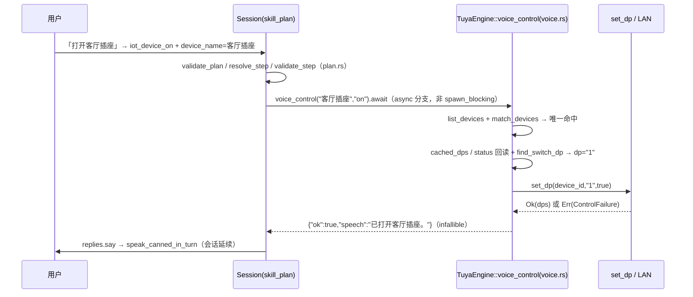

# 架构设计：NLU iot 域语音控制 Tuya 设备（首期插座开关）

依据 `docs/plans/nlu-iot-voice-prd.md`；代码现状已复核（skill_plan.rs L91-121 / plan.rs L102-118 / tuya/mod.rs set_dp / defaults.json / ConfigNluCatalog.kt）。全部设计已按用户裁决口径锁定。

## 1. 核心决策

### D1 分发链路：skill_plan.rs 新增显式 `"tuya.control"` async 分支（采纳主理人倾向）
- `set_dp` 是异步 rustuya TCP 调用且持有 per-device `tokio::Mutex`，**不能进 spawn_blocking**（阻塞线程上无法 `.await`，`block_on` 会死锁风险）。
- `devices.call`/`sessions.end`/`replies.say` 已是会话内 async 分支先例；session 直接持有 `self.engines.tuya: Arc<TuyaEngine>`，而 tuya 引擎无 weather 那样的进程级 global——weather_ops 模式（全局服务 + 同步调用）**不可复制**。
- 结论：**skills 目录零新增文件**。skills 铁律「本目录不联网」天然满足：plan.rs 只加能力元数据与校验（不联网），网络发生在 device/tuya。不建 tuya_ops 薄文件（weather_ops 存在的前提是全局同步服务，这里没有）。

### D2 高层方法落点：`device/tuya/voice.rs`（新文件）
- `TuyaEngine::voice_control(name, action) -> serde_json::Value`：**infallible**，恒返回 `{"ok":bool,"speech":str,...}`（对齐 weather.forecast「业务失败也 Ok」约定，会话永不中断）。
- 纯函数（可脱离网络单测）：`match_devices(query, &[DeviceRow])`（名称匹配）、`find_switch_dp(&HashMap<String,Value>)`（开关 DP 识别）、失败分类→话术组装。名称匹配与 DP 识别是 tuya 域知识，归 device/tuya；内部复用既有 `list_devices`/`cached_dps`/`set_dp`。
- plan 两步模式不变：第一步 `tuya.control` 产出 `speech` 字段，第二步 `replies.say {{steps.0.speech}}`，复用 results.rs 引用机制。

### D3 catalog_source / 重训提示
- **v2 保持不动**：新增 2 技能只扩充标签集与语料，intent 结构/schema 零变化，无需版本升级。
- 现有改名 WARNING（`renamedSkillsNote`）只覆盖「与保存态基线改名」场景，**默认种子新增标签不会触发**；本期不新增自动提示，由 T04 文案（IoT 组说明 + ConfigNluCard help 已有「新增或改名标签后须重新训练」表述）承担告知，符合 OQ4 的 P1 定位。

## 2. 名称匹配算法（voice.rs::match_devices，纯函数）

```
规范化：query trim；长度 <2 直接返回 NotFound（防「的」等碎词误命中）
① 精确：alias == query（优先）→ name == query，各取全部命中
② 包含（双向）：query ⊆ alias/name 或 alias/name ⊆ query
   双向理由：「客厅」→「客厅插座」（话短名长）与「客厅的插座」→「客厅插座」（话长名短）都要命中
③ 分类：命中 1 台 → 执行；≥2 台 → 歧义（不区分在线/离线、不自动选，OQ2 采纳）；
   0 台 → 未找到。离线设备参与匹配：命中离线时话术提示「离线」而非「未找到」
   （PRD 用户故事 4，让用户知道设备存在但不可控；set_dp 的 online 预检是兜底）。
```

## 3. 开关 DP 识别（voice.rs::find_switch_dp + voice_control 组合）

- `cached_dps` 有值：取**值为 bool 的 DP**，`id=="1"` 优先，无 "1" 则取任一 bool DP。
- 缓存为 None：**先做一次 `lan.get_or_build + status()` 回读填充 dp_cache**（仅在线设备有意义），回读失败或仍无 bool DP → 归 unsupported。
- 结论：回读一次而非直接 unsupported——60s 轮询间隙/服务重启后的首条指令不应误报「不支持开关」；回读失败（离线/超时）自然落入离线/超时话术，无误报代价。

## 4. 技能种子（defaults.json 追加，不动既有 16 技能）

槽位追加：`{"name":"device_name","values":[],"optional":false}`（与 task/delay 同模式）。

```json
{"name":"iot_device_on","domain":"iot","templates":["打开{device_name}","把{device_name}打开","开一下{device_name}","我要开{device_name}"],
 "action":{"kind":"plan","reply":"","plan":{"conditions":[],"steps":[
   {"api":"tuya.control","args":{"name":"{{slots.device_name}}","action":"on"}},
   {"api":"replies.say","args":{"text":"{{steps.0.speech}}"}}]}}}
{"name":"iot_device_off","domain":"iot","templates":["关闭{device_name}","把{device_name}关了","关掉{device_name}","把{device_name}关闭"],
 "action":{"kind":"plan","reply":"","plan":{"conditions":[],"steps":[
   {"api":"tuya.control","args":{"name":"{{slots.device_name}}","action":"off"}},
   {"api":"replies.say","args":{"text":"{{steps.0.speech}}"}}]}}}
```

plan.rs 配套：capabilities 追加 `("tuya.control","按名称开关 Tuya 设备","network",{"required":["name","action"],"action":"on|off"})`；validate_step 的 required/allowed 分支加 `("tuya.control",(&["name","action"],&["name","action"]))`，并校验 `action ∈ {on,off}`；`name`/`action` 进既有字符串白名单（max 256）。

## 5. 话术全集（voice.rs 组装，`{label}`=命中别名，无别名念云名称，OQ1 采纳）

| 类别 | 话术 |
|------|------|
| 成功 | 「已打开{label}。」 / 「已关闭{label}。」 |
| 未找到 | 「没有找到叫「{name}」的设备，可以在管理台确认设备名称或别名后再试。」 |
| 歧义 | 「找到多台匹配「{name}」的设备：{A}、{B}。请说得更具体些。」（最多列 3 个，label 同口径） |
| 离线 | 「{label}现在离线，请检查设备供电和网络后再试。」 |
| 超时 | 「{label}没有响应，请稍后再试。」 |
| 不支持 | 「{label}不是可开关的设备，暂时不支持语音开关。」 |

ControlFailure.kind 三归类（offline/timeout/unsupported）→ 上表后三行一一映射，不透传引擎内部 advice 文本（话术面向语音，保持简短）。

## 6. 调用时序



## 7. 任务列表（按依赖排序；⚠️ weather/geo 并行工作红线：所有追加只增不改 weather 相关行与断言）

**T01 技能声明层**（P0，无依赖）
- 文件：`server/src/skills/plan.rs`（能力元数据 + validate 分支 + action 约束）、`plugins/nlu/defaults.json`（2 intents + device_name 槽位）、`server/src/skills/tests_plan.rs`（追加 tuya.control 校验用例）
- 验收：`cargo test -p server skills::`（plan 相关全部通过）

**T02 tuya 语音域逻辑**（P0，无依赖）
- 文件：`server/src/device/tuya/voice.rs`（新建：match_devices / find_switch_dp / 话术组装 / voice_control）、`server/src/device/tuya/mod.rs`（挂 `pub mod voice`）、`server/src/device/tuya/voice_tests.rs`（新建：mock DeviceRow 与 DP 表纯函数单测，覆盖匹配三级/歧义/DP 优先级/失败映射）
- 验收：`cargo test tuya::voice`

**T03 会话分发接线**（P0，依赖 T01、T02）
- 文件：`server/src/workflow/session/skill_plan.rs`（加 `"tuya.control" =>` async 分支：抽 name/action → `self.engines.tuya.voice_control(...).await`）、`server/src/workflow/session/` 既有会话测试文件（追加分支用例，不触碰 weather 断言）、`server/src/skills/tests_results.rs`（如需补 speech 引用回归）
- 验收：`cargo test -p server workflow::` + 全量 `cargo test`

**T04 管理台与文档**（P1，依赖 T01）
- 文件：`client/shared/src/commonMain/kotlin/com/xiaozhi/admin/ConfigNluCatalog.kt`（L23 组标题去「规划中」、L138 help 同步、L168 占位文案微调）、`ConfigNluCard.kt` L53 与 `ConfigNluState.kt` domainOptions 同步去「规划中」（一致性顺带）、`docs/skill-catalog.md`（16→18，iot 转正式域说明）
- 验收：`./gradlew :shared:compileKotlinMacosArm64`

**测试策略**：名称匹配/DP 识别/话术组装全部纯函数单测（T02，无网络）；plan 校验走 tests_plan.rs 既有模式（T01）；会话分支走 workflow 既有测试模式（T03）。**真机语音验收另列**（不占任务）：重训后在真机依次验证成功/未找到/歧义/离线/不支持五类话术与会话延续，结论落 `docs/nlu-model-validation-*.md` 惯例文档。

## 8. Open Questions

无——PRD 4 个 Open Questions 均按建议答案采纳并落入上文章节（OQ1→§5 成功话术、OQ2→§2 歧义、OQ3→§3 unsupported、OQ4→§1 D3）。
