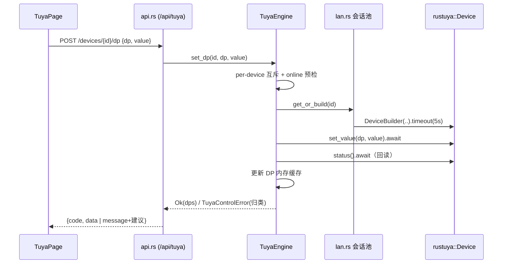

# Tuya IoT 集成架构设计（局域网控制 + 管理台设备管理）

> 上游：`docs/plans/tuya-integration-prd.md`。范围：服务端 `device/tuya` 模块 + 管理台涂鸦设备页；不含语音控制（NLU 不动）。

## 1. 模块与分层

### 1.1 rustuya 依赖结论：直接依赖 `rustuya = "0.3"`
- 已核实 docs.rs 0.3.0 源码：纯 Rust 单体 crate（rlib），**无 pyo3 依赖**（Python 绑定是独立 pip 包）；依赖树干净（tokio 1.49、aes/hmac/sha2/serde 等，与本项目栈兼容）。
- async facade（`rustuya::Device` / `DeviceBuilder` / `Scanner`）基于 tokio actor：`Device::build()` 立即 spawn 后台连接任务，自动重连（指数退避）+ 心跳保活在库内完成。协议 3.1–3.5 + device22 全覆盖——3.4/3.5 会话密钥握手（密钥协商 + AES-GCM 会话加密）复杂度已被库吸收，自实现收益为零、握手细节风险高，**不借鉴自实现**。
- `DeviceBuilder` 支持 `.address()/.port()/.version()/.timeout()`；`Scanner` 提供 UDP 广播发现。
- 陷阱：`sync::Device` 在 tokio runtime 内禁止（blocking_send panic），服务端一律用 async facade；`Device` 可 clone 共享同一 actor，最后一个 clone drop 或 `stop()` 后任务退出。

### 1.2 服务端落点：`server/src/device/tuya/`（与 echomuse 并列）
tuya 与 echomuse 同为"受管设备"，但**不接入语音会话链路**（无 Transport 翻译层），比 echomuse 薄；放 `device/` 下与 registry/echomuse 同层。

```
server/src/device/tuya/
├── mod.rs      # TuyaEngine 装配：store/cloud/lan 状态共享 + DP 内存缓存
├── store.rs    # SQLite 读写（<data>/tuya/devices.db，spawn_blocking）
├── cloud.rs    # 涂鸦云 OpenAPI 客户端（token 缓存 + simple_sign + 设备清单）
├── sync.rs     # 同步编排：拉清单 → diff upsert → 写 sync_history
├── lan.rs      # rustuya 会话池：device_id → Arc<Device>，懒式按需建连
├── worker.rs   # 后台 worker（SchedulerGuard + interval 模式）：定时同步 + 在线轮询
└── api.rs      # axum handler（挂载 gateway，/api/tuya/*，管理鉴权中间件）
```

### 1.3 管理台：独立一级导航
- **决策**：`AdminNav` 表加行 `NavDescriptor("tuya", 20, "涂鸦设备", GROUP_OBSERVE)`（插在 echomuse 15 与 console 47 之间，观测组相邻性不破坏，order 语义合规）。
- **理由**：① tuya 是与 ESP/EchoMuse 并列的"一类受管设备"完整页面（列表+详情+控制+凭证/同步生命周期），塞 devices 二级会混淆两类设备模型；② PRD 明确要求与 ESP 列表有明确区分；③ 二级页难以承载凭证/同步等独立状态。
- 新增文件（admin 包结构，.kt ≤600 行、仅 stateVar/stateListOf、GearUI 组件）：
  - `TuyaPage.kt`（@Page：设备列表 + 凭证状态条 + 同步按钮）
  - `TuyaDetailPage.kt`（设备信息 + DP 实时状态，可写项行内控制）
  - `TuyaState.kt`（generation ticket + adminRequestHeaders + httpRequest，参照 OpsState/NluSkillCatalogState）

## 2. 数据模型

### 2.1 存储：独立 SQLite `<data>/tuya/devices.db`
理由：① **故障隔离**——local_key 属敏感凭据，独立文件可单独收紧权限（0600），表损坏/重置不影响主配置库；② **写入特征独立**——在线轮询每 60s 更新 last_seen/online，写频高于 config 保存态，不污染 config 库 WAL。连接模式复用 config/store.rs（spawn_blocking）。

```sql
CREATE TABLE devices (
  device_id TEXT PRIMARY KEY,
  local_key TEXT NOT NULL,
  name TEXT, model TEXT, product_id TEXT,
  ip TEXT, protocol_version TEXT,   -- 发现优先（局域网实测），云同步补全
  online INTEGER DEFAULT 0, last_seen_ms INTEGER,
  alias TEXT,                       -- 本地别名（P1-4），UI 展示优先于 name
  updated_at INTEGER NOT NULL
);
CREATE TABLE sync_history (
  id INTEGER PRIMARY KEY AUTOINCREMENT,
  started_at INTEGER, finished_at INTEGER,
  result TEXT,                      -- ok / cloud_auth_failed / network_error / partial
  device_count INTEGER, message TEXT
);
```
DP 实时状态走 TuyaEngine 内存缓存（per-device `HashMap<u8, Value>`），不落库——易变数据，重启后由轮询重建。

### 2.2 凭证 config section（入 config/store 保存态体系）
```toml
[tuya]
enabled = true
region = "cn"               # cn/us/eu/in → openapi.tuya{,aus,eu,in}.com
access_id = ""
access_secret = ""          # 只写不读：API 层禁止返回，UI 显示掩码
sync_interval_secs = 86400  # 定时同步周期；0 = 仅手动
```
**热生效档位：全部热生效，无需重启**。worker 每 tick 读最新 config_revision；凭证变更 → sync 检测凭证指纹变化即丢弃 token 缓存，下次同步用新凭证。局域网会话池与凭证无关，不受影响。

## 3. 云同步设计（OpenAPI 仅目录同步）

签名流程要点（**涂鸦官方 v1.0 口径**，2026-11-03 真凭证联调**全链路验证通过**——token ✓、
设备详情 ✓、授权设备清单 ✓；与官方 SDK tuya-connector-python `_calculate_sign` 逐字节一致）：

```text
str_to_sign = METHOD + "\n" + sha256(body).小写hex + "\n" + "\n" + path?排序后query
sign        = HMAC-SHA256(secret, client_id + access_token + t + str_to_sign).大写hex
```

- body 为空（GET）时 sha256 取空串；**两段 `\n` 之间的空 Header 段必须保留**——
  2026-11-03 之前所有 `1004 sign invalid` 的根因就是少了这段换行，**不是凭证错**；
- 统一头：`client_id / access_token(token 请求传空) / t(13 位毫秒) / sign_method=HMAC-SHA256 / sign / lang`；
- token：`GET /v1.0/token?grant_type=1`（7200s，提前 300s 刷新）；1010/1011 → 重取一次重试；
- 设备清单：`GET /v1.0/iot-01/associated-users/devices?size=50`（免 uid，含 local_key/name/model/online/ip/status），
  回包 `result.{devices[], has_more, last_row_key, total}`，翻页带 `last_row_key`；
  旧路径 `…/actions/authorized-devices` 恒 1108（cn 网关不存在，已废弃）；
- 错误码判读：1108 = 路径不存在；1004 = 签名串构造错或 secret 不配对；
  28841003 = API 组未订阅；调试台（platform.tuya.com）的 `mode=cors`+`signVersion=2.0`
  是平台前端私有签名，公开 API 不适用；
- **调试代理**：`POST /api/tuya/cloud/proxy`，请求体 `{method, path, query?, body?}`
  （method 限 GET/POST/DELETE，path 限 `/v1.` 前缀），服务端按官方签名转发、回包原样透传——
  联调/修 bug 免写临时脚本（约定：**外部 SDK 集成一律以代理 API 形式暴露调试入口**）。
- 触发：手动按钮（POST /api/tuya/sync）+ 可选定时（默认 86400s）。**频率上限：最小同步间隔 60s** 全局闸门，手动与定时共用（防连点 + 云额度保护）。
- 失败处理：auth 失败 → cloud_auth_failed（提示检查凭证）；网络/超时 → network_error；部分页失败 → partial。全部写 sync_history，UI 状态条展示最近一次结果。
- local_key 变更：upsert 覆盖；若该设备在会话池中且 key 变化 → 重建对应 Device。

## 4. 局域网控制设计

- **发现**：`rustuya::Scanner` 广播 UDP 6666/6667/7000；启动时 + 每 5 分钟一轮，结果（ip/version/device_id）merge 进 devices 表（局域网实测覆盖云同步值）。发现未登记设备仅记日志，不自动纳管（目录以云同步为准）。
- **会话池**（lan.rs）：`HashMap<device_id, Arc<Device>>`，按需 `DeviceBuilder::new(id, key).address(ip).timeout(5s).build()`；rustuya 内建自动重连+心跳，服务重启后懒式重建（首次控制/轮询才建连）。
- **DP 控制流**：UI → POST /api/tuya/devices/{id}/dp → TuyaEngine（per-device 互斥，单设备仅 1 个在途控制）→ `Device.set_value(dp, value).await` → 回读 `status()` 更新 DP 缓存 → 响应 UI。
- **超时口径**：单请求 5s（DeviceBuilder.timeout，3–5s 区间取上限覆盖弱网握手）。
- **在线状态**：轮询 worker 每 60s（按 device_id 错峰散列）对每台设备 status() 探测；成功 → online=1/last_seen；连续 2 次失败 → online=0；rustuya listener 连接/断开事件即时修正。enabled=false 停控制与轮询。
- **失败归类**（`TuyaControlError`）：

| 归类 | 判定 | UI 建议动作 |
|---|---|---|
| offline | 库内 online=0，或 connect refused/unreachable | 检查供电与网络；可尝试重新同步 |
| timeout | 请求超 5s 无响应 | 稍后重试；频发则检查 2.4G 网络 |
| unsupported | 协议握手失败/版本不支持（rustuya TuyaError 对应码） | 重新同步获取 local_key；确认协议版本 |



## 5. API 设计（管理端，走现有管理鉴权中间件，响应统一 {code,data,message}）

| 方法/路径 | 说明 | 请求 | 响应要点 |
|---|---|---|---|
| GET /api/tuya/status | 凭证/同步状态 | - | {configured, access_id_masked, region, last_sync{finished_at,age_ms,result,device_count,message}, syncing, lan_unregistered:[{device_id,ip,age_ms}], store_path}；`last_sync.message` 带同步失败具体原因（如 code 1108），`lan_unregistered` 为 LAN 扫描发现的未登记设备内存快照（不纳管，目录以云同步为准） |
| POST /api/tuya/credentials | 录入/更新凭证 | {region, access_id, access_secret} | ok；**secret 永不回显**，GET 永远只有掩码 |
| DELETE /api/tuya/credentials | 清除凭证 | - | ok |
| POST /api/tuya/sync | 立即同步（60s 闸门） | - | {result} 或 {queued} |
| GET /api/tuya/devices | 设备列表 | ?online= | [{device_id, alias/name, model, online, last_sync_at}] |
| GET /api/tuya/devices/{id} | 详情 + DP | - | {device, dps:[{dp, value, writable}]} |
| POST /api/tuya/devices/{id}/dp | 控制 | {dp, value} | {dps}；失败返回归类 message |
| POST /api/tuya/devices/{id}/alias | 重命名（P1-4） | {alias} | ok |

writable 判定：控制成功即 true；首版以"能否成功下发"沉淀，不做设备能力探测。

## 6. 安全
- **local_key 默认明文存于独立 `<data>/tuya/devices.db` + 0600 权限**。理由：① 独立文件已收窄风险面；② 加密需引入 KEK 管理（服务端单机部署下密钥仍落同机磁盘，只换壳不换险）；③ 预留扩展位（下期可接 OS keychain），本期不实现加密选项。
- **secret 不回显**：API 永不返回 access_secret 原值；UI 状态条只显示"已配置 + 掩码"。
- **日志脱敏**：lan.rs/cloud.rs 全部日志禁止输出 local_key/access_secret/原始加密报文，只记报文长度与命令类型；不打印 sign 值。

## 7. 任务列表（T01→T05，验收命令见行内）

| ID | 任务 | 涉及文件 | 依赖 | 优先级 |
|---|---|---|---|---|
| T01 | 模块基础设施：rustuya 依赖 + tuya 骨架 + 独立 SQLite + config section + gateway 挂载 | server/Cargo.toml；server/src/device/tuya/{mod.rs,store.rs}；server/src/config/（[tuya] section 声明与 defaults）；server/src/gateway/mod.rs（路由挂载）；runtime/main 装配点 | - | P0 |
| T02 | 云同步：OpenAPI 客户端（签名/token/清单）+ 同步编排 + sync_history + 定时/手动闸门 | device/tuya/{cloud.rs,sync.rs,worker.rs}；cloud_tests.rs（签名向量、分页、1010 重试，wiremock） | T01 | P0 |
| T03 | 局域网控制：会话池 + Scanner 发现 + 轮询 worker + 错误归类 + DP 内存缓存 | device/tuya/{lan.rs,worker.rs,mod.rs}；lan_tests.rs（归类型单测） | T01 | P0 |
| T04 | 管理 API：全部端点 + 鉴权挂载 + secret 脱敏 + 合约测试 | device/tuya/api.rs；api_tests.rs；gateway/mod.rs 注册 | T02,T03 | P0 |
| T05 | 管理台 UI：AdminNav 加行 + 列表页 + 详情页 + 状态 | client/shared/src/commonMain/kotlin/com/xiaozhi/admin/contracts/AdminNav.kt；admin/{TuyaPage.kt,TuyaDetailPage.kt,TuyaState.kt} | T04 | P0 |

- 服务端验收：`cargo test -p xiaozhi-server tuya`（T01–T04 模块单测全绿）。
- 客户端验收：`:shared:compileKotlinMacosArm64`（T05）。
- 真机验收（不阻塞 CI，列手动清单）：局域网开关/调值/读状态端到端 <500ms；断电设备控制返回 offline 提示；改 local_key 后重新同步可恢复控制。

## 8. Open Questions 推荐答案（PRD §4 逐条）
1. **云同步周期**：手动 + 默认每日定时（sync_interval_secs=86400，可调/0 关闭）。目录变化低频，日同步够用，手动按钮覆盖即时需求。
2. **local_key 存储**：默认明文 + 独立库 + 0600（§6 理由）；不提供加密选项，留扩展开关。
3. **管理台入口**：一级导航 id=tuya，order=20（§1.3 理由）。
4. **并发/超时**：单设备同时仅 1 个在途控制（互斥排队）+ 5s 超时。
5. **同步频率上限**：最小间隔 60s 全局闸门；极端 1440 次/天，远低于免费额度。
6. **云端兜底**：**本期纯局域网，失败即归类提示**。理由：兜底需引入云控制 API（第二套签名面）+ 双轨控制语义一致性，而 PRD 核心卖点是"零云依赖、断云可用"——为兜底重新引入云控制依赖与定位冲突；§4 失败归类表已满足用户故事 6。下期语音控制再议。
