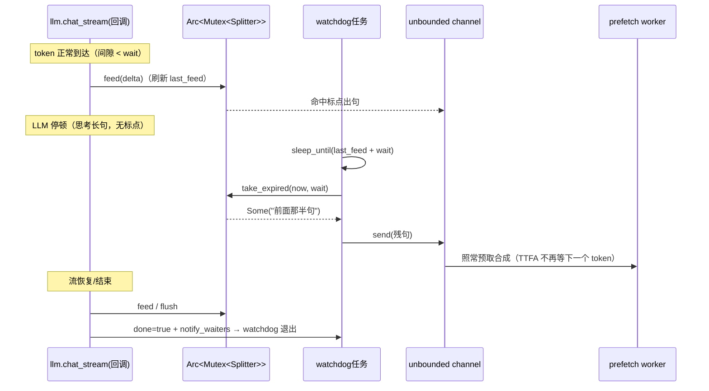

# 会话流水线维护

入口[会话建立](<start.rs>)负责热刷新、依赖快照和注册；[主循环](<../session.rs>)处理帧；[回复编排](<reply.rs>)串起上下文、LLM、TTS 和下行。测试台[bench](<bench.rs>)只服务 `hello.test=true`，不是生产捷径。

## 推理与流式生产

- ASR/TTS 同步推理通过 `spawn_blocking` 隔离，并共用[InferenceGates](<../inference.rs>)。许可 move 进 blocking 闭包以 RAII 释放，不能在等上一句时占着许可。
- ASR 裸 acquire，不受上一轮 stale abort 影响；TTS acquire 感知 abort。缓存命中不过推理闸门；AIUI 云闭环、音色探测和模型热重建不混进本地闸门。
- [LLM producer](<producer.rs>)与[分句器](<../splitter.rs>)旁挂 watchdog，LLM 静默时也能 flush 残句；不能把定时逻辑移回只在 token 到达时执行的回调。退出前先查 done/abort/通道关闭。
- 阶段延迟由[事件记录器](<../events.rs>) first-only 标记，使用单调钟；[观测出口](<observe.rs>)统一发事件，[metrics](<../metrics.rs>)独立聚合，接口只增不改。
- **轮次可归因**：`TurnTrace::new` 分配进程内唯一的 `turn_id`（一个 trace = 一轮），随事件负载与 `tracing` 的 `turn=` 字段流转；`grep turn=N` 能捞出整轮日志行，最后一行是分段摘要。首 token / 首句日志的判据取 `mark_*` 的返回值（是否首次写入），不要另设原子标志——那会与 first-only 语义漂移。`session_id` 在轮次内日志里不能丢：排查通常先按会话过滤再看轮次。
- **文件规模**：[reply.rs](<reply.rs>)是回复编排层（LLM 工具回接在[command.rs](<command.rs>)、观测在[observe.rs](<observe.rs>)），当前 ~540 行仍有余量，但**观测类代码一律落[observe.rs](<observe.rs>)**（事件出口、轮次日志、id 取值口径都在那里），不要再往 reply.rs 加日志或分支。

## 指令、MCP 与唤醒

- [技能级联](<command.rs>)在 ASR→LLM 之间两级本地识别（规则 → 轻量模型），命中即执行不调 LLM；都未命中才放行 LLM，LLM 的 `execute_skill` 工具调用回 `execute_llm_tool_calls` 经同一目录校验执行。AIUI 只能在云端结果回来后丢弃回复。`[command]` 归一化 exact 与 max_chars 两道保险不可互替，空词表不拦截。
- 告别语前清 stale abort；顺序是告别音频 → `tts stop` → MCP stop-listening。失败降级置 close_requested，由主循环跳过 VAD flush、排空后 close；不要分支直接 drop socket。
- MCP 主循环内调用必须同任务抽帧，否则等自己投递响应会死锁。能力发现保留上行音频，退下等待则丢弃残留音频；其他文本帧按序补派发。详细契约见[MCP 说明](<../mcp/AGENTS.md>)。
- [唤醒问候](<wakeup.rs>)挂 `listen detect`，不是 listen start 或 ASR；每次 detect 均问候，不能设“每会话一次”。复用 `speak_canned` 和原下行路径，跳过 LLM。
- TTS **实际租约**在会话建立时固定（`engine::TtsLease`），实例/构建配置/签名/代际原子发布；设备 overlay 仅覆写 speaker/speed。欢迎语、问候、固定应答和正常分句统一由 `HotAudioKey::from_lease` 取缓存身份（实际引擎/音色/语速/文本入磁盘身份，内存键再并入会话下行格式），重建失败继续用旧实例身份，不把请求配置当作已生效构建；别的会话热刷新不会令旧会话句间换引擎。
- EchoMuse 有界话语通过 typed epoch 化 `AudioBoundary` 结束，不改变 ESP `listen stop`：Speech 合并已切段与 flush 尾段后 reset 再识别；NoSpeech 丢弃两类残留并 reset，零 ASR/LLM。`utterance.rs` 的有界承载包装在下行轮询期间有序暂存上行（保留原生 PCM 的时长/字节 RAII 额度，另有4096项/8MiB防御上限，溢出关闭），不丢末包/结束事件；ESP 仍沿用播报期丢上行行为。
- 热音频内存→磁盘→真合成三级复用，共用[HotAudioKey](<../hot_audio.rs>)；生产预取路径逐句登记完整身份（`SentenceSource.hot_audio_key`），完整句合成成功经 `insert_async` 落盘（随行提交 24k PCM），磁盘命中经 `get_async` 读 PCM 按会话格式编码并暖入内存。**键分两级**：磁盘身份只含引擎签名/音色/语速/文本（存裸 24k PCM 单文件，换下行档位/设备不作废），内存键另含整个下行格式（已编码帧不可跨档互喂）；含凭据的签名绝不写日志；磁盘是内容寻址的裸 `.pcm` 文件（淘汰只认 `.pcm`，旧格式遗留不读取也不自动清理）；测试台等不可复现路径填 `None`。
- persist 要求 TTS 缓存开启且配置来源有路径；问候语应短，避免主循环等待播放期间拖住用户第一句话。

[下行维护](<../downlink/AGENTS.md>) · [推理设计记录](<../inference/AGENTS.md>) · [延迟设计记录](<../metrics/AGENTS.md>) · [残句设计记录](<#3-缺口③sentencesplitter-定时-flush>)

---

## 3. 缺口③：SentenceSplitter 定时 flush

> **历史设计 / 实施记录**：本章并入自原《三项缺口实施方案（gap-implementation-design）》§3，保留原章节编号及当时的结论，不代表所有提案均已落地。
> 文中 `§N` 指原长文对应章节，完整历史记录见[三项缺口设计](<../../../../docs/gap-implementation-design.md>)；当前行为先读本文件、源码与测试。

### 3.1 定时器位置取舍（核心论证）

现状：producer 是 `tokio::spawn` 的 async 任务，但**句子产出发生在同步回调里**（`llm.chat_stream` 的 `Box<dyn FnMut(LlmEvent)->bool>`，reply.rs:174-184 内 `splitter.feed(&delta)` 即时推 unbounded channel）。候选方案：

| 方案 | 结论 |
|---|---|
| A. **producer 旁挂独立 watchdog 任务**（`tokio::time::sleep_until` 到期检查共享 splitter） | ✅ 采用 |
| B. 回调内自判 | ❌ 回调只在 token 到达时执行——"停顿"期间根本没有代码在跑，物理上无法触发 |
| C. 消费者侧（prefetch worker）定时拉取 | ❌ 消费者看不到 splitter 的残句 buffer；除非也共享状态——那等于 A 却把 splitter 内部泄露给 prefetch，耦合更差 |
| D. 把 `chat_stream` 改成 async 事件循环 | ❌ 侵入引擎 trait 与实现（openai SSE 解析），为一个小功能动大接口，违反最小方案 |

方案 A 细节：`SentenceSplitter` 提到 `Arc<Mutex<..>>` 共享（回调与 watchdog 各自瞬时持锁、锁内无 await，`std::sync::Mutex` 足够）；watchdog 由 producer 侧 spawn，持有 `tx` 克隆：

- **sleep 目标**：`splitter.flush_deadline(wait)` = `last_feed + wait`（残句为空则 `None` → 只等 notify/500ms 兜底轮询）；
- **到期动作**：`take_expired(now, wait)` 返回残句（非空且静默 ≥ wait 才给）→ `tx.send`（消费者已退出则 `send` Err → watchdog 退出）；
- **误醒无害**：新 token 刷新了 `last_feed` → 到期重算 deadline 继续睡（每次停顿至多多醒一次）；
- **终止**：三个条件——producer 结束（置 `done: Arc<AtomicBool>` + `Notify::notify_waiters`，watchdog 收到即退）、`abort` 置位（select 侧轮询/醒来检查即退）、`tx.is_closed()`。Notify 与检查之间存在微小竞态窗口时，最坏多睡一个 `wait` 周期（≤ 上限 60s 内、默认 1.5s）后自行退出，可接受并注释；
- **abort 后不再出句**：watchdog 醒来先查 `done/abort` 再 `take_expired`，顺序保证打断后不追加残句。

### 3.2 配置与默认值

```rust
// plugins/llm/mod.rs :: LlmConfig 追加
/// 残句定时出句等待（毫秒）：LLM 流距上一 token 静默 ≥ 此值且残句非空时，
/// 先把残句送 TTS（TTFA 上界收紧；思考型停顿不再无限等标点或 50 字硬切）。
/// 0 = 关闭（回退现行为）。默认 1500：比常见 inter-token 间隙（20~100ms，
// 偶发 300~800ms）高一个量级，避免误切；normalize clamp 到 [0, 60000]。
#[serde(default = "default_sentence_flush_ms")]
pub sentence_flush_ms: u32,        // fn default_sentence_flush_ms() -> u32 { 1500 }
```

- 热生效：`NextSession`（`stream_response` 每轮从 `self.eff_config` 现读；仅**全局**生效——该键不在设备 overlay 白名单，`config/overlay.rs` 的 llm 段只放行 system_prompt/max_history）；`fields.rs` 的 LLM 字段表同步 1 条元数据。
- `config.example.toml` 加注释示例。
- 取值权衡写进 help：调小 → TTFA 更稳但残句更碎（中文 TTS 对碎片句韵律可接受）；调大 → 行为趋近现状。

### 3.3 数据结构与接口

```rust
// server/src/app/splitter.rs 扩展（纯同步逻辑 + watchdog）
pub struct SentenceSplitter {
    buf: String,
    /// 上次 feed 时刻（定时 flush 判定；None = 还没喂过）
    last_feed: Option<Instant>,
}

impl SentenceSplitter {
    pub fn new() -> Self;
    /// 喂增量（内部记录 last_feed = now）；返回本次切出的完整句（0~N 句）。
    pub fn feed(&mut self, delta: &str) -> Vec<String>;          // 标点/50字硬切逻辑不变
    /// 流结束：倒出残句（不变）。
    pub fn flush(&mut self) -> Vec<String>;
    /// 定时 flush 判定（NEW，纯函数可单测）：静默 ≥ max_wait 且残句非空 →
    /// 取走残句（trim 后非空才返回），并刷新 last_feed（残句清空）。
    pub fn take_expired(&mut self, now: Instant, max_wait: Duration) -> Option<String>;
    /// 下一次到期时刻（NEW）：last_feed + max_wait；残句空/没喂过 → None。
    pub fn flush_deadline(&self, max_wait: Duration) -> Option<Instant>;
}

/// 残句看门狗（NEW）：producer 侧 spawn，到期把残句推入句子通道。
/// 退出三条件：done（producer 收工）/ abort / tx 关闭。锁内无 await。
pub(crate) fn spawn_flush_watchdog(
    shared: Arc<Mutex<SentenceSplitter>>,
    tx: tokio::sync::mpsc::UnboundedSender<String>,
    abort: Arc<AtomicBool>,
    done: Arc<AtomicBool>,
    finished: Arc<tokio::sync::Notify>,
    max_wait: Duration,
)
```

```rust
// server/src/app/session/producer.rs（新文件：从 reply.rs 抽出的 LLM 生产者 + 分句泵）
pub(super) struct LlmProducer {
    pub sentences: mpsc::UnboundedReceiver<String>,
    pub result: tokio::task::JoinHandle<anyhow::Result<crate::plugins::llm::LlmOutput>>,
}

/// 读 LLM 流 → 按句切分（含定时 flush watchdog）→ unbounded channel。
/// 回调内：abort 轮询（不变）+ 首 token/首句 trace 埋点（缺口②）。
pub(super) fn spawn_llm_producer(
    llm: crate::plugins::llm::Llm,
    history: Vec<(String, String)>,
    user: String,
    prompt: TurnPrompt,
    abort: Arc<AtomicBool>,
    trace: Arc<TurnTrace>,
    flush_wait: Duration,          // 0 = 不 spawn watchdog（回退现行为）
) -> LlmProducer
```

`reply.rs::stream_response` 改为调用 `spawn_llm_producer(...)`（`self.engines.llm()`、`self.abort`、trace、`Duration::from_millis(self.eff_config.llm.sentence_flush_ms)`），自身瘦身为编排层（LLM 失败兜底/历史/计量逻辑原样保留）。**顺带解决 reply.rs 行数**：缺口①②③在 reply.rs 的净增量被 producer 抽出抵消，最终 ~560 行（< 600 上限）。

### 3.4 序列图（定时 flush）



---

## 上级入口

[上级 AGENTS](<../AGENTS.md>)
