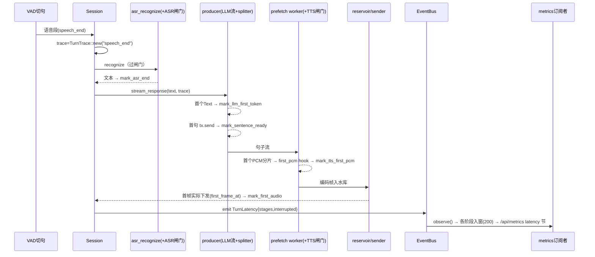

# TTFA 分段延迟指标维护

本模块维护被动式阶段延迟采集：[events.rs](<../events.rs>) 定义 `TurnLatency`/`TurnStages`/`TurnTrace`/`TurnId` 与字段命名，[观测出口](<../../workflow/session/observe.rs>)统一 emit，[metrics.rs](<../metrics.rs>)独立聚合，`/api/metrics` 只增不改。实际字段与分位以[源码](<../metrics.rs>)、[测试](<tests.rs>)和端点 JSON 为准。

## 当前口径（先读这段）

- **一轮 = 恰好一条 `TurnLatency`**：它带的 5 个阶段是同一轮的 5 次采样，分属 5 个独立窗口，
  每轮每窗口只 +1。订阅者若按"分段条数"计数，一轮会被灌 5 个样本，分位数被同一轮重复加权而失真。
  回归测试：`tests.rs::stages_of_one_turn_count_as_one_sample_per_window`。
- **`turns` 与整轮耗时窗口只由 `MessageAdded{role == "assistant"}` 驱动**；用户那条只是同一轮的
  另一半（共享同一个 `turn_id`），不额外计轮。`TurnLatency` 绝不参与轮次计数。
- **`turn_id` 是纯诊断字段**：只用于把分段归因到具体某轮 + 串联 `tracing` 日志，
  **不参与**任何计数或入窗，也不新增 `/api/metrics` 投影字段。回归测试：
  `tests.rs::turn_id_does_not_affect_aggregation`。
- 分窗口径：仅 `speech_end` / `inject` 入窗；`canned` / `aiui` 不与语音轮混窗。

> **历史设计 / 实施记录**：以下为原《三项缺口实施方案（gap-implementation-design）》§2，保留原章节编号及当时的结论，不代表所有提案均已落地。
> 文中 `§N` 指原长文对应章节，完整历史记录见[三项缺口设计](<../../../../docs/designs/gap-implementation-design.md>)；当前行为先读本文件、源码与测试。

## 2. 缺口②：TTFA 分段被动指标

### 2.1 设计要点

- **接缝现成**：`metrics.rs:10-12` 已注明"在 reply.rs 的流式回调处补事件字段即可（订阅者无需改 session）"。本方案照做：事件总线新增一个变体，会话侧只 `emit`，聚合在 metrics 订阅者。
- **阶段与锚点**：采集 6 个里程碑。**锚点（t0）= speech_end**（VAD 切句、即将送 ASR 的时刻；注入轮 = 文本到达，canned = 兜底/问候语入口，AIUI = 段落起点）。各阶段记录为**相对锚点的毫秒偏移**（`Instant` 单调钟，mark 时刻才算 elapsed）。`speech_end` 本身即锚点（偏移恒 0），在事件里以 `anchor` 字段显式标注，不单列数值（理由见 §6 待明确 #3）。
- **采集点**（全部为已有代码的现成位置，只加一行 mark）：

| 阶段 | 采集位置 | 说明 |
|---|---|---|
| anchor=t0 | `recognize_segments` 每段循环入口 `Instant::now()`（与 VAD 回调同 tick，误差微秒级） | 语音轮 |
| `asr_end_ms` | `asr_recognize` Ok 之后 | |
| `llm_first_token_ms` | producer 回调首个 `LlmEvent::Text` | |
| `sentence_ready_ms` | producer 首个句子 `tx.send`（含定时 flush 出的残句） | |
| `tts_first_pcm_ms` | 首个**非缓存**句的首个 PCM 分片回调（prefetch 内 hook） | 缓存命中轮为 `None`（零合成），`first_audio_ms` 仍采集 |
| `first_audio_ms` | `drain_prepared` 拿到 `first_frame_at` 后（`sender.rs` 已有该 out-param，零改动） | 即既有 TTFA 日志口径 |

- **向后兼容**：`ServerEvent` 是进程内 enum（broadcast），加变体只影响本仓订阅者（metrics.rs，同 PR 更新）；`/api/metrics` JSON **只增不改**——新增 `latency` 节与 `turns.elapsed_p90_ms/p99`，老字段（`elapsed_p50_ms` 等）原样保留。macApp 管理页可后续按需渲染（见 §6 待明确 #4）。
- **窗口与分位**：各阶段样本各自环形窗口（复用 `TURN_WINDOW=200`）；分位统一 p50/p90/p95/p99/max（`pick` 向上取整位函数已有，扩一档 q 值即可）。

### 2.2 数据结构与接口

```rust
// server/src/observability/events.rs 追加（含负载与共享记录器，字段命名单一权威在此）

/// 一轮对话的分段延迟快照（事件负载；全部为相对 anchor 的毫秒偏移）。
#[derive(Clone, Debug)]
pub struct TurnStages {
    /// 锚点语义："speech_end" | "inject" | "canned" | "aiui"
    pub anchor: &'static str,
    pub asr_end_ms: Option<u64>,
    pub llm_first_token_ms: Option<u64>,
    pub sentence_ready_ms: Option<u64>,
    pub tts_first_pcm_ms: Option<u64>,
    pub first_audio_ms: Option<u64>,
}

/// 分段延迟记录器：Arc 共享， producer/合成回调/发送端各自 mark（first-only 语义）。
pub struct TurnTrace {
    anchor: &'static str,
    t0: Instant,
    inner: Mutex<TurnStages>,   // 各字段 mark 时 None→Some(elapsed)，只记首次
}

impl TurnTrace {
    pub fn new(anchor: &'static str) -> Arc<Self>;
    pub fn mark_asr_end(&self);            // 以下 mark 均 first-only、瞬时持锁
    pub fn mark_llm_first_token(&self);
    pub fn mark_sentence_ready(&self);
    pub fn mark_tts_first_pcm(&self);
    pub fn mark_first_audio(&self);
    pub fn snapshot(&self) -> TurnStages;
}

// ServerEvent 新变体（追加在 enum 末尾）：
//   TurnLatency { session_id: String, device_id: String,
//                 stages: TurnStages, interrupted: bool }
```

```rust
// server/src/observability/metrics.rs :: Inner 追加
struct StageWindows {
    asr_end_ms: VecDeque<u64>,
    llm_first_token_ms: VecDeque<u64>,
    sentence_ready_ms: VecDeque<u64>,
    tts_first_pcm_ms: VecDeque<u64>,
    first_audio_ms: VecDeque<u64>,
}
// observe() 增匹配臂：ServerEvent::TurnLatency → 各 Some(ms) 分别入窗（窗口 200）
// snapshot_json() 追加（additive）：
//   "turns": { ..., "elapsed_p90_ms": pick(0.90), "elapsed_p99_ms": pick(0.99), ... }
//   "latency": {
//     "note": "各阶段相对锚点（speech_end/inject/canned/aiui）的毫秒偏移；缓存命中轮 tts_first_pcm 为空",
//     "asr_end_ms":        { p50,p90,p95,p99,max,samples },
//     "llm_first_token_ms":{...}, "sentence_ready_ms":{...},
//     "tts_first_pcm_ms":  {...}, "first_audio_ms":{...}
//   }
```

### 2.3 埋点接线（保持 session.rs 净增最小）

- `session/observe.rs` 新增两个辅助（埋点横切，具名收敛——与 `note_*` 同理）：

```rust
impl<'a, T: Transport> Session<'a, T> {
    /// 会话内统一的分段延迟事件出口（含 session_id/device_id 取值口径）。
    pub(super) fn emit_turn_latency(&self, trace: &Arc<TurnTrace>, interrupted: bool) {
        self.engines.event_bus.emit(ServerEvent::TurnLatency {
            session_id: self.session_id.clone(),
            device_id: self.device_id.clone(),
            stages: trace.snapshot(),
            interrupted,
        });
    }
}
```

- `session.rs`：`recognize_segments` 每段创建 `trace`（anchor="speech_end"）→ `asr_recognize` Ok 后 `mark_asr_end` → 显式传参 `stream_response(&user_text, trace.clone())`（签名加一个参数，优于隐藏字段）；`aiui_segments`/`aiui_downlink` 同法（anchor="aiui"，只采 `first_audio_ms`）；`handle_inject`（anchor="inject"，无 asr/sentence 阶段）。
- `reply.rs`：producer 回调 mark `llm_first_token`/`sentence_ready`；`drain_prepared` 拿到 `first_frame_at` 后 mark `first_audio`；`stream_response` 各结束分支（正常 / LLM 失败兜底前）`emit_turn_latency`；`speak_canned` 自建 trace（anchor="canned"）只采 `first_audio_ms` 并 emit——兜底/问候语与正常回复各自成事件，靠 anchor 区分。
- `prefetch.rs`：`spawn_sentence_prefetch` 签名加 `first_pcm: Option<Arc<dyn Fn() + Send + Sync>>`（由 reply.rs 传捕获 trace 的闭包；闭包内用捕获的 `AtomicBool` 保证只调一次，避免每分片加锁）。prefetch 不 import events 类型——保持通用流水线与观测解耦。
- **若 session.rs 因此超 600 行**：顺带把纯函数 `f32_to_i16_16k` 下移到 `app/audio`（行为不变搬移，遵守 §5.10）。

### 2.4 序列图（一轮语音回复的分段采集）



---

## 上级入口

[上级 AGENTS](<../AGENTS.md>)
