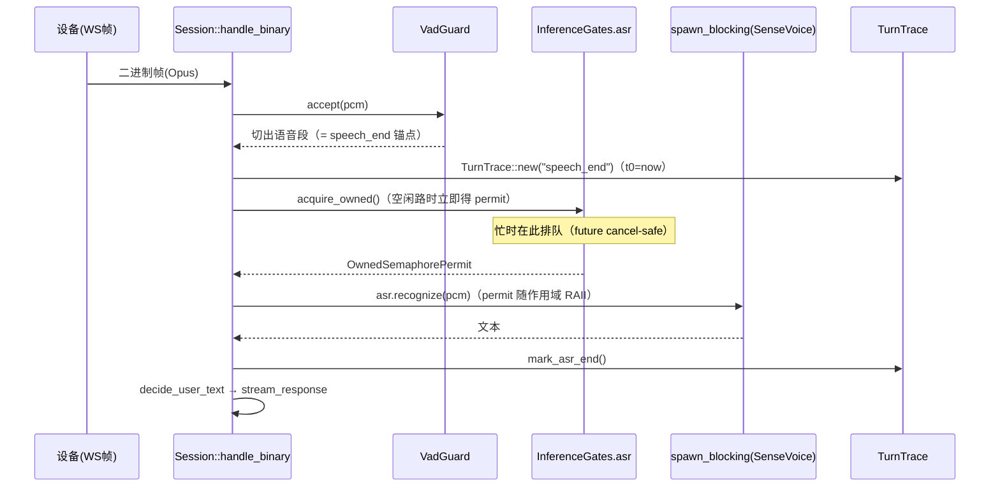

# ASR/TTS 推理并发闸门维护

本模块维护跨会话推理限流：[Engines](<../../../runtime/mod.rs>) 挂 `InferenceGates`（ASR/TTS 各一把信号量），包在现有 `spawn_blocking` 调用点外。许可数默认值、排队记账与 TTS 热切换对账以[源码](<../inference.rs>)、[测试](<tests.rs>)和注册表元数据为准。

> **历史设计 / 实施记录**：以下为原《三项缺口实施方案（gap-implementation-design）》§0–1，保留原章节编号及当时的结论，不代表所有提案均已落地。
> 文中 `§N` 指原长文对应章节，完整历史记录见[三项缺口设计](<../../../../../docs/designs/gap-implementation-design.md>)；当前行为先读本文件、源码与测试。

> 架构师：高见远（software-architect）｜日期：2026-10-13｜状态：✅ 已实施（2026-10-14，工程师寇豆码）
> 实施裁决：许可数默认值取读法 b（默认 1 路，`[asr]/[tts].max_concurrent`）；macApp 管理页渲染（T05 客户端部分）经 team-lead 裁决不做。
> 依据：2026-10-13 差距评估结论（三项真实缺口）+ 仓库 `AGENTS.md` 全部约束。
> 哲学：**最小方案、零新增依赖**（tokio `sync`/`time` 已在 `features=["full"]` 内）、贴合现有代码结构、不动协议枚举（`protocol.rs` 零改动，无 serde 小写风险）。

---

## 0. 总览

| 缺口 | 一句话方案 | 新增依赖 | 优先级 |
|---|---|---|---|
| ① ASR/TTS 跨会话推理限流 | `Engines` 上挂 `InferenceGates`（ASR/TTS 各一把 `tokio::sync::Semaphore`），包在现有 5 个 `spawn_blocking` 调用点外；许可数可配、TTS 随热切换对账；排队等待进 `/api/metrics` | 无 | P0 |
| ② TTFA 分段被动指标 | 事件总线新增 `ServerEvent::TurnLatency`（阶段偏移量），metrics 订阅者聚合 P50/P90/P95/P99；`/api/metrics` **只增不改** | 无 | P1 |
| ③ SentenceSplitter 定时 flush | splitter 记录 `last_feed`，**独立 watchdog 任务**在"距上一 token ≥ N ms 且残句非空"时倒出残句；N 走 `[llm].sentence_flush_ms`（默认 1500，0=关） | 无 | P1 |

三项互不耦合（除共享 `reply.rs` 文件，按任务顺序串行编辑即可）。

---

## 1. 缺口①：ASR/TTS 跨会话推理限流

### 1.1 问题与难点

- 四大引擎的重推理是同步 CPU 密集调用，统一经 `spawn_blocking` 隔离（`session.rs:63-73` 的 `blocking_result`、ASR `session.rs:295-301`、TTS `prefetch.rs:349-366`、测试台 `bench.rs:105/199`、`bench_api.rs:212`）。
- `spawn_blocking` **无并发上限**：tokio 的 blocking 池默认上限 512 线程。多设备同时说话 = 多路 ASR（各 `num_threads=2`）+ 多路 TTS（各 `num_threads=4`）同时压上 4 核小主机 → CPU 超订，延迟雪崩。
- 线程预算已分段（`runtime/mod.rs //!`：tokio 2 + ASR 2 + TTS 4 + VAD 1 + docker cpus 3.5）——**该预算只在"每能力同时 1 路推理"时成立**，信号量就是把这条隐含前提变成显式约束。
- 全库 Semaphore 仅有两处在用：VAD 池（`plugins/vad/pool.rs:26,47,60`，`acquire_owned` + RAII `VadGuard`）与音色探测（`device/voices.rs:150`，固定并发 2）。本方案复用 **VAD 池的范式**：`Arc<Semaphore>` + `acquire_owned()` + permit 随闭包 Drop 归还。

### 1.2 方案：`InferenceGates`（新模块 `server/src/workflow/pipeline/inference.rs`）

**Semaphore 放哪一层**：挂在 `Engines` 上（与 `vad_pool`、`tts_cache` 同性质的进程级共享资源）。理由：

1. 引擎热切换（`Engines::refresh_from_disk` / `refresh_tts_from_disk`）替换的是 `Arc<dyn TtsEngine>` 实例，**闸门不随引擎走**——限的是"并发推理路数"，与具体引擎实现无关（本地 Kokoro 换讯飞在线也一样要防测试台打爆）；
2. 调用点（session / prefetch worker / bench / bench_api）都已持有 `Arc<Engines>` 或能拿到，接线成本低；
3. 许可数跟随配置变化：ASR 段是 `RestartOnly`（闸门许可启动时定死即可）；TTS 段是 `NextSession`——在 `refresh_tts` 成功路径里调 `reconfigure_tts(fresh.tts.max_concurrent)` 对账（许可数变了就换新 Semaphore；在飞permit 持旧 Arc，最多短暂多放行一路，可接受并注释说明）。

**许可数默认值（关键取舍）**：`[asr].max_concurrent = 1`、`[tts].max_concurrent = 1`（均可配）。

> 取舍论证：差距评估原文"ASR 并发与 num_threads 同数"存在两种读法——(a) 许可数 = num_threads（ASR=2 路 × 2 线程 = 4 线程）；(b) **并发推理的线程总量与 num_threads 预算同数**（1 路 × 2 线程 = 2 线程，恰等于 `runtime/mod.rs //!` 预算表里"ASR 识别 2 线程 / TTS 合成 4 线程"的段预算）。本设计取 (b)：读法 (a) 在 4 核机上仅 ASR 一项就要 4 线程，直接击穿已声明的预算分段，与该缺口"防 CPU 超订"的动机矛盾。默认 1 已把行为收敛进预算；算力富余的部署（如换了大主机、或 TTS 用讯飞在线这类网络型引擎）改配置即可放宽，无需改代码。已列入 §6 待明确 #1。

**获取/释放模式（跨文件统一约定）**：

```text
let gate = engines.inference.asr();          // clone Arc<Semaphore>，开销可忽略
let _permit = gate.acquire_owned().await;    // 排队等待；future 被 drop 即取消（cancel-safe）
blocking_result(move || { ... 推理 ... })     // permit 在闭包/作用域结束时 RAII 归还
```

**与 abort 语义协同（不对称，刻意为之）**：

- **TTS 侧**：等待可被 abort 打断。提供 `acquire_with_abort(sem, abort)`：`select!` 200ms 轮询 `Arc<AtomicBool>`（粒度对齐 `downlink/sender.rs::POLL_MS` 的既有栽培轮询范式）。prefetch worker 本来就在每句合成前轮询 abort，排队期同样响应，打断后不白等。
- **ASR 侧**：**不**响应 abort，用裸 `acquire_owned().await`。理由：`abort` 只在 `stream_response` 入口复位（`reply.rs:132`），而 ASR 发生在它**之前**——上一轮打断遗留的 stale `abort=true` 会让"打断后立刻说的新话语"在排队时被静默丢弃，这正是 barge-in 最常见的行为序列。现有代码在 ASR 路径也刻意不查 abort，本方案保持该语义（见 §6 待明确 #5）。

**测试台（bench）过不过闸门**：**过**。`bench.rs` 的 `asr_test`/`tts_test` 与 `bench_api.rs` 的 `run_tts_bench` 全部走同一把闸门——管理台测试台与生产会话共享 CPU，不过闸门等于给生产埋雷。AIUI 全链路（`aiui_segments` 的 `blocking_result`）是**云端闭环网络调用**，不吃本地 CPU，不过闸门；音色探测维持既有独立并发 2，不动。

**排队等待观测（双通道）**：

1. `InferenceGates` 内每能力一组 `AtomicU64`（`wait_events` / `wait_ms_total` / `wait_ms_max`），获取成功时若等待 ≥ 1ms 记账；≥ 100ms 追加一行 `tracing::info!`（含等待时长与许可数），否则 debug；
2. `/api/metrics` 新增 `inference_gates` 节（**additive**，老字段零改动）：由 `ws/metrics.rs` 端点把 `engines.metrics.snapshot_json()` 与 `engines.inference.stats_json()` 合并返回。

**引擎热刷新本身（sherpa 重建加载模型）不过闸门**：模型加载以 IO/分配为主、频率极低（会话建立时且签名变更才发生），纳入反而会让"新会话建立"与"在飞推理"互相卡（见 §6 待明确 #6）。

### 1.3 数据结构与接口（签名级伪代码）

```rust
// server/src/workflow/pipeline/inference.rs（新文件）
//! 推理并发闸门（缺口①）：ASR/TTS 各一把 Semaphore，包在 spawn_blocking 外。
//! 范式对齐 plugins/vad/pool.rs：acquire_owned + permit RAII 归还。

use std::sync::{Arc, Mutex, RwLock};
use std::sync::atomic::{AtomicBool, AtomicU64, Ordering};
use std::time::{Duration, Instant};
use tokio::sync::{OwnedSemaphorePermit, Semaphore};

/// 等待轮询粒度（对齐 downlink/sender.rs::POLL_MS 的 abort 栽培轮询语义）。
const ABORT_POLL_MS: u64 = 200;
/// 排队 ≥ 该值打 info 日志（低于只记账）。
const LOUD_WAIT_MS: u64 = 100;

#[derive(Default)]
struct GateCounters {
    wait_events: AtomicU64,
    wait_ms_total: AtomicU64,
    wait_ms_max: AtomicU64,
}

struct Gate {
    sem: RwLock<Arc<Semaphore>>,
    permits: AtomicUsize,          // 当前许可数（对账/展示用）
    counters: GateCounters,
}

/// 进程级推理闸门：挂在 Engines 上，跨会话共享。
pub struct InferenceGates { asr: Gate, tts: Gate }

impl InferenceGates {
    /// 启动时按配置构造（asr.max_concurrent / tts.max_concurrent，均 clamp ≥ 1）。
    pub fn new(cfg: &Config) -> Self;
    /// 取当前 ASR 闸门（clone Arc，调用方 acquire_owned）。
    pub fn asr(&self) -> Arc<Semaphore>;
    /// 取当前 TTS 闸门。
    pub fn tts(&self) -> Arc<Semaphore>;
    /// TTS 热切换对账（Engines::refresh_tts 成功路径调用）：
    /// 许可数变化 → 换新 Semaphore（在飞 permit 持旧 Arc，短暂重叠可接受）。
    pub fn reconfigure_tts(&self, permits: u32);
    /// /api/metrics 合并用投影（additive）。
    pub fn stats_json(&self) -> serde_json::Value;
}

/// 记账后返回 permit；内部在获取成功时更新 counters + 日志。
async fn acquire_counted(gate: &Gate) -> OwnedSemaphorePermit;

/// abort 感知获取（仅 TTS 侧用）：200ms 轮询 abort，置位即放弃（返回 None）。
/// 取消安全：select 竞争失败只是放弃等待，不丢许可。
pub async fn acquire_with_abort(
    sem: &Arc<Semaphore>,
    abort: &AtomicBool,
) -> Option<OwnedSemaphorePermit>;
```

**配置字段（新增 2 个）**：

```rust
// plugins/asr/mod.rs :: AsrConfig 追加
/// 同时进行的 ASR 推理路上限（排队背压）。默认 1：每路 num_threads=2，
// 恰等于 runtime/mod.rs 预算表的 ASR 段线程预算；算力富余可放宽。
#[serde(default = "default_one")]
pub max_concurrent: u32,          // default_one() -> 1；normalize clamp ≥1

// plugins/tts/mod.rs :: TtsConfig 追加
/// 同时进行的 TTS 合成路上限。默认 1（本地 Kokoro 每路 4 线程 = 段预算）；
// 讯飞在线为网络型引擎，多设备部署建议 2~4。
#[serde(default = "default_one")]
pub max_concurrent: u32,          // normalize clamp ≥1
```

注册表字段元数据（`plugins/registry/fields.rs`）同步 2 条：
- `["asr"].max_concurrent`：Int，default_hint "1"，hot = `RestartOnly`（与 ASR 段一致）；
- `["tts"].max_concurrent`：Int，default_hint "1"，hot = `NextSession`（随 TTS 热切换对账），help 写明"本地引擎每路占 num_threads 线程；在线引擎可放宽"。

**调用点改造（5 处）**：

| 调用点 | 改法 |
|---|---|
| `session.rs::asr_recognize` | 关联函数加参 `asr_gate: Arc<Semaphore>`；内部先 `acquire_counted`（裸 await，不查 abort）再 `blocking_result`。两个调用方（`recognize_segments`、`bench.rs::handle_asr_test`）都传 `self.engines.inference.asr()` |
| `prefetch.rs::spawn_sentence_prefetch` | 签名加 `tts_gate: Arc<Semaphore>`；worker 循环内**缓存未命中**才 `acquire_with_abort`（缓存命中零合成不过闸），permit move 进 `spawn_blocking` 闭包随推理结束归还；**不要**在等上一句 `prev` 时持许可 |
| `reply.rs::spawn_prefetch` | 透传 `self.engines.inference.tts()` |
| `bench.rs::handle_tts_test` | producer `spawn_blocking` 前 `acquire_with_abort`，permit move 进闭包 |
| `bench_api.rs::run_tts_bench` | 签名加 `tts_gate: Arc<Semaphore>`（两个调用方 `bench_tts` 都从 `engines` 取），同上 |

**`Engines` 接线（`runtime/mod.rs`，净增 ~12 行）**：

```rust
pub struct Engines {
    ...
    /// 推理并发闸门（缺口①）：ASR/TTS 各一把，见 app/inference 模块注释。
    pub inference: crate::app::inference::InferenceGates,
}
// Engines::new：inference: InferenceGates::new(config)
// refresh_tts 成功替换引擎后：self.inference.reconfigure_tts(fresh.tts.max_concurrent);
```

### 1.4 序列图（ASR 限流）



---

## 上级入口

[上级 AGENTS](<../../AGENTS.md>)
